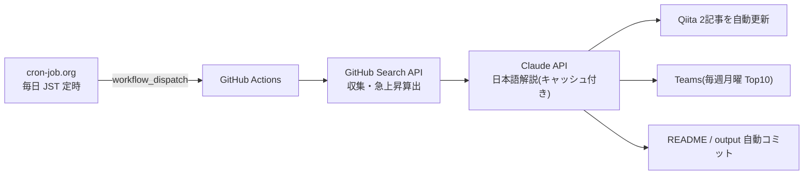

# Claude Code向けMCPツール候補ランキング

GitHub Search APIを使って、Claude Code周辺で活用候補になりそうなMCP関連リポジトリを定期収集するリポジトリです。

> 注意: この一覧は「Claude Codeでの動作」を保証するものではありません。  
> GitHub上のリポジトリ名・説明文・READMEなどに含まれる情報をもとに、MCP関連ツール候補を探すための入口として利用します。

## 仕組み(定常自律運転)

このランキングは cron-job.org → GitHub Actions → Claude API → Qiita / Teams のパイプラインで、毎日無人更新されています。



- 仕組みの詳細と**ライブ稼働ステータス**: [定常自律運転ページ](https://takanobusano.github.io/mcp-github-ranking/)
- 作り方の解説記事: [パイプライン編](https://qiita.com/4q_sano/items/913e93ee5cc2731561fc) / [cron-job.org 完全自動化編](https://qiita.com/4q_sano/items/1bc5e0669a8f0166936c)
<!-- MCP_REPOS_START -->
最終更新: **2026-10-12 08:17:15 JST**

MCP関連リポジトリに加え、Claude Code周辺で活用候補になりそうな関連ツールをGitHub Search APIで毎日自動収集してランキング化しています。

Stars / Forks の差分は、UTC基準の前日データ（2026-10-10）との差分です。
CSVには最大500件を保存し、本文では上位100件を表示しています。

> 注意: この一覧はClaude Codeでの動作を保証するものではありません。  
> MCP関連ツールまたはClaude Code関連ツール候補を探すための入口として利用してください。

# 注目MCP・関連ツール候補ランキング

## 1位 [public-apis/public-apis](https://github.com/public-apis/public-apis)

A collective list of free APIs

⭐ **487,591 Stars**（+313）　🍴 **54,031 Forks**（+60）　/　🟢 **2,108 Open Issues**　/　Python

Topics: `api` / `apis` / `dataset` / `development` / `free` / `list` / `lists` / `open-source`

## 2位 [openclaw/openclaw](https://github.com/openclaw/openclaw)

The AI that really does things. Any OS. Any Platform. The lobster way. 🦞

⭐ **391,696 Stars**（+80）　🍴 **82,363 Forks**（+37）　/　🟢 **9,531 Open Issues**　/　TypeScript

Topics: `ai` / `assistant` / `crustacean` / `molty` / `openclaw` / `own-your-data` / `personal`

## 3位 [obra/superpowers](https://github.com/obra/superpowers)

An agentic skills framework & software development methodology that works.

⭐ **297,692 Stars**（+470）　🍴 **26,593 Forks**（+59）　/　🟢 **330 Open Issues**　/　Shell

Topics: `ai` / `brainstorming` / `coding` / `obra` / `sdlc` / `skills` / `subagent-driven-development` / `superpowers`

## 4位 [mattpocock/skills](https://github.com/mattpocock/skills)

Skills for Real Engineers. Straight from my .agents directory.

⭐ **286,151 Stars**（+1,745）　🍴 **24,006 Forks**（+198）　/　🟢 **166 Open Issues**　/　Shell

Topics: `topicなし`

## 5位 [affaan-m/ECC](https://github.com/affaan-m/ECC)

The agent harness performance optimization system. Skills, instincts, memory, security, and research-first development for Claude Code, Codex, Opencode, Cursor and beyond.

⭐ **277,191 Stars**（+697）　🍴 **41,348 Forks**（+110）　/　🟢 **159 Open Issues**　/　JavaScript

Topics: `ai-agents` / `anthropic` / `claude` / `claude-code` / `developer-tools` / `llm` / `mcp` / `productivity`

## 6位 [NousResearch/hermes-agent](https://github.com/NousResearch/hermes-agent)

The agent that grows with you

⭐ **252,796 Stars**（+257）　🍴 **54,739 Forks**（+142）　/　🟢 **47,986 Open Issues**　/　Python

Topics: `ai` / `ai-agent` / `ai-agents` / `anthropic` / `chatgpt` / `claude` / `claude-code` / `codex`

## 7位 [multica-ai/andrej-karpathy-skills](https://github.com/multica-ai/andrej-karpathy-skills)

A single CLAUDE.md file to improve Claude Code behavior, derived from Andrej Karpathy's observations on LLM coding pitfalls.

⭐ **218,868 Stars**（+639）　🍴 **22,049 Forks**（+70）　/　🟢 **133 Open Issues**　/　不明

Topics: `topicなし`

## 8位 [ultraworkers/claw-code](https://github.com/ultraworkers/claw-code)

An agent-managed museum exhibit, built in Rust with Gajae-Code / LazyCodex — developed and maintained with no human intervention.

⭐ **194,977 Stars**（±0）　🍴 **108,082 Forks**（-1）　/　🟢 **38 Open Issues**　/　Rust

Topics: `topicなし`

## 9位 [firecrawl/firecrawl](https://github.com/firecrawl/firecrawl)

Supercharge your AI agents with data from the web and beyond. Building the library for superintelligence. 🔥

⭐ **190,523 Stars**（+307）　🍴 **10,122 Forks**（+34）　/　🟢 **573 Open Issues**　/　TypeScript

Topics: `ai` / `ai-agents` / `ai-crawler` / `ai-scraping` / `ai-search` / `crawler` / `data-extraction` / `html-to-markdown`

## 10位 [ollama/ollama](https://github.com/ollama/ollama)

Get up and running with Kimi, GLM, MiniMax, DeepSeek, gpt-oss, Qwen, Gemma and other models.

⭐ **182,782 Stars**（+123）　🍴 **18,223 Forks**（+31）　/　🟢 **4,257 Open Issues**　/　Go

Topics: `deepseek` / `gemma` / `gemma3` / `glm` / `go` / `golang` / `gpt-oss` / `llama`

## 11位 [anthropics/skills](https://github.com/anthropics/skills)

Public repository for Agent Skills

⭐ **180,503 Stars**（+165）　🍴 **21,397 Forks**（+55）　/　🟢 **1,399 Open Issues**　/　Python

Topics: `agent-skills`

## 12位 [DietrichGebert/ponytail](https://github.com/DietrichGebert/ponytail)

Makes your AI agent think like the laziest senior dev in the room. The best code is the code you never wrote.

⭐ **161,095 Stars**（+668）　🍴 **8,693 Forks**（+68）　/　🟢 **53 Open Issues**　/　JavaScript

Topics: `agent-skills` / `ai-agents` / `claude` / `claude-code` / `claude-code-plugin` / `cursor-rules` / `developer-tools` / `llm`

## 13位 [msitarzewski/agency-agents](https://github.com/msitarzewski/agency-agents)

A complete AI agency at your fingertips - From frontend wizards to Reddit community ninjas, from whimsy injectors to reality checkers. Each agent is a specialized expert with personality, processes, and proven deliverables.

⭐ **159,100 Stars**（+333）　🍴 **25,711 Forks**（+85）　/　🟢 **224 Open Issues**　/　Shell

Topics: `topicなし`

## 14位 [langgenius/dify](https://github.com/langgenius/dify)

Build Agentic workflows, RAG pipelines, with rich AI model and tool support on one collaborative workspace. Deploy on cloud, VPC, or self-hosted, so teams move from prototype to production without rebuilding the stack.

⭐ **158,166 Stars**（+67）　🍴 **25,003 Forks**（+41）　/　🟢 **1,096 Open Issues**　/　TypeScript

Topics: `agent` / `agentic-ai` / `agentic-framework` / `agentic-workflow` / `ai` / `automation` / `claude` / `deepseek`

## 15位 [langflow-ai/langflow](https://github.com/langflow-ai/langflow)

Langflow is a powerful tool for building and deploying AI-powered agents and workflows.

⭐ **155,510 Stars**（+29）　🍴 **10,228 Forks**（+30）　/　🟢 **1,138 Open Issues**　/　Python

Topics: `agents` / `chatgpt` / `generative-ai` / `large-language-models` / `multiagent` / `react-flow`

## 16位 [anthropics/claude-code](https://github.com/anthropics/claude-code)

Claude Code is an agentic coding tool that lives in your terminal, understands your codebase, and helps you code faster by executing routine tasks, explaining complex code, and handling git workflows - all through natural language commands.

⭐ **150,227 Stars**（+164）　🍴 **26,226 Forks**（+126）　/　🟢 **14,697 Open Issues**　/　TypeScript

Topics: `topicなし`

## 17位 [x1xhlol/system-prompts-and-models-of-ai-tools](https://github.com/x1xhlol/system-prompts-and-models-of-ai-tools)

FULL Augment Code, Claude Code, Cluely, CodeBuddy, Comet, Cursor, Devin AI, Junie, Kiro, Leap.new, Lovable, Manus, NotionAI, Orchids.app, Perplexity, Poke, Qoder, Replit, Same.dev, Trae, Traycer AI, VSCode Agent, Warp.dev, Windsurf, Xcode, Z.ai Code, Dia & v0. (And other Open Sourced) System Prompts, Internal Tools & AI Models

⭐ **143,954 Stars**（+8）　🍴 **34,761 Forks**（-2）　/　🟢 **164 Open Issues**　/　不明

Topics: `ai` / `bolt` / `cluely` / `copilot` / `cursor` / `cursorai` / `devin` / `github-copilot`

## 18位 [farion1231/cc-switch](https://github.com/farion1231/cc-switch)

A cross-platform desktop All-in-One assistant for Claude Code, Codex, OpenCode, OpenClaw, Grok Build & Hermes Agent. Only official website: ccswitch.io

⭐ **142,791 Stars**（+356）　🍴 **9,514 Forks**（+13）　/　🟢 **1,936 Open Issues**　/　Rust

Topics: `ai-tools` / `claude-code` / `codex` / `desktop-app` / `grok` / `grokbuild` / `hermes` / `hermes-agent`

## 19位 [garrytan/gstack](https://github.com/garrytan/gstack)

Use Garry Tan's exact Claude Code setup: 23 opinionated tools that serve as CEO, Designer, Eng Manager, Release Manager, Doc Engineer, and QA

⭐ **135,996 Stars**（+162）　🍴 **20,187 Forks**（+19）　/　🟢 **55 Open Issues**　/　TypeScript

Topics: `topicなし`

## 20位 [nextlevelbuilder/ui-ux-pro-max-skill](https://github.com/nextlevelbuilder/ui-ux-pro-max-skill)

An AI skill that provides design intelligence for building professional UI/UX across multiple platforms.

⭐ **134,817 Stars**（+306）　🍴 **14,332 Forks**（+37）　/　🟢 **91 Open Issues**　/　Python

Topics: `ai-skills` / `antigravity` / `claude` / `claude-code` / `codex` / `command-line` / `copilot` / `cursor-ai`

## 21位 [harry0703/MoneyPrinterTurbo](https://github.com/harry0703/MoneyPrinterTurbo)

利用 AI 大模型和自动化工作流，根据主题或关键词一键生成高清短视频。Generate HD short videos from a topic or keyword with an automated AI workflow.

⭐ **129,735 Stars**（+257）　🍴 **20,332 Forks**（+43）　/　🟢 **92 Open Issues**　/　Python

Topics: `ai-video-generator` / `content-creation` / `ffmpeg` / `instagram-reels` / `llm` / `python` / `short-video` / `subtitles`

## 22位 [Graphify-Labs/graphify](https://github.com/Graphify-Labs/graphify)

Turn any codebase, with its docs, SQL schemas, configs, and PDFs, into a queryable knowledge graph. A /graphify skill for Claude Code, Cursor, Codex, and Gemini CLI: local deterministic AST parsing, every edge explained, no vector store.

⭐ **125,546 Stars**（+247）　🍴 **12,118 Forks**（+21）　/　🟢 **1,537 Open Issues**　/　Python

Topics: `ai-agents` / `antigravity` / `ast` / `claude-code` / `code-analysis` / `code-search` / `codex` / `cursor`

## 23位 [browser-use/browser-use](https://github.com/browser-use/browser-use)

Agents that use the browser.

⭐ **117,658 Stars**（+88）　🍴 **13,018 Forks**（+13）　/　🟢 **524 Open Issues**　/　Python

Topics: `ai-agents` / `ai-tools` / `browser-automation` / `browser-use` / `llm` / `playwright` / `python`

## 24位 [JuliusBrussee/caveman](https://github.com/JuliusBrussee/caveman)

🪨 why use many token when few token do trick. Viral skill + proxy for coding agents that cuts 65% of tokens by talking like a caveman.

⭐ **111,052 Stars**（+124）　🍴 **6,431 Forks**（+7）　/　🟢 **59 Open Issues**　/　Go

Topics: `ai` / `anthropic` / `caveman` / `claude` / `claude-code` / `llm` / `meme` / `prompt-engineering`

## 25位 [TauricResearch/TradingAgents](https://github.com/TauricResearch/TradingAgents)

TradingAgents: Multi-Agents LLM Financial Trading Framework

⭐ **110,653 Stars**（+137）　🍴 **21,306 Forks**（+26）　/　🟢 **104 Open Issues**　/　Python

Topics: `agent` / `finance` / `llm` / `multiagent` / `trading`

## 26位 [google-gemini/gemini-cli](https://github.com/google-gemini/gemini-cli)

An open-source AI agent that brings the power of Gemini directly into your terminal.

⭐ **107,287 Stars**（+12）　🍴 **14,705 Forks**（+3）　/　🟢 **761 Open Issues**　/　TypeScript

Topics: `ai` / `ai-agents` / `cli` / `gemini` / `gemini-api` / `mcp-client` / `mcp-server`

## 27位 [addyosmani/agent-skills](https://github.com/addyosmani/agent-skills)

Production-grade engineering skills for AI coding agents.

⭐ **105,005 Stars**（+508）　🍴 **10,963 Forks**（+55）　/　🟢 **130 Open Issues**　/　JavaScript

Topics: `agent-skills` / `antigravity` / `claude-code` / `codex` / `cursor` / `skills`

## 28位 [morluto/rea](https://github.com/morluto/rea)

Reverse engineer anything with agents, from app behavior down to native binaries.

⭐ **102,501 Stars**（+31,172）　🍴 **22,487 Forks**（+7,533）　/　🟢 **168 Open Issues**　/　TypeScript

Topics: `agent-skills` / `ai-agents` / `binary-analysis` / `claude-code` / `cli` / `codex` / `cordis` / `ctf`

## 29位 [nexu-io/open-design](https://github.com/nexu-io/open-design)

🎨 Best DeepSeek Harness Design Plugin. The open-source Claude Design alternative. 🖥️ Local-first desktop app. 🖼️ Your coding agent becomes the design engine: pr...

⭐ **100,561 Stars**（+160）　🍴 **11,585 Forks**（+12）　/　🟢 **1,167 Open Issues**　/　TypeScript

Topics: `agent-skills` / `ai-design` / `byok` / `claude-code-for-design` / `claude-design` / `codex-design` / `coding-agents` / `cursor-design`

## 30位 [paperclipai/paperclip](https://github.com/paperclipai/paperclip)

The open-source app everyone uses to manage agents at work

⭐ **100,344 Stars**（+641）　🍴 **16,903 Forks**（+83）　/　🟢 **5,931 Open Issues**　/　TypeScript

Topics: `topicなし`

## 31位 [thedotmack/claude-mem](https://github.com/thedotmack/claude-mem)

Persistent Context Across Sessions for Every Agent –  Captures everything your agent does during sessions, compresses it with AI, and injects relevant context back into future sessions. Works with Claude Code, OpenClaw, Codex, Gemini, Hermes, Copilot, OpenCode + More

⭐ **99,717 Stars**（+498）　🍴 **8,743 Forks**（+51）　/　🟢 **199 Open Issues**　/　TypeScript

Topics: `ai` / `ai-agents` / `ai-memory` / `anthropic` / `artificial-intelligence` / `chromadb` / `claude` / `claude-agent-sdk`

## 32位 [microsoft/playwright](https://github.com/microsoft/playwright)

Playwright is a framework for Web Testing and Automation. It allows testing Chromium, Firefox and WebKit with a single API.

⭐ **97,496 Stars**（+53）　🍴 **6,588 Forks**（+8）　/　🟢 **196 Open Issues**　/　TypeScript

Topics: `automation` / `chrome` / `chromium` / `e2e-testing` / `electron` / `end-to-end-testing` / `firefox` / `javascript`

## 33位 [Panniantong/Agent-Reach](https://github.com/Panniantong/Agent-Reach)

Give your AI agent eyes to see the entire internet. Read & search Twitter, Reddit, YouTube, GitHub, Bilibili, XiaoHongShu — one CLI, zero API fees.

⭐ **95,998 Stars**（+521）　🍴 **8,407 Forks**（+52）　/　🟢 **207 Open Issues**　/　Python

Topics: `agent-infrastructure` / `ai-agent` / `ai-search` / `automation` / `bilibili` / `claude-code` / `cli` / `cursor`

## 34位 [puppeteer/puppeteer](https://github.com/puppeteer/puppeteer)

JavaScript API for Chrome and Firefox

⭐ **95,679 Stars**（+3）　🍴 **9,589 Forks**（-1）　/　🟢 **277 Open Issues**　/　TypeScript

Topics: `automation` / `chrome` / `chromium` / `developer-tools` / `firefox` / `headless-chrome` / `node-module` / `testing`

## 35位 [Leonxlnx/taste-skill](https://github.com/Leonxlnx/taste-skill)

Taste-Skill - gives your AI good taste. stops the AI from generating boring, generic slop

⭐ **94,737 Stars**（+325）　🍴 **6,451 Forks**（+29）　/　🟢 **6 Open Issues**　/　JavaScript

Topics: `agent` / `ai` / `claude` / `claude-code` / `codex` / `coding` / `design` / `frontend`

## 36位 [OpenCut-app/OpenCut](https://github.com/OpenCut-app/OpenCut)

The open-source CapCut alternative

⭐ **93,610 Stars**（+127）　🍴 **9,185 Forks**（+8）　/　🟢 **375 Open Issues**　/　TypeScript

Topics: `editor` / `oss` / `videoeditor`

## 37位 [modelcontextprotocol/servers](https://github.com/modelcontextprotocol/servers)

Model Context Protocol Servers

⭐ **91,149 Stars**（+20）　🍴 **11,778 Forks**（+4）　/　🟢 **492 Open Issues**　/　JavaScript

Topics: `topicなし`

## 38位 [OpenHands/OpenHands](https://github.com/OpenHands/OpenHands)

🙌 OpenHands: AI-Driven Development

⭐ **90,614 Stars**（+96）　🍴 **12,001 Forks**（+17）　/　🟢 **945 Open Issues**　/　TypeScript

Topics: `agent` / `artificial-intelligence` / `chatgpt` / `claude-ai` / `cli` / `developer-tools` / `gpt` / `llm`

## 39位 [stablyai/orca](https://github.com/stablyai/orca)

Orca is the ADE for working with a fleet of parallel agents. Run any coding agent with your own subscription. Available on desktop, mobile and remote runtime.

⭐ **89,733 Stars**（+575）　🍴 **5,738 Forks**（+38）　/　🟢 **8,041 Open Issues**　/　TypeScript

Topics: `ade` / `agent-ide` / `ai-agents` / `claude-code` / `cli` / `codex` / `cursor-agent` / `devtools`

## 40位 [ChatGPTNextWeb/NextChat](https://github.com/ChatGPTNextWeb/NextChat)

✨ Zero-config AI chat assistant. No API key needed — sign up and instantly chat with GPT-5, Claude 4, Gemini 2.5, DeepSeek & 100+ top models. Pay-as-you-go save...

⭐ **88,838 Stars**（-2）　🍴 **58,864 Forks**（-10）　/　🟢 **852 Open Issues**　/　TypeScript

Topics: `calclaude` / `claude` / `cross-platform` / `desktop` / `fe` / `gemini` / `gemini-pro` / `gemini-server`

## 41位 [koala73/worldmonitor](https://github.com/koala73/worldmonitor)

Real-time global intelligence dashboard. AI-powered news aggregation, geopolitical monitoring, and infrastructure tracking in a unified situational awareness interface

⭐ **88,254 Stars**（+73）　🍴 **13,487 Forks**（+22）　/　🟢 **359 Open Issues**　/　TypeScript

Topics: `agent` / `ai` / `dashboard` / `geopolitics` / `mcp` / `mcp-server` / `monitoring` / `news`

## 42位 [D4Vinci/Scrapling](https://github.com/D4Vinci/Scrapling)

🕷️ An adaptive Web Scraping framework that handles everything from a single request to a full-scale crawl! Don't be shy, join here:  and follow here for daily tips and tricks:

⭐ **86,839 Stars**（+146）　🍴 **8,892 Forks**（+11）　/　🟢 **17 Open Issues**　/　Python

Topics: `ai` / `ai-scraping` / `automation` / `crawler` / `crawling` / `crawling-python` / `data` / `data-extraction`

## 43位 [Egonex-AI/Understand-Anything](https://github.com/Egonex-AI/Understand-Anything)

Graphs that teach > graphs that impress. Turn any code into an interactive knowledge graph you can explore, search, and ask questions about. Works with Claude Code, Codex, Cursor, Copilot, Gemini CLI, and more.

⭐ **85,917 Stars**（+70）　🍴 **7,236 Forks**（+10）　/　🟢 **317 Open Issues**　/　TypeScript

Topics: `antigravity-skills` / `business-knowledge` / `claude-code` / `claude-skills` / `codebase-analysis` / `codex` / `codex-skills` / `developer-tools-ai-agent`

## 44位 [unclecode/crawl4ai](https://github.com/unclecode/crawl4ai)

Open-source web crawler and scraper for LLMs and AI agents: any website into clean, LLM-ready Markdown. Run it yourself, or use Crawl4AI Cloud with one key.

⭐ **85,258 Stars**（+97）　🍴 **8,844 Forks**（+9）　/　🟢 **236 Open Issues**　/　Python

Topics: `ai` / `ai-agents` / `crawler` / `data-extraction` / `llm` / `markdown` / `mcp` / `open-source`

## 45位 [laravel/laravel](https://github.com/laravel/laravel)

Laravel is a web application framework with expressive, elegant syntax. We’ve already laid the foundation for your next big idea — freeing you to create without sweating the small things.

⭐ **85,063 Stars**（+1）　🍴 **27,377 Forks**（+117）　/　🟢 **31 Open Issues**　/　Blade

Topics: `framework` / `laravel` / `php`

## 46位 [bytedance/deer-flow](https://github.com/bytedance/deer-flow)

An open-source long-horizon SuperAgent harness that researches, codes, and creates. With the help of sandboxes, memories, tools, skill, subagents and message gateway, it handles different levels of tasks that could take minutes to hours.

⭐ **83,698 Stars**（+33）　🍴 **11,651 Forks**（+15）　/　🟢 **916 Open Issues**　/　Python

Topics: `agent` / `agentic` / `agentic-framework` / `agentic-workflow` / `ai` / `ai-agents` / `deep-research` / `harness`

## 47位 [lobehub/lobehub](https://github.com/lobehub/lobehub)

🤯 LobeHub is your Chief Agent Operator, organizing your agents into 7×24 operations by hiring, scheduling, and reporting on your entire AI team.

⭐ **83,149 Stars**（+38）　🍴 **15,975 Forks**（+4）　/　🟢 **1,048 Open Issues**　/　TypeScript

Topics: `agent` / `agent-collaboration` / `agent-harness` / `ai` / `cao` / `chatgpt` / `chief-agent-operator` / `claude`

## 48位 [rtk-ai/rtk](https://github.com/rtk-ai/rtk)

CLI proxy that reduces LLM token consumption by 60-90% on common dev commands. Single Rust binary, zero dependencies

⭐ **82,974 Stars**（+102）　🍴 **5,267 Forks**（+9）　/　🟢 **1,518 Open Issues**　/　Rust

Topics: `agentic-coding` / `ai-coding` / `anthropic` / `claude-code` / `cli` / `command-line-tool` / `cost-reduction` / `developer-tools`

## 49位 [tt-a1i/archify](https://github.com/tt-a1i/archify)

Turn any idea, plan, or codebase into a beautiful interactive diagram. An agent skill for Claude Code, Codex, and more.

⭐ **82,037 Stars**（+386）　🍴 **5,541 Forks**（+26）　/　🟢 **273 Open Issues**　/　JavaScript

Topics: `agent-skills` / `ai-agents` / `architecture-diagram` / `claude-code` / `claude-skills` / `codex` / `coding-agents` / `deepseek-harness`

## 50位 [abi/screenshot-to-code](https://github.com/abi/screenshot-to-code)

Drop in a screenshot and convert it to clean code (HTML/Tailwind/React/Vue)

⭐ **80,231 Stars**（+48）　🍴 **9,805 Forks**（+10）　/　🟢 **147 Open Issues**　/　Python

Topics: `topicなし`

## 51位 [pbakaus/impeccable](https://github.com/pbakaus/impeccable)

The design language that makes your AI harness better at design.

⭐ **79,865 Stars**（+475）　🍴 **4,751 Forks**（+27）　/　🟢 **69 Open Issues**　/　JavaScript

Topics: `topicなし`

## 52位 [shareAI-lab/learn-claude-code](https://github.com/shareAI-lab/learn-claude-code)

Bash is all you need -  A nano claude code–like 「agent harness」, built from 0 to 1

⭐ **78,369 Stars**（+53）　🍴 **12,556 Forks**（+10）　/　🟢 **62 Open Issues**　/　Python

Topics: `agent` / `agent-development` / `ai-agent` / `claude` / `claude-code` / `educational` / `llm` / `python`

## 53位 [unslothai/unsloth](https://github.com/unslothai/unsloth)

Local UI to run and train LLMs and diffusion models. Supports GGUF, MLX, Qwen3.8, DeepSeek-V4, MiniMax-H3, Gemma 4, FLUX and more.

⭐ **77,797 Stars**（+78）　🍴 **7,188 Forks**（+12）　/　🟢 **540 Open Issues**　/　Python

Topics: `agent` / `ai` / `chatgpt` / `deepseek` / `fine-tuning` / `gemma` / `image-generation` / `llama`

## 54位 [diegosouzapw/OmniRoute](https://github.com/diegosouzapw/OmniRoute)

Never stop coding. Free MIT AI gateway: one endpoint, 359 providers (150+ free), 1200+ models Kimi, Claude, GPT, Gemini, GLM, DeepSeek, MiniMax. Works with Claude Code, Codex, Cursor, OpenCode, Cline & Copilot. Quota-aware auto-fallback, RTK+Caveman compression saves 15-95% tokens, MCP/A2A, Desktop/PWA. Built by hundreds of contributors

⭐ **75,316 Stars**（+346）　🍴 **10,879 Forks**（+44）　/　🟢 **359 Open Issues**　/　TypeScript

Topics: `a2a` / `ai-agents` / `ai-gateway` / `anthropic` / `claude` / `claude-code` / `cline` / `codex`

## 55位 [headroomlabs-ai/headroom](https://github.com/headroomlabs-ai/headroom)

Compress tool outputs, logs, files, and RAG chunks before they reach the LLM. 20% fewer tokens for coding agents, 60-95% fewer tokens for JSON, same answers. Library, proxy, MCP server.

⭐ **75,074 Stars**（+151）　🍴 **5,822 Forks**（+13）　/　🟢 **423 Open Issues**　/　Python

Topics: `agent` / `ai` / `anthropic` / `claude-code` / `compression` / `context-engineering` / `context-window` / `cursor`

## 56位 [Eugeny/tabby](https://github.com/Eugeny/tabby)

A terminal for a more modern age

⭐ **74,920 Stars**（+14）　🍴 **4,287 Forks**（+1）　/　🟢 **2,829 Open Issues**　/　TypeScript

Topics: `serial` / `ssh-client` / `telnet-client` / `terminal` / `terminal-emulators`

## 57位 [thedaviddias/Front-End-Checklist](https://github.com/thedaviddias/Front-End-Checklist)

🗂 The essential checklist for modern web development, for humans and AI agents

⭐ **74,435 Stars**（+13）　🍴 **6,760 Forks**（±0）　/　🟢 **7 Open Issues**　/　MDX

Topics: `ai-agent` / `ai-agents` / `checklist` / `css` / `front-end-developer-tool` / `front-end-development` / `frontend` / `guidelines`

## 58位 [ruvnet/ruflo](https://github.com/ruvnet/ruflo)

🌊 The original agent harness. Deploy intelligent multi-player swarms, coordinate autonomous workflows, and build conversational AI systems. Features adaptive me...

⭐ **74,360 Stars**（+74）　🍴 **8,847 Forks**（+10）　/　🟢 **1,039 Open Issues**　/　TypeScript

Topics: `agentic-ai` / `agentic-framework` / `agentic-workflow` / `agents` / `ai-agents` / `ai-assistant` / `ai-skills` / `autonomous-agents`

## 59位 [openbq-org/OpenBB](https://github.com/openbq-org/OpenBB)

Open Data Platform for analysts, quants and AI agents.

⭐ **74,118 Stars**（+34）　🍴 **7,659 Forks**（+10）　/　🟢 **102 Open Issues**　/　Python

Topics: `ai` / `crypto` / `derivatives` / `economics` / `equity` / `finance` / `fixed-income` / `machine-learning`

## 60位 [colbymchenry/codegraph](https://github.com/colbymchenry/codegraph)

Pre-indexed code knowledge graph, auto syncs on code changes, for Claude Code, Codex, Gemini, Cursor, OpenCode, AntiGravity, Kiro, CoPilot, and Hermes Agent — fewer tokens, fewer tool calls, 100% local

⭐ **73,742 Stars**（+62）　🍴 **4,754 Forks**（+8）　/　🟢 **549 Open Issues**　/　C

Topics: `topicなし`

## 61位 [cline/cline](https://github.com/cline/cline)

Autonomous coding agent as an SDK, IDE extension, or CLI assistant.

⭐ **70,177 Stars**（+51）　🍴 **7,639 Forks**（+6）　/　🟢 **1,655 Open Issues**　/　TypeScript

Topics: `topicなし`

## 62位 [code-yeongyu/oh-my-openagent](https://github.com/code-yeongyu/oh-my-openagent)

OmO: Just type "mass ulw" keyword with your prompt. Now you are the master of graph engineering.

⭐ **69,966 Stars**（+24）　🍴 **5,746 Forks**（±0）　/　🟢 **1,233 Open Issues**　/　TypeScript

Topics: `ai` / `ai-agents` / `anthropic` / `chatgpt` / `claude` / `claude-skills` / `codex` / `cursor`

## 63位 [asgeirtj/system_prompts_leaks](https://github.com/asgeirtj/system_prompts_leaks)

Documented system prompts from Anthropic - Claude Fable 5.1, Opus 5.5, Claude Design, Claude Code. OpenAI - ChatGPT GPT-6-Astra, Codex. Google - Gemini 3.8 Flash, 3.1 Pro, Antigravity. xAI - Grok, Grok Bot, Cursor, Kimi and more! Updated regularly.

⭐ **69,410 Stars**（+70）　🍴 **11,292 Forks**（+19）　/　🟢 **56 Open Issues**　/　Python

Topics: `ai` / `ai-agents` / `ai-prompts` / `anthropic` / `chatbot` / `chatgpt` / `claude` / `claude-code`

## 64位 [docling-project/docling](https://github.com/docling-project/docling)

Get your documents ready for gen AI

⭐ **68,693 Stars**（+46）　🍴 **5,048 Forks**（+10）　/　🟢 **1,054 Open Issues**　/　Python

Topics: `ai` / `convert` / `document-parser` / `document-parsing` / `documents` / `docx` / `html` / `markdown`

## 65位 [openinterpreter/openinterpreter](https://github.com/openinterpreter/openinterpreter)

A coding agent for open models like Kimi K3 and GLM 5.3

⭐ **68,552 Stars**（+12）　🍴 **5,892 Forks**（+3）　/　🟢 **14 Open Issues**　/　Rust

Topics: `acp` / `coding-agent` / `deepseek` / `kimi` / `python` / `qwen` / `rust`

## 66位 [usestrix/strix](https://github.com/usestrix/strix)

Open-source AI penetration testing tool to find and fix your app’s vulnerabilities.

⭐ **67,953 Stars**（+187）　🍴 **7,525 Forks**（+27）　/　🟢 **465 Open Issues**　/　Python

Topics: `agents` / `ai-hacking` / `ai-penetration-testing` / `ai-pentesting` / `ai-security` / `artificial-intelligence` / `bug-bounty` / `code-quality`

## 67位 [rohitg00/ai-engineering-from-scratch](https://github.com/rohitg00/ai-engineering-from-scratch)

Learn AI Engineering! Learn it. Build it. Ship it for others.

⭐ **67,480 Stars**（+720）　🍴 **11,827 Forks**（+133）　/　🟢 **70 Open Issues**　/　Python

Topics: `agents` / `ai` / `ai-agents` / `ai-engineering` / `computer-vision` / `course` / `deep-learning` / `from-scratch`

## 68位 [shanraisshan/claude-code-best-practice](https://github.com/shanraisshan/claude-code-best-practice)

from vibe coding to agentic engineering - practice makes claude perfect

⭐ **67,405 Stars**（+47）　🍴 **6,732 Forks**（+4）　/　🟢 **61 Open Issues**　/　HTML

Topics: `agentic-ai` / `agentic-coding` / `agentic-engineering` / `agentic-workflow` / `ai` / `ai-agents` / `anthropic` / `best-practices`

## 69位 [bradtraversy/design-resources-for-developers](https://github.com/bradtraversy/design-resources-for-developers)

Curated list of design and UI resources from stock photos, web templates, CSS frameworks, UI libraries, tools and much more

⭐ **67,136 Stars**（+5）　🍴 **12,246 Forks**（+6）　/　🟢 **17 Open Issues**　/　不明

Topics: `topicなし`

## 70位 [mem0ai/mem0](https://github.com/mem0ai/mem0)

The Memory Layer for AI Agents - Drop-in memory infrastructure for AI agents and apps. Context that persists. Built for production.

⭐ **66,995 Stars**（+40）　🍴 **7,881 Forks**（+10）　/　🟢 **819 Open Issues**　/　Python

Topics: `agentic-memory` / `agentic-memory-system` / `agents` / `ai` / `ai-agents` / `chatgpt` / `genai` / `llm`

## 71位 [calesthio/OpenMontage](https://github.com/calesthio/OpenMontage)

World's first open-source, agentic video production system. 12 production pipelines, 100+ tools, 700+ agent skill and production-knowledge files. Turn your AI coding assistant into a full video production studio.

⭐ **66,947 Stars**（+809）　🍴 **8,527 Forks**（+106）　/　🟢 **394 Open Issues**　/　Python

Topics: `agent` / `agentic-ai` / `ai` / `claude` / `copilot` / `cursor` / `elevenlabs` / `ffmpeg`

## 72位 [xtekky/gpt4free](https://github.com/xtekky/gpt4free)

The official gpt4free repository \| various collection of powerful language models \| opus 4.6 gpt 5.3 kimi 2.5 deepseek v3.2 gemini 3

⭐ **66,794 Stars**（+10）　🍴 **13,479 Forks**（+4）　/　🟢 **5 Open Issues**　/　Python

Topics: `chatbot` / `chatbots` / `chatgpt` / `chatgpt-4` / `chatgpt-api` / `chatgpt-free` / `chatgpt4` / `deepseek`

## 73位 [NanmiCoder/MediaCrawler](https://github.com/NanmiCoder/MediaCrawler)

小红书笔记 \| 评论爬虫、抖音视频 \| 评论爬虫、快手视频 \| 评论爬虫、B 站视频 ｜ 评论爬虫、微博帖子 ｜ 评论爬虫、百度贴吧帖子 ｜ 百度贴吧评论回复爬虫  \| 知乎问答文章｜评论爬虫

⭐ **66,654 Stars**（+49）　🍴 **12,767 Forks**（+2）　/　🟢 **216 Open Issues**　/　Python

Topics: `topicなし`

## 74位 [warpdotdev/warp](https://github.com/warpdotdev/warp)

Warp is an agentic development environment, born out of the terminal.

⭐ **65,426 Stars**（+14）　🍴 **5,630 Forks**（+1）　/　🟢 **5,379 Open Issues**　/　Rust

Topics: `bash` / `linux` / `macos` / `rust` / `shell` / `terminal` / `wasm` / `zsh`

## 75位 [mvanhorn/last30days-skill](https://github.com/mvanhorn/last30days-skill)

AI agent skill that researches any topic across Reddit, X, YouTube, HN, Polymarket, and the web - then synthesizes a grounded summary

⭐ **63,977 Stars**（+71）　🍴 **5,576 Forks**（+7）　/　🟢 **25 Open Issues**　/　Python

Topics: `ai-prompts` / `ai-skill` / `bluesky` / `claude` / `claude-code` / `clawhub` / `deep-research` / `hackernews`

## 76位 [upstash/context7](https://github.com/upstash/context7)

Context7 Platform -- Up-to-date code documentation for LLMs and AI code editors

⭐ **62,910 Stars**（+35）　🍴 **3,067 Forks**（+5）　/　🟢 **33 Open Issues**　/　TypeScript

Topics: `llm` / `mcp` / `mcp-server` / `vibe-coding`

## 77位 [coollabsio/coolify](https://github.com/coollabsio/coolify)

An open-source, self-hostable PaaS alternative to Vercel, Heroku & Netlify that lets you easily deploy static sites, databases, full-stack applications and 280+ one-click services on your own servers.

⭐ **62,869 Stars**（+35）　🍴 **5,635 Forks**（+7）　/　🟢 **723 Open Issues**　/　PHP

Topics: `coolify` / `databases` / `deployment` / `docker` / `docker-compose` / `inertiajs` / `laravel` / `mariadb`

## 78位 [sansan0/TrendRadar](https://github.com/sansan0/TrendRadar)

⭐AI-driven public opinion & trend monitor with multi-platform aggregation, RSS, and smart alerts.🎯 告别信息过载，你的 AI 舆情监控助手与热点筛选工具！聚合多平台热点 +  RSS 订阅，支持关键词精准筛选。AI 智能筛...

⭐ **62,807 Stars**（+21）　🍴 **24,900 Forks**（+3）　/　🟢 **73 Open Issues**　/　Python

Topics: `ai` / `bark` / `data-analysis` / `docker` / `hot-news` / `llm` / `mail` / `mcp`

## 79位 [tw93/Pake](https://github.com/tw93/Pake)

🤱🏻 Turn any website into a tiny, fast desktop app.

⭐ **62,006 Stars**（+19）　🍴 **12,766 Forks**（+1）　/　🟢 **0 Open Issues**　/　Rust

Topics: `chatgpt` / `claude` / `desktop` / `gemini` / `hight-performance` / `linux` / `macos` / `no-electron`

## 80位 [1c7/chinese-independent-developer](https://github.com/1c7/chinese-independent-developer)

👩🏿‍💻👨🏾‍💻👩🏼‍💻👨🏽‍💻👩🏻‍💻中国独立开发者项目列表 -- 分享大家都在做什么

⭐ **61,752 Stars**（+9）　🍴 **5,443 Forks**（+2）　/　🟢 **1 Open Issues**　/　不明

Topics: `china` / `indie` / `indie-developer`

## 81位 [microsoft/autogen](https://github.com/microsoft/autogen)

A programming framework for agentic AI

⭐ **61,359 Stars**（+16）　🍴 **9,279 Forks**（+5）　/　🟢 **1,104 Open Issues**　/　Python

Topics: `agentic` / `agentic-agi` / `agents` / `ai` / `autogen` / `autogen-ecosystem` / `chatgpt` / `framework`

## 82位 [BerriAI/litellm](https://github.com/BerriAI/litellm)

The fastest, litest AI Gateway. Rust core with Python SDK. Call 100+ LLM APIs in OpenAI (or native) format with cost tracking, guardrails, load balancing, and logging [Bedrock, Azure, OpenAI, Anthropic, OpenAI, VertexAI, vLLM, Nvidia NIM]

⭐ **60,979 Stars**（+72）　🍴 **12,231 Forks**（+15）　/　🟢 **5,448 Open Issues**　/　Python

Topics: `ai-gateway` / `anthropic` / `azure-openai` / `bedrock` / `gateway` / `langchain` / `litellm` / `llm`

## 83位 [heygen-com/hyperframes](https://github.com/heygen-com/hyperframes)

Write HTML. Render video. Built for agents.

⭐ **60,942 Stars**（+601）　🍴 **5,451 Forks**（+62）　/　🟢 **257 Open Issues**　/　TypeScript

Topics: `ai` / `animation` / `ffmpeg` / `framework` / `gsap` / `html` / `mcp` / `puppeteer`

## 84位 [penpot/penpot](https://github.com/penpot/penpot)

Penpot: The open-source design platform for Product teams that need scalable collaboration.

⭐ **60,922 Stars**（+39）　🍴 **4,199 Forks**（+2）　/　🟢 **805 Open Issues**　/　Clojure

Topics: `clojure` / `clojurescript` / `design` / `prototyping` / `ui` / `ux-design` / `ux-experience`

## 85位 [hugohe3/ppt-master](https://github.com/hugohe3/ppt-master)

AI turns documents or topics into real, native PowerPoint decks—with native shapes, transitions and animations, data-backed charts and tables on demand, audio narration from speaker notes, and support for your own .pptx templates. · by Hugo He

⭐ **60,345 Stars**（+956）　🍴 **4,763 Forks**（+86）　/　🟢 **5 Open Issues**　/　Python

Topics: `ai-agent` / `aippt` / `office` / `powerpoint` / `powerpoint-generation` / `ppt` / `pptx` / `presentation`

## 86位 [eternity4719/HowToLiveBetter](https://github.com/eternity4719/HowToLiveBetter)

高性价比人生指南: 长寿防病、急救、省钱理财、法律红线、失业与工伤、医保社保、恋爱婚育、怀孕育儿、创业与做平台合规、出国与技能。每条写明成本、收益、证据等级和原始出处，只引期刊论文与官方文件。

⭐ **59,841 Stars**（+1,074）　🍴 **4,953 Forks**（+94）　/　🟢 **14 Open Issues**　/　HTML

Topics: `topicなし`

## 87位 [crewAIInc/crewAI](https://github.com/crewAIInc/crewAI)

Framework for orchestrating role-playing, autonomous AI agents. By fostering collaborative intelligence, CrewAI empowers agents to work together seamlessly, tackling complex tasks.

⭐ **59,580 Stars**（+40）　🍴 **8,695 Forks**（+12）　/　🟢 **638 Open Issues**　/　Python

Topics: `agents` / `ai` / `ai-agents` / `aiagentframework` / `llms`

## 88位 [meilisearch/meilisearch](https://github.com/meilisearch/meilisearch)

A lightning-fast search engine API bringing AI-powered hybrid search to your sites and applications.

⭐ **59,546 Stars**（+5）　🍴 **2,726 Forks**（+1）　/　🟢 **321 Open Issues**　/　Rust

Topics: `ai` / `api` / `app-search` / `database` / `enterprise-search` / `faceting` / `full-text-search` / `fuzzy-search`

## 89位 [MemPalace/mempalace](https://github.com/MemPalace/mempalace)

The best-benchmarked open-source AI memory system. And it's free.

⭐ **59,511 Stars**（+14）　🍴 **7,562 Forks**（±0）　/　🟢 **787 Open Issues**　/　Python

Topics: `ai` / `chromadb` / `llm` / `mcp` / `memory` / `python`

## 90位 [debpalash/VoiceStudio](https://github.com/debpalash/VoiceStudio)

VoiceStudio is the open-source, fully-local ElevenLabs alternative — voice cloning, voice design, video dubbing, dictation, transcription & audiobook creation in 646 languages.

⭐ **58,660 Stars**（+1,388）　🍴 **6,587 Forks**（+172）　/　🟢 **111 Open Issues**　/　Python

Topics: `ai` / `audiobook` / `cuda` / `dubbing` / `elevenlabs-alternative` / `huggingface` / `local-first` / `mlx`

## 91位 [FoundationAgents/OpenManus](https://github.com/FoundationAgents/OpenManus)

No fortress, purely open ground.  OpenManus is Coming.

⭐ **58,616 Stars**（+14）　🍴 **10,167 Forks**（+4）　/　🟢 **451 Open Issues**　/　Python

Topics: `topicなし`

## 92位 [twentyhq/twenty](https://github.com/twentyhq/twenty)

The open alternative to Salesforce, designed for AI.

⭐ **58,216 Stars**（+34）　🍴 **9,506 Forks**（+16）　/　🟢 **105 Open Issues**　/　TypeScript

Topics: `crm` / `crm-system` / `customer` / `good-first-issue` / `graphql` / `hacktoberfest` / `javascript` / `marketing`

## 93位 [Alishahryar1/free-claude-code](https://github.com/Alishahryar1/free-claude-code)

Use Claude Code, Codex, VSCode, Pi, and OpenCode (and 6 other harnesses) for free (1.3B+ free tokens) from your terminal, app, IDE, or phone, and now from the browser with native browser sessions (multi-harness + multi-model) like OpenClaw (voice supported + ToS friendly)

⭐ **58,056 Stars**（+615）　🍴 **9,231 Forks**（+66）　/　🟢 **299 Open Issues**　/　Python

Topics: `topicなし`

## 94位 [appwrite/appwrite](https://github.com/appwrite/appwrite)

The open-source cloud for agents & devs. Including Auth, Databases, Storage, Functions, Messaging, Hosting, Realtime, WAF and more

⭐ **57,642 Stars**（+15）　🍴 **5,780 Forks**（+4）　/　🟢 **795 Open Issues**　/　TypeScript

Topics: `android` / `appwrite` / `backend` / `backend-as-a-service` / `docker` / `firebase` / `firewall` / `flutter`

## 95位 [zylon-ai/private-gpt](https://github.com/zylon-ai/private-gpt)

Complete API layer for private AI applications on local models: RAG, skills, tools, MCP, text-to-sql, and more. Works with any OpenAI-compatible inference server.

⭐ **57,565 Stars**（-1）　🍴 **7,621 Forks**（+2）　/　🟢 **12 Open Issues**　/　Python

Topics: `ai` / `ai-tools` / `on-premise`

## 96位 [jamiepine/voicebox](https://github.com/jamiepine/voicebox)

The open-source AI voice studio. Clone, dictate, create.

⭐ **56,901 Stars**（+84）　🍴 **7,091 Forks**（+11）　/　🟢 **499 Open Issues**　/　Python

Topics: `ai` / `cuda` / `mlx` / `qwen3-tts` / `qwen3-tts-ui` / `voice-ai` / `voice-clone` / `whisper`

## 97位 [ayghri/i-have-adhd](https://github.com/ayghri/i-have-adhd)

A skill to stop your coding agent from burying the answer. ADHD-friendly output.

⭐ **56,476 Stars**（+176）　🍴 **3,234 Forks**（+16）　/　🟢 **65 Open Issues**　/　Python

Topics: `adhd` / `claude-` / `claude-code-plugin` / `claude-skills` / `developer-tools` / `productivity`

## 98位 [blader/humanizer](https://github.com/blader/humanizer)

Agent skill that removes signs of AI-generated writing from text

⭐ **55,789 Stars**（+344）　🍴 **4,401 Forks**（+30）　/　🟢 **3 Open Issues**　/　Python

Topics: `agent-skills` / `ai-humanizer` / `ai-writing` / `chatgpt` / `claude` / `claude-code` / `codex` / `cursor`

## 99位 [aaif-goose/goose](https://github.com/aaif-goose/goose)

an open source, extensible AI agent that goes beyond code suggestions - install, execute, edit, and test with any LLM

⭐ **55,167 Stars**（+29）　🍴 **6,407 Forks**（+3）　/　🟢 **508 Open Issues**　/　Rust

Topics: `acp` / `ai` / `ai-agents` / `mcp`

## 100位 [router-for-me/CLIProxyAPI](https://github.com/router-for-me/CLIProxyAPI)

Wrap Antigravity, ChatGPT Codex, Claude Code, Grok Build, Muse Code, Devin as an OpenAI/Gemini/Claude/Codex compatible API service, allowing you to enjoy the free Gemini Series, GPT Series, Grok Series, Claude model through API

⭐ **54,853 Stars**（+106）　🍴 **8,373 Forks**（+18）　/　🟢 **650 Open Issues**　/　Go

Topics: `antigravity` / `claude-code` / `cluade` / `codex` / `devin` / `gemini` / `muse` / `openai`

# 最近プッシュされたMCP・関連ツール候補

スター数ランキングとは別に、最近コードがプッシュされたリポジトリを表示します。古いスター数だけではなく、現在も開発が動いていそうな候補を探すための一覧です。

## プッシュ順 1位 [manaflow-ai/cmux](https://github.com/manaflow-ai/cmux)

Open source Ghostty-based macOS terminal with vertical tabs and notifications for AI coding agents. Built for multitasking, organization, and programmability.

⭐ **28,103 Stars**（+17）　🍴 **2,488 Forks**（+3）　/　Swift　/　最終プッシュ: 2026-10-11

Topics: `amp` / `claude-code` / `cli` / `codex` / `coding-agents` / `gemini` / `ghostty` / `macos`

## プッシュ順 2位 [openclaw/openclaw](https://github.com/openclaw/openclaw)

The AI that really does things. Any OS. Any Platform. The lobster way. 🦞

⭐ **391,696 Stars**（+80）　🍴 **82,363 Forks**（+37）　/　TypeScript　/　最終プッシュ: 2026-10-11

Topics: `ai` / `assistant` / `crustacean` / `molty` / `openclaw` / `own-your-data` / `personal`

## プッシュ順 3位 [affaan-m/ECC](https://github.com/affaan-m/ECC)

The agent harness performance optimization system. Skills, instincts, memory, security, and research-first development for Claude Code, Codex, Opencode, Cursor and beyond.

⭐ **277,191 Stars**（+697）　🍴 **41,348 Forks**（+110）　/　JavaScript　/　最終プッシュ: 2026-10-11

Topics: `ai-agents` / `anthropic` / `claude` / `claude-code` / `developer-tools` / `llm` / `mcp` / `productivity`

## プッシュ順 4位 [apache/airflow](https://github.com/apache/airflow)

Apache Airflow - A platform to programmatically author, schedule, and monitor workflows

⭐ **47,147 Stars**（+7）　🍴 **17,999 Forks**（+8）　/　Python　/　最終プッシュ: 2026-10-11

Topics: `airflow` / `apache` / `apache-airflow` / `automation` / `dag` / `data-engineering` / `data-integration` / `data-orchestrator`

## プッシュ順 5位 [appwrite/appwrite](https://github.com/appwrite/appwrite)

The open-source cloud for agents & devs. Including Auth, Databases, Storage, Functions, Messaging, Hosting, Realtime, WAF and more

⭐ **57,642 Stars**（+15）　🍴 **5,780 Forks**（+4）　/　TypeScript　/　最終プッシュ: 2026-10-11

Topics: `android` / `appwrite` / `backend` / `backend-as-a-service` / `docker` / `firebase` / `firewall` / `flutter`

## プッシュ順 6位 [vercel/ai](https://github.com/vercel/ai)

The AI Toolkit for TypeScript. From the creators of Next.js, the AI SDK is a free open-source library for building AI-powered applications and agents

⭐ **27,248 Stars**（+18）　🍴 **5,305 Forks**（+3）　/　TypeScript　/　最終プッシュ: 2026-10-11

Topics: `anthropic` / `artificial-intelligence` / `gemini` / `generative-ai` / `generative-ui` / `javascript` / `language-model` / `llm`

## プッシュ順 7位 [mastra-ai/mastra](https://github.com/mastra-ai/mastra)

Mastra is the modern TypeScript framework for AI-powered applications and agents.

⭐ **28,719 Stars**（+25）　🍴 **2,954 Forks**（+7）　/　TypeScript　/　最終プッシュ: 2026-10-11

Topics: `agents` / `ai` / `chatbots` / `evals` / `javascript` / `llm` / `mcp` / `nextjs`

## プッシュ順 8位 [BerriAI/litellm](https://github.com/BerriAI/litellm)

The fastest, litest AI Gateway. Rust core with Python SDK. Call 100+ LLM APIs in OpenAI (or native) format with cost tracking, guardrails, load balancing, and logging [Bedrock, Azure, OpenAI, Anthropic, OpenAI, VertexAI, vLLM, Nvidia NIM]

⭐ **60,979 Stars**（+72）　🍴 **12,231 Forks**（+15）　/　Python　/　最終プッシュ: 2026-10-11

Topics: `ai-gateway` / `anthropic` / `azure-openai` / `bedrock` / `gateway` / `langchain` / `litellm` / `llm`

## プッシュ順 9位 [ccusage/ccusage](https://github.com/ccusage/ccusage)

npx ccusage

⭐ **18,971 Stars**（+19）　🍴 **870 Forks**（-1）　/　Rust　/　最終プッシュ: 2026-10-11

Topics: `topicなし`

## プッシュ順 10位 [stablyai/orca](https://github.com/stablyai/orca)

Orca is the ADE for working with a fleet of parallel agents. Run any coding agent with your own subscription. Available on desktop, mobile and remote runtime.

⭐ **89,733 Stars**（+575）　🍴 **5,738 Forks**（+38）　/　TypeScript　/　最終プッシュ: 2026-10-11

Topics: `ade` / `agent-ide` / `ai-agents` / `claude-code` / `cli` / `codex` / `cursor-agent` / `devtools`

## プッシュ順 11位 [storytold/photocraft](https://github.com/storytold/photocraft)

PhotoCraft: An open-source, photo editor written by scratch in pure Rust

⭐ **47,408 Stars**（+5,544）　🍴 **7,556 Forks**（+1,296）　/　Rust　/　最終プッシュ: 2026-10-11

Topics: `art` / `image-editing` / `image-editing-software` / `image-editor` / `images` / `photo-editing` / `rust`

## プッシュ順 12位 [vercel-labs/agent-browser](https://github.com/vercel-labs/agent-browser)

Browser automation CLI for AI agents

⭐ **43,821 Stars**（+42）　🍴 **2,972 Forks**（+7）　/　Rust　/　最終プッシュ: 2026-10-11

Topics: `topicなし`

## プッシュ順 13位 [eip-work/kuboard-press](https://github.com/eip-work/kuboard-press)

Kuboard v4 官方文档（zh/en 双语）：Kuboard 是基于 Kubernetes 的微服务管理界面。本仓库为 v4 版本文档站源码，涵盖安装升级、集群管理、工作负载、网络、存储、Kuboard MCP 等。

⭐ **25,250 Stars**（±0）　🍴 **1,592 Forks**（±0）　/　Shell　/　最終プッシュ: 2026-10-11

Topics: `docker` / `k8s` / `kubernetes` / `kubernetes-kuboard`

## プッシュ順 14位 [unslothai/unsloth](https://github.com/unslothai/unsloth)

Local UI to run and train LLMs and diffusion models. Supports GGUF, MLX, Qwen3.8, DeepSeek-V4, MiniMax-H3, Gemma 4, FLUX and more.

⭐ **77,797 Stars**（+78）　🍴 **7,188 Forks**（+12）　/　Python　/　最終プッシュ: 2026-10-11

Topics: `agent` / `ai` / `chatgpt` / `deepseek` / `fine-tuning` / `gemma` / `image-generation` / `llama`

## プッシュ順 15位 [heygen-com/hyperframes](https://github.com/heygen-com/hyperframes)

Write HTML. Render video. Built for agents.

⭐ **60,942 Stars**（+601）　🍴 **5,451 Forks**（+62）　/　TypeScript　/　最終プッシュ: 2026-10-11

Topics: `ai` / `animation` / `ffmpeg` / `framework` / `gsap` / `html` / `mcp` / `puppeteer`

## プッシュ順 16位 [marimo-team/marimo](https://github.com/marimo-team/marimo)

A reactive notebook for Python — run reproducible experiments, query with SQL, execute as a script, deploy as an app, and version with git. Stored as pure Python. All in a modern, AI-native editor.

⭐ **23,115 Stars**（+18）　🍴 **1,326 Forks**（+1）　/　Python　/　最終プッシュ: 2026-10-11

Topics: `artificial-intelligence` / `dag` / `data-science` / `data-visualization` / `dataflow` / `developer-tools` / `machine-learning` / `notebooks`

## プッシュ順 17位 [PostHog/posthog](https://github.com/PostHog/posthog)

:hedgehog: PostHog is the leading platform for building self-driving products. Our developer tools – AI observability, analytics, session replay, flags, experiments, error tracking, logs, and more – capture all the context agents need to diagnose problems, uncover opportunities, and ship fixes. Steer it all from Slack, web, desktop, or the MCP.

⭐ **40,221 Stars**（+3）　🍴 **3,499 Forks**（+8）　/　Python　/　最終プッシュ: 2026-10-11

Topics: `ab-testing` / `ai-analytics` / `analytics` / `cdp` / `data-warehouse` / `experiments` / `feature-flags` / `javascript`

## プッシュ順 18位 [theonedev/onedev](https://github.com/theonedev/onedev)

The Unified and Autonomous Development Platform

⭐ **15,296 Stars**（+4）　🍴 **985 Forks**（±0）　/　Java　/　最終プッシュ: 2026-10-11

Topics: `ai` / `ci-cd` / `devops` / `git` / `kanban` / `packages` / `self-hosted` / `wiki`

## プッシュ順 19位 [rtk-ai/rtk](https://github.com/rtk-ai/rtk)

CLI proxy that reduces LLM token consumption by 60-90% on common dev commands. Single Rust binary, zero dependencies

⭐ **82,974 Stars**（+102）　🍴 **5,267 Forks**（+9）　/　Rust　/　最終プッシュ: 2026-10-11

Topics: `agentic-coding` / `ai-coding` / `anthropic` / `claude-code` / `cli` / `command-line-tool` / `cost-reduction` / `developer-tools`

## プッシュ順 20位 [trycua/cua](https://github.com/trycua/cua)

Scale computer-use 2.0 with open-source drivers, cross-OS fleets, and benchmarks for training, evaluation, and data generation.

⭐ **29,393 Stars**（+99）　🍴 **2,088 Forks**（+14）　/　Rust　/　最終プッシュ: 2026-10-11

Topics: `agent` / `ai-agent` / `apple` / `computer-use` / `computer-use-agent` / `containerization` / `cua` / `desktop-automation`

## プッシュ順 21位 [code-yeongyu/oh-my-openagent](https://github.com/code-yeongyu/oh-my-openagent)

OmO: Just type "mass ulw" keyword with your prompt. Now you are the master of graph engineering.

⭐ **69,966 Stars**（+24）　🍴 **5,746 Forks**（±0）　/　TypeScript　/　最終プッシュ: 2026-10-11

Topics: `ai` / `ai-agents` / `anthropic` / `chatgpt` / `claude` / `claude-skills` / `codex` / `cursor`

## プッシュ順 22位 [getpaseo/paseo](https://github.com/getpaseo/paseo)

Orchestrate multiple coding agents from desktop and mobile

⭐ **20,512 Stars**（+97）　🍴 **2,422 Forks**（+13）　/　TypeScript　/　最終プッシュ: 2026-10-11

Topics: `ade` / `agents` / `android` / `claude-code` / `codex` / `copilot` / `developer-tools` / `hermes`

## プッシュ順 23位 [kortix-ai/suna](https://github.com/kortix-ai/suna)

The open-source AI Operating System

⭐ **20,264 Stars**（+1）　🍴 **3,436 Forks**（±0）　/　TypeScript　/　最終プッシュ: 2026-10-11

Topics: `ai` / `ai-agents` / `ai-operating-system` / `ai-os` / `llm` / `open-source` / `self-hosted`

## プッシュ順 24位 [1jehuang/jcode](https://github.com/1jehuang/jcode)

High performance coding agent harness written in rust

⭐ **20,476 Stars**（+92）　🍴 **2,383 Forks**（+9）　/　Rust　/　最終プッシュ: 2026-10-11

Topics: `ai` / `ai-agent` / `ai-coding-agent` / `claude` / `cli` / `coding-agent` / `llm` / `mcp`

## プッシュ順 25位 [morluto/rea](https://github.com/morluto/rea)

Reverse engineer anything with agents, from app behavior down to native binaries.

⭐ **102,501 Stars**（+31,172）　🍴 **22,487 Forks**（+7,533）　/　TypeScript　/　最終プッシュ: 2026-10-11

Topics: `agent-skills` / `ai-agents` / `binary-analysis` / `claude-code` / `cli` / `codex` / `cordis` / `ctf`

## プッシュ順 26位 [paperclipai/paperclip](https://github.com/paperclipai/paperclip)

The open-source app everyone uses to manage agents at work

⭐ **100,344 Stars**（+641）　🍴 **16,903 Forks**（+83）　/　TypeScript　/　最終プッシュ: 2026-10-11

Topics: `topicなし`

## プッシュ順 27位 [lobehub/lobehub](https://github.com/lobehub/lobehub)

🤯 LobeHub is your Chief Agent Operator, organizing your agents into 7×24 operations by hiring, scheduling, and reporting on your entire AI team.

⭐ **83,149 Stars**（+38）　🍴 **15,975 Forks**（+4）　/　TypeScript　/　最終プッシュ: 2026-10-11

Topics: `agent` / `agent-collaboration` / `agent-harness` / `ai` / `cao` / `chatgpt` / `chief-agent-operator` / `claude`

## プッシュ順 28位 [pbakaus/impeccable](https://github.com/pbakaus/impeccable)

The design language that makes your AI harness better at design.

⭐ **79,865 Stars**（+475）　🍴 **4,751 Forks**（+27）　/　JavaScript　/　最終プッシュ: 2026-10-11

Topics: `topicなし`

## プッシュ順 29位 [LibreChat-AI/LibreChat](https://github.com/LibreChat-AI/LibreChat)

Enhanced ChatGPT Clone: Features Agents, MCP, Skills, DeepSeek, Anthropic, AWS, OpenAI, Responses API, Azure, Groq, o1, GPT-5, Mistral, OpenRouter, Vertex AI, Gemini, Artifacts, AI model switching, message search, Code Interpreter, langchain, DALL-E-3, OpenAPI Actions, Functions, Secure Multi-User Auth, Presets, open-source for self-hosting. Active

⭐ **45,531 Stars**（+42）　🍴 **9,355 Forks**（+11）　/　TypeScript　/　最終プッシュ: 2026-10-11

Topics: `ai` / `anthropic` / `artifacts` / `aws` / `azure` / `chatgpt` / `chatgpt-clone` / `claude`

## プッシュ順 30位 [Leonxlnx/taste-skill](https://github.com/Leonxlnx/taste-skill)

Taste-Skill - gives your AI good taste. stops the AI from generating boring, generic slop

⭐ **94,737 Stars**（+325）　🍴 **6,451 Forks**（+29）　/　JavaScript　/　最終プッシュ: 2026-10-11

Topics: `agent` / `ai` / `claude` / `claude-code` / `codex` / `coding` / `design` / `frontend`

# 検索条件

以下の検索条件でGitHubリポジトリを収集しています。

- "model context protocol" in:name,description,readme stars:>10
- "mcp server" in:name,description,readme stars:>10
- "mcp" "claude" in:name,description,readme stars:>10
- "claude" "mcp" in:name,description,readme stars:>10
- "modelcontextprotocol" in:name,description,readme stars:>10
- "claude code" in:name,description,readme stars:>10
- "claude" "plugin" in:name,description,readme stars:>10
- "claude" "memory" in:name,description,readme stars:>10

<!-- MCP_REPOS_END -->

## 仕組み

```text
GitHub Search API
  ↓
MCP / Claude Code / Model Context Protocol 関連リポジトリを検索
  ↓
スター数・更新日・Fork数・説明文を取得
  ↓
Markdown / CSV を生成
  ↓
GitHub Actionsで毎日自動実行
  ↓
READMEを自動更新
