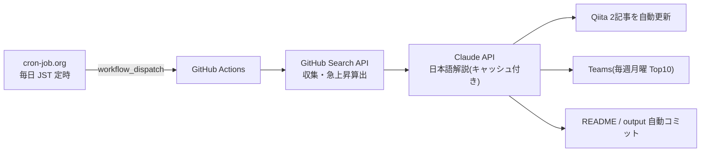

# Claude Code向けMCPツール候補ランキング

GitHub Search APIを使って、Claude Code周辺で活用候補になりそうなMCP関連リポジトリを定期収集するリポジトリです。

> 注意: この一覧は「Claude Codeでの動作」を保証するものではありません。  
> GitHub上のリポジトリ名・説明文・READMEなどに含まれる情報をもとに、MCP関連ツール候補を探すための入口として利用します。

## 仕組み(定常自律運転)

このランキングは cron-job.org → GitHub Actions → Claude API → Qiita / Teams のパイプラインで、毎日無人更新されています。



- 仕組みの詳細と**ライブ稼働ステータス**: [定常自律運転ページ](https://takanobusano.github.io/mcp-github-ranking/)
- 作り方の解説記事: [パイプライン編](https://qiita.com/4q_sano/items/913e93ee5cc2731561fc) / [cron-job.org 完全自動化編](https://qiita.com/4q_sano/items/1bc5e0669a8f0166936c)
<!-- MCP_REPOS_START -->
最終更新: **2026-10-22 08:17:14 JST**

MCP関連リポジトリに加え、Claude Code周辺で活用候補になりそうな関連ツールをGitHub Search APIで毎日自動収集してランキング化しています。

Stars / Forks の差分は、UTC基準の前日データ（2026-10-20）との差分です。
CSVには最大500件を保存し、本文では上位100件を表示しています。

> 注意: この一覧はClaude Codeでの動作を保証するものではありません。  
> MCP関連ツールまたはClaude Code関連ツール候補を探すための入口として利用してください。

# 注目MCP・関連ツール候補ランキング

## 1位 [public-apis/public-apis](https://github.com/public-apis/public-apis)

A collective list of free APIs

⭐ **491,123 Stars**（+263）　🍴 **54,594 Forks**（+43）　/　🟢 **2,294 Open Issues**　/　Python

Topics: `api` / `apis` / `dataset` / `development` / `free` / `list` / `lists` / `open-source`

## 2位 [openclaw/openclaw](https://github.com/openclaw/openclaw)

The AI that really does things. Any OS. Any Platform. The lobster way. 🦞

⭐ **392,689 Stars**（+11）　🍴 **82,543 Forks**（+8）　/　🟢 **9,548 Open Issues**　/　TypeScript

Topics: `ai` / `assistant` / `crustacean` / `molty` / `openclaw` / `own-your-data` / `personal`

## 3位 [morluto/rea](https://github.com/morluto/rea)

Reverse engineer anything with agents, from app behavior down to native binaries.

⭐ **357,467 Stars**（+9,873）　🍴 **89,692 Forks**（+2,227）　/　🟢 **1,613 Open Issues**　/　TypeScript

Topics: `agent-skills` / `ai-agents` / `binary-analysis` / `claude-code` / `cli` / `codex` / `cordis` / `decompiler`

## 4位 [obra/superpowers](https://github.com/obra/superpowers)

An agentic skills framework & software development methodology that works.

⭐ **303,142 Stars**（+558）　🍴 **27,015 Forks**（+36）　/　🟢 **341 Open Issues**　/　Shell

Topics: `ai` / `brainstorming` / `coding` / `obra` / `sdlc` / `skills` / `subagent-driven-development` / `superpowers`

## 5位 [mattpocock/skills](https://github.com/mattpocock/skills)

Skills for Real Engineers. Straight from my .agents directory.

⭐ **299,827 Stars**（+1,212）　🍴 **25,171 Forks**（+94）　/　🟢 **202 Open Issues**　/　Shell

Topics: `topicなし`

## 6位 [affaan-m/ECC](https://github.com/affaan-m/ECC)

The agent harness performance optimization system. Skills, instincts, memory, security, and research-first development for Claude Code, Codex, Opencode, Cursor and beyond.

⭐ **285,690 Stars**（+809）　🍴 **42,377 Forks**（+108）　/　🟢 **247 Open Issues**　/　JavaScript

Topics: `ai-agents` / `anthropic` / `claude` / `claude-code` / `developer-tools` / `llm` / `mcp` / `productivity`

## 7位 [NousResearch/hermes-agent](https://github.com/NousResearch/hermes-agent)

The agent that grows with you

⭐ **255,882 Stars**（+308）　🍴 **55,816 Forks**（+127）　/　🟢 **50,409 Open Issues**　/　Python

Topics: `ai` / `ai-agent` / `ai-agents` / `anthropic` / `chatgpt` / `claude` / `claude-code` / `codex`

## 8位 [multica-ai/andrej-karpathy-skills](https://github.com/multica-ai/andrej-karpathy-skills)

A single CLAUDE.md file to improve Claude Code behavior, derived from Andrej Karpathy's observations on LLM coding pitfalls.

⭐ **221,936 Stars**（+413）　🍴 **22,270 Forks**（+25）　/　🟢 **137 Open Issues**　/　不明

Topics: `topicなし`

## 9位 [ultraworkers/claw-code](https://github.com/ultraworkers/claw-code)

An agent-managed museum exhibit, built in Rust with Gajae-Code / LazyCodex — developed and maintained with no human intervention.

⭐ **195,070 Stars**（+105）　🍴 **107,849 Forks**（-40）　/　🟢 **1 Open Issues**　/　Rust

Topics: `topicなし`

## 10位 [firecrawl/firecrawl](https://github.com/firecrawl/firecrawl)

Supercharge your AI agents with data from the web and beyond. Building the library for superintelligence. 🔥

⭐ **193,926 Stars**（+457）　🍴 **10,229 Forks**（+17）　/　🟢 **639 Open Issues**　/　TypeScript

Topics: `ai` / `ai-agents` / `ai-crawler` / `ai-scraping` / `ai-search` / `crawler` / `data-extraction` / `html-to-markdown`

## 11位 [ollama/ollama](https://github.com/ollama/ollama)

Get up and running with Kimi, GLM, MiniMax, DeepSeek, gpt-oss, Qwen, Gemma and other models.

⭐ **184,201 Stars**（+137）　🍴 **18,475 Forks**（+26）　/　🟢 **4,385 Open Issues**　/　Go

Topics: `deepseek` / `gemma` / `gemma3` / `glm` / `go` / `golang` / `gpt-oss` / `llama`

## 12位 [anthropics/skills](https://github.com/anthropics/skills)

Public repository for Agent Skills

⭐ **182,750 Stars**（+261）　🍴 **21,648 Forks**（+22）　/　🟢 **1,427 Open Issues**　/　Python

Topics: `agent-skills`

## 13位 [DietrichGebert/ponytail](https://github.com/DietrichGebert/ponytail)

Makes your AI agent think like the laziest senior dev in the room. The best code is the code you never wrote.

⭐ **171,532 Stars**（+1,964）　🍴 **9,338 Forks**（+115）　/　🟢 **69 Open Issues**　/　JavaScript

Topics: `agent-skills` / `ai-agents` / `claude` / `claude-code` / `claude-code-plugin` / `cursor-rules` / `developer-tools` / `llm`

## 14位 [msitarzewski/agency-agents](https://github.com/msitarzewski/agency-agents)

A complete AI agency at your fingertips - From frontend wizards to Reddit community ninjas, from whimsy injectors to reality checkers. Each agent is a specialized expert with personality, processes, and proven deliverables.

⭐ **162,927 Stars**（+624）　🍴 **26,287 Forks**（+63）　/　🟢 **167 Open Issues**　/　Shell

Topics: `topicなし`

## 15位 [langgenius/dify](https://github.com/langgenius/dify)

Build Agentic workflows, RAG pipelines, with rich AI model and tool support on one collaborative workspace. Deploy on cloud, VPC, or self-hosted, so teams move from prototype to production without rebuilding the stack.

⭐ **159,154 Stars**（+94）　🍴 **25,156 Forks**（+18）　/　🟢 **1,151 Open Issues**　/　Python

Topics: `agent` / `agentic-ai` / `agentic-framework` / `agentic-workflow` / `ai` / `automation` / `claude` / `deepseek`

## 16位 [langflow-ai/langflow](https://github.com/langflow-ai/langflow)

Langflow is a powerful tool for building and deploying AI-powered agents and workflows.

⭐ **155,892 Stars**（+23）　🍴 **10,230 Forks**（-4）　/　🟢 **1,187 Open Issues**　/　Python

Topics: `agents` / `chatgpt` / `generative-ai` / `large-language-models` / `multiagent` / `react-flow`

## 17位 [anthropics/claude-code](https://github.com/anthropics/claude-code)

Claude Code is an agentic coding tool that lives in your terminal, understands your codebase, and helps you code faster by executing routine tasks, explaining complex code, and handling git workflows - all through natural language commands.

⭐ **152,746 Stars**（+99）　🍴 **26,711 Forks**（+44）　/　🟢 **15,540 Open Issues**　/　TypeScript

Topics: `topicなし`

## 18位 [farion1231/cc-switch](https://github.com/farion1231/cc-switch)

A cross-platform desktop All-in-One assistant for Claude Code, Codex, OpenCode, OpenClaw, Grok Build & Hermes Agent. Only official website: ccswitch.io

⭐ **147,221 Stars**（+425）　🍴 **9,712 Forks**（+20）　/　🟢 **1,493 Open Issues**　/　Rust

Topics: `ai-tools` / `claude-code` / `codex` / `desktop-app` / `grok` / `grokbuild` / `hermes` / `hermes-agent`

## 19位 [x1xhlol/system-prompts-and-models-of-ai-tools](https://github.com/x1xhlol/system-prompts-and-models-of-ai-tools)

FULL Augment Code, Claude Code, Cluely, CodeBuddy, Comet, Cursor, Devin AI, Junie, Kiro, Leap.new, Lovable, Manus, NotionAI, Orchids.app, Perplexity, Poke, Qoder, Replit, Same.dev, Trae, Traycer AI, VSCode Agent, Warp.dev, Windsurf, Xcode, Z.ai Code, Dia & v0. (And other Open Sourced) System Prompts, Internal Tools & AI Models

⭐ **144,170 Stars**（+35）　🍴 **34,720 Forks**（-2）　/　🟢 **162 Open Issues**　/　不明

Topics: `ai` / `bolt` / `cluely` / `copilot` / `cursor` / `cursorai` / `devin` / `github-copilot`

## 20位 [nextlevelbuilder/ui-ux-pro-max-skill](https://github.com/nextlevelbuilder/ui-ux-pro-max-skill)

An AI skill that provides design intelligence for building professional UI/UX across multiple platforms.

⭐ **138,483 Stars**（+494）　🍴 **14,680 Forks**（+42）　/　🟢 **90 Open Issues**　/　Python

Topics: `ai-skills` / `antigravity` / `claude` / `claude-code` / `codex` / `command-line` / `copilot` / `cursor-ai`

## 21位 [garrytan/gstack](https://github.com/garrytan/gstack)

Use Garry Tan's exact Claude Code setup: 23 opinionated tools that serve as CEO, Designer, Eng Manager, Release Manager, Doc Engineer, and QA

⭐ **137,203 Stars**（+130）　🍴 **20,339 Forks**（+11）　/　🟢 **62 Open Issues**　/　TypeScript

Topics: `topicなし`

## 22位 [harry0703/MoneyPrinterTurbo](https://github.com/harry0703/MoneyPrinterTurbo)

利用 AI 大模型和自动化工作流，根据主题或关键词一键生成高清短视频。Generate HD short videos from a topic or keyword with an automated AI workflow.

⭐ **133,779 Stars**（+351）　🍴 **21,123 Forks**（+63）　/　🟢 **75 Open Issues**　/　Python

Topics: `ai-video-generator` / `content-creation` / `ffmpeg` / `instagram-reels` / `llm` / `python` / `short-video` / `subtitles`

## 23位 [Graphify-Labs/graphify](https://github.com/Graphify-Labs/graphify)

Turn any codebase, with its docs, SQL schemas, configs, and PDFs, into a queryable knowledge graph. A /graphify skill for Claude Code, Cursor, Codex, and Gemini CLI: local deterministic AST parsing, every edge explained, no vector store.

⭐ **131,575 Stars**（+1,392）　🍴 **12,628 Forks**（+91）　/　🟢 **1,606 Open Issues**　/　Python

Topics: `ai-agents` / `antigravity` / `ast` / `claude-code` / `code-analysis` / `code-search` / `codex` / `cursor`

## 24位 [browser-use/browser-use](https://github.com/browser-use/browser-use)

Open-source Python library for AI browser agents, plus Browser Use Cloud: stealth browsers and a hosted agent API.

⭐ **118,776 Stars**（+113）　🍴 **13,195 Forks**（+16）　/　🟢 **591 Open Issues**　/　Python

Topics: `ai-agents` / `ai-tools` / `browser-agent` / `browser-automation` / `browser-use` / `cdp` / `cloud-browser` / `computer-use`

## 25位 [JuliusBrussee/caveman](https://github.com/JuliusBrussee/caveman)

🪨 why use many token when few token do trick. Viral skill + proxy for coding agents that cuts 65% of tokens by talking like a caveman.

⭐ **114,124 Stars**（+270）　🍴 **6,578 Forks**（+11）　/　🟢 **76 Open Issues**　/　Go

Topics: `ai` / `anthropic` / `caveman` / `claude` / `claude-code` / `llm` / `meme` / `prompt-engineering`

## 26位 [TauricResearch/TradingAgents](https://github.com/TauricResearch/TradingAgents)

TradingAgents: Multi-Agents LLM Financial Trading Framework

⭐ **112,571 Stars**（+235）　🍴 **21,768 Forks**（+68）　/　🟢 **110 Open Issues**　/　Python

Topics: `agent` / `finance` / `llm` / `multiagent` / `trading`

## 27位 [addyosmani/agent-skills](https://github.com/addyosmani/agent-skills)

Production-grade engineering skills for AI coding agents.

⭐ **109,321 Stars**（+343）　🍴 **11,395 Forks**（+34）　/　🟢 **146 Open Issues**　/　JavaScript

Topics: `agent-skills` / `antigravity` / `claude-code` / `codex` / `cursor` / `skills`

## 28位 [google-gemini/gemini-cli](https://github.com/google-gemini/gemini-cli)

An open-source AI agent that brings the power of Gemini directly into your terminal.

⭐ **107,489 Stars**（+17）　🍴 **14,756 Forks**（+9）　/　🟢 **747 Open Issues**　/　TypeScript

Topics: `ai` / `ai-agents` / `cli` / `gemini` / `gemini-api` / `mcp-client` / `mcp-server`

## 29位 [paperclipai/paperclip](https://github.com/paperclipai/paperclip)

The open-source app everyone uses to manage agents at work

⭐ **105,666 Stars**（+434）　🍴 **17,587 Forks**（+64）　/　🟢 **6,355 Open Issues**　/　TypeScript

Topics: `acpx` / `agent-orchestration` / `agent-skills` / `agentic-ai` / `ai-agents` / `ai-engineering` / `ai-governance` / `ai-tools`

## 30位 [nexu-io/open-design](https://github.com/nexu-io/open-design)

The 1st Collaborative AI Design Agent Workspace. Local-first and open source. Create motion, prototypes, websites, apps, dashboards, presentations, images, and videos with your team and AI agents. Share work, exchange feedback, and iterate together in one workspace.

⭐ **103,081 Stars**（+278）　🍴 **11,811 Forks**（+31）　/　🟢 **1,246 Open Issues**　/　TypeScript

Topics: `agent-skills` / `ai-design` / `byok` / `claude-code-for-design` / `claude-design` / `codex-design` / `cursor-design` / `deepseek`

## 31位 [thedotmack/claude-mem](https://github.com/thedotmack/claude-mem)

Persistent Context Across Sessions for Every Agent –  Captures everything your agent does during sessions, compresses it with AI, and injects relevant context back into future sessions. Works with Claude Code, OpenClaw, Codex, Gemini, Hermes, Copilot, OpenCode + More

⭐ **102,148 Stars**（+193）　🍴 **8,999 Forks**（+22）　/　🟢 **118 Open Issues**　/　TypeScript

Topics: `ai` / `ai-agents` / `ai-memory` / `anthropic` / `artificial-intelligence` / `chromadb` / `claude` / `claude-agent-sdk`

## 32位 [stablyai/orca](https://github.com/stablyai/orca)

Orca is the place for working with a fleet of agents (e.g. Grok Bot, Claude Code). Run any coding agent with your own subscription. Available on desktop, mobile and remote runtime.

⭐ **101,184 Stars**（+1,506）　🍴 **6,396 Forks**（+78）　/　🟢 **8,576 Open Issues**　/　TypeScript

Topics: `ade` / `agent-ide` / `ai-agents` / `automation` / `bot` / `claude-code` / `codex` / `ghostty`

## 33位 [Panniantong/Agent-Reach](https://github.com/Panniantong/Agent-Reach)

Give your AI agent eyes to see the entire internet. Read & search Twitter, Reddit, YouTube, GitHub, Bilibili, XiaoHongShu — one CLI, zero API fees.

⭐ **100,637 Stars**（+362）　🍴 **8,860 Forks**（+28）　/　🟢 **235 Open Issues**　/　Python

Topics: `agent-infrastructure` / `ai-agent` / `ai-search` / `automation` / `bilibili` / `claude-code` / `cli` / `cursor`

## 34位 [Leonxlnx/taste-skill](https://github.com/Leonxlnx/taste-skill)

Agent skills that give coding agents taste: art direction, reference images and a browser check instead of generic AI pages

⭐ **100,550 Stars**（+707）　🍴 **6,800 Forks**（+32）　/　🟢 **3 Open Issues**　/　JavaScript

Topics: `agent-skills` / `ai-agents` / `anti-slop` / `claude-code` / `codex` / `cursor` / `design-system` / `frontend`

## 35位 [microsoft/playwright](https://github.com/microsoft/playwright)

Playwright is a framework for Web Testing and Automation. It allows testing Chromium, Firefox and WebKit with a single API.

⭐ **98,234 Stars**（+61）　🍴 **6,665 Forks**（+5）　/　🟢 **188 Open Issues**　/　TypeScript

Topics: `automation` / `chrome` / `chromium` / `e2e-testing` / `electron` / `end-to-end-testing` / `firefox` / `javascript`

## 36位 [puppeteer/puppeteer](https://github.com/puppeteer/puppeteer)

JavaScript API for Chrome and Firefox

⭐ **95,729 Stars**（+6）　🍴 **9,571 Forks**（-8）　/　🟢 **229 Open Issues**　/　TypeScript

Topics: `automation` / `chrome` / `chromium` / `developer-tools` / `firefox` / `headless-chrome` / `node-module` / `testing`

## 37位 [OpenCut-app/OpenCut](https://github.com/OpenCut-app/OpenCut)

The open-source CapCut alternative

⭐ **95,583 Stars**（+95）　🍴 **9,436 Forks**（+13）　/　🟢 **385 Open Issues**　/　TypeScript

Topics: `editor` / `oss` / `videoeditor`

## 38位 [OpenHands/OpenHands](https://github.com/OpenHands/OpenHands)

🙌 OpenHands: AI-Driven Development

⭐ **91,496 Stars**（+84）　🍴 **12,143 Forks**（+14）　/　🟢 **1,077 Open Issues**　/　TypeScript

Topics: `agent` / `artificial-intelligence` / `chatgpt` / `claude-ai` / `cli` / `developer-tools` / `gpt` / `llm`

## 39位 [modelcontextprotocol/servers](https://github.com/modelcontextprotocol/servers)

Model Context Protocol Servers

⭐ **91,452 Stars**（+28）　🍴 **11,838 Forks**（+8）　/　🟢 **140 Open Issues**　/　TypeScript

Topics: `topicなし`

## 40位 [koala73/worldmonitor](https://github.com/koala73/worldmonitor)

Real-time global intelligence dashboard. AI-powered news aggregation, geopolitical monitoring, and infrastructure tracking in a unified situational awareness interface

⭐ **89,092 Stars**（+158）　🍴 **13,673 Forks**（+21）　/　🟢 **346 Open Issues**　/　TypeScript

Topics: `agent` / `ai` / `dashboard` / `geopolitics` / `mcp` / `mcp-server` / `monitoring` / `news`

## 41位 [D4Vinci/Scrapling](https://github.com/D4Vinci/Scrapling)

🕷️ A Web Scraping framework that handles everything from a single request to a full-scale crawl! Don't be shy, join here:  and follow here for daily tips and tricks:

⭐ **89,039 Stars**（+167）　🍴 **9,183 Forks**（+14）　/　🟢 **15 Open Issues**　/　Python

Topics: `ai` / `ai-scraping` / `automation` / `crawler` / `crawling` / `crawling-python` / `data` / `data-extraction`

## 42位 [ChatGPTNextWeb/NextChat](https://github.com/ChatGPTNextWeb/NextChat)

✨ Zero-config AI chat assistant. No API key needed — sign up and instantly chat with GPT-5, Claude 4, Gemini 2.5, DeepSeek & 100+ top models. Pay-as-you-go save...

⭐ **88,883 Stars**（+5）　🍴 **58,758 Forks**（-14）　/　🟢 **853 Open Issues**　/　TypeScript

Topics: `calclaude` / `claude` / `cross-platform` / `desktop` / `fe` / `gemini` / `gemini-pro` / `gemini-server`

## 43位 [Egonex-AI/Understand-Anything](https://github.com/Egonex-AI/Understand-Anything)

Graphs that teach > graphs that impress. Turn any code into an interactive knowledge graph you can explore, search, and ask questions about. Works with Claude Code, Codex, Cursor, Copilot, Gemini CLI, and more.

⭐ **87,484 Stars**（+239）　🍴 **7,378 Forks**（+15）　/　🟢 **331 Open Issues**　/　TypeScript

Topics: `antigravity-skills` / `business-knowledge` / `claude-code` / `claude-skills` / `codebase-analysis` / `codex` / `codex-skills` / `developer-tools-ai-agent`

## 44位 [tt-a1i/archify](https://github.com/tt-a1i/archify)

Turn any idea, plan, or codebase into a beautiful interactive diagram. An agent skill for Claude Code, Codex, and more.

⭐ **87,050 Stars**（+633）　🍴 **5,864 Forks**（+19）　/　🟢 **278 Open Issues**　/　JavaScript

Topics: `agent-skills` / `ai-agents` / `architecture-diagram` / `claude-code` / `claude-skills` / `codex` / `coding-agents` / `deepseek-harness`

## 45位 [unclecode/crawl4ai](https://github.com/unclecode/crawl4ai)

Open-source web crawler and scraper for LLMs and AI agents: any website into clean, LLM-ready Markdown. Run it yourself, or use Crawl4AI Cloud with one key. Join our Discord

⭐ **85,990 Stars**（+63）　🍴 **8,941 Forks**（+2）　/　🟢 **273 Open Issues**　/　Python

Topics: `ai` / `ai-agents` / `crawler` / `data-extraction` / `llm` / `markdown` / `mcp` / `open-source`

## 46位 [laravel/laravel](https://github.com/laravel/laravel)

Laravel is a web application framework with expressive, elegant syntax. We’ve already laid the foundation for your next big idea — freeing you to create without sweating the small things.

⭐ **85,231 Stars**（-9）　🍴 **27,580 Forks**（+24）　/　🟢 **31 Open Issues**　/　Blade

Topics: `framework` / `laravel` / `php`

## 47位 [pbakaus/impeccable](https://github.com/pbakaus/impeccable)

The design language that makes your AI harness better at design.

⭐ **84,431 Stars**（+618）　🍴 **5,047 Forks**（+24）　/　🟢 **51 Open Issues**　/　Rust

Topics: `topicなし`

## 48位 [bytedance/deer-flow](https://github.com/bytedance/deer-flow)

An open-source long-horizon SuperAgent harness that researches, codes, and creates. With the help of sandboxes, memories, tools, skill, subagents and message gateway, it handles different levels of tasks that could take minutes to hours.

⭐ **84,252 Stars**（+48）　🍴 **11,776 Forks**（+10）　/　🟢 **960 Open Issues**　/　Python

Topics: `agent` / `agentic` / `agentic-framework` / `agentic-workflow` / `ai` / `ai-agents` / `deep-research` / `harness`

## 49位 [rtk-ai/rtk](https://github.com/rtk-ai/rtk)

CLI proxy that reduces LLM token consumption by 60-90% on common dev commands. Single Rust binary, zero dependencies

⭐ **84,208 Stars**（+121）　🍴 **5,356 Forks**（+14）　/　🟢 **1,591 Open Issues**　/　Rust

Topics: `agentic-coding` / `ai-coding` / `anthropic` / `claude-code` / `cli` / `command-line-tool` / `cost-reduction` / `developer-tools`

## 50位 [lobehub/lobehub](https://github.com/lobehub/lobehub)

🤯 LobeHub is your Chief Agent Operator, organizing your agents into 7×24 operations by hiring, scheduling, and reporting on your entire AI team.

⭐ **83,393 Stars**（+30）　🍴 **16,012 Forks**（+9）　/　🟢 **1,125 Open Issues**　/　TypeScript

Topics: `agent` / `agent-collaboration` / `agent-harness` / `ai` / `cao` / `chatgpt` / `chief-agent-operator` / `claude`

## 51位 [abi/screenshot-to-code](https://github.com/abi/screenshot-to-code)

Drop in a screenshot and convert it to clean code (HTML/Tailwind/React/Vue)

⭐ **80,598 Stars**（+29）　🍴 **9,850 Forks**（+7）　/　🟢 **148 Open Issues**　/　Python

Topics: `topicなし`

## 52位 [debpalash/VoiceStudio](https://github.com/debpalash/VoiceStudio)

VoiceStudio is the open-source, fully-local ElevenLabs alternative — voice cloning, voice design, video dubbing, dictation, transcription & audiobook creation in 646 languages.

⭐ **80,341 Stars**（+1,423）　🍴 **8,856 Forks**（+185）　/　🟢 **298 Open Issues**　/　Python

Topics: `ai` / `audiobook` / `cuda` / `dubbing` / `elevenlabs-alternative` / `huggingface` / `local-first` / `mlx`

## 53位 [cheaper-inference/OmniRoute](https://github.com/cheaper-inference/OmniRoute)

Never stop coding. Free MIT AI gateway: one endpoint, 375 providers (150+ free), 1,400+ models Kimi, Claude, GPT, Gemini, GLM, DeepSeek, MiniMax. Works with Claude Code, Codex, Cursor, OpenCode, Cline & Copilot. Quota-aware auto-fallback, RTK+Caveman compression saves 15-95% tokens, MCP/A2A, Desktop/PWA. Built by 900+ contributors

⭐ **79,426 Stars**（前日なし）　🍴 **11,557 Forks**（前日なし）　/　🟢 **511 Open Issues**　/　TypeScript

Topics: `a2a` / `ai-agents` / `ai-gateway` / `anthropic` / `claude` / `claude-code` / `cline` / `codex`

## 54位 [shareAI-lab/learn-claude-code](https://github.com/shareAI-lab/learn-claude-code)

Bash is all you need -  A nano claude code–like 「agent harness」, built from 0 to 1

⭐ **78,956 Stars**（+54）　🍴 **12,625 Forks**（+5）　/　🟢 **69 Open Issues**　/　Python

Topics: `agent` / `agent-development` / `ai-agent` / `claude` / `claude-code` / `educational` / `llm` / `python`

## 55位 [unslothai/unsloth](https://github.com/unslothai/unsloth)

Local UI to run and train LLMs and diffusion models. Supports GGUF, MLX, Qwen3.8, DeepSeek-V4, MiniMax-H3, Gemma 4, FLUX and more.

⭐ **78,375 Stars**（+50）　🍴 **7,255 Forks**（+7）　/　🟢 **310 Open Issues**　/　Python

Topics: `agent` / `ai` / `chatgpt` / `deepseek` / `fine-tuning` / `gemma` / `image-generation` / `llama`

## 56位 [ruvnet/ruflo](https://github.com/ruvnet/ruflo)

🌊 The original agent harness. Deploy intelligent multi-player swarms, coordinate autonomous workflows, and build conversational AI systems. Features adaptive me...

⭐ **78,205 Stars**（+394）　🍴 **9,199 Forks**（+46）　/　🟢 **974 Open Issues**　/　TypeScript

Topics: `agentic-ai` / `agentic-framework` / `agentic-workflow` / `agents` / `ai-agents` / `ai-assistant` / `ai-skills` / `autonomous-agents`

## 57位 [headroomlabs-ai/headroom](https://github.com/headroomlabs-ai/headroom)

Compress tool outputs, logs, files, and RAG chunks before they reach the LLM. 20% fewer tokens for coding agents, 60-95% fewer tokens for JSON, same answers. Library, proxy, MCP server.

⭐ **77,231 Stars**（+499）　🍴 **5,989 Forks**（+32）　/　🟢 **527 Open Issues**　/　Python

Topics: `agent` / `ai` / `anthropic` / `claude-code` / `compression` / `context-engineering` / `context-window` / `cursor`

## 58位 [Eugeny/tabby](https://github.com/Eugeny/tabby)

A terminal for a more modern age

⭐ **75,070 Stars**（+26）　🍴 **4,300 Forks**（+2）　/　🟢 **2,846 Open Issues**　/　TypeScript

Topics: `serial` / `ssh-client` / `telnet-client` / `terminal` / `terminal-emulators`

## 59位 [colbymchenry/codegraph](https://github.com/colbymchenry/codegraph)

Pre-indexed code knowledge graph, auto syncs on code changes, for Claude Code, Codex, Gemini, Cursor, OpenCode, AntiGravity, Kiro, CoPilot, and Hermes Agent — fewer tokens, fewer tool calls, 100% local

⭐ **74,620 Stars**（+82）　🍴 **4,829 Forks**（+3）　/　🟢 **601 Open Issues**　/　C

Topics: `topicなし`

## 60位 [thedaviddias/Front-End-Checklist](https://github.com/thedaviddias/Front-End-Checklist)

🗂 The essential checklist for modern web development, for humans and AI agents

⭐ **74,541 Stars**（+15）　🍴 **6,759 Forks**（±0）　/　🟢 **14 Open Issues**　/　MDX

Topics: `ai-agent` / `ai-agents` / `checklist` / `css` / `front-end-developer-tool` / `front-end-development` / `frontend` / `guidelines`

## 61位 [openbq-org/OpenBB](https://github.com/openbq-org/OpenBB)

Open Data Platform for analysts, quants and AI agents.

⭐ **74,526 Stars**（+49）　🍴 **7,745 Forks**（+9）　/　🟢 **99 Open Issues**　/　Python

Topics: `ai` / `crypto` / `derivatives` / `economics` / `equity` / `finance` / `fixed-income` / `machine-learning`

## 62位 [tw93/Mole](https://github.com/tw93/Mole)

🐹 Keep your Mac and PC clean, light, and running like new. Fast open-source CLI, plus native Mac and Windows apps.

⭐ **72,196 Stars**（前日なし）　🍴 **2,551 Forks**（前日なし）　/　🟢 **6 Open Issues**　/　Shell

Topics: `analyzer` / `appcleaner` / `clean` / `cleaner` / `cleanmymac` / `command-line` / `daisydisk` / `istat`

## 63位 [rohitg00/ai-engineering-from-scratch](https://github.com/rohitg00/ai-engineering-from-scratch)

Learn AI Engineering! Learn it. Build it. Ship it for others.

⭐ **72,090 Stars**（+305）　🍴 **12,700 Forks**（+71）　/　🟢 **76 Open Issues**　/　Python

Topics: `agents` / `ai` / `ai-agents` / `ai-engineering` / `computer-vision` / `course` / `deep-learning` / `dsh`

## 64位 [usestrix/strix](https://github.com/usestrix/strix)

Open-source AI penetration testing tool to find and fix your app’s vulnerabilities.

⭐ **70,796 Stars**（+371）　🍴 **7,849 Forks**（+33）　/　🟢 **493 Open Issues**　/　Python

Topics: `agents` / `ai-hacking` / `ai-penetration-testing` / `ai-pentesting` / `ai-security` / `artificial-intelligence` / `bug-bounty` / `code-quality`

## 65位 [cline/cline](https://github.com/cline/cline)

Autonomous coding agent as an SDK, IDE extension, or CLI assistant.

⭐ **70,729 Stars**（+22）　🍴 **7,721 Forks**（-3）　/　🟢 **1,690 Open Issues**　/　TypeScript

Topics: `topicなし`

## 66位 [storytold/photocraft](https://github.com/storytold/photocraft)

PhotoCraft: An open-source, photo editor written by scratch in pure Rust

⭐ **70,607 Stars**（+995）　🍴 **12,440 Forks**（+159）　/　🟢 **2,857 Open Issues**　/　Rust

Topics: `art` / `image-editing` / `image-editing-software` / `image-editor` / `images` / `photo-editing` / `rust`

## 67位 [calesthio/OpenMontage](https://github.com/calesthio/OpenMontage)

World's first open-source, agentic video production system. 12 production pipelines, 100+ tools, 700+ agent skill and production-knowledge files. Turn your AI coding assistant into a full video production studio.

⭐ **70,603 Stars**（+314）　🍴 **9,126 Forks**（+55）　/　🟢 **413 Open Issues**　/　Python

Topics: `agent` / `agentic-ai` / `ai` / `claude` / `copilot` / `cursor` / `elevenlabs` / `ffmpeg`

## 68位 [code-yeongyu/oh-my-openagent](https://github.com/code-yeongyu/oh-my-openagent)

OmO: Just type "mass ulw" keyword with your prompt. Now you are the master of graph engineering.

⭐ **70,250 Stars**（+21）　🍴 **5,781 Forks**（+7）　/　🟢 **1,666 Open Issues**　/　TypeScript

Topics: `ai` / `ai-agents` / `anthropic` / `chatgpt` / `claude` / `claude-skills` / `codex` / `cursor`

## 69位 [asgeirtj/system_prompts_leaks](https://github.com/asgeirtj/system_prompts_leaks)

Documented system prompts from Anthropic - Claude Fable 5.1, Opus 5.5, Claude Design, Claude Code. OpenAI - ChatGPT GPT-6-Astra, Codex. Google - Gemini 3.8 Flash, 3.1 Pro, Antigravity. xAI - Grok, Grok Bot, Cursor, Kimi and more! Updated regularly.

⭐ **70,002 Stars**（+62）　🍴 **11,348 Forks**（+11）　/　🟢 **58 Open Issues**　/　Python

Topics: `ai` / `ai-agents` / `ai-prompts` / `anthropic` / `chatbot` / `chatgpt` / `claude` / `claude-code`

## 70位 [docling-project/docling](https://github.com/docling-project/docling)

Get your documents ready for gen AI

⭐ **69,292 Stars**（+79）　🍴 **5,138 Forks**（+16）　/　🟢 **921 Open Issues**　/　Python

Topics: `ai` / `convert` / `document-parser` / `document-parsing` / `documents` / `docx` / `html` / `markdown`

## 71位 [heygen-com/hyperframes](https://github.com/heygen-com/hyperframes)

Write HTML. Render video. Built for agents.

⭐ **69,187 Stars**（+724）　🍴 **6,263 Forks**（+74）　/　🟢 **394 Open Issues**　/　TypeScript

Topics: `ai` / `ai-agents` / `animation` / `claude-code` / `ffmpeg` / `framework` / `gsap` / `html`

## 72位 [openinterpreter/openinterpreter](https://github.com/openinterpreter/openinterpreter)

A coding agent for open models like Kimi K3 and GLM 5.3

⭐ **68,630 Stars**（+7）　🍴 **5,909 Forks**（±0）　/　🟢 **20 Open Issues**　/　Rust

Topics: `acp` / `coding-agent` / `deepseek` / `kimi` / `python` / `qwen` / `rust`

## 73位 [shanraisshan/claude-code-best-practice](https://github.com/shanraisshan/claude-code-best-practice)

from vibe coding to agentic engineering - practice makes claude perfect

⭐ **67,882 Stars**（+53）　🍴 **6,755 Forks**（+2）　/　🟢 **26 Open Issues**　/　HTML

Topics: `agentic-ai` / `agentic-coding` / `agentic-engineering` / `agentic-workflow` / `ai` / `ai-agents` / `anthropic` / `best-practices`

## 74位 [NanmiCoder/MediaCrawler](https://github.com/NanmiCoder/MediaCrawler)

小红书笔记 \| 评论爬虫、抖音视频 \| 评论爬虫、快手视频 \| 评论爬虫、B 站视频 ｜ 评论爬虫、微博帖子 ｜ 评论爬虫、百度贴吧帖子 ｜ 百度贴吧评论回复爬虫  \| 知乎问答文章｜评论爬虫

⭐ **67,614 Stars**（+148）　🍴 **12,894 Forks**（+23）　/　🟢 **216 Open Issues**　/　Python

Topics: `topicなし`

## 75位 [mem0ai/mem0](https://github.com/mem0ai/mem0)

The Memory Layer for AI Agents - Drop-in memory infrastructure for AI agents and apps. Context that persists. Built for production.

⭐ **67,599 Stars**（+60）　🍴 **7,977 Forks**（+9）　/　🟢 **861 Open Issues**　/　Python

Topics: `agentic-memory` / `agentic-memory-system` / `agents` / `ai` / `ai-agents` / `chatgpt` / `genai` / `llm`

## 76位 [eternity4719/HowToLiveBetter](https://github.com/eternity4719/HowToLiveBetter)

高性价比人生指南: 长寿防病、急救、省钱理财、法律红线、失业与工伤、医保社保、恋爱婚育、怀孕育儿、创业与做平台合规、出国与技能。每条写明成本、收益、证据等级和原始出处，只引期刊论文与官方文件。

⭐ **67,589 Stars**（+528）　🍴 **5,824 Forks**（+54）　/　🟢 **20 Open Issues**　/　HTML

Topics: `topicなし`

## 77位 [bradtraversy/design-resources-for-developers](https://github.com/bradtraversy/design-resources-for-developers)

Curated list of design and UI resources from stock photos, web templates, CSS frameworks, UI libraries, tools and much more

⭐ **67,223 Stars**（+6）　🍴 **12,276 Forks**（+2）　/　🟢 **1 Open Issues**　/　不明

Topics: `topicなし`

## 78位 [xtekky/gpt4free](https://github.com/xtekky/gpt4free)

The official gpt4free repository \| various collection of powerful language models \| opus 4.6 gpt 5.3 kimi 2.5 deepseek v3.2 gemini 3

⭐ **66,918 Stars**（+8）　🍴 **13,465 Forks**（-5）　/　🟢 **5 Open Issues**　/　Python

Topics: `chatbot` / `chatbots` / `chatgpt` / `chatgpt-4` / `chatgpt-api` / `chatgpt-free` / `chatgpt4` / `deepseek`

## 79位 [warpdotdev/warp](https://github.com/warpdotdev/warp)

Warp is an agentic development environment, born out of the terminal.

⭐ **65,620 Stars**（+24）　🍴 **5,687 Forks**（+4）　/　🟢 **5,466 Open Issues**　/　Rust

Topics: `bash` / `linux` / `macos` / `rust` / `shell` / `terminal` / `wasm` / `zsh`

## 80位 [hugohe3/ppt-master](https://github.com/hugohe3/ppt-master)

AI turns documents or topics into real, native PowerPoint decks—with native shapes, transitions and animations, data-backed charts and tables on demand, audio narration from speaker notes, and support for your own .pptx templates. · by Hugo He

⭐ **65,205 Stars**（+738）　🍴 **5,126 Forks**（+42）　/　🟢 **4 Open Issues**　/　Python

Topics: `ai-agent` / `aippt` / `office` / `powerpoint` / `powerpoint-generation` / `ppt` / `pptx` / `presentation`

## 81位 [mvanhorn/last30days-skill](https://github.com/mvanhorn/last30days-skill)

AI agent skill that researches any topic across Reddit, X, YouTube, HN, Polymarket, and the web - then synthesizes a grounded summary

⭐ **64,983 Stars**（+110）　🍴 **5,644 Forks**（-1）　/　🟢 **22 Open Issues**　/　Python

Topics: `ai-prompts` / `ai-skill` / `bluesky` / `claude` / `claude-code` / `clawhub` / `deep-research` / `hackernews`

## 82位 [usememos/memos](https://github.com/usememos/memos)

Memos is an open-source, self-hosted note-taking app that brings your everyday thoughts together in a personal timeline. Your data stays yours, and you choose what to keep private or share.

⭐ **63,983 Stars**（+31）　🍴 **4,879 Forks**（+7）　/　🟢 **91 Open Issues**　/　Go

Topics: `docker` / `foss` / `go` / `markdown` / `memo` / `microblog` / `note-taking` / `notes`

## 83位 [upstash/context7](https://github.com/upstash/context7)

Context7 Platform -- Up-to-date docs for AI agents

⭐ **63,450 Stars**（+73）　🍴 **3,121 Forks**（+1）　/　🟢 **47 Open Issues**　/　TypeScript

Topics: `llm` / `mcp` / `mcp-server` / `vibe-coding`

## 84位 [coollabsio/coolify](https://github.com/coollabsio/coolify)

An open-source, self-hostable PaaS alternative to Vercel, Heroku & Netlify that lets you easily deploy static sites, databases, full-stack applications and 360+ one-click services on your own servers.

⭐ **63,373 Stars**（+77）　🍴 **5,707 Forks**（+10）　/　🟢 **399 Open Issues**　/　PHP

Topics: `coolify` / `databases` / `deployment` / `docker` / `docker-compose` / `inertiajs` / `laravel` / `mariadb`

## 85位 [sansan0/TrendRadar](https://github.com/sansan0/TrendRadar)

⭐AI-driven public opinion & trend monitor with multi-platform aggregation, RSS, and smart alerts.🎯 告别信息过载，你的 AI 舆情监控助手与热点筛选工具！聚合多平台热点 +  RSS 订阅，支持关键词精准筛选。AI 智能筛...

⭐ **63,082 Stars**（+31）　🍴 **24,909 Forks**（-3）　/　🟢 **34 Open Issues**　/　Python

Topics: `ai` / `bark` / `data-analysis` / `docker` / `hot-news` / `llm` / `mail` / `mcp`

## 86位 [Alishahryar1/free-claude-code](https://github.com/Alishahryar1/free-claude-code)

Use Claude Code, Codex, VSCode, Pi, and OpenCode (and 6 other harnesses) for free (1.3B+ free tokens) from your terminal, app, IDE, or phone, and now from the browser with native browser sessions (multi-harness + multi-model) like OpenClaw (voice supported + ToS friendly)

⭐ **62,437 Stars**（+270）　🍴 **9,761 Forks**（+32）　/　🟢 **301 Open Issues**　/　Python

Topics: `topicなし`

## 87位 [tw93/Pake](https://github.com/tw93/Pake)

Turn any website into a lightweight desktop app with one command, on macOS, Windows and Linux.

⭐ **62,245 Stars**（+24）　🍴 **12,804 Forks**（+9）　/　🟢 **1 Open Issues**　/　Rust

Topics: `chatgpt` / `claude` / `cli` / `desktop` / `desktop-app` / `electron-alternative` / `gemini` / `linux`

## 88位 [1c7/chinese-independent-developer](https://github.com/1c7/chinese-independent-developer)

👩🏿‍💻👨🏾‍💻👩🏼‍💻👨🏽‍💻👩🏻‍💻中国独立开发者项目列表 -- 分享大家都在做什么

⭐ **61,872 Stars**（+8）　🍴 **5,496 Forks**（+5）　/　🟢 **3 Open Issues**　/　不明

Topics: `china` / `indie` / `indie-developer`

## 89位 [BerriAI/litellm](https://github.com/BerriAI/litellm)

The fastest, litest AI Gateway. Rust core with Python SDK. Call 100+ LLM APIs in OpenAI (or native) format with cost tracking, guardrails, load balancing, and logging [Bedrock, Azure, OpenAI, Anthropic, OpenAI, VertexAI, vLLM, Nvidia NIM]

⭐ **61,751 Stars**（+81）　🍴 **12,554 Forks**（+27）　/　🟢 **5,578 Open Issues**　/　Python

Topics: `ai-gateway` / `anthropic` / `azure-openai` / `bedrock` / `gateway` / `langchain` / `litellm` / `llm`

## 90位 [microsoft/autogen](https://github.com/microsoft/autogen)

A programming framework for agentic AI

⭐ **61,516 Stars**（+15）　🍴 **9,303 Forks**（+5）　/　🟢 **1,122 Open Issues**　/　Python

Topics: `agentic` / `agentic-agi` / `agents` / `ai` / `autogen` / `autogen-ecosystem` / `chatgpt` / `framework`

## 91位 [penpot/penpot](https://github.com/penpot/penpot)

Penpot: The open-source design platform for Product teams that need scalable collaboration.

⭐ **61,469 Stars**（+38）　🍴 **4,257 Forks**（+3）　/　🟢 **869 Open Issues**　/　Clojure

Topics: `clojure` / `clojurescript` / `design` / `prototyping` / `ui` / `ux-design` / `ux-experience`

## 92位 [crewAIInc/crewAI](https://github.com/crewAIInc/crewAI)

Framework for orchestrating role-playing, autonomous AI agents. By fostering collaborative intelligence, CrewAI empowers agents to work together seamlessly, tackling complex tasks.

⭐ **59,964 Stars**（+40）　🍴 **8,823 Forks**（+13）　/　🟢 **801 Open Issues**　/　Python

Topics: `agents` / `ai` / `ai-agents` / `aiagentframework` / `llms`

## 93位 [MemPalace/mempalace](https://github.com/MemPalace/mempalace)

The best-benchmarked open-source AI memory system. And it's free.

⭐ **59,685 Stars**（+20）　🍴 **7,570 Forks**（+2）　/　🟢 **831 Open Issues**　/　Python

Topics: `ai` / `chromadb` / `llm` / `mcp` / `memory` / `python`

## 94位 [meilisearch/meilisearch](https://github.com/meilisearch/meilisearch)

A lightning-fast search engine API bringing AI-powered hybrid search to your sites and applications.

⭐ **59,624 Stars**（+8）　🍴 **2,756 Forks**（+3）　/　🟢 **319 Open Issues**　/　Rust

Topics: `ai` / `api` / `app-search` / `database` / `enterprise-search` / `faceting` / `full-text-search` / `fuzzy-search`

## 95位 [cathrynlavery/diagram-design](https://github.com/cathrynlavery/diagram-design)

Editorial diagram design for Claude Code, Codex, GitHub Copilot, Cursor, Factory Droid, Qoder, and Pi. 45 diagram types. Self-contained HTML + SVG. No shadows. No Mermaid slop.

⭐ **59,505 Stars**（+538）　🍴 **3,834 Forks**（+40）　/　🟢 **38 Open Issues**　/　HTML

Topics: `agent-skills` / `claude-code` / `codex` / `data-visualization` / `diagrams` / `drawio` / `mermaid` / `svg`

## 96位 [blader/humanizer](https://github.com/blader/humanizer)

Agent skill that removes signs of AI-generated writing from text

⭐ **59,284 Stars**（+395）　🍴 **4,702 Forks**（+30）　/　🟢 **7 Open Issues**　/　Python

Topics: `agent-skills` / `ai-humanizer` / `ai-writing` / `chatgpt` / `claude` / `claude-code` / `codex` / `cursor`

## 97位 [twentyhq/twenty](https://github.com/twentyhq/twenty)

The open alternative to Salesforce, designed for AI.

⭐ **59,129 Stars**（+386）　🍴 **9,659 Forks**（+25）　/　🟢 **140 Open Issues**　/　TypeScript

Topics: `crm` / `crm-system` / `customer` / `good-first-issue` / `graphql` / `hacktoberfest` / `javascript` / `marketing`

## 98位 [bilawalsidhu/gods-eye-view](https://github.com/bilawalsidhu/gods-eye-view)

A spy satellite simulator in your browser, except the data is real. Live open source spatial intelligence on a photorealistic 3D globe.

⭐ **58,809 Stars**（+289）　🍴 **11,465 Forks**（+58）　/　🟢 **412 Open Issues**　/　JavaScript

Topics: `3d-globe` / `cesium` / `flight-tracking` / `geospatial` / `geospatial-intelligence` / `gis` / `osint` / `photogrammetry`

## 99位 [pathwaycom/serviette](https://github.com/pathwaycom/serviette)

A no-code RAG server that keeps answers in sync with your documents. Works with 8 vector databases. Built on Pathway.

⭐ **58,781 Stars**（±0）　🍴 **1,515 Forks**（+2）　/　🟢 **8 Open Issues**　/　Python

Topics: `chromadb` / `document-qa` / `document-search` / `duckdb` / `live-data` / `llm` / `milvus` / `mongodb`

## 100位 [FoundationAgents/OpenManus](https://github.com/FoundationAgents/OpenManus)

No fortress, purely open ground.  OpenManus is Coming.

⭐ **58,760 Stars**（+14）　🍴 **10,185 Forks**（-2）　/　🟢 **441 Open Issues**　/　Python

Topics: `topicなし`

# 最近プッシュされたMCP・関連ツール候補

スター数ランキングとは別に、最近コードがプッシュされたリポジトリを表示します。古いスター数だけではなく、現在も開発が動いていそうな候補を探すための一覧です。

## プッシュ順 1位 [PostHog/posthog](https://github.com/PostHog/posthog)

:hedgehog: PostHog is the leading platform for building self-driving products. Our developer tools – AI observability, analytics, session replay, flags, experiments, error tracking, logs, and more – capture all the context agents need to diagnose problems, uncover opportunities, and ship fixes. Steer it all from Slack, web, desktop, or the MCP.

⭐ **40,379 Stars**（+16）　🍴 **3,534 Forks**（+3）　/　Python　/　最終プッシュ: 2026-10-21

Topics: `ab-testing` / `ai-analytics` / `analytics` / `cdp` / `data-warehouse` / `experiments` / `feature-flags` / `javascript`

## プッシュ順 2位 [abhigyanpatwari/GitNexus](https://github.com/abhigyanpatwari/GitNexus)

GitNexus: The Zero-Server Code Intelligence Engine

⭐ **47,998 Stars**（+25）　🍴 **5,197 Forks**（-1）　/　TypeScript　/　最終プッシュ: 2026-10-21

Topics: `topicなし`

## プッシュ順 3位 [Yeachan-Heo/oh-my-claudecode](https://github.com/Yeachan-Heo/oh-my-claudecode)

Teams-first Multi-agent orchestration for Claude Code

⭐ **40,160 Stars**（+39）　🍴 **3,593 Forks**（-1）　/　TypeScript　/　最終プッシュ: 2026-10-21

Topics: `agentic-coding` / `ai-agents` / `automation` / `claude` / `claude-code` / `multi-agent-systems` / `oh-my-opencode` / `opencode`

## プッシュ順 4位 [bilawalsidhu/gods-eye-view](https://github.com/bilawalsidhu/gods-eye-view)

A spy satellite simulator in your browser, except the data is real. Live open source spatial intelligence on a photorealistic 3D globe.

⭐ **58,809 Stars**（+289）　🍴 **11,465 Forks**（+58）　/　JavaScript　/　最終プッシュ: 2026-10-21

Topics: `3d-globe` / `cesium` / `flight-tracking` / `geospatial` / `geospatial-intelligence` / `gis` / `osint` / `photogrammetry`

## プッシュ順 5位 [MemPalace/mempalace](https://github.com/MemPalace/mempalace)

The best-benchmarked open-source AI memory system. And it's free.

⭐ **59,685 Stars**（+20）　🍴 **7,570 Forks**（+2）　/　Python　/　最終プッシュ: 2026-10-21

Topics: `ai` / `chromadb` / `llm` / `mcp` / `memory` / `python`

## プッシュ順 6位 [manaflow-ai/cmux](https://github.com/manaflow-ai/cmux)

Open source Ghostty-based macOS terminal with vertical tabs and notifications for AI coding agents. Built for multitasking, organization, and programmability.

⭐ **28,330 Stars**（+27）　🍴 **2,566 Forks**（+5）　/　Swift　/　最終プッシュ: 2026-10-21

Topics: `amp` / `claude-code` / `cli` / `codex` / `coding-agents` / `gemini` / `ghostty` / `macos`

## プッシュ順 7位 [code-yeongyu/oh-my-openagent](https://github.com/code-yeongyu/oh-my-openagent)

OmO: Just type "mass ulw" keyword with your prompt. Now you are the master of graph engineering.

⭐ **70,250 Stars**（+21）　🍴 **5,781 Forks**（+7）　/　TypeScript　/　最終プッシュ: 2026-10-21

Topics: `ai` / `ai-agents` / `anthropic` / `chatgpt` / `claude` / `claude-skills` / `codex` / `cursor`

## プッシュ順 8位 [pydantic/pydantic-ai](https://github.com/pydantic/pydantic-ai)

How Python does AI. Agents, realtime voice, image generation, embeddings. Every model, every interface, typed end to end.

⭐ **20,771 Stars**（+14）　🍴 **2,985 Forks**（+10）　/　Python　/　最終プッシュ: 2026-10-21

Topics: `agent-framework` / `genai` / `harness` / `harness-engineering` / `llm` / `pydantic` / `python`

## プッシュ順 9位 [openclaw/openclaw](https://github.com/openclaw/openclaw)

The AI that really does things. Any OS. Any Platform. The lobster way. 🦞

⭐ **392,689 Stars**（+11）　🍴 **82,543 Forks**（+8）　/　TypeScript　/　最終プッシュ: 2026-10-21

Topics: `ai` / `assistant` / `crustacean` / `molty` / `openclaw` / `own-your-data` / `personal`

## プッシュ順 10位 [garrytan/gbrain](https://github.com/garrytan/gbrain)

Garry's Opinionated OpenClaw/Hermes Agent Brain

⭐ **31,064 Stars**（+33）　🍴 **4,649 Forks**（+8）　/　TypeScript　/　最終プッシュ: 2026-10-21

Topics: `topicなし`

## プッシュ順 11位 [warpdotdev/warp](https://github.com/warpdotdev/warp)

Warp is an agentic development environment, born out of the terminal.

⭐ **65,620 Stars**（+24）　🍴 **5,687 Forks**（+4）　/　Rust　/　最終プッシュ: 2026-10-21

Topics: `bash` / `linux` / `macos` / `rust` / `shell` / `terminal` / `wasm` / `zsh`

## プッシュ順 12位 [different-ai/openwork](https://github.com/different-ai/openwork)

The open-source alternative to Claude Cowork (powered by opencode)

⭐ **24,204 Stars**（+4）　🍴 **2,452 Forks**（±0）　/　TypeScript　/　最終プッシュ: 2026-10-21

Topics: `topicなし`

## プッシュ順 13位 [superset-sh/superset](https://github.com/superset-sh/superset)

Superset is an agentic IDE to orchestrate 100+ coding agents in parallel. Run any agent with your own subscription.

⭐ **15,437 Stars**（+31）　🍴 **1,365 Forks**（+5）　/　TypeScript　/　最終プッシュ: 2026-10-21

Topics: `ade` / `agent` / `agent-orchestration` / `ai-agents` / `ai-coding` / `claude-code` / `cli` / `codex`

## プッシュ順 14位 [prowler-cloud/prowler](https://github.com/prowler-cloud/prowler)

This repo hosts Prowler OSS (CLI and Local Server). Prowler is the world’s most widely used open-source cloud security platform that automates security and compliance across any cloud environment for Humans and AI Agents.

⭐ **15,081 Stars**（+5）　🍴 **2,451 Forks**（+5）　/　Python　/　最終プッシュ: 2026-10-21

Topics: `aws` / `azure` / `cis-benchmark` / `cloud` / `cloudsecurity` / `compliance` / `cspm` / `devsecops`

## プッシュ順 15位 [yc-software/qm](https://github.com/yc-software/qm)

Multiplayer agent harness for work.

⭐ **15,486 Stars**（+21）　🍴 **1,917 Forks**（+4）　/　TypeScript　/　最終プッシュ: 2026-10-21

Topics: `ai` / `assistant` / `harness` / `qm`

## プッシュ順 16位 [vercel/ai](https://github.com/vercel/ai)

The AI Toolkit for TypeScript. From the creators of Next.js, the AI SDK is a free open-source library for building AI-powered applications and agents

⭐ **27,438 Stars**（+19）　🍴 **5,406 Forks**（+8）　/　TypeScript　/　最終プッシュ: 2026-10-21

Topics: `anthropic` / `artificial-intelligence` / `gemini` / `generative-ai` / `generative-ui` / `javascript` / `language-model` / `llm`

## プッシュ順 17位 [onyx-dot-app/onyx](https://github.com/onyx-dot-app/onyx)

Open Source AI Platform - AI Chat with advanced features that works with every LLM

⭐ **32,756 Stars**（+146）　🍴 **4,598 Forks**（+19）　/　Python　/　最終プッシュ: 2026-10-21

Topics: `ai` / `ai-chat` / `chatgpt` / `chatui` / `enterprise-search` / `gen-ai` / `information-retrieval` / `llm`

## プッシュ順 18位 [airbytehq/airbyte](https://github.com/airbytehq/airbyte)

Open-source data movement for ELT pipelines and AI agents — from APIs, databases & files to warehouses, lakes, and AI applications. Both self-hosted and Cloud.

⭐ **22,253 Stars**（前日なし）　🍴 **5,414 Forks**（前日なし）　/　Python　/　最終プッシュ: 2026-10-21

Topics: `bigquery` / `change-data-capture` / `data` / `data-analysis` / `data-collection` / `data-engineering` / `data-integration` / `data-pipeline`

## プッシュ順 19位 [nesquena/hermes-webui](https://github.com/nesquena/hermes-webui)

Hermes WebUI: The best way to use Hermes Agent from the web or from your phone!

⭐ **19,086 Stars**（+27）　🍴 **2,768 Forks**（+10）　/　Python　/　最終プッシュ: 2026-10-21

Topics: `agent` / `ai-agents` / `hermes` / `hermes-agent` / `nous-research`

## プッシュ順 20位 [stablyai/orca](https://github.com/stablyai/orca)

Orca is the place for working with a fleet of agents (e.g. Grok Bot, Claude Code). Run any coding agent with your own subscription. Available on desktop, mobile and remote runtime.

⭐ **101,184 Stars**（+1,506）　🍴 **6,396 Forks**（+78）　/　TypeScript　/　最終プッシュ: 2026-10-21

Topics: `ade` / `agent-ide` / `ai-agents` / `automation` / `bot` / `claude-code` / `codex` / `ghostty`

## プッシュ順 21位 [storytold/filmcraft](https://github.com/storytold/filmcraft)

FilmCraft: An open-source, nonlinear video editor written by scratch in pure Rust

⭐ **15,557 Stars**（+245）　🍴 **6,546 Forks**（+118）　/　Rust　/　最終プッシュ: 2026-10-21

Topics: `art` / `rust` / `video` / `video-editing` / `video-editor` / `video-processing`

## プッシュ順 22位 [Infisical/infisical](https://github.com/Infisical/infisical)

Infisical is the open-source platform for securing secrets, certificates, access, and AI Agents.

⭐ **29,902 Stars**（+16）　🍴 **2,363 Forks**（+3）　/　TypeScript　/　最終プッシュ: 2026-10-21

Topics: `acme` / `agents` / `ai-agents` / `certificate-management` / `devsecops` / `environment-variables` / `kubernetes` / `open-source`

## プッシュ順 23位 [can1357/oh-my-pi](https://github.com/can1357/oh-my-pi)

⌥ Coding agent with the IDE wired in. Built by Stencil Labs.

⭐ **36,165 Stars**（+111）　🍴 **4,015 Forks**（+29）　/　TypeScript　/　最終プッシュ: 2026-10-21

Topics: `ai-agent` / `ai-coding-agent` / `anthropic` / `bun` / `claude` / `cli` / `coding-assistant` / `llm`

## プッシュ順 24位 [coleam00/Archon](https://github.com/coleam00/Archon)

The first open-source harness builder for AI coding. Make AI coding deterministic and repeatable.

⭐ **23,740 Stars**（+5）　🍴 **3,510 Forks**（-12）　/　TypeScript　/　最終プッシュ: 2026-10-21

Topics: `ai` / `automation` / `bun` / `claude` / `cli` / `coding-assistant` / `developer-tools` / `typescript`

## プッシュ順 25位 [lightpanda-io/browser](https://github.com/lightpanda-io/browser)

Lightpanda: the headless browser designed for AI and automation

⭐ **36,836 Stars**（+42）　🍴 **1,779 Forks**（+4）　/　Zig　/　最終プッシュ: 2026-10-21

Topics: `browser` / `browser-automation` / `cdp` / `headless` / `lightpanda` / `playwright` / `puppeteer` / `zig`

## プッシュ順 26位 [pingdotgg/t3code](https://github.com/pingdotgg/t3code)

説明なし

⭐ **29,146 Stars**（+287）　🍴 **7,822 Forks**（+76）　/　TypeScript　/　最終プッシュ: 2026-10-21

Topics: `topicなし`

## プッシュ順 27位 [JustVugg/colibri](https://github.com/JustVugg/colibri)

Run frontier MoE models on hardware you already own — pure C, zero deps, experts streamed from disk. Tiny engine, immense model. 🐦

⭐ **43,231 Stars**（+170）　🍴 **4,858 Forks**（+29）　/　C　/　最終プッシュ: 2026-10-21

Topics: `topicなし`

## プッシュ順 28位 [QwenLM/qwen-code](https://github.com/QwenLM/qwen-code)

An open-source AI coding agent that lives in your terminal.

⭐ **28,634 Stars**（+31）　🍴 **3,244 Forks**（+11）　/　TypeScript　/　最終プッシュ: 2026-10-21

Topics: `agentic` / `ai` / `ai-agent` / `ai-coding` / `cli` / `coding-agent` / `developer-tools` / `llm`

## プッシュ順 29位 [firecrawl/firecrawl](https://github.com/firecrawl/firecrawl)

Supercharge your AI agents with data from the web and beyond. Building the library for superintelligence. 🔥

⭐ **193,926 Stars**（+457）　🍴 **10,229 Forks**（+17）　/　TypeScript　/　最終プッシュ: 2026-10-21

Topics: `ai` / `ai-agents` / `ai-crawler` / `ai-scraping` / `ai-search` / `crawler` / `data-extraction` / `html-to-markdown`

## プッシュ順 30位 [unslothai/unsloth](https://github.com/unslothai/unsloth)

Local UI to run and train LLMs and diffusion models. Supports GGUF, MLX, Qwen3.8, DeepSeek-V4, MiniMax-H3, Gemma 4, FLUX and more.

⭐ **78,375 Stars**（+50）　🍴 **7,255 Forks**（+7）　/　Python　/　最終プッシュ: 2026-10-21

Topics: `agent` / `ai` / `chatgpt` / `deepseek` / `fine-tuning` / `gemma` / `image-generation` / `llama`

# 検索条件

以下の検索条件でGitHubリポジトリを収集しています。

- "model context protocol" in:name,description,readme stars:>10
- "mcp server" in:name,description,readme stars:>10
- "mcp" "claude" in:name,description,readme stars:>10
- "claude" "mcp" in:name,description,readme stars:>10
- "modelcontextprotocol" in:name,description,readme stars:>10
- "claude code" in:name,description,readme stars:>10
- "claude" "plugin" in:name,description,readme stars:>10
- "claude" "memory" in:name,description,readme stars:>10

<!-- MCP_REPOS_END -->

## 仕組み

```text
GitHub Search API
  ↓
MCP / Claude Code / Model Context Protocol 関連リポジトリを検索
  ↓
スター数・更新日・Fork数・説明文を取得
  ↓
Markdown / CSV を生成
  ↓
GitHub Actionsで毎日自動実行
  ↓
READMEを自動更新
