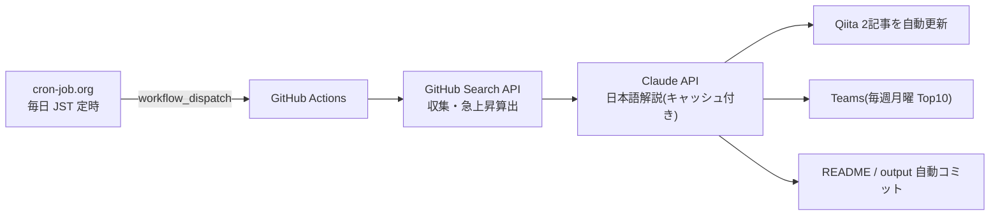

# Claude Code向けMCPツール候補ランキング

GitHub Search APIを使って、Claude Code周辺で活用候補になりそうなMCP関連リポジトリを定期収集するリポジトリです。

> 注意: この一覧は「Claude Codeでの動作」を保証するものではありません。  
> GitHub上のリポジトリ名・説明文・READMEなどに含まれる情報をもとに、MCP関連ツール候補を探すための入口として利用します。

## 仕組み(定常自律運転)

このランキングは cron-job.org → GitHub Actions → Claude API → Qiita / Teams のパイプラインで、毎日無人更新されています。



- 仕組みの詳細と**ライブ稼働ステータス**: [定常自律運転ページ](https://takanobusano.github.io/mcp-github-ranking/)
- 作り方の解説記事: [パイプライン編](https://qiita.com/4q_sano/items/913e93ee5cc2731561fc) / [cron-job.org 完全自動化編](https://qiita.com/4q_sano/items/1bc5e0669a8f0166936c)
<!-- MCP_REPOS_START -->
最終更新: **2026-10-20 08:17:11 JST**

MCP関連リポジトリに加え、Claude Code周辺で活用候補になりそうな関連ツールをGitHub Search APIで毎日自動収集してランキング化しています。

Stars / Forks の差分は、UTC基準の前日データ（2026-10-18）との差分です。
CSVには最大500件を保存し、本文では上位100件を表示しています。

> 注意: この一覧はClaude Codeでの動作を保証するものではありません。  
> MCP関連ツールまたはClaude Code関連ツール候補を探すための入口として利用してください。

# 注目MCP・関連ツール候補ランキング

## 1位 [public-apis/public-apis](https://github.com/public-apis/public-apis)

A collective list of free APIs

⭐ **490,499 Stars**（+413）　🍴 **54,493 Forks**（+84）　/　🟢 **2,241 Open Issues**　/　Python

Topics: `api` / `apis` / `dataset` / `development` / `free` / `list` / `lists` / `open-source`

## 2位 [openclaw/openclaw](https://github.com/openclaw/openclaw)

The AI that really does things. Any OS. Any Platform. The lobster way. 🦞

⭐ **392,557 Stars**（+162）　🍴 **82,530 Forks**（+44）　/　🟢 **9,586 Open Issues**　/　TypeScript

Topics: `ai` / `assistant` / `crustacean` / `molty` / `openclaw` / `own-your-data` / `personal`

## 3位 [morluto/rea](https://github.com/morluto/rea)

Reverse engineer anything with agents, from app behavior down to native binaries.

⭐ **336,271 Stars**（+14,572）　🍴 **84,940 Forks**（+3,414）　/　🟢 **1,259 Open Issues**　/　TypeScript

Topics: `agent-skills` / `ai-agents` / `binary-analysis` / `claude-code` / `cli` / `codex` / `cordis` / `decompiler`

## 4位 [obra/superpowers](https://github.com/obra/superpowers)

An agentic skills framework & software development methodology that works.

⭐ **302,117 Stars**（+478）　🍴 **26,974 Forks**（+40）　/　🟢 **383 Open Issues**　/　Shell

Topics: `ai` / `brainstorming` / `coding` / `obra` / `sdlc` / `skills` / `subagent-driven-development` / `superpowers`

## 5位 [mattpocock/skills](https://github.com/mattpocock/skills)

Skills for Real Engineers. Straight from my .agents directory.

⭐ **297,452 Stars**（+1,298）　🍴 **24,973 Forks**（+109）　/　🟢 **197 Open Issues**　/　Shell

Topics: `topicなし`

## 6位 [affaan-m/ECC](https://github.com/affaan-m/ECC)

The agent harness performance optimization system. Skills, instincts, memory, security, and research-first development for Claude Code, Codex, Opencode, Cursor and beyond.

⭐ **284,105 Stars**（+844）　🍴 **42,204 Forks**（+126）　/　🟢 **249 Open Issues**　/　JavaScript

Topics: `ai-agents` / `anthropic` / `claude` / `claude-code` / `developer-tools` / `llm` / `mcp` / `productivity`

## 7位 [NousResearch/hermes-agent](https://github.com/NousResearch/hermes-agent)

The agent that grows with you

⭐ **255,262 Stars**（+321）　🍴 **55,567 Forks**（+107）　/　🟢 **50,064 Open Issues**　/　Python

Topics: `ai` / `ai-agent` / `ai-agents` / `anthropic` / `chatgpt` / `claude` / `claude-code` / `codex`

## 8位 [multica-ai/andrej-karpathy-skills](https://github.com/multica-ai/andrej-karpathy-skills)

A single CLAUDE.md file to improve Claude Code behavior, derived from Andrej Karpathy's observations on LLM coding pitfalls.

⭐ **221,211 Stars**（+254）　🍴 **22,223 Forks**（+30）　/　🟢 **135 Open Issues**　/　不明

Topics: `topicなし`

## 9位 [ultraworkers/claw-code](https://github.com/ultraworkers/claw-code)

An agent-managed museum exhibit, built in Rust with Gajae-Code / LazyCodex — developed and maintained with no human intervention.

⭐ **194,905 Stars**（-7）　🍴 **107,881 Forks**（-31）　/　🟢 **1 Open Issues**　/　Rust

Topics: `topicなし`

## 10位 [firecrawl/firecrawl](https://github.com/firecrawl/firecrawl)

Supercharge your AI agents with data from the web and beyond. Building the library for superintelligence. 🔥

⭐ **193,092 Stars**（+328）　🍴 **10,195 Forks**（+13）　/　🟢 **627 Open Issues**　/　TypeScript

Topics: `ai` / `ai-agents` / `ai-crawler` / `ai-scraping` / `ai-search` / `crawler` / `data-extraction` / `html-to-markdown`

## 11位 [ollama/ollama](https://github.com/ollama/ollama)

Get up and running with Kimi, GLM, MiniMax, DeepSeek, gpt-oss, Qwen, Gemma and other models.

⭐ **183,868 Stars**（+125）　🍴 **18,414 Forks**（+20）　/　🟢 **4,360 Open Issues**　/　Go

Topics: `deepseek` / `gemma` / `gemma3` / `glm` / `go` / `golang` / `gpt-oss` / `llama`

## 12位 [anthropics/skills](https://github.com/anthropics/skills)

Public repository for Agent Skills

⭐ **182,224 Stars**（+235）　🍴 **21,586 Forks**（+24）　/　🟢 **1,422 Open Issues**　/　Python

Topics: `agent-skills`

## 13位 [DietrichGebert/ponytail](https://github.com/DietrichGebert/ponytail)

Makes your AI agent think like the laziest senior dev in the room. The best code is the code you never wrote.

⭐ **168,076 Stars**（+1,063）　🍴 **9,139 Forks**（+76）　/　🟢 **37 Open Issues**　/　JavaScript

Topics: `agent-skills` / `ai-agents` / `claude` / `claude-code` / `claude-code-plugin` / `cursor-rules` / `developer-tools` / `llm`

## 14位 [msitarzewski/agency-agents](https://github.com/msitarzewski/agency-agents)

A complete AI agency at your fingertips - From frontend wizards to Reddit community ninjas, from whimsy injectors to reality checkers. Each agent is a specialized expert with personality, processes, and proven deliverables.

⭐ **161,736 Stars**（+558）　🍴 **26,173 Forks**（+89）　/　🟢 **166 Open Issues**　/　Shell

Topics: `topicなし`

## 15位 [langgenius/dify](https://github.com/langgenius/dify)

Build Agentic workflows, RAG pipelines, with rich AI model and tool support on one collaborative workspace. Deploy on cloud, VPC, or self-hosted, so teams move from prototype to production without rebuilding the stack.

⭐ **158,927 Stars**（+118）　🍴 **25,118 Forks**（+19）　/　🟢 **1,143 Open Issues**　/　Python

Topics: `agent` / `agentic-ai` / `agentic-framework` / `agentic-workflow` / `ai` / `automation` / `claude` / `deepseek`

## 16位 [langflow-ai/langflow](https://github.com/langflow-ai/langflow)

Langflow is a powerful tool for building and deploying AI-powered agents and workflows.

⭐ **155,848 Stars**（+44）　🍴 **10,258 Forks**（+6）　/　🟢 **1,153 Open Issues**　/　Python

Topics: `agents` / `chatgpt` / `generative-ai` / `large-language-models` / `multiagent` / `react-flow`

## 17位 [anthropics/claude-code](https://github.com/anthropics/claude-code)

Claude Code is an agentic coding tool that lives in your terminal, understands your codebase, and helps you code faster by executing routine tasks, explaining complex code, and handling git workflows - all through natural language commands.

⭐ **152,625 Stars**（+374）　🍴 **27,136 Forks**（+127）　/　🟢 **15,321 Open Issues**　/　TypeScript

Topics: `topicなし`

## 18位 [farion1231/cc-switch](https://github.com/farion1231/cc-switch)

A cross-platform desktop All-in-One assistant for Claude Code, Codex, OpenCode, OpenClaw, Grok Build & Hermes Agent. Only official website: ccswitch.io

⭐ **146,338 Stars**（+503）　🍴 **9,668 Forks**（+21）　/　🟢 **1,484 Open Issues**　/　Rust

Topics: `ai-tools` / `claude-code` / `codex` / `desktop-app` / `grok` / `grokbuild` / `hermes` / `hermes-agent`

## 19位 [x1xhlol/system-prompts-and-models-of-ai-tools](https://github.com/x1xhlol/system-prompts-and-models-of-ai-tools)

FULL Augment Code, Claude Code, Cluely, CodeBuddy, Comet, Cursor, Devin AI, Junie, Kiro, Leap.new, Lovable, Manus, NotionAI, Orchids.app, Perplexity, Poke, Qoder, Replit, Same.dev, Trae, Traycer AI, VSCode Agent, Warp.dev, Windsurf, Xcode, Z.ai Code, Dia & v0. (And other Open Sourced) System Prompts, Internal Tools & AI Models

⭐ **144,104 Stars**（+17）　🍴 **34,725 Forks**（-8）　/　🟢 **162 Open Issues**　/　不明

Topics: `ai` / `bolt` / `cluely` / `copilot` / `cursor` / `cursorai` / `devin` / `github-copilot`

## 20位 [nextlevelbuilder/ui-ux-pro-max-skill](https://github.com/nextlevelbuilder/ui-ux-pro-max-skill)

An AI skill that provides design intelligence for building professional UI/UX across multiple platforms.

⭐ **137,608 Stars**（+383）　🍴 **14,612 Forks**（+31）　/　🟢 **91 Open Issues**　/　Python

Topics: `ai-skills` / `antigravity` / `claude` / `claude-code` / `codex` / `command-line` / `copilot` / `cursor-ai`

## 21位 [garrytan/gstack](https://github.com/garrytan/gstack)

Use Garry Tan's exact Claude Code setup: 23 opinionated tools that serve as CEO, Designer, Eng Manager, Release Manager, Doc Engineer, and QA

⭐ **136,960 Stars**（+112）　🍴 **20,319 Forks**（+9）　/　🟢 **68 Open Issues**　/　TypeScript

Topics: `topicなし`

## 22位 [harry0703/MoneyPrinterTurbo](https://github.com/harry0703/MoneyPrinterTurbo)

利用 AI 大模型和自动化工作流，根据主题或关键词一键生成高清短视频。Generate HD short videos from a topic or keyword with an automated AI workflow.

⭐ **133,161 Stars**（+387）　🍴 **21,037 Forks**（+72）　/　🟢 **91 Open Issues**　/　Python

Topics: `ai-video-generator` / `content-creation` / `ffmpeg` / `instagram-reels` / `llm` / `python` / `short-video` / `subtitles`

## 23位 [Graphify-Labs/graphify](https://github.com/Graphify-Labs/graphify)

Turn any codebase, with its docs, SQL schemas, configs, and PDFs, into a queryable knowledge graph. A /graphify skill for Claude Code, Cursor, Codex, and Gemini CLI: local deterministic AST parsing, every edge explained, no vector store.

⭐ **129,142 Stars**（+745）　🍴 **12,454 Forks**（+78）　/　🟢 **1,564 Open Issues**　/　Python

Topics: `ai-agents` / `antigravity` / `ast` / `claude-code` / `code-analysis` / `code-search` / `codex` / `cursor`

## 24位 [browser-use/browser-use](https://github.com/browser-use/browser-use)

Open-source Python library for AI browser agents, plus Browser Use Cloud: stealth browsers and a hosted agent API.

⭐ **118,543 Stars**（+132）　🍴 **13,157 Forks**（+16）　/　🟢 **561 Open Issues**　/　Python

Topics: `ai-agents` / `ai-tools` / `browser-agent` / `browser-automation` / `browser-use` / `cdp` / `cloud-browser` / `computer-use`

## 25位 [JuliusBrussee/caveman](https://github.com/JuliusBrussee/caveman)

🪨 why use many token when few token do trick. Viral skill + proxy for coding agents that cuts 65% of tokens by talking like a caveman.

⭐ **113,669 Stars**（+203）　🍴 **6,579 Forks**（+15）　/　🟢 **65 Open Issues**　/　Go

Topics: `ai` / `anthropic` / `caveman` / `claude` / `claude-code` / `llm` / `meme` / `prompt-engineering`

## 26位 [TauricResearch/TradingAgents](https://github.com/TauricResearch/TradingAgents)

TradingAgents: Multi-Agents LLM Financial Trading Framework

⭐ **112,113 Stars**（+204）　🍴 **21,667 Forks**（+51）　/　🟢 **103 Open Issues**　/　Python

Topics: `agent` / `finance` / `llm` / `multiagent` / `trading`

## 27位 [addyosmani/agent-skills](https://github.com/addyosmani/agent-skills)

Production-grade engineering skills for AI coding agents.

⭐ **108,612 Stars**（+426）　🍴 **11,324 Forks**（+50）　/　🟢 **146 Open Issues**　/　JavaScript

Topics: `agent-skills` / `antigravity` / `claude-code` / `codex` / `cursor` / `skills`

## 28位 [google-gemini/gemini-cli](https://github.com/google-gemini/gemini-cli)

An open-source AI agent that brings the power of Gemini directly into your terminal.

⭐ **107,458 Stars**（+18）　🍴 **14,746 Forks**（+10）　/　🟢 **751 Open Issues**　/　TypeScript

Topics: `ai` / `ai-agents` / `cli` / `gemini` / `gemini-api` / `mcp-client` / `mcp-server`

## 29位 [paperclipai/paperclip](https://github.com/paperclipai/paperclip)

The open-source app everyone uses to manage agents at work

⭐ **104,711 Stars**（+601）　🍴 **17,461 Forks**（+64）　/　🟢 **6,222 Open Issues**　/　TypeScript

Topics: `acpx` / `agent-orchestration` / `agent-skills` / `agentic-ai` / `ai-agents` / `ai-engineering` / `ai-governance` / `ai-tools`

## 30位 [nexu-io/open-design](https://github.com/nexu-io/open-design)

The 1st Collaborative AI Design Agent Workspace. Local-first and open source. Create motion, prototypes, websites, apps, dashboards, presentations, images, and videos with your team and AI agents. Share work, exchange feedback, and iterate together in one workspace.

⭐ **102,518 Stars**（+325）　🍴 **11,749 Forks**（+24）　/　🟢 **1,209 Open Issues**　/　TypeScript

Topics: `agent-skills` / `ai-design` / `byok` / `claude-code-for-design` / `claude-design` / `codex-design` / `cursor-design` / `deepseek`

## 31位 [thedotmack/claude-mem](https://github.com/thedotmack/claude-mem)

Persistent Context Across Sessions for Every Agent –  Captures everything your agent does during sessions, compresses it with AI, and injects relevant context back into future sessions. Works with Claude Code, OpenClaw, Codex, Gemini, Hermes, Copilot, OpenCode + More

⭐ **101,804 Stars**（+187）　🍴 **8,960 Forks**（+34）　/　🟢 **92 Open Issues**　/　TypeScript

Topics: `ai` / `ai-agents` / `ai-memory` / `anthropic` / `artificial-intelligence` / `chromadb` / `claude` / `claude-agent-sdk`

## 32位 [Panniantong/Agent-Reach](https://github.com/Panniantong/Agent-Reach)

Give your AI agent eyes to see the entire internet. Read & search Twitter, Reddit, YouTube, GitHub, Bilibili, XiaoHongShu — one CLI, zero API fees.

⭐ **99,669 Stars**（+618）　🍴 **8,805 Forks**（+78）　/　🟢 **230 Open Issues**　/　Python

Topics: `agent-infrastructure` / `ai-agent` / `ai-search` / `automation` / `bilibili` / `claude-code` / `cli` / `cursor`

## 33位 [Leonxlnx/taste-skill](https://github.com/Leonxlnx/taste-skill)

Agent skills that give coding agents taste: art direction, reference images and a browser check instead of generic AI pages

⭐ **99,342 Stars**（+504）　🍴 **6,759 Forks**（+43）　/　🟢 **2 Open Issues**　/　JavaScript

Topics: `agent-skills` / `ai-agents` / `anti-slop` / `claude-code` / `codex` / `cursor` / `design-system` / `frontend`

## 34位 [stablyai/orca](https://github.com/stablyai/orca)

Orca is the place for working with a fleet of agents (e.g. Grok Bot, Claude Code). Run any coding agent with your own subscription. Available on desktop, mobile and remote runtime.

⭐ **98,203 Stars**（+1,627）　🍴 **6,263 Forks**（+89）　/　🟢 **8,617 Open Issues**　/　TypeScript

Topics: `ade` / `agent-ide` / `ai-agents` / `automation` / `bot` / `claude-code` / `codex` / `ghostty`

## 35位 [microsoft/playwright](https://github.com/microsoft/playwright)

Playwright is a framework for Web Testing and Automation. It allows testing Chromium, Firefox and WebKit with a single API.

⭐ **98,100 Stars**（+85）　🍴 **6,657 Forks**（+13）　/　🟢 **191 Open Issues**　/　TypeScript

Topics: `automation` / `chrome` / `chromium` / `e2e-testing` / `electron` / `end-to-end-testing` / `firefox` / `javascript`

## 36位 [puppeteer/puppeteer](https://github.com/puppeteer/puppeteer)

JavaScript API for Chrome and Firefox

⭐ **95,726 Stars**（+7）　🍴 **9,601 Forks**（+4）　/　🟢 **265 Open Issues**　/　TypeScript

Topics: `automation` / `chrome` / `chromium` / `developer-tools` / `firefox` / `headless-chrome` / `node-module` / `testing`

## 37位 [OpenCut-app/OpenCut](https://github.com/OpenCut-app/OpenCut)

The open-source CapCut alternative

⭐ **95,384 Stars**（+146）　🍴 **9,404 Forks**（+23）　/　🟢 **383 Open Issues**　/　TypeScript

Topics: `editor` / `oss` / `videoeditor`

## 38位 [modelcontextprotocol/servers](https://github.com/modelcontextprotocol/servers)

Model Context Protocol Servers

⭐ **91,383 Stars**（+29）　🍴 **11,821 Forks**（+10）　/　🟢 **354 Open Issues**　/　TypeScript

Topics: `topicなし`

## 39位 [OpenHands/OpenHands](https://github.com/OpenHands/OpenHands)

🙌 OpenHands: AI-Driven Development

⭐ **91,306 Stars**（+94）　🍴 **12,119 Forks**（+12）　/　🟢 **1,078 Open Issues**　/　TypeScript

Topics: `agent` / `artificial-intelligence` / `chatgpt` / `claude-ai` / `cli` / `developer-tools` / `gpt` / `llm`

## 40位 [ChatGPTNextWeb/NextChat](https://github.com/ChatGPTNextWeb/NextChat)

✨ Zero-config AI chat assistant. No API key needed — sign up and instantly chat with GPT-5, Claude 4, Gemini 2.5, DeepSeek & 100+ top models. Pay-as-you-go save...

⭐ **88,873 Stars**（+12）　🍴 **58,775 Forks**（-9）　/　🟢 **855 Open Issues**　/　TypeScript

Topics: `calclaude` / `claude` / `cross-platform` / `desktop` / `fe` / `gemini` / `gemini-pro` / `gemini-server`

## 41位 [koala73/worldmonitor](https://github.com/koala73/worldmonitor)

Real-time global intelligence dashboard. AI-powered news aggregation, geopolitical monitoring, and infrastructure tracking in a unified situational awareness interface

⭐ **88,848 Stars**（+119）　🍴 **13,631 Forks**（+27）　/　🟢 **357 Open Issues**　/　TypeScript

Topics: `agent` / `ai` / `dashboard` / `geopolitics` / `mcp` / `mcp-server` / `monitoring` / `news`

## 42位 [D4Vinci/Scrapling](https://github.com/D4Vinci/Scrapling)

🕷️ A Web Scraping framework that handles everything from a single request to a full-scale crawl! Don't be shy, join here:  and follow here for daily tips and tricks:

⭐ **88,674 Stars**（+187）　🍴 **9,147 Forks**（+22）　/　🟢 **8 Open Issues**　/　Python

Topics: `ai` / `ai-scraping` / `automation` / `crawler` / `crawling` / `crawling-python` / `data` / `data-extraction`

## 43位 [Egonex-AI/Understand-Anything](https://github.com/Egonex-AI/Understand-Anything)

Graphs that teach > graphs that impress. Turn any code into an interactive knowledge graph you can explore, search, and ask questions about. Works with Claude Code, Codex, Cursor, Copilot, Gemini CLI, and more.

⭐ **87,021 Stars**（+133）　🍴 **7,343 Forks**（+19）　/　🟢 **330 Open Issues**　/　TypeScript

Topics: `antigravity-skills` / `business-knowledge` / `claude-code` / `claude-skills` / `codebase-analysis` / `codex` / `codex-skills` / `developer-tools-ai-agent`

## 44位 [unclecode/crawl4ai](https://github.com/unclecode/crawl4ai)

Open-source web crawler and scraper for LLMs and AI agents: any website into clean, LLM-ready Markdown. Run it yourself, or use Crawl4AI Cloud with one key.

⭐ **85,860 Stars**（+84）　🍴 **8,927 Forks**（+10）　/　🟢 **268 Open Issues**　/　Python

Topics: `ai` / `ai-agents` / `crawler` / `data-extraction` / `llm` / `markdown` / `mcp` / `open-source`

## 45位 [tt-a1i/archify](https://github.com/tt-a1i/archify)

Turn any idea, plan, or codebase into a beautiful interactive diagram. An agent skill for Claude Code, Codex, and more.

⭐ **85,840 Stars**（+446）　🍴 **5,843 Forks**（+47）　/　🟢 **258 Open Issues**　/　JavaScript

Topics: `agent-skills` / `ai-agents` / `architecture-diagram` / `claude-code` / `claude-skills` / `codex` / `coding-agents` / `deepseek-harness`

## 46位 [laravel/laravel](https://github.com/laravel/laravel)

Laravel is a web application framework with expressive, elegant syntax. We’ve already laid the foundation for your next big idea — freeing you to create without sweating the small things.

⭐ **85,256 Stars**（+76）　🍴 **28,036 Forks**（+91）　/　🟢 **32 Open Issues**　/　Blade

Topics: `framework` / `laravel` / `php`

## 47位 [bytedance/deer-flow](https://github.com/bytedance/deer-flow)

An open-source long-horizon SuperAgent harness that researches, codes, and creates. With the help of sandboxes, memories, tools, skill, subagents and message gateway, it handles different levels of tasks that could take minutes to hours.

⭐ **84,157 Stars**（+78）　🍴 **11,750 Forks**（+23）　/　🟢 **961 Open Issues**　/　Python

Topics: `agent` / `agentic` / `agentic-framework` / `agentic-workflow` / `ai` / `ai-agents` / `deep-research` / `harness`

## 48位 [rtk-ai/rtk](https://github.com/rtk-ai/rtk)

CLI proxy that reduces LLM token consumption by 60-90% on common dev commands. Single Rust binary, zero dependencies

⭐ **83,988 Stars**（+119）　🍴 **5,339 Forks**（+10）　/　🟢 **1,548 Open Issues**　/　Rust

Topics: `agentic-coding` / `ai-coding` / `anthropic` / `claude-code` / `cli` / `command-line-tool` / `cost-reduction` / `developer-tools`

## 49位 [lobehub/lobehub](https://github.com/lobehub/lobehub)

🤯 LobeHub is your Chief Agent Operator, organizing your agents into 7×24 operations by hiring, scheduling, and reporting on your entire AI team.

⭐ **83,339 Stars**（+29）　🍴 **16,001 Forks**（+5）　/　🟢 **1,125 Open Issues**　/　TypeScript

Topics: `agent` / `agent-collaboration` / `agent-harness` / `ai` / `cao` / `chatgpt` / `chief-agent-operator` / `claude`

## 50位 [pbakaus/impeccable](https://github.com/pbakaus/impeccable)

The design language that makes your AI harness better at design.

⭐ **83,203 Stars**（+494）　🍴 **5,032 Forks**（+41）　/　🟢 **49 Open Issues**　/　Rust

Topics: `topicなし`

## 51位 [abi/screenshot-to-code](https://github.com/abi/screenshot-to-code)

Drop in a screenshot and convert it to clean code (HTML/Tailwind/React/Vue)

⭐ **80,521 Stars**（+46）　🍴 **9,841 Forks**（+3）　/　🟢 **148 Open Issues**　/　Python

Topics: `topicなし`

## 52位 [shareAI-lab/learn-claude-code](https://github.com/shareAI-lab/learn-claude-code)

Bash is all you need -  A nano claude code–like 「agent harness」, built from 0 to 1

⭐ **78,837 Stars**（+50）　🍴 **12,616 Forks**（+13）　/　🟢 **70 Open Issues**　/　Python

Topics: `agent` / `agent-development` / `ai-agent` / `claude` / `claude-code` / `educational` / `llm` / `python`

## 53位 [diegosouzapw/OmniRoute](https://github.com/diegosouzapw/OmniRoute)

Never stop coding. Free MIT AI gateway: one endpoint, 375 providers (150+ free), 1,400+ models Kimi, Claude, GPT, Gemini, GLM, DeepSeek, MiniMax. Works with Claude Code, Codex, Cursor, OpenCode, Cline & Copilot. Quota-aware auto-fallback, RTK+Caveman compression saves 15-95% tokens, MCP/A2A, Desktop/PWA. Built by 900+ contributors

⭐ **78,538 Stars**（+404）　🍴 **11,416 Forks**（+75）　/　🟢 **292 Open Issues**　/　TypeScript

Topics: `a2a` / `ai-agents` / `ai-gateway` / `anthropic` / `claude` / `claude-code` / `cline` / `codex`

## 54位 [unslothai/unsloth](https://github.com/unslothai/unsloth)

Local UI to run and train LLMs and diffusion models. Supports GGUF, MLX, Qwen3.8, DeepSeek-V4, MiniMax-H3, Gemma 4, FLUX and more.

⭐ **78,274 Stars**（+45）　🍴 **7,243 Forks**（+7）　/　🟢 **317 Open Issues**　/　Python

Topics: `agent` / `ai` / `chatgpt` / `deepseek` / `fine-tuning` / `gemma` / `image-generation` / `llama`

## 55位 [debpalash/VoiceStudio](https://github.com/debpalash/VoiceStudio)

VoiceStudio is the open-source, fully-local ElevenLabs alternative — voice cloning, voice design, video dubbing, dictation, transcription & audiobook creation in 646 languages.

⭐ **77,442 Stars**（+2,205）　🍴 **8,481 Forks**（+246）　/　🟢 **250 Open Issues**　/　Python

Topics: `ai` / `audiobook` / `cuda` / `dubbing` / `elevenlabs-alternative` / `huggingface` / `local-first` / `mlx`

## 56位 [ruvnet/ruflo](https://github.com/ruvnet/ruflo)

🌊 The original agent harness. Deploy intelligent multi-player swarms, coordinate autonomous workflows, and build conversational AI systems. Features adaptive me...

⭐ **77,159 Stars**（+672）　🍴 **9,102 Forks**（+61）　/　🟢 **1,022 Open Issues**　/　TypeScript

Topics: `agentic-ai` / `agentic-framework` / `agentic-workflow` / `agents` / `ai-agents` / `ai-assistant` / `ai-skills` / `autonomous-agents`

## 57位 [headroomlabs-ai/headroom](https://github.com/headroomlabs-ai/headroom)

Compress tool outputs, logs, files, and RAG chunks before they reach the LLM. 20% fewer tokens for coding agents, 60-95% fewer tokens for JSON, same answers. Library, proxy, MCP server.

⭐ **76,212 Stars**（+315）　🍴 **5,923 Forks**（+23）　/　🟢 **484 Open Issues**　/　Python

Topics: `agent` / `ai` / `anthropic` / `claude-code` / `compression` / `context-engineering` / `context-window` / `cursor`

## 58位 [Eugeny/tabby](https://github.com/Eugeny/tabby)

A terminal for a more modern age

⭐ **75,032 Stars**（+12）　🍴 **4,294 Forks**（+4）　/　🟢 **2,842 Open Issues**　/　TypeScript

Topics: `serial` / `ssh-client` / `telnet-client` / `terminal` / `terminal-emulators`

## 59位 [thedaviddias/Front-End-Checklist](https://github.com/thedaviddias/Front-End-Checklist)

🗂 The essential checklist for modern web development, for humans and AI agents

⭐ **74,517 Stars**（+17）　🍴 **6,760 Forks**（±0）　/　🟢 **14 Open Issues**　/　MDX

Topics: `ai-agent` / `ai-agents` / `checklist` / `css` / `front-end-developer-tool` / `front-end-development` / `frontend` / `guidelines`

## 60位 [colbymchenry/codegraph](https://github.com/colbymchenry/codegraph)

Pre-indexed code knowledge graph, auto syncs on code changes, for Claude Code, Codex, Gemini, Cursor, OpenCode, AntiGravity, Kiro, CoPilot, and Hermes Agent — fewer tokens, fewer tool calls, 100% local

⭐ **74,461 Stars**（+75）　🍴 **4,818 Forks**（+9）　/　🟢 **625 Open Issues**　/　C

Topics: `topicなし`

## 61位 [openbq-org/OpenBB](https://github.com/openbq-org/OpenBB)

Open Data Platform for analysts, quants and AI agents.

⭐ **74,455 Stars**（+52）　🍴 **7,732 Forks**（+13）　/　🟢 **98 Open Issues**　/　Python

Topics: `ai` / `crypto` / `derivatives` / `economics` / `equity` / `finance` / `fixed-income` / `machine-learning`

## 62位 [rohitg00/ai-engineering-from-scratch](https://github.com/rohitg00/ai-engineering-from-scratch)

Learn AI Engineering! Learn it. Build it. Ship it for others.

⭐ **71,433 Stars**（+404）　🍴 **12,568 Forks**（+78）　/　🟢 **74 Open Issues**　/　Python

Topics: `agents` / `ai` / `ai-agents` / `ai-engineering` / `computer-vision` / `course` / `deep-learning` / `dsh`

## 63位 [cline/cline](https://github.com/cline/cline)

Autonomous coding agent as an SDK, IDE extension, or CLI assistant.

⭐ **70,567 Stars**（+52）　🍴 **7,708 Forks**（+5）　/　🟢 **1,690 Open Issues**　/　TypeScript

Topics: `topicなし`

## 64位 [code-yeongyu/oh-my-openagent](https://github.com/code-yeongyu/oh-my-openagent)

OmO: Just type "mass ulw" keyword with your prompt. Now you are the master of graph engineering.

⭐ **70,203 Stars**（+41）　🍴 **5,772 Forks**（±0）　/　🟢 **1,542 Open Issues**　/　TypeScript

Topics: `ai` / `ai-agents` / `anthropic` / `chatgpt` / `claude` / `claude-skills` / `codex` / `cursor`

## 65位 [usestrix/strix](https://github.com/usestrix/strix)

Open-source AI penetration testing tool to find and fix your app’s vulnerabilities.

⭐ **70,064 Stars**（+505）　🍴 **7,816 Forks**（+86）　/　🟢 **480 Open Issues**　/　Python

Topics: `agents` / `ai-hacking` / `ai-penetration-testing` / `ai-pentesting` / `ai-security` / `artificial-intelligence` / `bug-bounty` / `code-quality`

## 66位 [asgeirtj/system_prompts_leaks](https://github.com/asgeirtj/system_prompts_leaks)

Documented system prompts from Anthropic - Claude Fable 5.1, Opus 5.5, Claude Design, Claude Code. OpenAI - ChatGPT GPT-6-Astra, Codex. Google - Gemini 3.8 Flash, 3.1 Pro, Antigravity. xAI - Grok, Grok Bot, Cursor, Kimi and more! Updated regularly.

⭐ **69,918 Stars**（+58）　🍴 **11,359 Forks**（+8）　/　🟢 **60 Open Issues**　/　Python

Topics: `ai` / `ai-agents` / `ai-prompts` / `anthropic` / `chatbot` / `chatgpt` / `claude` / `claude-code`

## 67位 [calesthio/OpenMontage](https://github.com/calesthio/OpenMontage)

World's first open-source, agentic video production system. 12 production pipelines, 100+ tools, 700+ agent skill and production-knowledge files. Turn your AI coding assistant into a full video production studio.

⭐ **69,913 Stars**（+392）　🍴 **9,056 Forks**（+78）　/　🟢 **409 Open Issues**　/　Python

Topics: `agent` / `agentic-ai` / `ai` / `claude` / `copilot` / `cursor` / `elevenlabs` / `ffmpeg`

## 68位 [docling-project/docling](https://github.com/docling-project/docling)

Get your documents ready for gen AI

⭐ **69,130 Stars**（+68）　🍴 **5,111 Forks**（+6）　/　🟢 **885 Open Issues**　/　Python

Topics: `ai` / `convert` / `document-parser` / `document-parsing` / `documents` / `docx` / `html` / `markdown`

## 69位 [openinterpreter/openinterpreter](https://github.com/openinterpreter/openinterpreter)

A coding agent for open models like Kimi K3 and GLM 5.3

⭐ **68,607 Stars**（+2）　🍴 **5,908 Forks**（+4）　/　🟢 **16 Open Issues**　/　Rust

Topics: `acp` / `coding-agent` / `deepseek` / `kimi` / `python` / `qwen` / `rust`

## 70位 [storytold/photocraft](https://github.com/storytold/photocraft)

PhotoCraft: An open-source, photo editor written by scratch in pure Rust

⭐ **68,528 Stars**（+1,099）　🍴 **12,081 Forks**（+220）　/　🟢 **2,835 Open Issues**　/　Rust

Topics: `art` / `image-editing` / `image-editing-software` / `image-editor` / `images` / `photo-editing` / `rust`

## 71位 [shanraisshan/claude-code-best-practice](https://github.com/shanraisshan/claude-code-best-practice)

from vibe coding to agentic engineering - practice makes claude perfect

⭐ **67,773 Stars**（+68）　🍴 **6,748 Forks**（±0）　/　🟢 **24 Open Issues**　/　HTML

Topics: `agentic-ai` / `agentic-coding` / `agentic-engineering` / `agentic-workflow` / `ai` / `ai-agents` / `anthropic` / `best-practices`

## 72位 [heygen-com/hyperframes](https://github.com/heygen-com/hyperframes)

Write HTML. Render video. Built for agents.

⭐ **67,631 Stars**（+927）　🍴 **6,115 Forks**（+71）　/　🟢 **375 Open Issues**　/　TypeScript

Topics: `ai` / `animation` / `ffmpeg` / `framework` / `gsap` / `html` / `mcp` / `puppeteer`

## 73位 [mem0ai/mem0](https://github.com/mem0ai/mem0)

The Memory Layer for AI Agents - Drop-in memory infrastructure for AI agents and apps. Context that persists. Built for production.

⭐ **67,468 Stars**（+66）　🍴 **7,962 Forks**（+10）　/　🟢 **853 Open Issues**　/　Python

Topics: `agentic-memory` / `agentic-memory-system` / `agents` / `ai` / `ai-agents` / `chatgpt` / `genai` / `llm`

## 74位 [NanmiCoder/MediaCrawler](https://github.com/NanmiCoder/MediaCrawler)

小红书笔记 \| 评论爬虫、抖音视频 \| 评论爬虫、快手视频 \| 评论爬虫、B 站视频 ｜ 评论爬虫、微博帖子 ｜ 评论爬虫、百度贴吧帖子 ｜ 百度贴吧评论回复爬虫  \| 知乎问答文章｜评论爬虫

⭐ **67,222 Stars**（+100）　🍴 **12,840 Forks**（+16）　/　🟢 **217 Open Issues**　/　Python

Topics: `topicなし`

## 75位 [bradtraversy/design-resources-for-developers](https://github.com/bradtraversy/design-resources-for-developers)

Curated list of design and UI resources from stock photos, web templates, CSS frameworks, UI libraries, tools and much more

⭐ **67,214 Stars**（+5）　🍴 **12,273 Forks**（+2）　/　🟢 **1 Open Issues**　/　不明

Topics: `topicなし`

## 76位 [xtekky/gpt4free](https://github.com/xtekky/gpt4free)

The official gpt4free repository \| various collection of powerful language models \| opus 4.6 gpt 5.3 kimi 2.5 deepseek v3.2 gemini 3

⭐ **66,901 Stars**（+9）　🍴 **13,471 Forks**（+2）　/　🟢 **4 Open Issues**　/　Python

Topics: `chatbot` / `chatbots` / `chatgpt` / `chatgpt-4` / `chatgpt-api` / `chatgpt-free` / `chatgpt4` / `deepseek`

## 77位 [eternity4719/HowToLiveBetter](https://github.com/eternity4719/HowToLiveBetter)

高性价比人生指南: 长寿防病、急救、省钱理财、法律红线、失业与工伤、医保社保、恋爱婚育、怀孕育儿、创业与做平台合规、出国与技能。每条写明成本、收益、证据等级和原始出处，只引期刊论文与官方文件。

⭐ **66,366 Stars**（+601）　🍴 **5,689 Forks**（+71）　/　🟢 **19 Open Issues**　/　HTML

Topics: `topicなし`

## 78位 [warpdotdev/warp](https://github.com/warpdotdev/warp)

Warp is an agentic development environment, born out of the terminal.

⭐ **65,553 Stars**（+39）　🍴 **5,664 Forks**（+11）　/　🟢 **5,443 Open Issues**　/　Rust

Topics: `bash` / `linux` / `macos` / `rust` / `shell` / `terminal` / `wasm` / `zsh`

## 79位 [mvanhorn/last30days-skill](https://github.com/mvanhorn/last30days-skill)

AI agent skill that researches any topic across Reddit, X, YouTube, HN, Polymarket, and the web - then synthesizes a grounded summary

⭐ **64,776 Stars**（+109）　🍴 **5,656 Forks**（+14）　/　🟢 **29 Open Issues**　/　Python

Topics: `ai-prompts` / `ai-skill` / `bluesky` / `claude` / `claude-code` / `clawhub` / `deep-research` / `hackernews`

## 80位 [usememos/memos](https://github.com/usememos/memos)

Memos is an open-source, self-hosted note-taking app that brings your everyday thoughts together in a personal timeline. Your data stays yours, and you choose what to keep private or share.

⭐ **63,924 Stars**（+28）　🍴 **4,869 Forks**（+2）　/　🟢 **90 Open Issues**　/　Go

Topics: `docker` / `foss` / `go` / `markdown` / `memo` / `microblog` / `note-taking` / `notes`

## 81位 [hugohe3/ppt-master](https://github.com/hugohe3/ppt-master)

AI turns documents or topics into real, native PowerPoint decks—with native shapes, transitions and animations, data-backed charts and tables on demand, audio narration from speaker notes, and support for your own .pptx templates. · by Hugo He

⭐ **63,867 Stars**（+409）　🍴 **5,049 Forks**（+31）　/　🟢 **1 Open Issues**　/　Python

Topics: `ai-agent` / `aippt` / `office` / `powerpoint` / `powerpoint-generation` / `ppt` / `pptx` / `presentation`

## 82位 [upstash/context7](https://github.com/upstash/context7)

Context7 Platform -- Up-to-date docs for AI agents

⭐ **63,325 Stars**（+69）　🍴 **3,118 Forks**（+7）　/　🟢 **51 Open Issues**　/　TypeScript

Topics: `llm` / `mcp` / `mcp-server` / `vibe-coding`

## 83位 [coollabsio/coolify](https://github.com/coollabsio/coolify)

An open-source, self-hostable PaaS alternative to Vercel, Heroku & Netlify that lets you easily deploy static sites, databases, full-stack applications and 360+ one-click services on your own servers.

⭐ **63,232 Stars**（+79）　🍴 **5,693 Forks**（+7）　/　🟢 **438 Open Issues**　/　PHP

Topics: `coolify` / `databases` / `deployment` / `docker` / `docker-compose` / `inertiajs` / `laravel` / `mariadb`

## 84位 [sansan0/TrendRadar](https://github.com/sansan0/TrendRadar)

⭐AI-driven public opinion & trend monitor with multi-platform aggregation, RSS, and smart alerts.🎯 告别信息过载，你的 AI 舆情监控助手与热点筛选工具！聚合多平台热点 +  RSS 订阅，支持关键词精准筛选。AI 智能筛...

⭐ **63,029 Stars**（+27）　🍴 **24,909 Forks**（+2）　/　🟢 **32 Open Issues**　/　Python

Topics: `ai` / `bark` / `data-analysis` / `docker` / `hot-news` / `llm` / `mail` / `mcp`

## 85位 [tw93/Pake](https://github.com/tw93/Pake)

Turn any website into a lightweight desktop app with one command, on macOS, Windows and Linux.

⭐ **62,194 Stars**（+20）　🍴 **12,792 Forks**（+5）　/　🟢 **2 Open Issues**　/　Rust

Topics: `chatgpt` / `claude` / `cli` / `desktop` / `desktop-app` / `electron-alternative` / `gemini` / `linux`

## 86位 [Alishahryar1/free-claude-code](https://github.com/Alishahryar1/free-claude-code)

Use Claude Code, Codex, VSCode, Pi, and OpenCode (and 6 other harnesses) for free (1.3B+ free tokens) from your terminal, app, IDE, or phone, and now from the browser with native browser sessions (multi-harness + multi-model) like OpenClaw (voice supported + ToS friendly)

⭐ **61,910 Stars**（+388）　🍴 **9,727 Forks**（+77）　/　🟢 **299 Open Issues**　/　Python

Topics: `topicなし`

## 87位 [1c7/chinese-independent-developer](https://github.com/1c7/chinese-independent-developer)

👩🏿‍💻👨🏾‍💻👩🏼‍💻👨🏽‍💻👩🏻‍💻中国独立开发者项目列表 -- 分享大家都在做什么

⭐ **61,858 Stars**（+15）　🍴 **5,492 Forks**（+6）　/　🟢 **3 Open Issues**　/　不明

Topics: `china` / `indie` / `indie-developer`

## 88位 [BerriAI/litellm](https://github.com/BerriAI/litellm)

The fastest, litest AI Gateway. Rust core with Python SDK. Call 100+ LLM APIs in OpenAI (or native) format with cost tracking, guardrails, load balancing, and logging [Bedrock, Azure, OpenAI, Anthropic, OpenAI, VertexAI, vLLM, Nvidia NIM]

⭐ **61,584 Stars**（+80）　🍴 **12,485 Forks**（+29）　/　🟢 **5,559 Open Issues**　/　Python

Topics: `ai-gateway` / `anthropic` / `azure-openai` / `bedrock` / `gateway` / `langchain` / `litellm` / `llm`

## 89位 [microsoft/autogen](https://github.com/microsoft/autogen)

A programming framework for agentic AI

⭐ **61,490 Stars**（+25）　🍴 **9,298 Forks**（+3）　/　🟢 **1,121 Open Issues**　/　Python

Topics: `agentic` / `agentic-agi` / `agents` / `ai` / `autogen` / `autogen-ecosystem` / `chatgpt` / `framework`

## 90位 [penpot/penpot](https://github.com/penpot/penpot)

Penpot: The open-source design platform for Product teams that need scalable collaboration.

⭐ **61,385 Stars**（+50）　🍴 **4,254 Forks**（+5）　/　🟢 **845 Open Issues**　/　Clojure

Topics: `clojure` / `clojurescript` / `design` / `prototyping` / `ui` / `ux-design` / `ux-experience`

## 91位 [crewAIInc/crewAI](https://github.com/crewAIInc/crewAI)

Framework for orchestrating role-playing, autonomous AI agents. By fostering collaborative intelligence, CrewAI empowers agents to work together seamlessly, tackling complex tasks.

⭐ **59,883 Stars**（+45）　🍴 **8,799 Forks**（+25）　/　🟢 **766 Open Issues**　/　Python

Topics: `agents` / `ai` / `ai-agents` / `aiagentframework` / `llms`

## 92位 [MemPalace/mempalace](https://github.com/MemPalace/mempalace)

The best-benchmarked open-source AI memory system. And it's free.

⭐ **59,646 Stars**（+21）　🍴 **7,566 Forks**（+4）　/　🟢 **823 Open Issues**　/　Python

Topics: `ai` / `chromadb` / `llm` / `mcp` / `memory` / `python`

## 93位 [meilisearch/meilisearch](https://github.com/meilisearch/meilisearch)

A lightning-fast search engine API bringing AI-powered hybrid search to your sites and applications.

⭐ **59,612 Stars**（+14）　🍴 **2,748 Forks**（+4）　/　🟢 **322 Open Issues**　/　Rust

Topics: `ai` / `api` / `app-search` / `database` / `enterprise-search` / `faceting` / `full-text-search` / `fuzzy-search`

## 94位 [pathwaycom/serviette](https://github.com/pathwaycom/serviette)

A no-code RAG server that keeps answers in sync with your documents. Works with 8 vector databases. Built on Pathway.

⭐ **58,787 Stars**（-4）　🍴 **1,512 Forks**（±0）　/　🟢 **8 Open Issues**　/　Python

Topics: `chromadb` / `document-qa` / `document-search` / `duckdb` / `live-data` / `llm` / `milvus` / `mongodb`

## 95位 [FoundationAgents/OpenManus](https://github.com/FoundationAgents/OpenManus)

No fortress, purely open ground.  OpenManus is Coming.

⭐ **58,735 Stars**（+24）　🍴 **10,184 Forks**（+3）　/　🟢 **442 Open Issues**　/　Python

Topics: `topicなし`

## 96位 [twentyhq/twenty](https://github.com/twentyhq/twenty)

The open alternative to Salesforce, designed for AI.

⭐ **58,586 Stars**（+83）　🍴 **9,600 Forks**（+12）　/　🟢 **106 Open Issues**　/　TypeScript

Topics: `crm` / `crm-system` / `customer` / `good-first-issue` / `graphql` / `hacktoberfest` / `javascript` / `marketing`

## 97位 [blader/humanizer](https://github.com/blader/humanizer)

Agent skill that removes signs of AI-generated writing from text

⭐ **58,497 Stars**（+410）　🍴 **4,635 Forks**（+31）　/　🟢 **7 Open Issues**　/　Python

Topics: `agent-skills` / `ai-humanizer` / `ai-writing` / `chatgpt` / `claude` / `claude-code` / `codex` / `cursor`

## 98位 [cathrynlavery/diagram-design](https://github.com/cathrynlavery/diagram-design)

Editorial diagram design for Claude Code, Codex, GitHub Copilot, Cursor, Factory Droid, and Pi. 44 diagram types. Self-contained HTML + SVG. No shadows. No Mermaid slop.

⭐ **58,373 Stars**（+714）　🍴 **3,751 Forks**（+63）　/　🟢 **44 Open Issues**　/　HTML

Topics: `agent-skills` / `claude-code` / `codex` / `data-visualization` / `diagrams` / `drawio` / `mermaid` / `svg`

## 99位 [bilawalsidhu/gods-eye-view](https://github.com/bilawalsidhu/gods-eye-view)

A spy satellite simulator in your browser, except the data is real. Live open source spatial intelligence on a photorealistic 3D globe.

⭐ **58,269 Stars**（+326）　🍴 **11,359 Forks**（+60）　/　🟢 **389 Open Issues**　/　JavaScript

Topics: `3d-globe` / `cesium` / `flight-tracking` / `geospatial` / `geospatial-intelligence` / `gis` / `osint` / `photogrammetry`

## 100位 [jamiepine/voicebox](https://github.com/jamiepine/voicebox)

The open-source AI voice studio. Clone, dictate, create.

⭐ **58,028 Stars**（+86）　🍴 **7,275 Forks**（+12）　/　🟢 **515 Open Issues**　/　Python

Topics: `ai` / `cuda` / `mlx` / `qwen3-tts` / `qwen3-tts-ui` / `voice-ai` / `voice-clone` / `whisper`

# 最近プッシュされたMCP・関連ツール候補

スター数ランキングとは別に、最近コードがプッシュされたリポジトリを表示します。古いスター数だけではなく、現在も開発が動いていそうな候補を探すための一覧です。

## プッシュ順 1位 [mksglu/context-mode](https://github.com/mksglu/context-mode)

Context window optimization for AI coding agents. Sandboxes tool output (98% reduction), persists session memory, and   enforces routing across 17 platforms via MCP + hooks.

⭐ **31,062 Stars**（+322）　🍴 **2,335 Forks**（+59）　/　TypeScript　/　最終プッシュ: 2026-10-19

Topics: `antigravity` / `claude` / `claude-code` / `claude-code-hooks` / `claude-code-plugins` / `claude-code-skill` / `codex` / `codex-cli`

## プッシュ順 2位 [openclaw/openclaw](https://github.com/openclaw/openclaw)

The AI that really does things. Any OS. Any Platform. The lobster way. 🦞

⭐ **392,557 Stars**（+162）　🍴 **82,530 Forks**（+44）　/　TypeScript　/　最終プッシュ: 2026-10-19

Topics: `ai` / `assistant` / `crustacean` / `molty` / `openclaw` / `own-your-data` / `personal`

## プッシュ順 3位 [onyx-dot-app/onyx](https://github.com/onyx-dot-app/onyx)

Open Source AI Platform - AI Chat with advanced features that works with every LLM

⭐ **32,592 Stars**（+29）　🍴 **4,585 Forks**（+7）　/　Python　/　最終プッシュ: 2026-10-19

Topics: `ai` / `ai-chat` / `chatgpt` / `chatui` / `enterprise-search` / `gen-ai` / `information-retrieval` / `llm`

## プッシュ順 4位 [QwenLM/qwen-code](https://github.com/QwenLM/qwen-code)

An open-source AI coding agent that lives in your terminal.

⭐ **28,586 Stars**（+21）　🍴 **3,229 Forks**（+9）　/　TypeScript　/　最終プッシュ: 2026-10-19

Topics: `agentic` / `ai` / `ai-agent` / `ai-coding` / `cli` / `coding-agent` / `developer-tools` / `llm`

## プッシュ順 5位 [pingdotgg/t3code](https://github.com/pingdotgg/t3code)

説明なし

⭐ **28,626 Stars**（+275）　🍴 **7,662 Forks**（+94）　/　TypeScript　/　最終プッシュ: 2026-10-19

Topics: `topicなし`

## プッシュ順 6位 [different-ai/openwork](https://github.com/different-ai/openwork)

The open-source alternative to Claude Cowork (powered by opencode)

⭐ **24,188 Stars**（+18）　🍴 **2,450 Forks**（±0）　/　TypeScript　/　最終プッシュ: 2026-10-19

Topics: `topicなし`

## プッシュ順 7位 [PostHog/posthog](https://github.com/PostHog/posthog)

:hedgehog: PostHog is the leading platform for building self-driving products. Our developer tools – AI observability, analytics, session replay, flags, experiments, error tracking, logs, and more – capture all the context agents need to diagnose problems, uncover opportunities, and ship fixes. Steer it all from Slack, web, desktop, or the MCP.

⭐ **40,350 Stars**（+15）　🍴 **3,530 Forks**（+7）　/　Python　/　最終プッシュ: 2026-10-19

Topics: `ab-testing` / `ai-analytics` / `analytics` / `cdp` / `data-warehouse` / `experiments` / `feature-flags` / `javascript`

## プッシュ順 8位 [kortix-ai/suna](https://github.com/kortix-ai/suna)

The open-source AI Operating System

⭐ **20,287 Stars**（+6）　🍴 **3,440 Forks**（+1）　/　TypeScript　/　最終プッシュ: 2026-10-19

Topics: `ai` / `ai-agents` / `ai-operating-system` / `ai-os` / `llm` / `open-source` / `self-hosted`

## プッシュ順 9位 [yc-software/qm](https://github.com/yc-software/qm)

Multiplayer agent harness for work.

⭐ **15,450 Stars**（+8）　🍴 **1,913 Forks**（±0）　/　TypeScript　/　最終プッシュ: 2026-10-19

Topics: `ai` / `assistant` / `harness` / `qm`

## プッシュ順 10位 [manaflow-ai/cmux](https://github.com/manaflow-ai/cmux)

Open source Ghostty-based macOS terminal with vertical tabs and notifications for AI coding agents. Built for multitasking, organization, and programmability.

⭐ **28,287 Stars**（+42）　🍴 **2,547 Forks**（+14）　/　Swift　/　最終プッシュ: 2026-10-19

Topics: `amp` / `claude-code` / `cli` / `codex` / `coding-agents` / `gemini` / `ghostty` / `macos`

## プッシュ順 11位 [simstudioai/sim](https://github.com/simstudioai/sim)

Sim is the collaborative workspace to build, deploy, and monitor AI agents and workflows. Used by 100,000+ builders.

⭐ **29,845 Stars**（前日なし）　🍴 **3,863 Forks**（前日なし）　/　TypeScript　/　最終プッシュ: 2026-10-19

Topics: `agent-workflow` / `agentic-workflow` / `agents` / `ai` / `aiagents` / `anthropic` / `artificial-intelligence` / `automation`

## プッシュ順 12位 [heygen-com/hyperframes](https://github.com/heygen-com/hyperframes)

Write HTML. Render video. Built for agents.

⭐ **67,631 Stars**（+927）　🍴 **6,115 Forks**（+71）　/　TypeScript　/　最終プッシュ: 2026-10-19

Topics: `ai` / `animation` / `ffmpeg` / `framework` / `gsap` / `html` / `mcp` / `puppeteer`

## プッシュ順 13位 [code-yeongyu/oh-my-openagent](https://github.com/code-yeongyu/oh-my-openagent)

OmO: Just type "mass ulw" keyword with your prompt. Now you are the master of graph engineering.

⭐ **70,203 Stars**（+41）　🍴 **5,772 Forks**（±0）　/　TypeScript　/　最終プッシュ: 2026-10-19

Topics: `ai` / `ai-agents` / `anthropic` / `chatgpt` / `claude` / `claude-skills` / `codex` / `cursor`

## プッシュ順 14位 [tinyhumansai/openhuman](https://github.com/tinyhumansai/openhuman)

The fastest, cheapest, most efficient open-source agent harness. Run more than 500 agents on a $10 VPS.

⭐ **42,162 Stars**（+15）　🍴 **4,164 Forks**（+6）　/　Rust　/　最終プッシュ: 2026-10-19

Topics: `agent-orchestration` / `ai-agents` / `ai-assistant` / `desktop` / `llm` / `local-first` / `mcp` / `personal-ai`

## プッシュ順 15位 [firecrawl/firecrawl](https://github.com/firecrawl/firecrawl)

Supercharge your AI agents with data from the web and beyond. Building the library for superintelligence. 🔥

⭐ **193,092 Stars**（+328）　🍴 **10,195 Forks**（+13）　/　TypeScript　/　最終プッシュ: 2026-10-19

Topics: `ai` / `ai-agents` / `ai-crawler` / `ai-scraping` / `ai-search` / `crawler` / `data-extraction` / `html-to-markdown`

## プッシュ順 16位 [cline/cline](https://github.com/cline/cline)

Autonomous coding agent as an SDK, IDE extension, or CLI assistant.

⭐ **70,567 Stars**（+52）　🍴 **7,708 Forks**（+5）　/　TypeScript　/　最終プッシュ: 2026-10-19

Topics: `topicなし`

## プッシュ順 17位 [Kilo-Org/kilocode](https://github.com/Kilo-Org/kilocode)

Kilo is the all-in-one agentic engineering platform. Build, ship, and iterate faster with the most popular open source coding agent.

⭐ **27,663 Stars**（+9）　🍴 **3,279 Forks**（+5）　/　TypeScript　/　最終プッシュ: 2026-10-19

Topics: `ai` / `ai-age` / `ai-coding` / `ai-developer-tools` / `chatgpt` / `claude` / `cli` / `gemini`

## プッシュ順 18位 [mastra-ai/mastra](https://github.com/mastra-ai/mastra)

Mastra is the modern TypeScript framework for AI-powered applications and agents.

⭐ **28,921 Stars**（+29）　🍴 **3,018 Forks**（+15）　/　TypeScript　/　最終プッシュ: 2026-10-19

Topics: `agents` / `ai` / `chatbots` / `evals` / `javascript` / `llm` / `mcp` / `nextjs`

## プッシュ順 19位 [stablyai/orca](https://github.com/stablyai/orca)

Orca is the place for working with a fleet of agents (e.g. Grok Bot, Claude Code). Run any coding agent with your own subscription. Available on desktop, mobile and remote runtime.

⭐ **98,203 Stars**（+1,627）　🍴 **6,263 Forks**（+89）　/　TypeScript　/　最終プッシュ: 2026-10-19

Topics: `ade` / `agent-ide` / `ai-agents` / `automation` / `bot` / `claude-code` / `codex` / `ghostty`

## プッシュ順 20位 [NVIDIA/NemoClaw](https://github.com/NVIDIA/NemoClaw)

Run agents like Hermes, LangChain Deep Agents, and OpenClaw more securely inside NVIDIA OpenShell with managed inference

⭐ **22,771 Stars**（+6）　🍴 **3,147 Forks**（±0）　/　TypeScript　/　最終プッシュ: 2026-10-19

Topics: `ai-agents` / `deep-agents` / `hermes` / `nvidia` / `openclaw` / `openshell` / `sandboxing` / `typescript`

## プッシュ順 21位 [BerriAI/litellm](https://github.com/BerriAI/litellm)

The fastest, litest AI Gateway. Rust core with Python SDK. Call 100+ LLM APIs in OpenAI (or native) format with cost tracking, guardrails, load balancing, and logging [Bedrock, Azure, OpenAI, Anthropic, OpenAI, VertexAI, vLLM, Nvidia NIM]

⭐ **61,584 Stars**（+80）　🍴 **12,485 Forks**（+29）　/　Python　/　最終プッシュ: 2026-10-19

Topics: `ai-gateway` / `anthropic` / `azure-openai` / `bedrock` / `gateway` / `langchain` / `litellm` / `llm`

## プッシュ順 22位 [unslothai/unsloth](https://github.com/unslothai/unsloth)

Local UI to run and train LLMs and diffusion models. Supports GGUF, MLX, Qwen3.8, DeepSeek-V4, MiniMax-H3, Gemma 4, FLUX and more.

⭐ **78,274 Stars**（+45）　🍴 **7,243 Forks**（+7）　/　Python　/　最終プッシュ: 2026-10-19

Topics: `agent` / `ai` / `chatgpt` / `deepseek` / `fine-tuning` / `gemma` / `image-generation` / `llama`

## プッシュ順 23位 [pydantic/pydantic-ai](https://github.com/pydantic/pydantic-ai)

How Python does AI. Agents, realtime voice, image generation, embeddings. Every model, every interface, typed end to end.

⭐ **20,736 Stars**（+22）　🍴 **2,963 Forks**（+18）　/　Python　/　最終プッシュ: 2026-10-19

Topics: `agent-framework` / `genai` / `harness` / `harness-engineering` / `llm` / `pydantic` / `python`

## プッシュ順 24位 [block/buzz](https://github.com/block/buzz)

A hive mind communication platform

⭐ **36,162 Stars**（+36）　🍴 **4,795 Forks**（+8）　/　Rust　/　最終プッシュ: 2026-10-19

Topics: `topicなし`

## プッシュ順 25位 [twentyhq/twenty](https://github.com/twentyhq/twenty)

The open alternative to Salesforce, designed for AI.

⭐ **58,586 Stars**（+83）　🍴 **9,600 Forks**（+12）　/　TypeScript　/　最終プッシュ: 2026-10-19

Topics: `crm` / `crm-system` / `customer` / `good-first-issue` / `graphql` / `hacktoberfest` / `javascript` / `marketing`

## プッシュ順 26位 [coder/coder](https://github.com/coder/coder)

Secure environments for developers and their agents

⭐ **17,108 Stars**（+18）　🍴 **1,636 Forks**（+1）　/　Go　/　最終プッシュ: 2026-10-19

Topics: `agents` / `dev-tools` / `development-environment` / `go` / `golang` / `ide` / `jetbrains` / `remote-development`

## プッシュ順 27位 [sgl-project/sglang](https://github.com/sgl-project/sglang)

SGLang is a high-performance serving framework for large language models and multimodal models.

⭐ **37,446 Stars**（+163）　🍴 **9,699 Forks**（+29）　/　Python　/　最終プッシュ: 2026-10-19

Topics: `attention` / `blackwell` / `cuda` / `deepseek` / `diffusion` / `glm` / `gpt-oss` / `inference`

## プッシュ順 28位 [bilawalsidhu/gods-eye-view](https://github.com/bilawalsidhu/gods-eye-view)

A spy satellite simulator in your browser, except the data is real. Live open source spatial intelligence on a photorealistic 3D globe.

⭐ **58,269 Stars**（+326）　🍴 **11,359 Forks**（+60）　/　JavaScript　/　最終プッシュ: 2026-10-19

Topics: `3d-globe` / `cesium` / `flight-tracking` / `geospatial` / `geospatial-intelligence` / `gis` / `osint` / `photogrammetry`

## プッシュ順 29位 [coleam00/Archon](https://github.com/coleam00/Archon)

The first open-source harness builder for AI coding. Make AI coding deterministic and repeatable.

⭐ **23,727 Stars**（+15）　🍴 **3,596 Forks**（+21）　/　TypeScript　/　最終プッシュ: 2026-10-19

Topics: `ai` / `automation` / `bun` / `claude` / `cli` / `coding-assistant` / `developer-tools` / `typescript`

## プッシュ順 30位 [marimo-team/marimo](https://github.com/marimo-team/marimo)

A reactive notebook for Python — run reproducible experiments, query with SQL, execute as a script, deploy as an app, and version with git. Stored as pure Python. All in a modern, AI-native editor.

⭐ **23,242 Stars**（+8）　🍴 **1,347 Forks**（+4）　/　Python　/　最終プッシュ: 2026-10-19

Topics: `artificial-intelligence` / `dag` / `data-science` / `data-visualization` / `dataflow` / `developer-tools` / `machine-learning` / `notebooks`

# 検索条件

以下の検索条件でGitHubリポジトリを収集しています。

- "model context protocol" in:name,description,readme stars:>10
- "mcp server" in:name,description,readme stars:>10
- "mcp" "claude" in:name,description,readme stars:>10
- "claude" "mcp" in:name,description,readme stars:>10
- "modelcontextprotocol" in:name,description,readme stars:>10
- "claude code" in:name,description,readme stars:>10
- "claude" "plugin" in:name,description,readme stars:>10
- "claude" "memory" in:name,description,readme stars:>10

<!-- MCP_REPOS_END -->

## 仕組み

```text
GitHub Search API
  ↓
MCP / Claude Code / Model Context Protocol 関連リポジトリを検索
  ↓
スター数・更新日・Fork数・説明文を取得
  ↓
Markdown / CSV を生成
  ↓
GitHub Actionsで毎日自動実行
  ↓
READMEを自動更新
