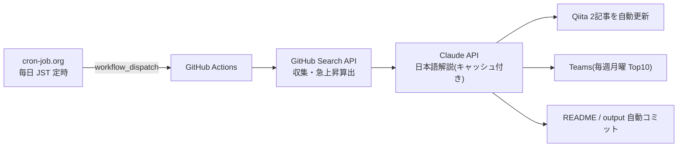

# Claude Code向けMCPツール候補ランキング

GitHub Search APIを使って、Claude Code周辺で活用候補になりそうなMCP関連リポジトリを定期収集するリポジトリです。

> 注意: この一覧は「Claude Codeでの動作」を保証するものではありません。  
> GitHub上のリポジトリ名・説明文・READMEなどに含まれる情報をもとに、MCP関連ツール候補を探すための入口として利用します。

## 仕組み(定常自律運転)

このランキングは cron-job.org → GitHub Actions → Claude API → Qiita / Teams のパイプラインで、毎日無人更新されています。



- 仕組みの詳細と**ライブ稼働ステータス**: [定常自律運転ページ](https://takanobusano.github.io/mcp-github-ranking/)
- 作り方の解説記事: [パイプライン編](https://qiita.com/4q_sano/items/913e93ee5cc2731561fc) / [cron-job.org 完全自動化編](https://qiita.com/4q_sano/items/1bc5e0669a8f0166936c)
<!-- MCP_REPOS_START -->
最終更新: **2026-11-26 08:17:16 JST**

MCP関連リポジトリに加え、Claude Code周辺で活用候補になりそうな関連ツールをGitHub Search APIで毎日自動収集してランキング化しています。

Stars / Forks の差分は、UTC基準の前日データ（2026-11-24）との差分です。
CSVには最大500件を保存し、本文では上位100件を表示しています。

> 注意: この一覧はClaude Codeでの動作を保証するものではありません。  
> MCP関連ツールまたはClaude Code関連ツール候補を探すための入口として利用してください。

# 注目MCP・関連ツール候補ランキング

## 1位 [public-apis/public-apis](https://github.com/public-apis/public-apis)

A collective list of free APIs

⭐ **501,443 Stars**（前日なし）　🍴 **56,398 Forks**（前日なし）　/　🟢 **2,964 Open Issues**　/　Python

Topics: `api` / `apis` / `dataset` / `development` / `free` / `list` / `lists` / `open-source`

## 2位 [morluto/rea](https://github.com/morluto/rea)

Reverse engineer anything with agents, from app behavior down to native binaries.

⭐ **478,417 Stars**（前日なし）　🍴 **116,370 Forks**（前日なし）　/　🟢 **1,183 Open Issues**　/　TypeScript

Topics: `agent-skills` / `ai` / `android` / `claude-code` / `cli` / `cpp` / `dsh-plugin` / `html`

## 3位 [openclaw/openclaw](https://github.com/openclaw/openclaw)

The AI that really does things. Any OS. Any Platform. The lobster way. 🦞

⭐ **395,218 Stars**（前日なし）　🍴 **82,975 Forks**（前日なし）　/　🟢 **9,194 Open Issues**　/　TypeScript

Topics: `ai` / `assistant` / `crustacean` / `molty` / `openclaw` / `own-your-data` / `personal`

## 4位 [mattpocock/skills](https://github.com/mattpocock/skills)

Skills for Real Engineers. Straight from my .agents directory.

⭐ **332,857 Stars**（前日なし）　🍴 **27,993 Forks**（前日なし）　/　🟢 **251 Open Issues**　/　Shell

Topics: `topicなし`

## 5位 [obra/superpowers](https://github.com/obra/superpowers)

An agentic skills framework & software development methodology that works.

⭐ **326,581 Stars**（前日なし）　🍴 **28,979 Forks**（前日なし）　/　🟢 **372 Open Issues**　/　Shell

Topics: `ai` / `brainstorming` / `coding` / `obra` / `sdlc` / `skills` / `subagent-driven-development` / `superpowers`

## 6位 [affaan-m/ECC](https://github.com/affaan-m/ECC)

The agent harness performance optimization system. Skills, instincts, memory, security, and research-first development for Claude Code, Codex, Opencode, Cursor and beyond.

⭐ **310,709 Stars**（前日なし）　🍴 **45,649 Forks**（前日なし）　/　🟢 **220 Open Issues**　/　JavaScript

Topics: `ai-agents` / `anthropic` / `claude` / `claude-code` / `developer-tools` / `llm` / `mcp` / `productivity`

## 7位 [NousResearch/hermes-agent](https://github.com/NousResearch/hermes-agent)

The agent that grows with you

⭐ **266,107 Stars**（前日なし）　🍴 **60,350 Forks**（前日なし）　/　🟢 **54,556 Open Issues**　/　Python

Topics: `ai` / `ai-agent` / `ai-agents` / `anthropic` / `chatgpt` / `claude` / `claude-code` / `codex`

## 8位 [multica-ai/andrej-karpathy-skills](https://github.com/multica-ai/andrej-karpathy-skills)

A single CLAUDE.md file to improve Claude Code behavior, derived from Andrej Karpathy's observations on LLM coding pitfalls.

⭐ **235,702 Stars**（前日なし）　🍴 **23,377 Forks**（前日なし）　/　🟢 **138 Open Issues**　/　不明

Topics: `topicなし`

## 9位 [firecrawl/firecrawl](https://github.com/firecrawl/firecrawl)

Knowledge infrastructure to make your agents smarter. Search, scrape and access 550+ data providers through one API.

⭐ **209,992 Stars**（前日なし）　🍴 **10,985 Forks**（前日なし）　/　🟢 **920 Open Issues**　/　TypeScript

Topics: `ai` / `ai-agents` / `ai-crawler` / `ai-scraping` / `ai-search` / `crawler` / `data-extraction` / `html-to-markdown`

## 10位 [anthropics/skills](https://github.com/anthropics/skills)

Public repository for Agent Skills

⭐ **200,501 Stars**（前日なし）　🍴 **23,449 Forks**（前日なし）　/　🟢 **1,580 Open Issues**　/　Python

Topics: `agent-skills`

## 11位 [DietrichGebert/ponytail](https://github.com/DietrichGebert/ponytail)

Makes your AI agent think like the laziest senior dev in the room. The best code is the code you never wrote.

⭐ **198,694 Stars**（前日なし）　🍴 **11,272 Forks**（前日なし）　/　🟢 **337 Open Issues**　/　JavaScript

Topics: `agent-skills` / `ai-agents` / `claude` / `claude-code` / `claude-code-plugin` / `cursor-rules` / `developer-tools` / `llm`

## 12位 [ultraworkers/claw-code](https://github.com/ultraworkers/claw-code)

An agent-managed museum exhibit, built in Rust with Gajae-Code / LazyCodex — developed and maintained with no human intervention.

⭐ **194,724 Stars**（前日なし）　🍴 **107,093 Forks**（前日なし）　/　🟢 **1 Open Issues**　/　Rust

Topics: `topicなし`

## 13位 [Significant-Gravitas/AutoGPT](https://github.com/Significant-Gravitas/AutoGPT)

AutoGPT is the vision of accessible AI for everyone, to use and to build on. Our mission is to provide the tools, so that you can focus on what matters.

⭐ **188,194 Stars**（前日なし）　🍴 **45,826 Forks**（前日なし）　/　🟢 **858 Open Issues**　/　Python

Topics: `agentic-ai` / `agents` / `ai` / `artificial-intelligence` / `autonomous-agents` / `claude` / `gpt` / `llama-api`

## 14位 [ollama/ollama](https://github.com/ollama/ollama)

Get up and running with Kimi, GLM, MiniMax, DeepSeek, gpt-oss, Qwen, Gemma and other models.

⭐ **188,127 Stars**（前日なし）　🍴 **19,207 Forks**（前日なし）　/　🟢 **4,773 Open Issues**　/　Go

Topics: `deepseek` / `gemma` / `glm` / `go` / `golang` / `gpt-oss` / `llama` / `llm`

## 15位 [msitarzewski/agency-agents](https://github.com/msitarzewski/agency-agents)

A complete AI agency at your fingertips - From frontend wizards to Reddit community ninjas, from whimsy injectors to reality checkers. Each agent is a specialized expert with personality, processes, and proven deliverables.

⭐ **170,255 Stars**（前日なし）　🍴 **27,659 Forks**（前日なし）　/　🟢 **278 Open Issues**　/　Shell

Topics: `topicなし`

## 16位 [langgenius/dify](https://github.com/langgenius/dify)

Build Agentic workflows, RAG pipelines, with rich AI model and tool support on one collaborative workspace. Deploy on cloud, VPC, or self-hosted, so teams move from prototype to production without rebuilding the stack.

⭐ **161,902 Stars**（前日なし）　🍴 **25,558 Forks**（前日なし）　/　🟢 **1,300 Open Issues**　/　Python

Topics: `agent` / `agentic-ai` / `agentic-framework` / `agentic-workflow` / `ai` / `automation` / `claude` / `deepseek`

## 17位 [farion1231/cc-switch](https://github.com/farion1231/cc-switch)

A cross-platform desktop All-in-One assistant for Claude Code, Codex, OpenCode,DeepSeek Harness and more. Only official website: ccswitch.io

⭐ **157,159 Stars**（前日なし）　🍴 **10,256 Forks**（前日なし）　/　🟢 **765 Open Issues**　/　Rust

Topics: `ai-tools` / `claude-code` / `codex` / `deepseek-harness` / `desktop-app` / `grok` / `grokbuild` / `hermes`

## 18位 [anthropics/claude-code](https://github.com/anthropics/claude-code)

Claude Code is an agentic coding tool that lives in your terminal, understands your codebase, and helps you code faster by executing routine tasks, explaining complex code, and handling git workflows - all through natural language commands.

⭐ **157,079 Stars**（前日なし）　🍴 **25,117 Forks**（前日なし）　/　🟢 **16,244 Open Issues**　/　TypeScript

Topics: `topicなし`

## 19位 [langflow-ai/langflow](https://github.com/langflow-ai/langflow)

Langflow is a powerful tool for building and deploying AI-powered agents and workflows.

⭐ **156,946 Stars**（前日なし）　🍴 **10,445 Forks**（前日なし）　/　🟢 **1,351 Open Issues**　/　Python

Topics: `agents` / `chatgpt` / `generative-ai` / `large-language-models` / `multiagent` / `react-flow`

## 20位 [nextlevelbuilder/ui-ux-pro-max-skill](https://github.com/nextlevelbuilder/ui-ux-pro-max-skill)

An AI skill that provides design intelligence for building professional UI/UX across multiple platforms.

⭐ **154,187 Stars**（前日なし）　🍴 **16,237 Forks**（前日なし）　/　🟢 **87 Open Issues**　/　Python

Topics: `ai-skills` / `antigravity` / `claude` / `claude-code` / `codex` / `command-line` / `copilot` / `cursor-ai`

## 21位 [Graphify-Labs/graphify](https://github.com/Graphify-Labs/graphify)

Turn any codebase, with its docs, SQL schemas, configs, and PDFs, into a queryable knowledge graph. A /graphify skill for Claude Code, Cursor, Codex, and Gemini CLI: local deterministic AST parsing, every edge explained, no vector store.

⭐ **153,365 Stars**（前日なし）　🍴 **14,745 Forks**（前日なし）　/　🟢 **1,753 Open Issues**　/　Python

Topics: `ai-agents` / `antigravity` / `ast` / `claude-code` / `code-analysis` / `code-search` / `codex` / `cursor`

## 22位 [harry0703/MoneyPrinterTurbo](https://github.com/harry0703/MoneyPrinterTurbo)

利用 AI 大模型和自动化工作流，根据主题或关键词一键生成高清短视频。Generate HD short videos from a topic or keyword with an automated AI workflow.

⭐ **145,688 Stars**（前日なし）　🍴 **23,454 Forks**（前日なし）　/　🟢 **91 Open Issues**　/　Python

Topics: `ai-video-generator` / `content-creation` / `ffmpeg` / `instagram-reels` / `llm` / `python` / `short-video` / `subtitles`

## 23位 [x1xhlol/system-prompts-and-models-of-ai-tools](https://github.com/x1xhlol/system-prompts-and-models-of-ai-tools)

FULL Augment Code, Claude Code, Cluely, CodeBuddy, Comet, Cursor, Devin AI, Junie, Kiro, Leap.new, Lovable, Manus, NotionAI, Orchids.app, Perplexity, Poke, Qoder, Replit, Same.dev, Trae, Traycer AI, VSCode Agent, Warp.dev, Windsurf, Xcode, Z.ai Code, Dia & v0. (And other Open Sourced) System Prompts, Internal Tools & AI Models

⭐ **144,866 Stars**（前日なし）　🍴 **34,630 Forks**（前日なし）　/　🟢 **161 Open Issues**　/　不明

Topics: `ai` / `bolt` / `cluely` / `copilot` / `cursor` / `cursorai` / `devin` / `github-copilot`

## 24位 [garrytan/gstack](https://github.com/garrytan/gstack)

Use Garry Tan's exact Claude Code setup: 23 opinionated tools that serve as CEO, Designer, Eng Manager, Release Manager, Doc Engineer, and QA

⭐ **142,655 Stars**（前日なし）　🍴 **21,049 Forks**（前日なし）　/　🟢 **42 Open Issues**　/　TypeScript

Topics: `topicなし`

## 25位 [stablyai/orca](https://github.com/stablyai/orca)

Orca lets you run a fleet of bots with your own subscription (e.g. Claude Code, Grok, Agy, Codex). Available on desktop, mobile and remote runtime.

⭐ **137,917 Stars**（前日なし）　🍴 **8,830 Forks**（前日なし）　/　🟢 **9,922 Open Issues**　/　TypeScript

Topics: `agent-ide` / `ai-agents` / `automation` / `bot` / `claude-code` / `codex` / `ghostty` / `grok-bot`

## 26位 [JuliusBrussee/caveman](https://github.com/JuliusBrussee/caveman)

why use many token when few token do trick. Skill + local proxy for coding agents: shorter answers, smaller tool output, every original recoverable.

⭐ **122,848 Stars**（前日なし）　🍴 **7,178 Forks**（前日なし）　/　🟢 **107 Open Issues**　/　Go

Topics: `ai` / `anthropic` / `caveman` / `claude` / `claude-code` / `llm` / `meme` / `prompt-engineering`

## 27位 [browser-use/browser-use](https://github.com/browser-use/browser-use)

Open-source Python library for AI browser agents, plus Browser Use Cloud: stealth browsers and a hosted agent API.

⭐ **122,069 Stars**（前日なし）　🍴 **13,655 Forks**（前日なし）　/　🟢 **585 Open Issues**　/　Python

Topics: `ai-agents` / `ai-tools` / `browser-agent` / `browser-automation` / `browser-use` / `cdp` / `cloud-browser` / `computer-use`

## 28位 [Leonxlnx/taste-skill](https://github.com/Leonxlnx/taste-skill)

Agent skills that give coding agents taste: art direction, reference images and a browser check instead of generic AI pages

⭐ **121,547 Stars**（前日なし）　🍴 **8,168 Forks**（前日なし）　/　🟢 **26 Open Issues**　/　JavaScript

Topics: `agent-skills` / `ai-agents` / `anti-slop` / `claude-code` / `codex` / `cursor` / `design-system` / `frontend`

## 29位 [addyosmani/agent-skills](https://github.com/addyosmani/agent-skills)

Production-grade engineering skills for AI coding agents.

⭐ **120,423 Stars**（前日なし）　🍴 **12,527 Forks**（前日なし）　/　🟢 **115 Open Issues**　/　JavaScript

Topics: `agent-skills` / `antigravity` / `claude-code` / `codex` / `cursor` / `skills`

## 30位 [thedotmack/claude-mem](https://github.com/thedotmack/claude-mem)

Persistent Context Across Sessions for Every Agent –  Captures everything your agent does during sessions, compresses it with AI, and injects relevant context back into future sessions. Works with Claude Code, OpenClaw, Codex, Gemini, Hermes, Copilot, OpenCode + More

⭐ **119,761 Stars**（前日なし）　🍴 **10,411 Forks**（前日なし）　/　🟢 **99 Open Issues**　/　TypeScript

Topics: `ai` / `ai-agents` / `ai-memory` / `anthropic` / `artificial-intelligence` / `chromadb` / `claude` / `claude-agent-sdk`

## 31位 [debpalash/VoiceStudio](https://github.com/debpalash/VoiceStudio)

VoiceStudio is the open-source, fully-local ElevenLabs alternative — voice cloning, voice design, video dubbing, dictation, transcription & audiobook creation in 646 languages.

⭐ **118,371 Stars**（前日なし）　🍴 **13,203 Forks**（前日なし）　/　🟢 **22 Open Issues**　/　Python

Topics: `ai` / `audiobook` / `cuda` / `dubbing` / `elevenlabs-alternative` / `huggingface` / `local-first` / `mlx`

## 32位 [paperclipai/paperclip](https://github.com/paperclipai/paperclip)

The open-source app everyone uses to manage agents at work

⭐ **117,038 Stars**（前日なし）　🍴 **19,447 Forks**（前日なし）　/　🟢 **6,775 Open Issues**　/　TypeScript

Topics: `acpx` / `agent-orchestration` / `agent-skills` / `agentic-ai` / `ai-agents` / `ai-engineering` / `ai-governance` / `ai-tools`

## 33位 [pbakaus/impeccable](https://github.com/pbakaus/impeccable)

The design vocabulary for your coding agent. Steer with polish and bolder, review with critique and audit, catch AI slop before it ships.

⭐ **116,868 Stars**（前日なし）　🍴 **6,993 Forks**（前日なし）　/　🟢 **73 Open Issues**　/　Rust

Topics: `agent-skills` / `ai` / `anti-slop` / `design` / `slop`

## 34位 [Panniantong/Agent-Reach](https://github.com/Panniantong/Agent-Reach)

Give your AI agent eyes to see the entire internet. Read & search Twitter, Reddit, YouTube, GitHub, Bilibili, XiaoHongShu — one CLI, zero API fees.

⭐ **114,712 Stars**（前日なし）　🍴 **10,305 Forks**（前日なし）　/　🟢 **160 Open Issues**　/　Python

Topics: `agent-infrastructure` / `ai-agent` / `ai-search` / `automation` / `bilibili` / `claude-code` / `cli` / `cursor`

## 35位 [nexu-io/open-design](https://github.com/nexu-io/open-design)

The 1st Collaborative AI Design Agent Workspace. Local-first and open source. Create motion, prototypes, websites, apps, dashboards, presentations, images, and videos with your team and AI agents. Share work, exchange feedback, and iterate together in one workspace.

⭐ **109,486 Stars**（前日なし）　🍴 **12,371 Forks**（前日なし）　/　🟢 **1,466 Open Issues**　/　TypeScript

Topics: `agent-skills` / `ai-design` / `byok` / `claude-code-for-design` / `claude-design` / `codex-design` / `cursor-design` / `deepseek`

## 36位 [google-gemini/gemini-cli](https://github.com/google-gemini/gemini-cli)

An open-source AI agent that brings the power of Gemini directly into your terminal.

⭐ **109,111 Stars**（前日なし）　🍴 **15,009 Forks**（前日なし）　/　🟢 **755 Open Issues**　/　TypeScript

Topics: `ai` / `ai-agents` / `cli` / `gemini` / `gemini-api` / `mcp-client` / `mcp-server`

## 37位 [D4Vinci/Scrapling](https://github.com/D4Vinci/Scrapling)

🕷️ The BEST Web Scraping framework that handles everything from a single request to a full-scale crawl! Don't be shy, join here:  and follow here for daily tips and tricks:

⭐ **105,780 Stars**（前日なし）　🍴 **11,084 Forks**（前日なし）　/　🟢 **26 Open Issues**　/　Python

Topics: `ai` / `ai-scraping` / `automation` / `crawler` / `crawling` / `crawling-python` / `data` / `data-extraction`

## 38位 [ruvnet/RuView](https://github.com/ruvnet/RuView)

π RuView turns commodity WiFi signals into real-time spatial intelligence, vital sign monitoring, and presence detection — all without a single pixel of video.

⭐ **105,181 Stars**（前日なし）　🍴 **13,646 Forks**（前日なし）　/　🟢 **643 Open Issues**　/　Rust

Topics: `claude` / `claude-code` / `esp32` / `firmware` / `home-assistant` / `home-automation` / `iot` / `mcp`

## 39位 [microsoft/playwright](https://github.com/microsoft/playwright)

Playwright is a framework for Web Testing and Automation. It allows testing Chromium, Firefox and WebKit with a single API.

⭐ **101,072 Stars**（前日なし）　🍴 **6,978 Forks**（前日なし）　/　🟢 **49 Open Issues**　/　TypeScript

Topics: `automation` / `chrome` / `chromium` / `e2e-testing` / `electron` / `end-to-end-testing` / `firefox` / `javascript`

## 40位 [tt-a1i/archify](https://github.com/tt-a1i/archify)

Turn any idea, plan, or codebase into an interactive diagram or one-page answer: 10 diagram types, Architecture Diagnosis, Story video and PR walkthroughs. An Agent Skill for Claude Code, Codex, Cursor and more.

⭐ **99,905 Stars**（前日なし）　🍴 **6,832 Forks**（前日なし）　/　🟢 **362 Open Issues**　/　JavaScript

Topics: `agent-skills` / `ai-agents` / `architecture-diagram` / `claude-code` / `claude-skills` / `code-analysis` / `codex` / `coding-agents`

## 41位 [OpenCut-app/OpenCut](https://github.com/OpenCut-app/OpenCut)

The open-source CapCut alternative

⭐ **99,375 Stars**（前日なし）　🍴 **9,950 Forks**（前日なし）　/　🟢 **392 Open Issues**　/　TypeScript

Topics: `editor` / `oss` / `videoeditor`

## 42位 [puppeteer/puppeteer](https://github.com/puppeteer/puppeteer)

JavaScript API for Chrome and Firefox

⭐ **95,904 Stars**（前日なし）　🍴 **9,601 Forks**（前日なし）　/　🟢 **186 Open Issues**　/　TypeScript

Topics: `automation` / `chrome` / `chromium` / `developer-tools` / `firefox` / `headless-chrome` / `node-module` / `testing`

## 43位 [Egonex-AI/Understand-Anything](https://github.com/Egonex-AI/Understand-Anything)

Graphs that teach > graphs that impress. Turn any code into an interactive knowledge graph you can explore, search, and ask questions about. Works with Claude Code, Codex, Cursor, Copilot, Gemini CLI, and more.

⭐ **94,425 Stars**（前日なし）　🍴 **8,032 Forks**（前日なし）　/　🟢 **376 Open Issues**　/　TypeScript

Topics: `antigravity-skills` / `business-knowledge` / `claude-code` / `claude-skills` / `codebase-analysis` / `codex` / `codex-skills` / `developer-tools-ai-agent`

## 44位 [OpenHands/OpenHands](https://github.com/OpenHands/OpenHands)

🙌 OpenHands: AI-Driven Development

⭐ **94,337 Stars**（前日なし）　🍴 **12,644 Forks**（前日なし）　/　🟢 **1,245 Open Issues**　/　TypeScript

Topics: `agent` / `artificial-intelligence` / `chatgpt` / `claude-ai` / `cli` / `developer-tools` / `gpt` / `llm`

## 45位 [modelcontextprotocol/servers](https://github.com/modelcontextprotocol/servers)

Model Context Protocol Reference Servers

⭐ **92,250 Stars**（前日なし）　🍴 **11,991 Forks**（前日なし）　/　🟢 **23 Open Issues**　/　TypeScript

Topics: `topicなし`

## 46位 [storybookjs/storybook](https://github.com/storybookjs/storybook)

Storybook is the industry standard workshop for building, documenting, and testing UI components in isolation

⭐ **91,723 Stars**（前日なし）　🍴 **10,591 Forks**（前日なし）　/　🟢 **1,908 Open Issues**　/　TypeScript

Topics: `angular` / `components` / `design-systems` / `documentation` / `html` / `javascript` / `react` / `react-native`

## 47位 [koala73/worldmonitor](https://github.com/koala73/worldmonitor)

Real-time global intelligence dashboard. AI-powered news aggregation, geopolitical monitoring, and infrastructure tracking in a unified situational awareness interface

⭐ **91,186 Stars**（前日なし）　🍴 **14,165 Forks**（前日なし）　/　🟢 **366 Open Issues**　/　TypeScript

Topics: `agent` / `ai` / `dashboard` / `gemini-cli-extension` / `geopolitics` / `mcp` / `mcp-server` / `monitoring`

## 48位 [cheaper-inference/OmniRoute](https://github.com/cheaper-inference/OmniRoute)

Never stop coding. Free MIT AI gateway: one endpoint, 375 providers (150+ free), 1,400+ models Kimi, Claude, GPT, Gemini, GLM, DeepSeek, MiniMax. Works with Claude Code, Codex, Cursor, OpenCode, Cline & Copilot. Quota-aware auto-fallback, RTK+Caveman compression saves 15-95% tokens, MCP/A2A, Desktop/PWA. Built by 900+ contributors

⭐ **90,329 Stars**（前日なし）　🍴 **14,049 Forks**（前日なし）　/　🟢 **866 Open Issues**　/　TypeScript

Topics: `a2a` / `ai-agents` / `ai-gateway` / `anthropic` / `claude` / `claude-code` / `cline` / `codex`

## 49位 [heygen-com/hyperframes](https://github.com/heygen-com/hyperframes)

Open-source AI video editor: edit your own footage, or create and remake any video with Claude Code, Codex or the free Studio app. Write HTML, render MP4. By HeyGen.

⭐ **90,135 Stars**（前日なし）　🍴 **8,395 Forks**（前日なし）　/　🟢 **325 Open Issues**　/　TypeScript

Topics: `agent-skills` / `ai` / `ai-agents` / `ai-video` / `ai-video-editor` / `animation` / `claude-code` / `ffmpeg`

## 50位 [ChatGPTNextWeb/NextChat](https://github.com/ChatGPTNextWeb/NextChat)

✨ Zero-config AI chat assistant. No API key needed — sign up and instantly chat with GPT-5, Claude 4, Gemini 2.5, DeepSeek & 100+ top models. Pay-as-you-go save...

⭐ **88,985 Stars**（前日なし）　🍴 **58,432 Forks**（前日なし）　/　🟢 **870 Open Issues**　/　TypeScript

Topics: `calclaude` / `claude` / `cross-platform` / `desktop` / `fe` / `gemini` / `gemini-pro` / `gemini-server`

## 51位 [unclecode/crawl4ai](https://github.com/unclecode/crawl4ai)

Official Crawl4AI Cloud: a hosted web scraping, extraction, and search API for AI agents. Free API key, 1,000 credits a month, no card. Fully open source: this repo is the Apache-2.0 crawler that powers it, and you can self-host it.

⭐ **87,903 Stars**（前日なし）　🍴 **9,165 Forks**（前日なし）　/　🟢 **351 Open Issues**　/　Python

Topics: `ai` / `ai-agents` / `crawl4ai-cloud` / `crawler` / `data-extraction` / `llm` / `markdown` / `mcp`

## 52位 [rtk-ai/rtk](https://github.com/rtk-ai/rtk)

CLI proxy that reduces LLM token consumption by 60-90% on common dev commands. Single Rust binary, zero dependencies

⭐ **87,836 Stars**（前日なし）　🍴 **5,637 Forks**（前日なし）　/　🟢 **1,732 Open Issues**　/　Rust

Topics: `agentic-coding` / `ai-coding` / `anthropic` / `claude-code` / `cli` / `command-line-tool` / `cost-reduction` / `developer-tools`

## 53位 [Ebony-Vinyl/dsh-our-free-model](https://github.com/Ebony-Vinyl/dsh-our-free-model)

在 dsh 里装上这个插件即可，无需登录、注册或填 API Key，就能使用包括 DeepSeek V4.1 Flash、Kimi K3 在内的前沿模型——完全免费，不限量。 All you do is install this plugin in dsh: no login, no sign-up, no API k...

⭐ **87,081 Stars**（前日なし）　🍴 **2,460 Forks**（前日なし）　/　🟢 **238 Open Issues**　/　JavaScript

Topics: `ai-agents` / `deepseek` / `deepseek-harness` / `developer-tools` / `dsh` / `dsh-plugin` / `free-model` / `llm`

## 54位 [lobehub/lobehub](https://github.com/lobehub/lobehub)

🤯 LobeHub - Super-Agents on Your Team. Add super-agents to the chats your team already uses.They take on work by themselves and get better every week.

⭐ **86,147 Stars**（前日なし）　🍴 **16,371 Forks**（前日なし）　/　🟢 **1,462 Open Issues**　/　TypeScript

Topics: `agent` / `agent-collaboration` / `agent-harness` / `loop-engineering` / `mcp` / `personal-assistant` / `proactive-agent` / `skills`

## 55位 [bytedance/deer-flow](https://github.com/bytedance/deer-flow)

An open-source long-horizon SuperAgent harness that researches, codes, and creates. With the help of sandboxes, memories, tools, skill, subagents and message gateway, it handles different levels of tasks that could take minutes to hours.

⭐ **85,802 Stars**（前日なし）　🍴 **12,110 Forks**（前日なし）　/　🟢 **961 Open Issues**　/　Python

Topics: `agent` / `agentic` / `agentic-framework` / `agentic-workflow` / `ai` / `ai-agents` / `deep-research` / `harness`

## 56位 [laravel/laravel](https://github.com/laravel/laravel)

Laravel is a web application framework with expressive, elegant syntax. We’ve already laid the foundation for your next big idea — freeing you to create without sweating the small things.

⭐ **85,448 Stars**（前日なし）　🍴 **25,395 Forks**（前日なし）　/　🟢 **31 Open Issues**　/　Blade

Topics: `framework` / `laravel` / `php`

## 57位 [OpenMontageInc/OpenMontage](https://github.com/OpenMontageInc/OpenMontage)

World's first open-source, agentic video production system. 12 production pipelines, 100+ tools, 700+ agent skill and production-knowledge files. Turn your AI coding assistant into a full video production studio.

⭐ **83,324 Stars**（前日なし）　🍴 **11,363 Forks**（前日なし）　/　🟢 **357 Open Issues**　/　Python

Topics: `agent` / `agentic-ai` / `ai` / `claude` / `copilot` / `cursor` / `elevenlabs` / `ffmpeg`

## 58位 [ruvnet/ruflo](https://github.com/ruvnet/ruflo)

🌊 The original agent harness. Deploy intelligent multi-player swarms, coordinate autonomous workflows, and build conversational AI systems. Features adaptive me...

⭐ **82,420 Stars**（前日なし）　🍴 **9,712 Forks**（前日なし）　/　🟢 **566 Open Issues**　/　TypeScript

Topics: `agent-memory` / `agent-orchestration` / `agentic-ai` / `agentic-workflow` / `ai-agents` / `autonomous-agents` / `claude` / `claude-code`

## 59位 [netdata/netdata](https://github.com/netdata/netdata)

Full-stack observability · Metrics · Logs · Traces · Flows · Topology · Infrastructure · APM · NPM · DBM · RUM · Synthetics · Cloud · AI SRE · OpenTelemetry · SNMP · NetFlow/IPFIX/sFlow · IPMI · Redfish · 2000+ integrations

⭐ **81,645 Stars**（前日なし）　🍴 **6,742 Forks**（前日なし）　/　🟢 **488 Open Issues**　/　Go

Topics: `ai` / `anomaly-detection` / `dashboard` / `data-visualization` / `database` / `devops` / `docker` / `grafana`

## 60位 [storytold/photocraft](https://github.com/storytold/photocraft)

PhotoCraft: An open-source photo editor written from scratch in pure Rust

⭐ **81,495 Stars**（前日なし）　🍴 **14,330 Forks**（前日なし）　/　🟢 **6,057 Open Issues**　/　Rust

Topics: `art` / `image-editing` / `image-editing-software` / `image-editor` / `images` / `photo-editing` / `rust`

## 61位 [abi/screenshot-to-code](https://github.com/abi/screenshot-to-code)

Drop in a screenshot and convert it to clean code (HTML/Tailwind/React/Vue)

⭐ **81,439 Stars**（前日なし）　🍴 **9,972 Forks**（前日なし）　/　🟢 **148 Open Issues**　/　Python

Topics: `topicなし`

## 62位 [shareAI-lab/learn-claude-code](https://github.com/shareAI-lab/learn-claude-code)

Bash is all you need -  A nano claude code–like 「agent harness」, built from 0 to 1

⭐ **80,896 Stars**（前日なし）　🍴 **12,907 Forks**（前日なし）　/　🟢 **57 Open Issues**　/　Python

Topics: `agent` / `agent-development` / `ai-agent` / `claude` / `claude-code` / `educational` / `llm` / `python`

## 63位 [headroomlabs-ai/headroom](https://github.com/headroomlabs-ai/headroom)

Compress tool outputs, logs, files, and RAG chunks before they reach the LLM. 20% fewer tokens for coding agents, 60-95% fewer tokens for JSON, same answers. Library, proxy, MCP server.

⭐ **80,864 Stars**（前日なし）　🍴 **6,346 Forks**（前日なし）　/　🟢 **336 Open Issues**　/　Python

Topics: `agent` / `ai` / `anthropic` / `claude-code` / `compression` / `context-engineering` / `context-window` / `cursor`

## 64位 [unslothai/unsloth](https://github.com/unslothai/unsloth)

Local UI to run and train LLMs and diffusion models. Supports GGUF, MLX, Qwen3.8, DeepSeek-V4.1, MiniMax-H3, Gemma 4, FLUX and more.

⭐ **80,249 Stars**（前日なし）　🍴 **7,476 Forks**（前日なし）　/　🟢 **612 Open Issues**　/　Python

Topics: `agent` / `ai` / `chatgpt` / `deepseek` / `fine-tuning` / `gemma` / `image-generation` / `llama`

## 65位 [hugohe3/ppt-master](https://github.com/hugohe3/ppt-master)

AI turns documents or topics into real, native PowerPoint decks—with native shapes, transitions and animations, data-backed charts and tables on demand, audio narration from speaker notes, and support for your own .pptx templates. · by Hugo He

⭐ **80,187 Stars**（前日なし）　🍴 **6,239 Forks**（前日なし）　/　🟢 **1 Open Issues**　/　Python

Topics: `ai-agent` / `aippt` / `office` / `powerpoint` / `powerpoint-generation` / `ppt` / `pptx` / `presentation`

## 66位 [rohitg00/ai-engineering-from-scratch](https://github.com/rohitg00/ai-engineering-from-scratch)

Learn AI Engineering! Learn it. Build it. Ship it for others.

⭐ **80,125 Stars**（前日なし）　🍴 **14,327 Forks**（前日なし）　/　🟢 **61 Open Issues**　/　Python

Topics: `agents` / `ai` / `ai-agents` / `ai-engineering` / `computer-vision` / `course` / `deep-learning` / `dsh`

## 67位 [pingdotgg/t3code](https://github.com/pingdotgg/t3code)

The best way to control Claude Code, Codex and more from any computer or phone

⭐ **79,376 Stars**（前日なし）　🍴 **13,991 Forks**（前日なし）　/　🟢 **3,713 Open Issues**　/　TypeScript

Topics: `agent-orchestration` / `agents` / `ai` / `chatgpt` / `claude` / `claude-code` / `code` / `vibe-coding`

## 68位 [colbymchenry/codegraph](https://github.com/colbymchenry/codegraph)

Pre-indexed code knowledge graph, auto syncs on code changes, for Claude Code, Codex, Gemini, Cursor, OpenCode, AntiGravity, Kiro, CoPilot, and Hermes Agent — fewer tokens, fewer tool calls, 100% local

⭐ **78,701 Stars**（前日なし）　🍴 **5,248 Forks**（前日なし）　/　🟢 **251 Open Issues**　/　TypeScript

Topics: `topicなし`

## 69位 [usestrix/strix](https://github.com/usestrix/strix)

Open-source AI penetration testing tool to find and fix your app’s vulnerabilities.

⭐ **77,583 Stars**（前日なし）　🍴 **8,840 Forks**（前日なし）　/　🟢 **639 Open Issues**　/　Python

Topics: `agents` / `ai-hacking` / `ai-penetration-testing` / `ai-pentesting` / `ai-security` / `artificial-intelligence` / `bug-bounty` / `code-quality`

## 70位 [eternity4719/HowToLiveBetter](https://github.com/eternity4719/HowToLiveBetter)

高性价比人生指南: 长寿防病、急救、省钱理财、法律红线、失业与工伤、医保社保、恋爱婚育、怀孕育儿、创业与做平台合规、出国与技能。每条写明成本、收益、证据等级和原始出处，只引期刊论文与官方文件。

⭐ **77,570 Stars**（前日なし）　🍴 **6,865 Forks**（前日なし）　/　🟢 **16 Open Issues**　/　HTML

Topics: `topicなし`

## 71位 [nestjs/nest](https://github.com/nestjs/nest)

A progressive TypeScript framework for Node.js backends: from a small API in one file to efficient, scalable, enterprise-grade systems 🚀

⭐ **77,181 Stars**（前日なし）　🍴 **8,653 Forks**（前日なし）　/　🟢 **51 Open Issues**　/　TypeScript

Topics: `framework` / `hacktoberfest` / `javascript` / `javascript-framework` / `microservices` / `nest` / `nestjs` / `node`

## 72位 [tw93/Mole](https://github.com/tw93/Mole)

🐹 Open-source Mac and PC cleaner. Keep your machine clean, light, and running like new. Fast CLI, plus native Mac and Windows apps.

⭐ **76,191 Stars**（前日なし）　🍴 **2,739 Forks**（前日なし）　/　🟢 **3 Open Issues**　/　Shell

Topics: `analyzer` / `appcleaner` / `clean` / `cleaner` / `cleanmymac` / `command-line` / `daisydisk` / `deepseek-harness`

## 73位 [openbq-org/OpenBB](https://github.com/openbq-org/OpenBB)

Open Data Platform for analysts, quants and AI agents.

⭐ **75,738 Stars**（前日なし）　🍴 **7,906 Forks**（前日なし）　/　🟢 **134 Open Issues**　/　Python

Topics: `ai` / `crypto` / `derivatives` / `economics` / `equity` / `finance` / `fixed-income` / `machine-learning`

## 74位 [Eugeny/tabby](https://github.com/Eugeny/tabby)

A terminal for a more modern age

⭐ **75,584 Stars**（前日なし）　🍴 **4,351 Forks**（前日なし）　/　🟢 **2,732 Open Issues**　/　TypeScript

Topics: `serial` / `ssh-client` / `telnet-client` / `terminal` / `terminal-emulators`

## 75位 [mvanhorn/last30days-skill](https://github.com/mvanhorn/last30days-skill)

AI agent skill that researches any topic across Reddit, X, YouTube, HN, Polymarket, and the web - then synthesizes a grounded summary

⭐ **75,067 Stars**（前日なし）　🍴 **6,617 Forks**（前日なし）　/　🟢 **27 Open Issues**　/　Python

Topics: `agent-skills` / `artificial-intelligence` / `automation` / `bot` / `command-line` / `data-science` / `dsh` / `dsh-plugin`

## 76位 [thedaviddias/Front-End-Checklist](https://github.com/thedaviddias/Front-End-Checklist)

🗂 The essential checklist for modern web development, for humans and AI agents

⭐ **74,823 Stars**（前日なし）　🍴 **6,771 Forks**（前日なし）　/　🟢 **25 Open Issues**　/　MDX

Topics: `ai-agent` / `ai-agents` / `checklist` / `css` / `front-end-developer-tool` / `front-end-development` / `frontend` / `guidelines`

## 77位 [ZhuLinsen/daily_stock_analysis](https://github.com/ZhuLinsen/daily_stock_analysis)

LLM 驱动的多市场股票智能分析系统：多源行情、实时新闻、决策看板与自动推送，支持零成本定时运行。  LLM-powered multi-market stock analysis system with multi-source market data, real-time news, decision dashbo...

⭐ **74,552 Stars**（前日なし）　🍴 **58,591 Forks**（前日なし）　/　🟢 **52 Open Issues**　/　Python

Topics: `a-stock` / `ai-agent` / `aigc` / `llm` / `quant` / `quantitative-finance` / `quantitative-trading`

## 78位 [blader/humanizer](https://github.com/blader/humanizer)

Agent skill that removes signs of AI-generated writing from text

⭐ **73,572 Stars**（前日なし）　🍴 **5,774 Forks**（前日なし）　/　🟢 **9 Open Issues**　/　Python

Topics: `agent-skills` / `ai-humanizer` / `ai-writing` / `chatgpt` / `claude` / `claude-code` / `codex` / `cursor`

## 79位 [Alishahryar1/free-claude-code](https://github.com/Alishahryar1/free-claude-code)

Use Claude Code, Codex, Antigravity, VSCode, Pi, and OpenCode (and 6 other harnesses) for free (1.3B+ free tokens) from your terminal, app, IDE, or phone, and now from the browser with native browser sessions (multi-harness + multi-model) like OpenClaw (voice supported + ToS friendly)

⭐ **73,193 Stars**（前日なし）　🍴 **11,365 Forks**（前日なし）　/　🟢 **446 Open Issues**　/　Python

Topics: `topicなし`

## 80位 [cathrynlavery/diagram-design](https://github.com/cathrynlavery/diagram-design)

Editorial diagram design for Claude Code, Codex, GitHub Copilot, Cursor, Factory Droid, Qoder, and Pi. 52 diagram types. Self-contained HTML + SVG. No shadows. No Mermaid slop.

⭐ **72,981 Stars**（前日なし）　🍴 **4,856 Forks**（前日なし）　/　🟢 **38 Open Issues**　/　HTML

Topics: `agent-skills` / `claude-code` / `codex` / `data-visualization` / `diagrams` / `drawio` / `mermaid` / `svg`

## 81位 [asgeirtj/system_prompts_leaks](https://github.com/asgeirtj/system_prompts_leaks)

Leaked system prompts of ChatGPT, Claude, Gemini and more. The hidden system prompt of every popular chatbot, in full, every version since May 2025. Also Anthropic Claude Code, OpenAI Codex, Google Antigravity, xAI Grok, Meta Muse, Moonshot Kimi, Alibaba Qwen, Z.ai GLM ZCode, MiniMax, Cursor, Perplexity, DeepSeek and 30+ others. Updated daily.

⭐ **72,644 Stars**（前日なし）　🍴 **11,701 Forks**（前日なし）　/　🟢 **27 Open Issues**　/　Python

Topics: `ai` / `ai-agents` / `ai-prompts` / `anthropic` / `chatbot` / `chatgpt` / `claude` / `claude-code`

## 82位 [cline/cline](https://github.com/cline/cline)

Autonomous coding agent as an SDK, IDE extension, or CLI assistant.

⭐ **71,896 Stars**（前日なし）　🍴 **7,965 Forks**（前日なし）　/　🟢 **1,835 Open Issues**　/　TypeScript

Topics: `topicなし`

## 83位 [NanmiCoder/MediaCrawler](https://github.com/NanmiCoder/MediaCrawler)

小红书笔记 \| 评论爬虫、抖音视频 \| 评论爬虫、快手视频 \| 评论爬虫、B 站视频 ｜ 评论爬虫、微博帖子 ｜ 评论爬虫、百度贴吧帖子 ｜ 百度贴吧评论回复爬虫  \| 知乎问答文章｜评论爬虫

⭐ **71,795 Stars**（前日なし）　🍴 **13,508 Forks**（前日なし）　/　🟢 **218 Open Issues**　/　Python

Topics: `topicなし`

## 84位 [code-yeongyu/oh-my-openagent](https://github.com/code-yeongyu/oh-my-openagent)

OmO: Just type "mass ulw" keyword with your prompt. Now you are the master of graph engineering.

⭐ **71,115 Stars**（前日なし）　🍴 **5,840 Forks**（前日なし）　/　🟢 **2,903 Open Issues**　/　TypeScript

Topics: `ai` / `ai-agents` / `anthropic` / `chatgpt` / `claude` / `claude-skills` / `codex` / `cursor`

## 85位 [docling-project/docling](https://github.com/docling-project/docling)

Get your documents ready for gen AI

⭐ **71,050 Stars**（前日なし）　🍴 **5,428 Forks**（前日なし）　/　🟢 **1,078 Open Issues**　/　Python

Topics: `ai` / `convert` / `document-parser` / `document-parsing` / `documents` / `docx` / `html` / `markdown`

## 86位 [mem0ai/mem0](https://github.com/mem0ai/mem0)

The Memory Layer for AI Agents - Drop-in memory infrastructure for AI agents and apps. Context that persists. Built for production.

⭐ **69,474 Stars**（前日なし）　🍴 **8,265 Forks**（前日なし）　/　🟢 **997 Open Issues**　/　Python

Topics: `agentic-memory` / `agentic-memory-system` / `agents` / `ai` / `ai-agents` / `chatgpt` / `genai` / `llm`

## 87位 [shanraisshan/claude-code-best-practice](https://github.com/shanraisshan/claude-code-best-practice)

from vibe coding to agentic engineering - practice makes claude perfect

⭐ **69,413 Stars**（前日なし）　🍴 **6,887 Forks**（前日なし）　/　🟢 **35 Open Issues**　/　HTML

Topics: `agentic-ai` / `agentic-coding` / `agentic-engineering` / `agentic-workflow` / `ai` / `ai-agents` / `anthropic` / `best-practices`

## 88位 [openinterpreter/openinterpreter](https://github.com/openinterpreter/openinterpreter)

A coding agent for open models like Kimi K3.1 and GLM 5.3

⭐ **68,962 Stars**（前日なし）　🍴 **5,949 Forks**（前日なし）　/　🟢 **38 Open Issues**　/　Rust

Topics: `acp` / `coding-agent` / `deepseek` / `kimi` / `python` / `qwen` / `rust`

## 89位 [bradtraversy/design-resources-for-developers](https://github.com/bradtraversy/design-resources-for-developers)

Curated list of design and UI resources from stock photos, web templates, CSS frameworks, UI libraries, tools and much more

⭐ **67,464 Stars**（前日なし）　🍴 **12,281 Forks**（前日なし）　/　🟢 **5 Open Issues**　/　不明

Topics: `topicなし`

## 90位 [xtekky/gpt4free](https://github.com/xtekky/gpt4free)

The official gpt4free repository \| various collection of powerful language models \| opus 4.6 gpt 5.3 kimi 2.5 deepseek v3.2 gemini 3

⭐ **67,110 Stars**（前日なし）　🍴 **13,432 Forks**（前日なし）　/　🟢 **4 Open Issues**　/　Python

Topics: `chatbot` / `chatbots` / `chatgpt` / `chatgpt-4` / `chatgpt-api` / `chatgpt-free` / `chatgpt4` / `deepseek`

## 91位 [bilawalsidhu/gods-eye-view](https://github.com/bilawalsidhu/gods-eye-view)

God's Eye View: a spy satellite simulator in your browser, except the data is real. Live open source spatial intelligence on a photorealistic 3D globe. Official site: godseyeview.ai

⭐ **66,813 Stars**（前日なし）　🍴 **13,226 Forks**（前日なし）　/　🟢 **434 Open Issues**　/　JavaScript

Topics: `3d-globe` / `cesium` / `flight-tracking` / `geospatial` / `geospatial-intelligence` / `gis` / `osint` / `photogrammetry`

## 92位 [coollabsio/coolify](https://github.com/coollabsio/coolify)

An open-source, self-hostable PaaS alternative to Vercel, Heroku & Netlify that lets you easily deploy static sites, databases, full-stack applications and 360+ one-click services on your own servers.

⭐ **66,464 Stars**（前日なし）　🍴 **6,025 Forks**（前日なし）　/　🟢 **51 Open Issues**　/　PHP

Topics: `coolify` / `databases` / `deployment` / `docker` / `docker-compose` / `inertiajs` / `laravel` / `mariadb`

## 93位 [warpdotdev/warp](https://github.com/warpdotdev/warp)

Warp is an agentic development environment, born out of the terminal.

⭐ **66,143 Stars**（前日なし）　🍴 **5,793 Forks**（前日なし）　/　🟢 **5,598 Open Issues**　/　Rust

Topics: `bash` / `linux` / `macos` / `rust` / `shell` / `terminal` / `wasm` / `zsh`

## 94位 [HKUDS/CLI-Anything](https://github.com/HKUDS/CLI-Anything)

"CLI-Anything: Making ALL Software Agent-Native" -- CLI-Hub:

⭐ **65,642 Stars**（前日なし）　🍴 **5,971 Forks**（前日なし）　/　🟢 **312 Open Issues**　/　Python

Topics: `topicなし`

## 95位 [upstash/context7](https://github.com/upstash/context7)

Context7 Platform -- Up-to-date docs for AI agents

⭐ **65,463 Stars**（前日なし）　🍴 **3,271 Forks**（前日なし）　/　🟢 **62 Open Issues**　/　TypeScript

Topics: `llm` / `mcp` / `mcp-server` / `vibe-coding`

## 96位 [usememos/memos](https://github.com/usememos/memos)

Memos is an open-source, self-hosted note-taking app that brings your everyday thoughts together in a personal timeline. Your data stays yours, and you choose what to keep private or share.

⭐ **64,694 Stars**（前日なし）　🍴 **4,989 Forks**（前日なし）　/　🟢 **75 Open Issues**　/　Go

Topics: `docker` / `foss` / `go` / `markdown` / `memo` / `microblog` / `note-taking` / `notes`

## 97位 [tw93/Pake](https://github.com/tw93/Pake)

Turn any website into a lightweight desktop app with one command, on macOS, Windows and Linux.

⭐ **64,035 Stars**（前日なし）　🍴 **13,064 Forks**（前日なし）　/　🟢 **0 Open Issues**　/　Rust

Topics: `chatgpt` / `claude` / `cli` / `desktop` / `desktop-app` / `electron-alternative` / `gemini` / `linux`

## 98位 [BerriAI/litellm](https://github.com/BerriAI/litellm)

The fastest, litest AI Gateway. Rust core with Python SDK. Call 100+ LLM APIs in OpenAI (or native) format with cost tracking, guardrails, load balancing, and logging [Bedrock, Azure, OpenAI, Anthropic, OpenAI, VertexAI, vLLM, Nvidia NIM]

⭐ **63,909 Stars**（前日なし）　🍴 **13,568 Forks**（前日なし）　/　🟢 **5,542 Open Issues**　/　Python

Topics: `ai-gateway` / `anthropic` / `azure-openai` / `bedrock` / `gateway` / `langchain` / `litellm` / `llm`

## 99位 [sansan0/TrendRadar](https://github.com/sansan0/TrendRadar)

⭐AI-driven public opinion & trend monitor with multi-platform aggregation, RSS, web search, MCP & smart alerts.🎯 告别信息过载，你的 AI     舆情监控助手与热点筛选工具！聚合多平台热点 + RSS 订阅...

⭐ **63,877 Stars**（前日なし）　🍴 **24,950 Forks**（前日なし）　/　🟢 **44 Open Issues**　/　Python

Topics: `ai` / `bark` / `data-analysis` / `docker` / `hot-news` / `llm` / `mail` / `mcp`

## 100位 [vectorize-io/hindsight](https://github.com/vectorize-io/hindsight)

Hindsight: Agent Memory That Learns

⭐ **63,401 Stars**（前日なし）　🍴 **7,401 Forks**（前日なし）　/　🟢 **165 Open Issues**　/　Python

Topics: `agentic-ai` / `agents` / `ai-memory` / `memory`

# 最近プッシュされたMCP・関連ツール候補

スター数ランキングとは別に、最近コードがプッシュされたリポジトリを表示します。古いスター数だけではなく、現在も開発が動いていそうな候補を探すための一覧です。

## プッシュ順 1位 [manaflow-ai/cmux](https://github.com/manaflow-ai/cmux)

Open source Ghostty-based macOS terminal with vertical tabs and notifications for AI coding agents. Built for multitasking, organization, and programmability.

⭐ **28,969 Stars**（前日なし）　🍴 **2,709 Forks**（前日なし）　/　Swift　/　最終プッシュ: 2026-11-25

Topics: `amp` / `claude-code` / `cli` / `codex` / `coding-agents` / `gemini` / `ghostty` / `macos`

## プッシュ順 2位 [Yeachan-Heo/oh-my-claudecode](https://github.com/Yeachan-Heo/oh-my-claudecode)

Teams-first Multi-agent orchestration for Claude Code

⭐ **41,062 Stars**（前日なし）　🍴 **3,664 Forks**（前日なし）　/　TypeScript　/　最終プッシュ: 2026-11-25

Topics: `agentic-coding` / `ai-agents` / `automation` / `claude` / `claude-code` / `multi-agent-systems` / `oh-my-opencode` / `opencode`

## プッシュ順 3位 [tangency-labs/solidcraft](https://github.com/tangency-labs/solidcraft)

SolidCraft: an open-source parametric 3D CAD application built in pure Rust. Desktop, web, and automation through MCP.

⭐ **18,248 Stars**（前日なし）　🍴 **2,597 Forks**（前日なし）　/　Rust　/　最終プッシュ: 2026-11-25

Topics: `3d-modeling` / `brep` / `cad` / `egui` / `mcp` / `parametric-cad` / `rust` / `step`

## プッシュ順 4位 [block/buzz](https://github.com/block/buzz)

A hive mind communication platform

⭐ **37,758 Stars**（前日なし）　🍴 **4,973 Forks**（前日なし）　/　Rust　/　最終プッシュ: 2026-11-25

Topics: `topicなし`

## プッシュ順 5位 [stablyai/orca](https://github.com/stablyai/orca)

Orca lets you run a fleet of bots with your own subscription (e.g. Claude Code, Grok, Agy, Codex). Available on desktop, mobile and remote runtime.

⭐ **137,917 Stars**（前日なし）　🍴 **8,830 Forks**（前日なし）　/　TypeScript　/　最終プッシュ: 2026-11-25

Topics: `agent-ide` / `ai-agents` / `automation` / `bot` / `claude-code` / `codex` / `ghostty` / `grok-bot`

## プッシュ順 6位 [PostHog/posthog](https://github.com/PostHog/posthog)

:hedgehog: PostHog is the leading platform for building self-driving products. Our developer tools – AI observability, analytics, session replay, flags, experiments, error tracking, logs, and more – capture all the context agents need to diagnose problems, uncover opportunities, and ship fixes. Steer it all from Slack, web, desktop, or the MCP.

⭐ **41,120 Stars**（前日なし）　🍴 **3,730 Forks**（前日なし）　/　Python　/　最終プッシュ: 2026-11-25

Topics: `ab-testing` / `ai-analytics` / `analytics` / `cdp` / `data-warehouse` / `experiments` / `feature-flags` / `javascript`

## プッシュ順 7位 [pydantic/pydantic-ai](https://github.com/pydantic/pydantic-ai)

How Python does AI. Agents, realtime voice, image generation, embeddings. Every model, every interface, typed end to end.

⭐ **21,388 Stars**（前日なし）　🍴 **3,271 Forks**（前日なし）　/　Python　/　最終プッシュ: 2026-11-25

Topics: `agent-framework` / `genai` / `harness` / `harness-engineering` / `llm` / `pydantic` / `python`

## プッシュ順 8位 [Niko1221/Strata](https://github.com/Niko1221/Strata)

Qwen3.8-Flash-Next on any consumer hardware: one-click install for Windows / Linux. Strata inference engine, OpenAI/Anthropic API on localhost, optional image input.

⭐ **48,143 Stars**（前日なし）　🍴 **5,429 Forks**（前日なし）　/　C++　/　最終プッシュ: 2026-11-25

Topics: `topicなし`

## プッシュ順 9位 [onyx-dot-app/onyx](https://github.com/onyx-dot-app/onyx)

Open Source AI Platform - AI Chat with advanced features that works with every LLM

⭐ **33,546 Stars**（前日なし）　🍴 **4,773 Forks**（前日なし）　/　Python　/　最終プッシュ: 2026-11-25

Topics: `ai` / `ai-chat` / `chatgpt` / `chatui` / `enterprise-search` / `gen-ai` / `information-retrieval` / `llm`

## プッシュ順 10位 [BerriAI/litellm](https://github.com/BerriAI/litellm)

The fastest, litest AI Gateway. Rust core with Python SDK. Call 100+ LLM APIs in OpenAI (or native) format with cost tracking, guardrails, load balancing, and logging [Bedrock, Azure, OpenAI, Anthropic, OpenAI, VertexAI, vLLM, Nvidia NIM]

⭐ **63,909 Stars**（前日なし）　🍴 **13,568 Forks**（前日なし）　/　Python　/　最終プッシュ: 2026-11-25

Topics: `ai-gateway` / `anthropic` / `azure-openai` / `bedrock` / `gateway` / `langchain` / `litellm` / `llm`

## プッシュ順 11位 [pingdotgg/t3code](https://github.com/pingdotgg/t3code)

The best way to control Claude Code, Codex and more from any computer or phone

⭐ **79,376 Stars**（前日なし）　🍴 **13,991 Forks**（前日なし）　/　TypeScript　/　最終プッシュ: 2026-11-25

Topics: `agent-orchestration` / `agents` / `ai` / `chatgpt` / `claude` / `claude-code` / `code` / `vibe-coding`

## プッシュ順 12位 [meta/astryx](https://github.com/meta/astryx)

An open source design system that's fully customizable and agent ready

⭐ **33,108 Stars**（前日なし）　🍴 **2,593 Forks**（前日なし）　/　TypeScript　/　最終プッシュ: 2026-11-25

Topics: `topicなし`

## プッシュ順 13位 [openclaw/openclaw](https://github.com/openclaw/openclaw)

The AI that really does things. Any OS. Any Platform. The lobster way. 🦞

⭐ **395,218 Stars**（前日なし）　🍴 **82,975 Forks**（前日なし）　/　TypeScript　/　最終プッシュ: 2026-11-25

Topics: `ai` / `assistant` / `crustacean` / `molty` / `openclaw` / `own-your-data` / `personal`

## プッシュ順 14位 [tashfeenahmed/freellmapi](https://github.com/tashfeenahmed/freellmapi)

10.1 billion tokens per month. 87 free LLM providers. 1,313 free model endpoints. All behind one /v1 endpoint, plus any custom OpenAI-compatible endpoint. Smart routing, automatic failover, encrypted keys. Personal experimentation only.

⭐ **58,347 Stars**（前日なし）　🍴 **8,377 Forks**（前日なし）　/　TypeScript　/　最終プッシュ: 2026-11-25

Topics: `topicなし`

## プッシュ順 15位 [QwenLM/qwen-code](https://github.com/QwenLM/qwen-code)

An open-source AI coding agent that lives in your terminal.

⭐ **30,939 Stars**（前日なし）　🍴 **3,582 Forks**（前日なし）　/　TypeScript　/　最終プッシュ: 2026-11-25

Topics: `agentic` / `ai` / `ai-agent` / `ai-coding` / `cli` / `coding-agent` / `developer-tools` / `llm`

## プッシュ順 16位 [NousResearch/hermes-agent](https://github.com/NousResearch/hermes-agent)

The agent that grows with you

⭐ **266,107 Stars**（前日なし）　🍴 **60,350 Forks**（前日なし）　/　Python　/　最終プッシュ: 2026-11-25

Topics: `ai` / `ai-agent` / `ai-agents` / `anthropic` / `chatgpt` / `claude` / `claude-code` / `codex`

## プッシュ順 17位 [mlflow/mlflow](https://github.com/mlflow/mlflow)

The open source AI engineering platform for agents, LLMs, and ML models. MLflow enables teams of all sizes to debug, evaluate, monitor, and optimize production-quality AI applications while controlling costs and managing access to models and data.

⭐ **28,968 Stars**（前日なし）　🍴 **6,658 Forks**（前日なし）　/　Python　/　最終プッシュ: 2026-11-25

Topics: `agentops` / `agents` / `ai` / `ai-governance` / `apache-spark` / `evaluation` / `langchain` / `llm-evaluation`

## プッシュ順 18位 [voyager-crew/voyager](https://github.com/voyager-crew/voyager)

Enhancement suite for Gemini, AI Studio, Claude, ChatGPT & DeepSeek — plus a prompt manager for any website, DeepSeek Harness included. / 面向 Gemini、AI Studio、Cl...

⭐ **20,724 Stars**（前日なし）　🍴 **704 Forks**（前日なし）　/　TypeScript　/　最終プッシュ: 2026-11-25

Topics: `ai-studio` / `browser-extension` / `bun` / `chat-management` / `chatgpt` / `chrome-extension` / `claude-ai` / `deepseek`

## プッシュ順 19位 [CopilotKit/CopilotKit](https://github.com/CopilotKit/CopilotKit)

The Frontend Stack for Agents & Generative UI. React, Angular, Mobile, Slack, and more.  Makers of the AG-UI Protocol

⭐ **38,977 Stars**（前日なし）　🍴 **4,856 Forks**（前日なし）　/　TypeScript　/　最終プッシュ: 2026-11-25

Topics: `agent` / `agent-native` / `agentic-ai` / `agents` / `ai` / `ai-agent` / `ai-assistant` / `assistant`

## プッシュ順 20位 [CherryHQ/cherry-studio](https://github.com/CherryHQ/cherry-studio)

Your AI workspace for models, agents, and productivity.

⭐ **53,879 Stars**（前日なし）　🍴 **5,270 Forks**（前日なし）　/　TypeScript　/　最終プッシュ: 2026-11-25

Topics: `agent-skills` / `agent-workspace` / `agentic-workspace` / `ai-agents` / `ai-models` / `ai-productivity` / `ai-workspace` / `computer-use`

## プッシュ順 21位 [NVIDIA/NemoClaw](https://github.com/NVIDIA/NemoClaw)

Run agents like Hermes, LangChain Deep Agents, and OpenClaw more securely inside NVIDIA OpenShell with managed inference

⭐ **23,097 Stars**（前日なし）　🍴 **3,238 Forks**（前日なし）　/　TypeScript　/　最終プッシュ: 2026-11-25

Topics: `ai-agents` / `deep-agents` / `hermes` / `nvidia` / `openclaw` / `openshell` / `sandboxing` / `typescript`

## プッシュ順 22位 [paperclipai/paperclip](https://github.com/paperclipai/paperclip)

The open-source app everyone uses to manage agents at work

⭐ **117,038 Stars**（前日なし）　🍴 **19,447 Forks**（前日なし）　/　TypeScript　/　最終プッシュ: 2026-11-25

Topics: `acpx` / `agent-orchestration` / `agent-skills` / `agentic-ai` / `ai-agents` / `ai-engineering` / `ai-governance` / `ai-tools`

## プッシュ順 23位 [DayuanJiang/next-ai-draw-io](https://github.com/DayuanJiang/next-ai-draw-io)

Draw and edit draw.io diagrams by chatting with an AI. Web app, desktop app, and an MCP server for Claude Code, Cursor, Codex and VS Code.

⭐ **37,184 Stars**（前日なし）　🍴 **3,846 Forks**（前日なし）　/　TypeScript　/　最終プッシュ: 2026-11-25

Topics: `ai` / `architecture-diagram` / `claude-code` / `deepseek-harness` / `diagram-generator` / `diagrams` / `draw-io` / `drawio`

## プッシュ順 24位 [PrefectHQ/fastmcp](https://github.com/PrefectHQ/fastmcp)

🚀 The fast, Pythonic way to build MCP servers and clients.

⭐ **28,758 Stars**（前日なし）　🍴 **2,657 Forks**（前日なし）　/　Python　/　最終プッシュ: 2026-11-25

Topics: `agents` / `fastmcp` / `llms` / `mcp` / `mcp-clients` / `mcp-servers` / `mcp-tools` / `model-context-protocol`

## プッシュ順 25位 [mastra-ai/mastra](https://github.com/mastra-ai/mastra)

Mastra is the modern TypeScript framework for AI-powered applications and agents.

⭐ **29,817 Stars**（前日なし）　🍴 **3,138 Forks**（前日なし）　/　TypeScript　/　最終プッシュ: 2026-11-25

Topics: `agents` / `ai` / `chatbots` / `evals` / `javascript` / `llm` / `mcp` / `nextjs`

## プッシュ順 26位 [code-yeongyu/oh-my-openagent](https://github.com/code-yeongyu/oh-my-openagent)

OmO: Just type "mass ulw" keyword with your prompt. Now you are the master of graph engineering.

⭐ **71,115 Stars**（前日なし）　🍴 **5,840 Forks**（前日なし）　/　TypeScript　/　最終プッシュ: 2026-11-25

Topics: `ai` / `ai-agents` / `anthropic` / `chatgpt` / `claude` / `claude-skills` / `codex` / `cursor`

## プッシュ順 27位 [aaif-goose/goose](https://github.com/aaif-goose/goose)

an open source, extensible AI agent that goes beyond code suggestions - install, execute, edit, and test with any LLM

⭐ **56,995 Stars**（前日なし）　🍴 **6,676 Forks**（前日なし）　/　Rust　/　最終プッシュ: 2026-11-25

Topics: `acp` / `ai` / `ai-agents` / `mcp`

## プッシュ順 28位 [twentyhq/twenty](https://github.com/twentyhq/twenty)

The open alternative to Salesforce, designed for AI.

⭐ **61,475 Stars**（前日なし）　🍴 **10,183 Forks**（前日なし）　/　TypeScript　/　最終プッシュ: 2026-11-25

Topics: `crm` / `crm-system` / `customer` / `good-first-issue` / `graphql` / `hacktoberfest` / `javascript` / `marketing`

## プッシュ順 29位 [firecrawl/firecrawl](https://github.com/firecrawl/firecrawl)

Knowledge infrastructure to make your agents smarter. Search, scrape and access 550+ data providers through one API.

⭐ **209,992 Stars**（前日なし）　🍴 **10,985 Forks**（前日なし）　/　TypeScript　/　最終プッシュ: 2026-11-25

Topics: `ai` / `ai-agents` / `ai-crawler` / `ai-scraping` / `ai-search` / `crawler` / `data-extraction` / `html-to-markdown`

## プッシュ順 30位 [milind-soni/OpenMausBot](https://github.com/milind-soni/OpenMausBot)

Open-source Grok Bot alternative with a virtual machine that bots can use

⭐ **27,835 Stars**（前日なし）　🍴 **3,969 Forks**（前日なし）　/　TypeScript　/　最終プッシュ: 2026-11-25

Topics: `ai-agents` / `claude-code` / `codex` / `computer-use` / `docker` / `electron` / `grok` / `grok-bot`

# 検索条件

以下の検索条件でGitHubリポジトリを収集しています。

- "model context protocol" in:name,description,readme stars:>10
- "mcp server" in:name,description,readme stars:>10
- "mcp" "claude" in:name,description,readme stars:>10
- "claude" "mcp" in:name,description,readme stars:>10
- "modelcontextprotocol" in:name,description,readme stars:>10
- "claude code" in:name,description,readme stars:>10
- "claude" "plugin" in:name,description,readme stars:>10
- "claude" "memory" in:name,description,readme stars:>10

<!-- MCP_REPOS_END -->

## 仕組み

```text
GitHub Search API
  ↓
MCP / Claude Code / Model Context Protocol 関連リポジトリを検索
  ↓
スター数・更新日・Fork数・説明文を取得
  ↓
Markdown / CSV を生成
  ↓
GitHub Actionsで毎日自動実行
  ↓
READMEを自動更新
