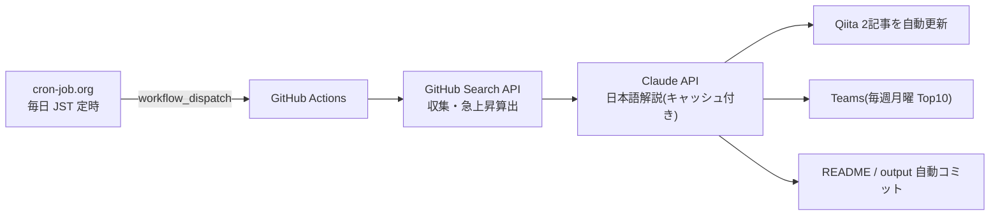

# Claude Code向けMCPツール候補ランキング

GitHub Search APIを使って、Claude Code周辺で活用候補になりそうなMCP関連リポジトリを定期収集するリポジトリです。

> 注意: この一覧は「Claude Codeでの動作」を保証するものではありません。  
> GitHub上のリポジトリ名・説明文・READMEなどに含まれる情報をもとに、MCP関連ツール候補を探すための入口として利用します。

## 仕組み(定常自律運転)

このランキングは cron-job.org → GitHub Actions → Claude API → Qiita / Teams のパイプラインで、毎日無人更新されています。



- 仕組みの詳細と**ライブ稼働ステータス**: [定常自律運転ページ](https://takanobusano.github.io/mcp-github-ranking/)
- 作り方の解説記事: [パイプライン編](https://qiita.com/4q_sano/items/913e93ee5cc2731561fc) / [cron-job.org 完全自動化編](https://qiita.com/4q_sano/items/1bc5e0669a8f0166936c)
<!-- MCP_REPOS_START -->
最終更新: **2026-10-24 08:17:16 JST**

MCP関連リポジトリに加え、Claude Code周辺で活用候補になりそうな関連ツールをGitHub Search APIで毎日自動収集してランキング化しています。

Stars / Forks の差分は、UTC基準の前日データ（2026-10-22）との差分です。
CSVには最大500件を保存し、本文では上位100件を表示しています。

> 注意: この一覧はClaude Codeでの動作を保証するものではありません。  
> MCP関連ツールまたはClaude Code関連ツール候補を探すための入口として利用してください。

# 注目MCP・関連ツール候補ランキング

## 1位 [public-apis/public-apis](https://github.com/public-apis/public-apis)

A collective list of free APIs

⭐ **491,671 Stars**（+259）　🍴 **54,700 Forks**（+47）　/　🟢 **2,342 Open Issues**　/　Python

Topics: `api` / `apis` / `dataset` / `development` / `free` / `list` / `lists` / `open-source`

## 2位 [openclaw/openclaw](https://github.com/openclaw/openclaw)

The AI that really does things. Any OS. Any Platform. The lobster way. 🦞

⭐ **392,883 Stars**（+97）　🍴 **82,568 Forks**（+12）　/　🟢 **8,937 Open Issues**　/　TypeScript

Topics: `ai` / `assistant` / `crustacean` / `molty` / `openclaw` / `own-your-data` / `personal`

## 3位 [morluto/rea](https://github.com/morluto/rea)

Reverse engineer anything with agents, from app behavior down to native binaries.

⭐ **373,000 Stars**（+7,040）　🍴 **93,319 Forks**（+1,616）　/　🟢 **1,562 Open Issues**　/　TypeScript

Topics: `agent-skills` / `ai-agents` / `binary-analysis` / `claude-code` / `cli` / `codex` / `cordis` / `decompiler`

## 4位 [obra/superpowers](https://github.com/obra/superpowers)

An agentic skills framework & software development methodology that works.

⭐ **304,229 Stars**（+509）　🍴 **27,105 Forks**（+44）　/　🟢 **354 Open Issues**　/　Shell

Topics: `ai` / `brainstorming` / `coding` / `obra` / `sdlc` / `skills` / `subagent-driven-development` / `superpowers`

## 5位 [mattpocock/skills](https://github.com/mattpocock/skills)

Skills for Real Engineers. Straight from my .agents directory.

⭐ **301,788 Stars**（+930）　🍴 **25,367 Forks**（+86）　/　🟢 **201 Open Issues**　/　Shell

Topics: `topicなし`

## 6位 [affaan-m/ECC](https://github.com/affaan-m/ECC)

The agent harness performance optimization system. Skills, instincts, memory, security, and research-first development for Claude Code, Codex, Opencode, Cursor and beyond.

⭐ **287,299 Stars**（+801）　🍴 **42,605 Forks**（+105）　/　🟢 **264 Open Issues**　/　JavaScript

Topics: `ai-agents` / `anthropic` / `claude` / `claude-code` / `developer-tools` / `llm` / `mcp` / `productivity`

## 7位 [NousResearch/hermes-agent](https://github.com/NousResearch/hermes-agent)

The agent that grows with you

⭐ **256,521 Stars**（+284）　🍴 **56,072 Forks**（+113）　/　🟢 **50,669 Open Issues**　/　Python

Topics: `ai` / `ai-agent` / `ai-agents` / `anthropic` / `chatgpt` / `claude` / `claude-code` / `codex`

## 8位 [multica-ai/andrej-karpathy-skills](https://github.com/multica-ai/andrej-karpathy-skills)

A single CLAUDE.md file to improve Claude Code behavior, derived from Andrej Karpathy's observations on LLM coding pitfalls.

⭐ **222,916 Stars**（+406）　🍴 **22,343 Forks**（+32）　/　🟢 **137 Open Issues**　/　不明

Topics: `topicなし`

## 9位 [ultraworkers/claw-code](https://github.com/ultraworkers/claw-code)

An agent-managed museum exhibit, built in Rust with Gajae-Code / LazyCodex — developed and maintained with no human intervention.

⭐ **195,069 Stars**（-4）　🍴 **107,802 Forks**（-28）　/　🟢 **1 Open Issues**　/　Rust

Topics: `topicなし`

## 10位 [firecrawl/firecrawl](https://github.com/firecrawl/firecrawl)

Supercharge your AI agents with data from the web and beyond. Building the library for superintelligence. 🔥

⭐ **194,672 Stars**（+378）　🍴 **10,273 Forks**（+18）　/　🟢 **662 Open Issues**　/　TypeScript

Topics: `ai` / `ai-agents` / `ai-crawler` / `ai-scraping` / `ai-search` / `crawler` / `data-extraction` / `html-to-markdown`

## 11位 [ollama/ollama](https://github.com/ollama/ollama)

Get up and running with Kimi, GLM, MiniMax, DeepSeek, gpt-oss, Qwen, Gemma and other models.

⭐ **184,482 Stars**（+145）　🍴 **18,501 Forks**（+26）　/　🟢 **4,400 Open Issues**　/　Go

Topics: `deepseek` / `gemma` / `gemma3` / `glm` / `go` / `golang` / `gpt-oss` / `llama`

## 12位 [anthropics/skills](https://github.com/anthropics/skills)

Public repository for Agent Skills

⭐ **183,288 Stars**（+263）　🍴 **21,708 Forks**（+34）　/　🟢 **1,432 Open Issues**　/　Python

Topics: `agent-skills`

## 13位 [DietrichGebert/ponytail](https://github.com/DietrichGebert/ponytail)

Makes your AI agent think like the laziest senior dev in the room. The best code is the code you never wrote.

⭐ **174,772 Stars**（+1,375）　🍴 **9,514 Forks**（+78）　/　🟢 **109 Open Issues**　/　JavaScript

Topics: `agent-skills` / `ai-agents` / `claude` / `claude-code` / `claude-code-plugin` / `cursor-rules` / `developer-tools` / `llm`

## 14位 [msitarzewski/agency-agents](https://github.com/msitarzewski/agency-agents)

A complete AI agency at your fingertips - From frontend wizards to Reddit community ninjas, from whimsy injectors to reality checkers. Each agent is a specialized expert with personality, processes, and proven deliverables.

⭐ **163,505 Stars**（+262）　🍴 **26,392 Forks**（+52）　/　🟢 **180 Open Issues**　/　Shell

Topics: `topicなし`

## 15位 [langgenius/dify](https://github.com/langgenius/dify)

Build Agentic workflows, RAG pipelines, with rich AI model and tool support on one collaborative workspace. Deploy on cloud, VPC, or self-hosted, so teams move from prototype to production without rebuilding the stack.

⭐ **159,373 Stars**（+93）　🍴 **25,177 Forks**（+16）　/　🟢 **1,166 Open Issues**　/　Python

Topics: `agent` / `agentic-ai` / `agentic-framework` / `agentic-workflow` / `ai` / `automation` / `claude` / `deepseek`

## 16位 [langflow-ai/langflow](https://github.com/langflow-ai/langflow)

Langflow is a powerful tool for building and deploying AI-powered agents and workflows.

⭐ **155,967 Stars**（+37）　🍴 **10,242 Forks**（+2）　/　🟢 **1,223 Open Issues**　/　Python

Topics: `agents` / `chatgpt` / `generative-ai` / `large-language-models` / `multiagent` / `react-flow`

## 17位 [anthropics/claude-code](https://github.com/anthropics/claude-code)

Claude Code is an agentic coding tool that lives in your terminal, understands your codebase, and helps you code faster by executing routine tasks, explaining complex code, and handling git workflows - all through natural language commands.

⭐ **153,168 Stars**（+258）　🍴 **26,654 Forks**（-122）　/　🟢 **15,553 Open Issues**　/　TypeScript

Topics: `topicなし`

## 18位 [farion1231/cc-switch](https://github.com/farion1231/cc-switch)

A cross-platform desktop All-in-One assistant for Claude Code, Codex, OpenCode, OpenClaw, Grok Build & Hermes Agent. Only official website: ccswitch.io

⭐ **148,038 Stars**（+371）　🍴 **9,742 Forks**（+16）　/　🟢 **1,099 Open Issues**　/　Rust

Topics: `ai-tools` / `claude-code` / `codex` / `desktop-app` / `grok` / `grokbuild` / `hermes` / `hermes-agent`

## 19位 [x1xhlol/system-prompts-and-models-of-ai-tools](https://github.com/x1xhlol/system-prompts-and-models-of-ai-tools)

FULL Augment Code, Claude Code, Cluely, CodeBuddy, Comet, Cursor, Devin AI, Junie, Kiro, Leap.new, Lovable, Manus, NotionAI, Orchids.app, Perplexity, Poke, Qoder, Replit, Same.dev, Trae, Traycer AI, VSCode Agent, Warp.dev, Windsurf, Xcode, Z.ai Code, Dia & v0. (And other Open Sourced) System Prompts, Internal Tools & AI Models

⭐ **144,205 Stars**（+10）　🍴 **34,700 Forks**（-6）　/　🟢 **162 Open Issues**　/　不明

Topics: `ai` / `bolt` / `cluely` / `copilot` / `cursor` / `cursorai` / `devin` / `github-copilot`

## 20位 [nextlevelbuilder/ui-ux-pro-max-skill](https://github.com/nextlevelbuilder/ui-ux-pro-max-skill)

An AI skill that provides design intelligence for building professional UI/UX across multiple platforms.

⭐ **139,426 Stars**（+425）　🍴 **14,767 Forks**（+46）　/　🟢 **88 Open Issues**　/　Python

Topics: `ai-skills` / `antigravity` / `claude` / `claude-code` / `codex` / `command-line` / `copilot` / `cursor-ai`

## 21位 [garrytan/gstack](https://github.com/garrytan/gstack)

Use Garry Tan's exact Claude Code setup: 23 opinionated tools that serve as CEO, Designer, Eng Manager, Release Manager, Doc Engineer, and QA

⭐ **137,385 Stars**（+73）　🍴 **20,365 Forks**（+10）　/　🟢 **81 Open Issues**　/　TypeScript

Topics: `topicなし`

## 22位 [harry0703/MoneyPrinterTurbo](https://github.com/harry0703/MoneyPrinterTurbo)

利用 AI 大模型和自动化工作流，根据主题或关键词一键生成高清短视频。Generate HD short videos from a topic or keyword with an automated AI workflow.

⭐ **134,568 Stars**（+340）　🍴 **21,287 Forks**（+66）　/　🟢 **79 Open Issues**　/　Python

Topics: `ai-video-generator` / `content-creation` / `ffmpeg` / `instagram-reels` / `llm` / `python` / `short-video` / `subtitles`

## 23位 [Graphify-Labs/graphify](https://github.com/Graphify-Labs/graphify)

Turn any codebase, with its docs, SQL schemas, configs, and PDFs, into a queryable knowledge graph. A /graphify skill for Claude Code, Cursor, Codex, and Gemini CLI: local deterministic AST parsing, every edge explained, no vector store.

⭐ **133,889 Stars**（+991）　🍴 **12,789 Forks**（+72）　/　🟢 **1,596 Open Issues**　/　Python

Topics: `ai-agents` / `antigravity` / `ast` / `claude-code` / `code-analysis` / `code-search` / `codex` / `cursor`

## 24位 [browser-use/browser-use](https://github.com/browser-use/browser-use)

Open-source Python library for AI browser agents, plus Browser Use Cloud: stealth browsers and a hosted agent API.

⭐ **118,983 Stars**（+93）　🍴 **13,215 Forks**（+12）　/　🟢 **600 Open Issues**　/　Python

Topics: `ai-agents` / `ai-tools` / `browser-agent` / `browser-automation` / `browser-use` / `cdp` / `cloud-browser` / `computer-use`

## 25位 [JuliusBrussee/caveman](https://github.com/JuliusBrussee/caveman)

🪨 why use many token when few token do trick. Viral skill + proxy for coding agents that cuts 65% of tokens by talking like a caveman.

⭐ **114,626 Stars**（+226）　🍴 **6,607 Forks**（+13）　/　🟢 **106 Open Issues**　/　Go

Topics: `ai` / `anthropic` / `caveman` / `claude` / `claude-code` / `llm` / `meme` / `prompt-engineering`

## 26位 [TauricResearch/TradingAgents](https://github.com/TauricResearch/TradingAgents)

TradingAgents: Multi-Agents LLM Financial Trading Framework

⭐ **113,383 Stars**（+390）　🍴 **21,947 Forks**（+84）　/　🟢 **117 Open Issues**　/　Python

Topics: `agent` / `finance` / `llm` / `multiagent` / `trading`

## 27位 [addyosmani/agent-skills](https://github.com/addyosmani/agent-skills)

Production-grade engineering skills for AI coding agents.

⭐ **109,910 Stars**（+262）　🍴 **11,465 Forks**（+29）　/　🟢 **154 Open Issues**　/　JavaScript

Topics: `agent-skills` / `antigravity` / `claude-code` / `codex` / `cursor` / `skills`

## 28位 [google-gemini/gemini-cli](https://github.com/google-gemini/gemini-cli)

An open-source AI agent that brings the power of Gemini directly into your terminal.

⭐ **107,562 Stars**（+39）　🍴 **14,767 Forks**（+13）　/　🟢 **754 Open Issues**　/　TypeScript

Topics: `ai` / `ai-agents` / `cli` / `gemini` / `gemini-api` / `mcp-client` / `mcp-server`

## 29位 [paperclipai/paperclip](https://github.com/paperclipai/paperclip)

The open-source app everyone uses to manage agents at work

⭐ **106,578 Stars**（+431）　🍴 **17,717 Forks**（+65）　/　🟢 **6,440 Open Issues**　/　TypeScript

Topics: `acpx` / `agent-orchestration` / `agent-skills` / `agentic-ai` / `ai-agents` / `ai-engineering` / `ai-governance` / `ai-tools`

## 30位 [stablyai/orca](https://github.com/stablyai/orca)

Orca is the place for working with a fleet of agents (e.g. Grok Bot, Claude Code). Run any coding agent with your own subscription. Available on desktop, mobile and remote runtime.

⭐ **103,811 Stars**（+1,101）　🍴 **6,557 Forks**（+71）　/　🟢 **8,752 Open Issues**　/　TypeScript

Topics: `ade` / `agent-ide` / `ai-agents` / `automation` / `bot` / `claude-code` / `codex` / `ghostty`

## 31位 [nexu-io/open-design](https://github.com/nexu-io/open-design)

The 1st Collaborative AI Design Agent Workspace. Local-first and open source. Create motion, prototypes, websites, apps, dashboards, presentations, images, and videos with your team and AI agents. Share work, exchange feedback, and iterate together in one workspace.

⭐ **103,590 Stars**（+248）　🍴 **11,856 Forks**（+29）　/　🟢 **1,275 Open Issues**　/　TypeScript

Topics: `agent-skills` / `ai-design` / `byok` / `claude-code-for-design` / `claude-design` / `codex-design` / `cursor-design` / `deepseek`

## 32位 [thedotmack/claude-mem](https://github.com/thedotmack/claude-mem)

Persistent Context Across Sessions for Every Agent –  Captures everything your agent does during sessions, compresses it with AI, and injects relevant context back into future sessions. Works with Claude Code, OpenClaw, Codex, Gemini, Hermes, Copilot, OpenCode + More

⭐ **102,554 Stars**（+221）　🍴 **9,059 Forks**（+34）　/　🟢 **102 Open Issues**　/　TypeScript

Topics: `ai` / `ai-agents` / `ai-memory` / `anthropic` / `artificial-intelligence` / `chromadb` / `claude` / `claude-agent-sdk`

## 33位 [Leonxlnx/taste-skill](https://github.com/Leonxlnx/taste-skill)

Agent skills that give coding agents taste: art direction, reference images and a browser check instead of generic AI pages

⭐ **101,609 Stars**（+499）　🍴 **6,859 Forks**（+25）　/　🟢 **6 Open Issues**　/　JavaScript

Topics: `agent-skills` / `ai-agents` / `anti-slop` / `claude-code` / `codex` / `cursor` / `design-system` / `frontend`

## 34位 [Panniantong/Agent-Reach](https://github.com/Panniantong/Agent-Reach)

Give your AI agent eyes to see the entire internet. Read & search Twitter, Reddit, YouTube, GitHub, Bilibili, XiaoHongShu — one CLI, zero API fees.

⭐ **101,332 Stars**（+315）　🍴 **8,935 Forks**（+31）　/　🟢 **228 Open Issues**　/　Python

Topics: `agent-infrastructure` / `ai-agent` / `ai-search` / `automation` / `bilibili` / `claude-code` / `cli` / `cursor`

## 35位 [microsoft/playwright](https://github.com/microsoft/playwright)

Playwright is a framework for Web Testing and Automation. It allows testing Chromium, Firefox and WebKit with a single API.

⭐ **98,379 Stars**（+63）　🍴 **6,676 Forks**（+11）　/　🟢 **191 Open Issues**　/　TypeScript

Topics: `automation` / `chrome` / `chromium` / `e2e-testing` / `electron` / `end-to-end-testing` / `firefox` / `javascript`

## 36位 [OpenCut-app/OpenCut](https://github.com/OpenCut-app/OpenCut)

The open-source CapCut alternative

⭐ **95,914 Stars**（+163）　🍴 **9,486 Forks**（+25）　/　🟢 **386 Open Issues**　/　TypeScript

Topics: `editor` / `oss` / `videoeditor`

## 37位 [puppeteer/puppeteer](https://github.com/puppeteer/puppeteer)

JavaScript API for Chrome and Firefox

⭐ **95,739 Stars**（+3）　🍴 **9,570 Forks**（-1）　/　🟢 **205 Open Issues**　/　TypeScript

Topics: `automation` / `chrome` / `chromium` / `developer-tools` / `firefox` / `headless-chrome` / `node-module` / `testing`

## 38位 [OpenHands/OpenHands](https://github.com/OpenHands/OpenHands)

🙌 OpenHands: AI-Driven Development

⭐ **91,678 Stars**（+86）　🍴 **12,163 Forks**（+5）　/　🟢 **1,087 Open Issues**　/　TypeScript

Topics: `agent` / `artificial-intelligence` / `chatgpt` / `claude-ai` / `cli` / `developer-tools` / `gpt` / `llm`

## 39位 [modelcontextprotocol/servers](https://github.com/modelcontextprotocol/servers)

Model Context Protocol Servers

⭐ **91,524 Stars**（+36）　🍴 **11,853 Forks**（+14）　/　🟢 **136 Open Issues**　/　TypeScript

Topics: `topicなし`

## 40位 [koala73/worldmonitor](https://github.com/koala73/worldmonitor)

Real-time global intelligence dashboard. AI-powered news aggregation, geopolitical monitoring, and infrastructure tracking in a unified situational awareness interface

⭐ **89,352 Stars**（+125）　🍴 **13,713 Forks**（+20）　/　🟢 **354 Open Issues**　/　TypeScript

Topics: `agent` / `ai` / `dashboard` / `geopolitics` / `mcp` / `mcp-server` / `monitoring` / `news`

## 41位 [D4Vinci/Scrapling](https://github.com/D4Vinci/Scrapling)

🕷️ A Web Scraping framework that handles everything from a single request to a full-scale crawl! Don't be shy, join here:  and follow here for daily tips and tricks:

⭐ **89,346 Stars**（+150）　🍴 **9,216 Forks**（+18）　/　🟢 **16 Open Issues**　/　Python

Topics: `ai` / `ai-scraping` / `automation` / `crawler` / `crawling` / `crawling-python` / `data` / `data-extraction`

## 42位 [ChatGPTNextWeb/NextChat](https://github.com/ChatGPTNextWeb/NextChat)

✨ Zero-config AI chat assistant. No API key needed — sign up and instantly chat with GPT-5, Claude 4, Gemini 2.5, DeepSeek & 100+ top models. Pay-as-you-go save...

⭐ **88,884 Stars**（±0）　🍴 **58,737 Forks**（-11）　/　🟢 **854 Open Issues**　/　TypeScript

Topics: `calclaude` / `claude` / `cross-platform` / `desktop` / `fe` / `gemini` / `gemini-pro` / `gemini-server`

## 43位 [tt-a1i/archify](https://github.com/tt-a1i/archify)

Turn any idea, plan, or codebase into a beautiful interactive diagram. An agent skill for Claude Code, Codex, and more.

⭐ **88,280 Stars**（+687）　🍴 **5,953 Forks**（+48）　/　🟢 **289 Open Issues**　/　JavaScript

Topics: `agent-skills` / `ai-agents` / `architecture-diagram` / `claude-code` / `claude-skills` / `codex` / `coding-agents` / `deepseek-harness`

## 44位 [Egonex-AI/Understand-Anything](https://github.com/Egonex-AI/Understand-Anything)

Graphs that teach > graphs that impress. Turn any code into an interactive knowledge graph you can explore, search, and ask questions about. Works with Claude Code, Codex, Cursor, Copilot, Gemini CLI, and more.

⭐ **87,920 Stars**（+203）　🍴 **7,418 Forks**（+17）　/　🟢 **335 Open Issues**　/　TypeScript

Topics: `antigravity-skills` / `business-knowledge` / `claude-code` / `claude-skills` / `codebase-analysis` / `codex` / `codex-skills` / `developer-tools-ai-agent`

## 45位 [unclecode/crawl4ai](https://github.com/unclecode/crawl4ai)

Open-source web crawler and scraper for LLMs and AI agents: any website into clean, LLM-ready Markdown. Run it yourself, or use Crawl4AI Cloud with one key. Join our Discord

⭐ **86,114 Stars**（+61）　🍴 **8,951 Forks**（+8）　/　🟢 **278 Open Issues**　/　Python

Topics: `ai` / `ai-agents` / `crawler` / `data-extraction` / `llm` / `markdown` / `mcp` / `open-source`

## 46位 [pbakaus/impeccable](https://github.com/pbakaus/impeccable)

The design language that makes your AI harness better at design.

⭐ **85,511 Stars**（+545）　🍴 **5,108 Forks**（+37）　/　🟢 **37 Open Issues**　/　Rust

Topics: `topicなし`

## 47位 [laravel/laravel](https://github.com/laravel/laravel)

Laravel is a web application framework with expressive, elegant syntax. We’ve already laid the foundation for your next big idea — freeing you to create without sweating the small things.

⭐ **85,257 Stars**（+10）　🍴 **27,554 Forks**（-80）　/　🟢 **31 Open Issues**　/　Blade

Topics: `framework` / `laravel` / `php`

## 48位 [rtk-ai/rtk](https://github.com/rtk-ai/rtk)

CLI proxy that reduces LLM token consumption by 60-90% on common dev commands. Single Rust binary, zero dependencies

⭐ **84,394 Stars**（+82）　🍴 **5,359 Forks**（+3）　/　🟢 **1,603 Open Issues**　/　Rust

Topics: `agentic-coding` / `ai-coding` / `anthropic` / `claude-code` / `cli` / `command-line-tool` / `cost-reduction` / `developer-tools`

## 49位 [bytedance/deer-flow](https://github.com/bytedance/deer-flow)

An open-source long-horizon SuperAgent harness that researches, codes, and creates. With the help of sandboxes, memories, tools, skill, subagents and message gateway, it handles different levels of tasks that could take minutes to hours.

⭐ **84,341 Stars**（+50）　🍴 **11,797 Forks**（+12）　/　🟢 **969 Open Issues**　/　Python

Topics: `agent` / `agentic` / `agentic-framework` / `agentic-workflow` / `ai` / `ai-agents` / `deep-research` / `harness`

## 50位 [lobehub/lobehub](https://github.com/lobehub/lobehub)

🤯 LobeHub is your Chief Agent Operator, organizing your agents into 7×24 operations by hiring, scheduling, and reporting on your entire AI team.

⭐ **83,448 Stars**（+22）　🍴 **16,018 Forks**（+4）　/　🟢 **1,171 Open Issues**　/　TypeScript

Topics: `agent` / `agent-collaboration` / `agent-harness` / `ai` / `cao` / `chatgpt` / `chief-agent-operator` / `claude`

## 51位 [debpalash/VoiceStudio](https://github.com/debpalash/VoiceStudio)

VoiceStudio is the open-source, fully-local ElevenLabs alternative — voice cloning, voice design, video dubbing, dictation, transcription & audiobook creation in 646 languages.

⭐ **83,257 Stars**（+1,547）　🍴 **9,186 Forks**（+162）　/　🟢 **331 Open Issues**　/　Python

Topics: `ai` / `audiobook` / `cuda` / `dubbing` / `elevenlabs-alternative` / `huggingface` / `local-first` / `mlx`

## 52位 [abi/screenshot-to-code](https://github.com/abi/screenshot-to-code)

Drop in a screenshot and convert it to clean code (HTML/Tailwind/React/Vue)

⭐ **80,664 Stars**（+28）　🍴 **9,859 Forks**（+11）　/　🟢 **148 Open Issues**　/　Python

Topics: `topicなし`

## 53位 [cheaper-inference/OmniRoute](https://github.com/cheaper-inference/OmniRoute)

Never stop coding. Free MIT AI gateway: one endpoint, 375 providers (150+ free), 1,400+ models Kimi, Claude, GPT, Gemini, GLM, DeepSeek, MiniMax. Works with Claude Code, Codex, Cursor, OpenCode, Cline & Copilot. Quota-aware auto-fallback, RTK+Caveman compression saves 15-95% tokens, MCP/A2A, Desktop/PWA. Built by 900+ contributors

⭐ **80,389 Stars**（+514）　🍴 **11,734 Forks**（+106）　/　🟢 **502 Open Issues**　/　TypeScript

Topics: `a2a` / `ai-agents` / `ai-gateway` / `anthropic` / `claude` / `claude-code` / `cline` / `codex`

## 54位 [shareAI-lab/learn-claude-code](https://github.com/shareAI-lab/learn-claude-code)

Bash is all you need -  A nano claude code–like 「agent harness」, built from 0 to 1

⭐ **79,095 Stars**（+63）　🍴 **12,644 Forks**（+11）　/　🟢 **69 Open Issues**　/　Python

Topics: `agent` / `agent-development` / `ai-agent` / `claude` / `claude-code` / `educational` / `llm` / `python`

## 55位 [ruvnet/ruflo](https://github.com/ruvnet/ruflo)

🌊 The original agent harness. Deploy intelligent multi-player swarms, coordinate autonomous workflows, and build conversational AI systems. Features adaptive me...

⭐ **78,771 Stars**（+293）　🍴 **9,250 Forks**（+25）　/　🟢 **972 Open Issues**　/　TypeScript

Topics: `agentic-ai` / `agentic-framework` / `agentic-workflow` / `agents` / `ai-agents` / `ai-assistant` / `ai-skills` / `autonomous-agents`

## 56位 [unslothai/unsloth](https://github.com/unslothai/unsloth)

Local UI to run and train LLMs and diffusion models. Supports GGUF, MLX, Qwen3.8, DeepSeek-V4.1, MiniMax-H3, Gemma 4, FLUX and more.

⭐ **78,485 Stars**（+53）　🍴 **7,268 Forks**（+1）　/　🟢 **379 Open Issues**　/　Python

Topics: `agent` / `ai` / `chatgpt` / `deepseek` / `fine-tuning` / `gemma` / `image-generation` / `llama`

## 57位 [headroomlabs-ai/headroom](https://github.com/headroomlabs-ai/headroom)

Compress tool outputs, logs, files, and RAG chunks before they reach the LLM. 20% fewer tokens for coding agents, 60-95% fewer tokens for JSON, same answers. Library, proxy, MCP server.

⭐ **77,651 Stars**（+99）　🍴 **6,031 Forks**（+11）　/　🟢 **607 Open Issues**　/　Python

Topics: `agent` / `ai` / `anthropic` / `claude-code` / `compression` / `context-engineering` / `context-window` / `cursor`

## 58位 [Eugeny/tabby](https://github.com/Eugeny/tabby)

A terminal for a more modern age

⭐ **75,096 Stars**（+9）　🍴 **4,296 Forks**（±0）　/　🟢 **2,850 Open Issues**　/　TypeScript

Topics: `serial` / `ssh-client` / `telnet-client` / `terminal` / `terminal-emulators`

## 59位 [colbymchenry/codegraph](https://github.com/colbymchenry/codegraph)

Pre-indexed code knowledge graph, auto syncs on code changes, for Claude Code, Codex, Gemini, Cursor, OpenCode, AntiGravity, Kiro, CoPilot, and Hermes Agent — fewer tokens, fewer tool calls, 100% local

⭐ **75,072 Stars**（+321）　🍴 **4,894 Forks**（+52）　/　🟢 **504 Open Issues**　/　C

Topics: `topicなし`

## 60位 [openbq-org/OpenBB](https://github.com/openbq-org/OpenBB)

Open Data Platform for analysts, quants and AI agents.

⭐ **74,594 Stars**（+37）　🍴 **7,753 Forks**（+5）　/　🟢 **100 Open Issues**　/　Python

Topics: `ai` / `crypto` / `derivatives` / `economics` / `equity` / `finance` / `fixed-income` / `machine-learning`

## 61位 [thedaviddias/Front-End-Checklist](https://github.com/thedaviddias/Front-End-Checklist)

🗂 The essential checklist for modern web development, for humans and AI agents

⭐ **74,552 Stars**（+4）　🍴 **6,756 Forks**（+1）　/　🟢 **13 Open Issues**　/　MDX

Topics: `ai-agent` / `ai-agents` / `checklist` / `css` / `front-end-developer-tool` / `front-end-development` / `frontend` / `guidelines`

## 62位 [rohitg00/ai-engineering-from-scratch](https://github.com/rohitg00/ai-engineering-from-scratch)

Learn AI Engineering! Learn it. Build it. Ship it for others.

⭐ **72,800 Stars**（+338）　🍴 **12,785 Forks**（+43）　/　🟢 **73 Open Issues**　/　Python

Topics: `agents` / `ai` / `ai-agents` / `ai-engineering` / `computer-vision` / `course` / `deep-learning` / `dsh`

## 63位 [tw93/Mole](https://github.com/tw93/Mole)

🐹 Keep your Mac and PC clean, light, and running like new. Fast open-source CLI, plus native Mac and Windows apps.

⭐ **72,600 Stars**（+193）　🍴 **2,560 Forks**（+3）　/　🟢 **9 Open Issues**　/　Shell

Topics: `analyzer` / `appcleaner` / `clean` / `cleaner` / `cleanmymac` / `command-line` / `daisydisk` / `istat`

## 64位 [storytold/photocraft](https://github.com/storytold/photocraft)

PhotoCraft: An open-source, photo editor written by scratch in pure Rust

⭐ **71,938 Stars**（+603）　🍴 **12,705 Forks**（+117）　/　🟢 **2,813 Open Issues**　/　Rust

Topics: `art` / `image-editing` / `image-editing-software` / `image-editor` / `images` / `photo-editing` / `rust`

## 65位 [usestrix/strix](https://github.com/usestrix/strix)

Open-source AI penetration testing tool to find and fix your app’s vulnerabilities.

⭐ **71,439 Stars**（+281）　🍴 **7,961 Forks**（+48）　/　🟢 **507 Open Issues**　/　Python

Topics: `agents` / `ai-hacking` / `ai-penetration-testing` / `ai-pentesting` / `ai-security` / `artificial-intelligence` / `bug-bounty` / `code-quality`

## 66位 [calesthio/OpenMontage](https://github.com/calesthio/OpenMontage)

World's first open-source, agentic video production system. 12 production pipelines, 100+ tools, 700+ agent skill and production-knowledge files. Turn your AI coding assistant into a full video production studio.

⭐ **71,177 Stars**（+295）　🍴 **9,212 Forks**（+50）　/　🟢 **421 Open Issues**　/　Python

Topics: `agent` / `agentic-ai` / `ai` / `claude` / `copilot` / `cursor` / `elevenlabs` / `ffmpeg`

## 67位 [cline/cline](https://github.com/cline/cline)

Autonomous coding agent as an SDK, IDE extension, or CLI assistant.

⭐ **70,784 Stars**（+42）　🍴 **7,727 Forks**（+1）　/　🟢 **1,705 Open Issues**　/　TypeScript

Topics: `topicなし`

## 68位 [heygen-com/hyperframes](https://github.com/heygen-com/hyperframes)

Write HTML. Render video. Built for agents.

⭐ **70,775 Stars**（+792）　🍴 **6,399 Forks**（+66）　/　🟢 **412 Open Issues**　/　TypeScript

Topics: `ai` / `ai-agents` / `animation` / `claude-code` / `ffmpeg` / `framework` / `gsap` / `html`

## 69位 [code-yeongyu/oh-my-openagent](https://github.com/code-yeongyu/oh-my-openagent)

OmO: Just type "mass ulw" keyword with your prompt. Now you are the master of graph engineering.

⭐ **70,291 Stars**（+13）　🍴 **5,780 Forks**（-2）　/　🟢 **1,712 Open Issues**　/　TypeScript

Topics: `ai` / `ai-agents` / `anthropic` / `chatgpt` / `claude` / `claude-skills` / `codex` / `cursor`

## 70位 [asgeirtj/system_prompts_leaks](https://github.com/asgeirtj/system_prompts_leaks)

Documented system prompts from Anthropic - Claude Fable 5.1, Opus 5.5, Claude Design, Claude Code. OpenAI - ChatGPT GPT-6-Astra, Codex. Google - Gemini 3.8 Flash, 3.1 Pro, Antigravity. xAI - Grok, Grok Bot, Cursor, Kimi and more! Updated regularly.

⭐ **70,113 Stars**（+61）　🍴 **11,355 Forks**（+6）　/　🟢 **56 Open Issues**　/　Python

Topics: `ai` / `ai-agents` / `ai-prompts` / `anthropic` / `chatbot` / `chatgpt` / `claude` / `claude-code`

## 71位 [docling-project/docling](https://github.com/docling-project/docling)

Get your documents ready for gen AI

⭐ **69,465 Stars**（+76）　🍴 **5,165 Forks**（+8）　/　🟢 **912 Open Issues**　/　Python

Topics: `ai` / `convert` / `document-parser` / `document-parsing` / `documents` / `docx` / `html` / `markdown`

## 72位 [openinterpreter/openinterpreter](https://github.com/openinterpreter/openinterpreter)

A coding agent for open models like Kimi K3 and GLM 5.3

⭐ **68,651 Stars**（+12）　🍴 **5,908 Forks**（+1）　/　🟢 **22 Open Issues**　/　Rust

Topics: `acp` / `coding-agent` / `deepseek` / `kimi` / `python` / `qwen` / `rust`

## 73位 [eternity4719/HowToLiveBetter](https://github.com/eternity4719/HowToLiveBetter)

高性价比人生指南: 长寿防病、急救、省钱理财、法律红线、失业与工伤、医保社保、恋爱婚育、怀孕育儿、创业与做平台合规、出国与技能。每条写明成本、收益、证据等级和原始出处，只引期刊论文与官方文件。

⭐ **68,324 Stars**（+351）　🍴 **5,919 Forks**（+46）　/　🟢 **21 Open Issues**　/　HTML

Topics: `topicなし`

## 74位 [shanraisshan/claude-code-best-practice](https://github.com/shanraisshan/claude-code-best-practice)

from vibe coding to agentic engineering - practice makes claude perfect

⭐ **67,941 Stars**（+26）　🍴 **6,760 Forks**（+6）　/　🟢 **28 Open Issues**　/　HTML

Topics: `agentic-ai` / `agentic-coding` / `agentic-engineering` / `agentic-workflow` / `ai` / `ai-agents` / `anthropic` / `best-practices`

## 75位 [NanmiCoder/MediaCrawler](https://github.com/NanmiCoder/MediaCrawler)

小红书笔记 \| 评论爬虫、抖音视频 \| 评论爬虫、快手视频 \| 评论爬虫、B 站视频 ｜ 评论爬虫、微博帖子 ｜ 评论爬虫、百度贴吧帖子 ｜ 百度贴吧评论回复爬虫  \| 知乎问答文章｜评论爬虫

⭐ **67,810 Stars**（+102）　🍴 **12,938 Forks**（+32）　/　🟢 **217 Open Issues**　/　Python

Topics: `topicなし`

## 76位 [mem0ai/mem0](https://github.com/mem0ai/mem0)

The Memory Layer for AI Agents - Drop-in memory infrastructure for AI agents and apps. Context that persists. Built for production.

⭐ **67,711 Stars**（+58）　🍴 **7,999 Forks**（+16）　/　🟢 **868 Open Issues**　/　Python

Topics: `agentic-memory` / `agentic-memory-system` / `agents` / `ai` / `ai-agents` / `chatgpt` / `genai` / `llm`

## 77位 [bradtraversy/design-resources-for-developers](https://github.com/bradtraversy/design-resources-for-developers)

Curated list of design and UI resources from stock photos, web templates, CSS frameworks, UI libraries, tools and much more

⭐ **67,230 Stars**（+3）　🍴 **12,273 Forks**（+1）　/　🟢 **1 Open Issues**　/　不明

Topics: `topicなし`

## 78位 [xtekky/gpt4free](https://github.com/xtekky/gpt4free)

The official gpt4free repository \| various collection of powerful language models \| opus 4.6 gpt 5.3 kimi 2.5 deepseek v3.2 gemini 3

⭐ **66,918 Stars**（-6）　🍴 **13,461 Forks**（-2）　/　🟢 **6 Open Issues**　/　Python

Topics: `chatbot` / `chatbots` / `chatgpt` / `chatgpt-4` / `chatgpt-api` / `chatgpt-free` / `chatgpt4` / `deepseek`

## 79位 [hugohe3/ppt-master](https://github.com/hugohe3/ppt-master)

AI turns documents or topics into real, native PowerPoint decks—with native shapes, transitions and animations, data-backed charts and tables on demand, audio narration from speaker notes, and support for your own .pptx templates. · by Hugo He

⭐ **66,739 Stars**（+759）　🍴 **5,229 Forks**（+48）　/　🟢 **1 Open Issues**　/　Python

Topics: `ai-agent` / `aippt` / `office` / `powerpoint` / `powerpoint-generation` / `ppt` / `pptx` / `presentation`

## 80位 [warpdotdev/warp](https://github.com/warpdotdev/warp)

Warp is an agentic development environment, born out of the terminal.

⭐ **65,660 Stars**（+24）　🍴 **5,693 Forks**（+3）　/　🟢 **5,486 Open Issues**　/　Rust

Topics: `bash` / `linux` / `macos` / `rust` / `shell` / `terminal` / `wasm` / `zsh`

## 81位 [mvanhorn/last30days-skill](https://github.com/mvanhorn/last30days-skill)

AI agent skill that researches any topic across Reddit, X, YouTube, HN, Polymarket, and the web - then synthesizes a grounded summary

⭐ **65,210 Stars**（+85）　🍴 **5,655 Forks**（+5）　/　🟢 **21 Open Issues**　/　Python

Topics: `ai-prompts` / `ai-skill` / `bluesky` / `claude` / `claude-code` / `clawhub` / `deep-research` / `hackernews`

## 82位 [usememos/memos](https://github.com/usememos/memos)

Memos is an open-source, self-hosted note-taking app that brings your everyday thoughts together in a personal timeline. Your data stays yours, and you choose what to keep private or share.

⭐ **64,026 Stars**（+21）　🍴 **4,883 Forks**（+4）　/　🟢 **87 Open Issues**　/　Go

Topics: `docker` / `foss` / `go` / `markdown` / `memo` / `microblog` / `note-taking` / `notes`

## 83位 [coollabsio/coolify](https://github.com/coollabsio/coolify)

An open-source, self-hostable PaaS alternative to Vercel, Heroku & Netlify that lets you easily deploy static sites, databases, full-stack applications and 360+ one-click services on your own servers.

⭐ **63,591 Stars**（+112）　🍴 **5,721 Forks**（+9）　/　🟢 **373 Open Issues**　/　PHP

Topics: `coolify` / `databases` / `deployment` / `docker` / `docker-compose` / `inertiajs` / `laravel` / `mariadb`

## 84位 [upstash/context7](https://github.com/upstash/context7)

Context7 Platform -- Up-to-date docs for AI agents

⭐ **63,550 Stars**（+39）　🍴 **3,129 Forks**（±0）　/　🟢 **46 Open Issues**　/　TypeScript

Topics: `llm` / `mcp` / `mcp-server` / `vibe-coding`

## 85位 [sansan0/TrendRadar](https://github.com/sansan0/TrendRadar)

⭐AI-driven public opinion & trend monitor with multi-platform aggregation, RSS, and smart alerts.🎯 告别信息过载，你的 AI 舆情监控助手与热点筛选工具！聚合多平台热点 +  RSS 订阅，支持关键词精准筛选。AI 智能筛...

⭐ **63,137 Stars**（+21）　🍴 **24,909 Forks**（+4）　/　🟢 **34 Open Issues**　/　Python

Topics: `ai` / `bark` / `data-analysis` / `docker` / `hot-news` / `llm` / `mail` / `mcp`

## 86位 [Alishahryar1/free-claude-code](https://github.com/Alishahryar1/free-claude-code)

Use Claude Code, Codex, VSCode, Pi, and OpenCode (and 6 other harnesses) for free (1.3B+ free tokens) from your terminal, app, IDE, or phone, and now from the browser with native browser sessions (multi-harness + multi-model) like OpenClaw (voice supported + ToS friendly)

⭐ **62,890 Stars**（+237）　🍴 **9,837 Forks**（+42）　/　🟢 **302 Open Issues**　/　Python

Topics: `topicなし`

## 87位 [tw93/Pake](https://github.com/tw93/Pake)

Turn any website into a lightweight desktop app with one command, on macOS, Windows and Linux.

⭐ **62,283 Stars**（+24）　🍴 **12,822 Forks**（+9）　/　🟢 **1 Open Issues**　/　Rust

Topics: `chatgpt` / `claude` / `cli` / `desktop` / `desktop-app` / `electron-alternative` / `gemini` / `linux`

## 88位 [BerriAI/litellm](https://github.com/BerriAI/litellm)

The fastest, litest AI Gateway. Rust core with Python SDK. Call 100+ LLM APIs in OpenAI (or native) format with cost tracking, guardrails, load balancing, and logging [Bedrock, Azure, OpenAI, Anthropic, OpenAI, VertexAI, vLLM, Nvidia NIM]

⭐ **61,921 Stars**（+85）　🍴 **12,616 Forks**（+37）　/　🟢 **5,674 Open Issues**　/　Python

Topics: `ai-gateway` / `anthropic` / `azure-openai` / `bedrock` / `gateway` / `langchain` / `litellm` / `llm`

## 89位 [1c7/chinese-independent-developer](https://github.com/1c7/chinese-independent-developer)

👩🏿‍💻👨🏾‍💻👩🏼‍💻👨🏽‍💻👩🏻‍💻中国独立开发者项目列表 -- 分享大家都在做什么

⭐ **61,905 Stars**（+18）　🍴 **5,499 Forks**（±0）　/　🟢 **3 Open Issues**　/　不明

Topics: `china` / `indie` / `indie-developer`

## 90位 [penpot/penpot](https://github.com/penpot/penpot)

Penpot: The open-source design platform for Product teams that need scalable collaboration.

⭐ **61,547 Stars**（+46）　🍴 **4,262 Forks**（+3）　/　🟢 **924 Open Issues**　/　Clojure

Topics: `clojure` / `clojurescript` / `design` / `prototyping` / `ui` / `ux-design` / `ux-experience`

## 91位 [microsoft/autogen](https://github.com/microsoft/autogen)

A programming framework for agentic AI

⭐ **61,540 Stars**（+10）　🍴 **9,312 Forks**（+2）　/　🟢 **1,123 Open Issues**　/　Python

Topics: `agentic` / `agentic-agi` / `agents` / `ai` / `autogen` / `autogen-ecosystem` / `chatgpt` / `framework`

## 92位 [cathrynlavery/diagram-design](https://github.com/cathrynlavery/diagram-design)

Editorial diagram design for Claude Code, Codex, GitHub Copilot, Cursor, Factory Droid, Qoder, and Pi. 45 diagram types. Self-contained HTML + SVG. No shadows. No Mermaid slop.

⭐ **60,344 Stars**（+319）　🍴 **3,901 Forks**（+32）　/　🟢 **42 Open Issues**　/　HTML

Topics: `agent-skills` / `claude-code` / `codex` / `data-visualization` / `diagrams` / `drawio` / `mermaid` / `svg`

## 93位 [crewAIInc/crewAI](https://github.com/crewAIInc/crewAI)

Framework for orchestrating role-playing, autonomous AI agents. By fostering collaborative intelligence, CrewAI empowers agents to work together seamlessly, tackling complex tasks.

⭐ **60,041 Stars**（+43）　🍴 **8,855 Forks**（+19）　/　🟢 **824 Open Issues**　/　Python

Topics: `agents` / `ai` / `ai-agents` / `aiagentframework` / `llms`

## 94位 [blader/humanizer](https://github.com/blader/humanizer)

Agent skill that removes signs of AI-generated writing from text

⭐ **59,988 Stars**（+351）　🍴 **4,757 Forks**（+25）　/　🟢 **8 Open Issues**　/　Python

Topics: `agent-skills` / `ai-humanizer` / `ai-writing` / `chatgpt` / `claude` / `claude-code` / `codex` / `cursor`

## 95位 [MemPalace/mempalace](https://github.com/MemPalace/mempalace)

The best-benchmarked open-source AI memory system. And it's free.

⭐ **59,719 Stars**（+19）　🍴 **7,576 Forks**（+4）　/　🟢 **839 Open Issues**　/　Python

Topics: `ai` / `chromadb` / `llm` / `mcp` / `memory` / `python`

## 96位 [meilisearch/meilisearch](https://github.com/meilisearch/meilisearch)

A lightning-fast search engine API bringing AI-powered hybrid search to your sites and applications.

⭐ **59,642 Stars**（+6）　🍴 **2,755 Forks**（+2）　/　🟢 **319 Open Issues**　/　Rust

Topics: `ai` / `api` / `app-search` / `database` / `enterprise-search` / `faceting` / `full-text-search` / `fuzzy-search`

## 97位 [twentyhq/twenty](https://github.com/twentyhq/twenty)

The open alternative to Salesforce, designed for AI.

⭐ **59,605 Stars**（+71）　🍴 **9,714 Forks**（+20）　/　🟢 **150 Open Issues**　/　TypeScript

Topics: `crm` / `crm-system` / `customer` / `good-first-issue` / `graphql` / `hacktoberfest` / `javascript` / `marketing`

## 98位 [bilawalsidhu/gods-eye-view](https://github.com/bilawalsidhu/gods-eye-view)

A spy satellite simulator in your browser, except the data is real. Live open source spatial intelligence on a photorealistic 3D globe.

⭐ **59,360 Stars**（+255）　🍴 **11,568 Forks**（+53）　/　🟢 **405 Open Issues**　/　JavaScript

Topics: `3d-globe` / `cesium` / `flight-tracking` / `geospatial` / `geospatial-intelligence` / `gis` / `osint` / `photogrammetry`

## 99位 [pathwaycom/serviette](https://github.com/pathwaycom/serviette)

A no-code RAG server that keeps answers in sync with your documents. Works with 8 vector databases. Built on Pathway.

⭐ **58,773 Stars**（-8）　🍴 **1,515 Forks**（+1）　/　🟢 **9 Open Issues**　/　Python

Topics: `chromadb` / `document-qa` / `document-search` / `duckdb` / `live-data` / `llm` / `milvus` / `mongodb`

## 100位 [FoundationAgents/OpenManus](https://github.com/FoundationAgents/OpenManus)

No fortress, purely open ground.  OpenManus is Coming.

⭐ **58,765 Stars**（+4）　🍴 **10,184 Forks**（+1）　/　🟢 **443 Open Issues**　/　Python

Topics: `topicなし`

# 最近プッシュされたMCP・関連ツール候補

スター数ランキングとは別に、最近コードがプッシュされたリポジトリを表示します。古いスター数だけではなく、現在も開発が動いていそうな候補を探すための一覧です。

## プッシュ順 1位 [PostHog/posthog](https://github.com/PostHog/posthog)

:hedgehog: PostHog is the leading platform for building self-driving products. Our developer tools – AI observability, analytics, session replay, flags, experiments, error tracking, logs, and more – capture all the context agents need to diagnose problems, uncover opportunities, and ship fixes. Steer it all from Slack, web, desktop, or the MCP.

⭐ **40,392 Stars**（+5）　🍴 **3,543 Forks**（+5）　/　Python　/　最終プッシュ: 2026-10-23

Topics: `ab-testing` / `ai-analytics` / `analytics` / `cdp` / `data-warehouse` / `experiments` / `feature-flags` / `javascript`

## プッシュ順 2位 [manaflow-ai/cmux](https://github.com/manaflow-ai/cmux)

Open source Ghostty-based macOS terminal with vertical tabs and notifications for AI coding agents. Built for multitasking, organization, and programmability.

⭐ **28,377 Stars**（+23）　🍴 **2,573 Forks**（+4）　/　Swift　/　最終プッシュ: 2026-10-23

Topics: `amp` / `claude-code` / `cli` / `codex` / `coding-agents` / `gemini` / `ghostty` / `macos`

## プッシュ順 3位 [openclaw/openclaw](https://github.com/openclaw/openclaw)

The AI that really does things. Any OS. Any Platform. The lobster way. 🦞

⭐ **392,883 Stars**（+97）　🍴 **82,568 Forks**（+12）　/　TypeScript　/　最終プッシュ: 2026-10-23

Topics: `ai` / `assistant` / `crustacean` / `molty` / `openclaw` / `own-your-data` / `personal`

## プッシュ順 4位 [simstudioai/sim](https://github.com/simstudioai/sim)

Sim is the collaborative workspace to build, deploy, and monitor AI agents and workflows. Used by 100,000+ builders.

⭐ **29,904 Stars**（+25）　🍴 **3,868 Forks**（+3）　/　TypeScript　/　最終プッシュ: 2026-10-23

Topics: `agent-workflow` / `agentic-workflow` / `agents` / `ai` / `aiagents` / `anthropic` / `artificial-intelligence` / `automation`

## プッシュ順 5位 [screenpipe/screenpipe](https://github.com/screenpipe/screenpipe)

YC (S26) \| Open Computer History \| Continuously record your company computer work, map your workflows, help you find work worth automating, and power your agents' context

⭐ **22,046 Stars**（+11）　🍴 **2,250 Forks**（±0）　/　Rust　/　最終プッシュ: 2026-10-23

Topics: `agents` / `agi` / `ai` / `ai-memory` / `audio-recording` / `computer-vision` / `hermes` / `hermes-agent`

## プッシュ順 6位 [bytedance/deer-flow](https://github.com/bytedance/deer-flow)

An open-source long-horizon SuperAgent harness that researches, codes, and creates. With the help of sandboxes, memories, tools, skill, subagents and message gateway, it handles different levels of tasks that could take minutes to hours.

⭐ **84,341 Stars**（+50）　🍴 **11,797 Forks**（+12）　/　Python　/　最終プッシュ: 2026-10-23

Topics: `agent` / `agentic` / `agentic-framework` / `agentic-workflow` / `ai` / `ai-agents` / `deep-research` / `harness`

## プッシュ順 7位 [paperclipai/paperclip](https://github.com/paperclipai/paperclip)

The open-source app everyone uses to manage agents at work

⭐ **106,578 Stars**（+431）　🍴 **17,717 Forks**（+65）　/　TypeScript　/　最終プッシュ: 2026-10-23

Topics: `acpx` / `agent-orchestration` / `agent-skills` / `agentic-ai` / `ai-agents` / `ai-engineering` / `ai-governance` / `ai-tools`

## プッシュ順 8位 [stablyai/orca](https://github.com/stablyai/orca)

Orca is the place for working with a fleet of agents (e.g. Grok Bot, Claude Code). Run any coding agent with your own subscription. Available on desktop, mobile and remote runtime.

⭐ **103,811 Stars**（+1,101）　🍴 **6,557 Forks**（+71）　/　TypeScript　/　最終プッシュ: 2026-10-23

Topics: `ade` / `agent-ide` / `ai-agents` / `automation` / `bot` / `claude-code` / `codex` / `ghostty`

## プッシュ順 9位 [different-ai/openwork](https://github.com/different-ai/openwork)

The open-source alternative to Claude Cowork (powered by opencode)

⭐ **24,235 Stars**（+6）　🍴 **2,458 Forks**（+3）　/　TypeScript　/　最終プッシュ: 2026-10-23

Topics: `topicなし`

## プッシュ順 10位 [ollama/ollama](https://github.com/ollama/ollama)

Get up and running with Kimi, GLM, MiniMax, DeepSeek, gpt-oss, Qwen, Gemma and other models.

⭐ **184,482 Stars**（+145）　🍴 **18,501 Forks**（+26）　/　Go　/　最終プッシュ: 2026-10-23

Topics: `deepseek` / `gemma` / `gemma3` / `glm` / `go` / `golang` / `gpt-oss` / `llama`

## プッシュ順 11位 [BerriAI/litellm](https://github.com/BerriAI/litellm)

The fastest, litest AI Gateway. Rust core with Python SDK. Call 100+ LLM APIs in OpenAI (or native) format with cost tracking, guardrails, load balancing, and logging [Bedrock, Azure, OpenAI, Anthropic, OpenAI, VertexAI, vLLM, Nvidia NIM]

⭐ **61,921 Stars**（+85）　🍴 **12,616 Forks**（+37）　/　Python　/　最終プッシュ: 2026-10-23

Topics: `ai-gateway` / `anthropic` / `azure-openai` / `bedrock` / `gateway` / `langchain` / `litellm` / `llm`

## プッシュ順 12位 [NousResearch/hermes-agent](https://github.com/NousResearch/hermes-agent)

The agent that grows with you

⭐ **256,521 Stars**（+284）　🍴 **56,072 Forks**（+113）　/　Python　/　最終プッシュ: 2026-10-23

Topics: `ai` / `ai-agent` / `ai-agents` / `anthropic` / `chatgpt` / `claude` / `claude-code` / `codex`

## プッシュ順 13位 [mastra-ai/mastra](https://github.com/mastra-ai/mastra)

Mastra is the modern TypeScript framework for AI-powered applications and agents.

⭐ **29,037 Stars**（+22）　🍴 **3,039 Forks**（+5）　/　TypeScript　/　最終プッシュ: 2026-10-23

Topics: `agents` / `ai` / `chatbots` / `evals` / `javascript` / `llm` / `mcp` / `nextjs`

## プッシュ順 14位 [open-metadata/OpenMetadata](https://github.com/open-metadata/OpenMetadata)

The Open Context Layer for Data and AI ,  OpenMetadata is the open platform for building trusted data context and business semantics for humans, AI assistants, and agents.

⭐ **15,562 Stars**（+10）　🍴 **2,478 Forks**（+4）　/　TypeScript　/　最終プッシュ: 2026-10-23

Topics: `context` / `context-layer` / `data-catalog` / `data-collaboration` / `data-contracts` / `data-discovery` / `data-governance` / `data-lineage`

## プッシュ順 15位 [QwenLM/qwen-code](https://github.com/QwenLM/qwen-code)

An open-source AI coding agent that lives in your terminal.

⭐ **28,677 Stars**（+19）　🍴 **3,252 Forks**（±0）　/　TypeScript　/　最終プッシュ: 2026-10-23

Topics: `agentic` / `ai` / `ai-agent` / `ai-coding` / `cli` / `coding-agent` / `developer-tools` / `llm`

## プッシュ順 16位 [pingdotgg/t3code](https://github.com/pingdotgg/t3code)

説明なし

⭐ **29,654 Stars**（+215）　🍴 **7,965 Forks**（+59）　/　TypeScript　/　最終プッシュ: 2026-10-23

Topics: `topicなし`

## プッシュ順 17位 [onyx-dot-app/onyx](https://github.com/onyx-dot-app/onyx)

Open Source AI Platform - AI Chat with advanced features that works with every LLM

⭐ **32,923 Stars**（+63）　🍴 **4,623 Forks**（+7）　/　Python　/　最終プッシュ: 2026-10-23

Topics: `ai` / `ai-chat` / `chatgpt` / `chatui` / `enterprise-search` / `gen-ai` / `information-retrieval` / `llm`

## プッシュ順 18位 [heygen-com/hyperframes](https://github.com/heygen-com/hyperframes)

Write HTML. Render video. Built for agents.

⭐ **70,775 Stars**（+792）　🍴 **6,399 Forks**（+66）　/　TypeScript　/　最終プッシュ: 2026-10-23

Topics: `ai` / `ai-agents` / `animation` / `claude-code` / `ffmpeg` / `framework` / `gsap` / `html`

## プッシュ順 19位 [questdb/questdb](https://github.com/questdb/questdb)

QuestDB is a high performance, open-source, time-series database

⭐ **17,466 Stars**（+4）　🍴 **1,680 Forks**（+2）　/　Java　/　最終プッシュ: 2026-10-23

Topics: `apache-arrow` / `capital-markets` / `database` / `historian` / `kdb` / `low-latency` / `market-data` / `parquet`

## プッシュ順 20位 [code-yeongyu/oh-my-openagent](https://github.com/code-yeongyu/oh-my-openagent)

OmO: Just type "mass ulw" keyword with your prompt. Now you are the master of graph engineering.

⭐ **70,291 Stars**（+13）　🍴 **5,780 Forks**（-2）　/　TypeScript　/　最終プッシュ: 2026-10-23

Topics: `ai` / `ai-agents` / `anthropic` / `chatgpt` / `claude` / `claude-skills` / `codex` / `cursor`

## プッシュ順 21位 [Kilo-Org/kilocode](https://github.com/Kilo-Org/kilocode)

Kilo is the all-in-one agentic engineering platform. Build, ship, and iterate faster with the most popular open source coding agent.

⭐ **27,722 Stars**（+12）　🍴 **3,294 Forks**（+4）　/　TypeScript　/　最終プッシュ: 2026-10-23

Topics: `ai` / `ai-age` / `ai-coding` / `ai-developer-tools` / `chatgpt` / `claude` / `cli` / `gemini`

## プッシュ順 22位 [garrytan/gbrain](https://github.com/garrytan/gbrain)

Garry's Opinionated OpenClaw/Hermes Agent Brain

⭐ **31,098 Stars**（+18）　🍴 **4,653 Forks**（±0）　/　TypeScript　/　最終プッシュ: 2026-10-23

Topics: `topicなし`

## プッシュ順 23位 [morluto/rea](https://github.com/morluto/rea)

Reverse engineer anything with agents, from app behavior down to native binaries.

⭐ **373,000 Stars**（+7,040）　🍴 **93,319 Forks**（+1,616）　/　TypeScript　/　最終プッシュ: 2026-10-23

Topics: `agent-skills` / `ai-agents` / `binary-analysis` / `claude-code` / `cli` / `codex` / `cordis` / `decompiler`

## プッシュ順 24位 [unslothai/unsloth](https://github.com/unslothai/unsloth)

Local UI to run and train LLMs and diffusion models. Supports GGUF, MLX, Qwen3.8, DeepSeek-V4.1, MiniMax-H3, Gemma 4, FLUX and more.

⭐ **78,485 Stars**（+53）　🍴 **7,268 Forks**（+1）　/　Python　/　最終プッシュ: 2026-10-23

Topics: `agent` / `ai` / `chatgpt` / `deepseek` / `fine-tuning` / `gemma` / `image-generation` / `llama`

## プッシュ順 25位 [browser-use/browser-harness](https://github.com/browser-use/browser-harness)

Let Claude Code, Codex or Cursor use your real Chrome, logged in as you. One prompt to set up. Open source, MIT.

⭐ **18,588 Stars**（+17）　🍴 **1,834 Forks**（+4）　/　Python　/　最終プッシュ: 2026-10-23

Topics: `ai-agent` / `browser-agent` / `browser-automation` / `browser-use` / `browser-use-box` / `browser-use-cloud` / `cdp` / `chrome`

## プッシュ順 26位 [topoteretes/cognee](https://github.com/topoteretes/cognee)

Cognee is the open-source AI memory platform for agents. Give your AI agents persistent long-term memory with small models for free

⭐ **32,701 Stars**（+23）　🍴 **3,409 Forks**（+3）　/　Python　/　最終プッシュ: 2026-10-23

Topics: `agent-memory` / `agent-skills` / `ai` / `ai-agents` / `ai-memory` / `cognitive-architecture` / `cognitive-memory` / `context-engineering`

## プッシュ順 27位 [browserbase/stagehand](https://github.com/browserbase/stagehand)

The SDK to extract data and interact with any site on the web. Get started with Claude Code, Codex, Eve, Mastra, and more.

⭐ **25,791 Stars**（+6）　🍴 **1,778 Forks**（+1）　/　TypeScript　/　最終プッシュ: 2026-10-23

Topics: `agents` / `ai` / `ai-agents` / `browser-agent` / `browser-automation` / `cdp` / `cloud-browser` / `data-extraction`

## プッシュ順 28位 [vercel-labs/agent-browser](https://github.com/vercel-labs/agent-browser)

Browser automation CLI for AI agents

⭐ **44,487 Stars**（+46）　🍴 **3,048 Forks**（+7）　/　Rust　/　最終プッシュ: 2026-10-23

Topics: `topicなし`

## プッシュ順 29位 [codewhale-hq/Codewhale](https://github.com/codewhale-hq/Codewhale)

Open-source agent for the terminal written in Rust. Use any provider or model. Issues & PRs always welcome

⭐ **41,111 Stars**（+1）　🍴 **3,566 Forks**（±0）　/　Rust　/　最終プッシュ: 2026-10-23

Topics: `agent-orchestration` / `ai-agent` / `cli` / `codewhale` / `coding-agent` / `developer-tools` / `local-first` / `mcp`

## プッシュ順 30位 [rmyndharis/OpenWA](https://github.com/rmyndharis/OpenWA)

Free, Open Source, Self-Hosted WhatsApp API Gateway

⭐ **16,179 Stars**（+54）　🍴 **3,787 Forks**（+14）　/　TypeScript　/　最終プッシュ: 2026-10-23

Topics: `api` / `bot` / `gateway` / `self-hosted` / `whatsapp` / `whatsapp-api` / `whatsapp-automation` / `whatsapp-bot`

# 検索条件

以下の検索条件でGitHubリポジトリを収集しています。

- "model context protocol" in:name,description,readme stars:>10
- "mcp server" in:name,description,readme stars:>10
- "mcp" "claude" in:name,description,readme stars:>10
- "claude" "mcp" in:name,description,readme stars:>10
- "modelcontextprotocol" in:name,description,readme stars:>10
- "claude code" in:name,description,readme stars:>10
- "claude" "plugin" in:name,description,readme stars:>10
- "claude" "memory" in:name,description,readme stars:>10

<!-- MCP_REPOS_END -->

## 仕組み

```text
GitHub Search API
  ↓
MCP / Claude Code / Model Context Protocol 関連リポジトリを検索
  ↓
スター数・更新日・Fork数・説明文を取得
  ↓
Markdown / CSV を生成
  ↓
GitHub Actionsで毎日自動実行
  ↓
READMEを自動更新
