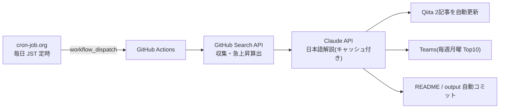

# Claude Code向けMCPツール候補ランキング

GitHub Search APIを使って、Claude Code周辺で活用候補になりそうなMCP関連リポジトリを定期収集するリポジトリです。

> 注意: この一覧は「Claude Codeでの動作」を保証するものではありません。  
> GitHub上のリポジトリ名・説明文・READMEなどに含まれる情報をもとに、MCP関連ツール候補を探すための入口として利用します。

## 仕組み(定常自律運転)

このランキングは cron-job.org → GitHub Actions → Claude API → Qiita / Teams のパイプラインで、毎日無人更新されています。



- 仕組みの詳細と**ライブ稼働ステータス**: [定常自律運転ページ](https://takanobusano.github.io/mcp-github-ranking/)
- 作り方の解説記事: [パイプライン編](https://qiita.com/4q_sano/items/913e93ee5cc2731561fc) / [cron-job.org 完全自動化編](https://qiita.com/4q_sano/items/1bc5e0669a8f0166936c)
<!-- MCP_REPOS_START -->
最終更新: **2026-11-15 08:17:15 JST**

MCP関連リポジトリに加え、Claude Code周辺で活用候補になりそうな関連ツールをGitHub Search APIで毎日自動収集してランキング化しています。

Stars / Forks の差分は、UTC基準の前日データ（2026-11-13）との差分です。
CSVには最大500件を保存し、本文では上位100件を表示しています。

> 注意: この一覧はClaude Codeでの動作を保証するものではありません。  
> MCP関連ツールまたはClaude Code関連ツール候補を探すための入口として利用してください。

# 注目MCP・関連ツール候補ランキング

## 1位 [public-apis/public-apis](https://github.com/public-apis/public-apis)

A collective list of free APIs

⭐ **499,029 Stars**（+248）　🍴 **55,914 Forks**（+46）　/　🟢 **2,703 Open Issues**　/　Python

Topics: `api` / `apis` / `dataset` / `development` / `free` / `list` / `lists` / `open-source`

## 2位 [morluto/rea](https://github.com/morluto/rea)

Reverse engineer anything with agents, from app behavior down to native binaries.

⭐ **459,787 Stars**（+2,220）　🍴 **112,698 Forks**（+414）　/　🟢 **1,570 Open Issues**　/　TypeScript

Topics: `agent-skills` / `ai` / `android` / `claude-code` / `cli` / `cpp` / `dsh-plugin` / `html`

## 3位 [openclaw/openclaw](https://github.com/openclaw/openclaw)

The AI that really does things. Any OS. Any Platform. The lobster way. 🦞

⭐ **394,458 Stars**（+62）　🍴 **82,888 Forks**（±0）　/　🟢 **8,445 Open Issues**　/　TypeScript

Topics: `ai` / `assistant` / `crustacean` / `molty` / `openclaw` / `own-your-data` / `personal`

## 4位 [mattpocock/skills](https://github.com/mattpocock/skills)

Skills for Real Engineers. Straight from my .agents directory.

⭐ **324,474 Stars**（+680）　🍴 **27,231 Forks**（+59）　/　🟢 **246 Open Issues**　/　Shell

Topics: `topicなし`

## 5位 [obra/superpowers](https://github.com/obra/superpowers)

An agentic skills framework & software development methodology that works.

⭐ **317,633 Stars**（+412）　🍴 **28,284 Forks**（+45）　/　🟢 **350 Open Issues**　/　Shell

Topics: `ai` / `brainstorming` / `coding` / `obra` / `sdlc` / `skills` / `subagent-driven-development` / `superpowers`

## 6位 [affaan-m/ECC](https://github.com/affaan-m/ECC)

The agent harness performance optimization system. Skills, instincts, memory, security, and research-first development for Claude Code, Codex, Opencode, Cursor and beyond.

⭐ **303,025 Stars**（+584）　🍴 **44,683 Forks**（+72）　/　🟢 **279 Open Issues**　/　JavaScript

Topics: `ai-agents` / `anthropic` / `claude` / `claude-code` / `developer-tools` / `llm` / `mcp` / `productivity`

## 7位 [NousResearch/hermes-agent](https://github.com/NousResearch/hermes-agent)

The agent that grows with you

⭐ **263,397 Stars**（+179）　🍴 **59,369 Forks**（+86）　/　🟢 **53,085 Open Issues**　/　Python

Topics: `ai` / `ai-agent` / `ai-agents` / `anthropic` / `chatgpt` / `claude` / `claude-code` / `codex`

## 8位 [multica-ai/andrej-karpathy-skills](https://github.com/multica-ai/andrej-karpathy-skills)

A single CLAUDE.md file to improve Claude Code behavior, derived from Andrej Karpathy's observations on LLM coding pitfalls.

⭐ **233,148 Stars**（+282）　🍴 **23,176 Forks**（+28）　/　🟢 **138 Open Issues**　/　不明

Topics: `topicなし`

## 9位 [firecrawl/firecrawl](https://github.com/firecrawl/firecrawl)

Supercharge your AI agents with data from the web and beyond. Building the library for superintelligence. 🔥

⭐ **201,808 Stars**（+228）　🍴 **10,583 Forks**（+11）　/　🟢 **801 Open Issues**　/　TypeScript

Topics: `ai` / `ai-agents` / `ai-crawler` / `ai-scraping` / `ai-search` / `crawler` / `data-extraction` / `html-to-markdown`

## 10位 [ultraworkers/claw-code](https://github.com/ultraworkers/claw-code)

An agent-managed museum exhibit, built in Rust with Gajae-Code / LazyCodex — developed and maintained with no human intervention.

⭐ **194,780 Stars**（-2）　🍴 **107,301 Forks**（-16）　/　🟢 **5 Open Issues**　/　Rust

Topics: `topicなし`

## 11位 [anthropics/skills](https://github.com/anthropics/skills)

Public repository for Agent Skills

⭐ **194,610 Stars**（+488）　🍴 **22,899 Forks**（+68）　/　🟢 **1,542 Open Issues**　/　Python

Topics: `agent-skills`

## 12位 [DietrichGebert/ponytail](https://github.com/DietrichGebert/ponytail)

Makes your AI agent think like the laziest senior dev in the room. The best code is the code you never wrote.

⭐ **190,901 Stars**（+555）　🍴 **10,674 Forks**（+45）　/　🟢 **237 Open Issues**　/　JavaScript

Topics: `agent-skills` / `ai-agents` / `claude` / `claude-code` / `claude-code-plugin` / `cursor-rules` / `developer-tools` / `llm`

## 13位 [Significant-Gravitas/AutoGPT](https://github.com/Significant-Gravitas/AutoGPT)

AutoGPT is the vision of accessible AI for everyone, to use and to build on. Our mission is to provide the tools, so that you can focus on what matters.

⭐ **188,026 Stars**（+7）　🍴 **45,865 Forks**（-1）　/　🟢 **689 Open Issues**　/　Python

Topics: `agentic-ai` / `agents` / `ai` / `artificial-intelligence` / `autonomous-agents` / `claude` / `gpt` / `llama-api`

## 14位 [ollama/ollama](https://github.com/ollama/ollama)

Get up and running with Kimi, GLM, MiniMax, DeepSeek, gpt-oss, Qwen, Gemma and other models.

⭐ **186,975 Stars**（+83）　🍴 **19,082 Forks**（+14）　/　🟢 **4,656 Open Issues**　/　Go

Topics: `deepseek` / `gemma` / `glm` / `go` / `golang` / `gpt-oss` / `llama` / `llm`

## 15位 [msitarzewski/agency-agents](https://github.com/msitarzewski/agency-agents)

A complete AI agency at your fingertips - From frontend wizards to Reddit community ninjas, from whimsy injectors to reality checkers. Each agent is a specialized expert with personality, processes, and proven deliverables.

⭐ **168,331 Stars**（+193）　🍴 **27,298 Forks**（+20）　/　🟢 **251 Open Issues**　/　Shell

Topics: `topicなし`

## 16位 [langgenius/dify](https://github.com/langgenius/dify)

Build Agentic workflows, RAG pipelines, with rich AI model and tool support on one collaborative workspace. Deploy on cloud, VPC, or self-hosted, so teams move from prototype to production without rebuilding the stack.

⭐ **161,165 Stars**（+47）　🍴 **25,498 Forks**（+19）　/　🟢 **1,400 Open Issues**　/　Python

Topics: `agent` / `agentic-ai` / `agentic-framework` / `agentic-workflow` / `ai` / `automation` / `claude` / `deepseek`

## 17位 [langflow-ai/langflow](https://github.com/langflow-ai/langflow)

Langflow is a powerful tool for building and deploying AI-powered agents and workflows.

⭐ **156,640 Stars**（+31）　🍴 **10,407 Forks**（+10）　/　🟢 **1,338 Open Issues**　/　Python

Topics: `agents` / `chatgpt` / `generative-ai` / `large-language-models` / `multiagent` / `react-flow`

## 18位 [anthropics/claude-code](https://github.com/anthropics/claude-code)

Claude Code is an agentic coding tool that lives in your terminal, understands your codebase, and helps you code faster by executing routine tasks, explaining complex code, and handling git workflows - all through natural language commands.

⭐ **155,686 Stars**（+120）　🍴 **24,994 Forks**（+23）　/　🟢 **17,221 Open Issues**　/　TypeScript

Topics: `topicなし`

## 19位 [farion1231/cc-switch](https://github.com/farion1231/cc-switch)

A cross-platform desktop All-in-One assistant for Claude Code, Codex, OpenCode,DeepSeek Harness and more. Only official website: ccswitch.io

⭐ **154,427 Stars**（+200）　🍴 **10,126 Forks**（+11）　/　🟢 **964 Open Issues**　/　Rust

Topics: `ai-tools` / `claude-code` / `codex` / `deepseek-harness` / `desktop-app` / `grok` / `grokbuild` / `hermes`

## 20位 [nextlevelbuilder/ui-ux-pro-max-skill](https://github.com/nextlevelbuilder/ui-ux-pro-max-skill)

An AI skill that provides design intelligence for building professional UI/UX across multiple platforms.

⭐ **149,511 Stars**（+424）　🍴 **15,807 Forks**（+36）　/　🟢 **83 Open Issues**　/　Python

Topics: `ai-skills` / `antigravity` / `claude` / `claude-code` / `codex` / `command-line` / `copilot` / `cursor-ai`

## 21位 [Graphify-Labs/graphify](https://github.com/Graphify-Labs/graphify)

Turn any codebase, with its docs, SQL schemas, configs, and PDFs, into a queryable knowledge graph. A /graphify skill for Claude Code, Cursor, Codex, and Gemini CLI: local deterministic AST parsing, every edge explained, no vector store.

⭐ **147,749 Stars**（+480）　🍴 **14,160 Forks**（+46）　/　🟢 **1,635 Open Issues**　/　Python

Topics: `ai-agents` / `antigravity` / `ast` / `claude-code` / `code-analysis` / `code-search` / `codex` / `cursor`

## 22位 [x1xhlol/system-prompts-and-models-of-ai-tools](https://github.com/x1xhlol/system-prompts-and-models-of-ai-tools)

FULL Augment Code, Claude Code, Cluely, CodeBuddy, Comet, Cursor, Devin AI, Junie, Kiro, Leap.new, Lovable, Manus, NotionAI, Orchids.app, Perplexity, Poke, Qoder, Replit, Same.dev, Trae, Traycer AI, VSCode Agent, Warp.dev, Windsurf, Xcode, Z.ai Code, Dia & v0. (And other Open Sourced) System Prompts, Internal Tools & AI Models

⭐ **144,670 Stars**（+11）　🍴 **34,689 Forks**（+2）　/　🟢 **162 Open Issues**　/　不明

Topics: `ai` / `bolt` / `cluely` / `copilot` / `cursor` / `cursorai` / `devin` / `github-copilot`

## 23位 [harry0703/MoneyPrinterTurbo](https://github.com/harry0703/MoneyPrinterTurbo)

利用 AI 大模型和自动化工作流，根据主题或关键词一键生成高清短视频。Generate HD short videos from a topic or keyword with an automated AI workflow.

⭐ **143,576 Stars**（+287）　🍴 **23,003 Forks**（+72）　/　🟢 **86 Open Issues**　/　Python

Topics: `ai-video-generator` / `content-creation` / `ffmpeg` / `instagram-reels` / `llm` / `python` / `short-video` / `subtitles`

## 24位 [garrytan/gstack](https://github.com/garrytan/gstack)

Use Garry Tan's exact Claude Code setup: 23 opinionated tools that serve as CEO, Designer, Eng Manager, Release Manager, Doc Engineer, and QA

⭐ **141,574 Stars**（+107）　🍴 **20,912 Forks**（+21）　/　🟢 **135 Open Issues**　/　TypeScript

Topics: `topicなし`

## 25位 [stablyai/orca](https://github.com/stablyai/orca)

Orca lets you run a fleet of coding agents (e.g. Claude Code, Codex) with your own subscription. Available on desktop, mobile and remote runtime.

⭐ **125,032 Stars**（+647）　🍴 **7,923 Forks**（+52）　/　🟢 **8,486 Open Issues**　/　TypeScript

Topics: `agent-ide` / `ai-agents` / `automation` / `bot` / `claude-code` / `codex` / `ghostty` / `grok-bot`

## 26位 [TauricResearch/TradingAgents](https://github.com/TauricResearch/TradingAgents)

TradingAgents: Multi-Agents LLM Financial Trading Framework

⭐ **122,594 Stars**（+132）　🍴 **23,484 Forks**（+34）　/　🟢 **147 Open Issues**　/　Python

Topics: `agent` / `finance` / `llm` / `multiagent` / `trading`

## 27位 [browser-use/browser-use](https://github.com/browser-use/browser-use)

Open-source Python library for AI browser agents, plus Browser Use Cloud: stealth browsers and a hosted agent API.

⭐ **121,027 Stars**（+74）　🍴 **13,538 Forks**（+11）　/　🟢 **581 Open Issues**　/　Python

Topics: `ai-agents` / `ai-tools` / `browser-agent` / `browser-automation` / `browser-use` / `cdp` / `cloud-browser` / `computer-use`

## 28位 [JuliusBrussee/caveman](https://github.com/JuliusBrussee/caveman)

🪨 why use many token when few token do trick. Viral skill + proxy for coding agents that cuts 65% of tokens by talking like a caveman.

⭐ **120,039 Stars**（+347）　🍴 **7,002 Forks**（+29）　/　🟢 **88 Open Issues**　/　Go

Topics: `ai` / `anthropic` / `caveman` / `claude` / `claude-code` / `llm` / `meme` / `prompt-engineering`

## 29位 [addyosmani/agent-skills](https://github.com/addyosmani/agent-skills)

Production-grade engineering skills for AI coding agents.

⭐ **117,556 Stars**（+426）　🍴 **12,295 Forks**（+48）　/　🟢 **122 Open Issues**　/　JavaScript

Topics: `agent-skills` / `antigravity` / `claude-code` / `codex` / `cursor` / `skills`

## 30位 [thedotmack/claude-mem](https://github.com/thedotmack/claude-mem)

Persistent Context Across Sessions for Every Agent –  Captures everything your agent does during sessions, compresses it with AI, and injects relevant context back into future sessions. Works with Claude Code, OpenClaw, Codex, Gemini, Hermes, Copilot, OpenCode + More

⭐ **117,105 Stars**（+268）　🍴 **10,164 Forks**（+26）　/　🟢 **160 Open Issues**　/　TypeScript

Topics: `ai` / `ai-agents` / `ai-memory` / `anthropic` / `artificial-intelligence` / `chromadb` / `claude` / `claude-agent-sdk`

## 31位 [Leonxlnx/taste-skill](https://github.com/Leonxlnx/taste-skill)

Agent skills that give coding agents taste: art direction, reference images and a browser check instead of generic AI pages

⭐ **115,627 Stars**（+610）　🍴 **7,760 Forks**（+45）　/　🟢 **9 Open Issues**　/　JavaScript

Topics: `agent-skills` / `ai-agents` / `anti-slop` / `claude-code` / `codex` / `cursor` / `design-system` / `frontend`

## 32位 [paperclipai/paperclip](https://github.com/paperclipai/paperclip)

The open-source app everyone uses to manage agents at work

⭐ **113,925 Stars**（+239）　🍴 **18,901 Forks**（+33）　/　🟢 **6,671 Open Issues**　/　TypeScript

Topics: `acpx` / `agent-orchestration` / `agent-skills` / `agentic-ai` / `ai-agents` / `ai-engineering` / `ai-governance` / `ai-tools`

## 33位 [Panniantong/Agent-Reach](https://github.com/Panniantong/Agent-Reach)

Give your AI agent eyes to see the entire internet. Read & search Twitter, Reddit, YouTube, GitHub, Bilibili, XiaoHongShu — one CLI, zero API fees.

⭐ **111,790 Stars**（+224）　🍴 **10,023 Forks**（+23）　/　🟢 **106 Open Issues**　/　Python

Topics: `agent-infrastructure` / `ai-agent` / `ai-search` / `automation` / `bilibili` / `claude-code` / `cli` / `cursor`

## 34位 [debpalash/VoiceStudio](https://github.com/debpalash/VoiceStudio)

VoiceStudio is the open-source, fully-local ElevenLabs alternative — voice cloning, voice design, video dubbing, dictation, transcription & audiobook creation in 646 languages.

⭐ **110,655 Stars**（+709）　🍴 **12,253 Forks**（+68）　/　🟢 **21 Open Issues**　/　Python

Topics: `ai` / `audiobook` / `cuda` / `dubbing` / `elevenlabs-alternative` / `huggingface` / `local-first` / `mlx`

## 35位 [pbakaus/impeccable](https://github.com/pbakaus/impeccable)

The design vocabulary for your coding agent. Steer with polish and bolder, review with critique and audit, catch AI slop before it ships.

⭐ **110,194 Stars**（+623）　🍴 **6,570 Forks**（+36）　/　🟢 **56 Open Issues**　/　Rust

Topics: `agent-skills` / `ai` / `anti-slop` / `design` / `slop`

## 36位 [google-gemini/gemini-cli](https://github.com/google-gemini/gemini-cli)

An open-source AI agent that brings the power of Gemini directly into your terminal.

⭐ **108,832 Stars**（+13）　🍴 **14,957 Forks**（+7）　/　🟢 **729 Open Issues**　/　TypeScript

Topics: `ai` / `ai-agents` / `cli` / `gemini` / `gemini-api` / `mcp-client` / `mcp-server`

## 37位 [nexu-io/open-design](https://github.com/nexu-io/open-design)

The 1st Collaborative AI Design Agent Workspace. Local-first and open source. Create motion, prototypes, websites, apps, dashboards, presentations, images, and videos with your team and AI agents. Share work, exchange feedback, and iterate together in one workspace.

⭐ **107,650 Stars**（+126）　🍴 **12,240 Forks**（+16）　/　🟢 **1,402 Open Issues**　/　TypeScript

Topics: `agent-skills` / `ai-design` / `byok` / `claude-code-for-design` / `claude-design` / `codex-design` / `cursor-design` / `deepseek`

## 38位 [ruvnet/RuView](https://github.com/ruvnet/RuView)

π RuView turns commodity WiFi signals into real-time spatial intelligence, vital sign monitoring, and presence detection — all without a single pixel of video.

⭐ **104,295 Stars**（+58）　🍴 **13,567 Forks**（+5）　/　🟢 **585 Open Issues**　/　Rust

Topics: `claude` / `claude-code` / `esp32` / `firmware` / `home-assistant` / `home-automation` / `iot` / `mcp`

## 39位 [D4Vinci/Scrapling](https://github.com/D4Vinci/Scrapling)

🕷️ The BEST Web Scraping framework that handles everything from a single request to a full-scale crawl! Don't be shy, join here:  and follow here for daily tips and tricks:

⭐ **102,915 Stars**（+432）　🍴 **10,718 Forks**（+45）　/　🟢 **21 Open Issues**　/　Python

Topics: `ai` / `ai-scraping` / `automation` / `crawler` / `crawling` / `crawling-python` / `data` / `data-extraction`

## 40位 [microsoft/playwright](https://github.com/microsoft/playwright)

Playwright is a framework for Web Testing and Automation. It allows testing Chromium, Firefox and WebKit with a single API.

⭐ **100,185 Stars**（+76）　🍴 **6,882 Forks**（+9）　/　🟢 **41 Open Issues**　/　TypeScript

Topics: `automation` / `chrome` / `chromium` / `e2e-testing` / `electron` / `end-to-end-testing` / `firefox` / `javascript`

## 41位 [OpenCut-app/OpenCut](https://github.com/OpenCut-app/OpenCut)

The open-source CapCut alternative

⭐ **98,363 Stars**（+77）　🍴 **9,828 Forks**（+8）　/　🟢 **386 Open Issues**　/　TypeScript

Topics: `editor` / `oss` / `videoeditor`

## 42位 [tt-a1i/archify](https://github.com/tt-a1i/archify)

Turn any idea, plan, or codebase into a beautiful interactive diagram. An agent skill for Claude Code, Codex, and more.

⭐ **96,439 Stars**（+220）　🍴 **6,591 Forks**（+16）　/　🟢 **358 Open Issues**　/　JavaScript

Topics: `agent-skills` / `ai-agents` / `architecture-diagram` / `claude-code` / `claude-skills` / `codex` / `coding-agents` / `deepseek-harness`

## 43位 [puppeteer/puppeteer](https://github.com/puppeteer/puppeteer)

JavaScript API for Chrome and Firefox

⭐ **95,840 Stars**（+8）　🍴 **9,604 Forks**（+1）　/　🟢 **208 Open Issues**　/　TypeScript

Topics: `automation` / `chrome` / `chromium` / `developer-tools` / `firefox` / `headless-chrome` / `node-module` / `testing`

## 44位 [OpenHands/OpenHands](https://github.com/OpenHands/OpenHands)

🙌 OpenHands: AI-Driven Development

⭐ **93,477 Stars**（+49）　🍴 **12,513 Forks**（+12）　/　🟢 **1,180 Open Issues**　/　TypeScript

Topics: `agent` / `artificial-intelligence` / `chatgpt` / `claude-ai` / `cli` / `developer-tools` / `gpt` / `llm`

## 45位 [Egonex-AI/Understand-Anything](https://github.com/Egonex-AI/Understand-Anything)

Graphs that teach > graphs that impress. Turn any code into an interactive knowledge graph you can explore, search, and ask questions about. Works with Claude Code, Codex, Cursor, Copilot, Gemini CLI, and more.

⭐ **92,628 Stars**（+83）　🍴 **7,903 Forks**（+6）　/　🟢 **365 Open Issues**　/　TypeScript

Topics: `antigravity-skills` / `business-knowledge` / `claude-code` / `claude-skills` / `codebase-analysis` / `codex` / `codex-skills` / `developer-tools-ai-agent`

## 46位 [modelcontextprotocol/servers](https://github.com/modelcontextprotocol/servers)

Model Context Protocol Reference Servers

⭐ **91,996 Stars**（+20）　🍴 **11,968 Forks**（+6）　/　🟢 **19 Open Issues**　/　TypeScript

Topics: `topicなし`

## 47位 [koala73/worldmonitor](https://github.com/koala73/worldmonitor)

Real-time global intelligence dashboard. AI-powered news aggregation, geopolitical monitoring, and infrastructure tracking in a unified situational awareness interface

⭐ **90,647 Stars**（+46）　🍴 **14,063 Forks**（+11）　/　🟢 **329 Open Issues**　/　TypeScript

Topics: `agent` / `ai` / `dashboard` / `gemini-cli-extension` / `geopolitics` / `mcp` / `mcp-server` / `monitoring`

## 48位 [ChatGPTNextWeb/NextChat](https://github.com/ChatGPTNextWeb/NextChat)

✨ Zero-config AI chat assistant. No API key needed — sign up and instantly chat with GPT-5, Claude 4, Gemini 2.5, DeepSeek & 100+ top models. Pay-as-you-go save...

⭐ **88,963 Stars**（+4）　🍴 **58,527 Forks**（-6）　/　🟢 **866 Open Issues**　/　TypeScript

Topics: `calclaude` / `claude` / `cross-platform` / `desktop` / `fe` / `gemini` / `gemini-pro` / `gemini-server`

## 49位 [cheaper-inference/OmniRoute](https://github.com/cheaper-inference/OmniRoute)

Never stop coding. Free MIT AI gateway: one endpoint, 375 providers (150+ free), 1,400+ models Kimi, Claude, GPT, Gemini, GLM, DeepSeek, MiniMax. Works with Claude Code, Codex, Cursor, OpenCode, Cline & Copilot. Quota-aware auto-fallback, RTK+Caveman compression saves 15-95% tokens, MCP/A2A, Desktop/PWA. Built by 900+ contributors

⭐ **87,476 Stars**（+313）　🍴 **13,417 Forks**（+64）　/　🟢 **529 Open Issues**　/　TypeScript

Topics: `a2a` / `ai-agents` / `ai-gateway` / `anthropic` / `claude` / `claude-code` / `cline` / `codex`

## 50位 [unclecode/crawl4ai](https://github.com/unclecode/crawl4ai)

Official Crawl4AI Cloud: a hosted web scraping, extraction, and search API for AI agents. Free API key, 1,000 credits a month, no card. Fully open source: this repo is the Apache-2.0 crawler that powers it, and you can self-host it.

⭐ **87,358 Stars**（+37）　🍴 **9,115 Forks**（+8）　/　🟢 **347 Open Issues**　/　Python

Topics: `ai` / `ai-agents` / `crawl4ai-cloud` / `crawler` / `data-extraction` / `llm` / `markdown` / `mcp`

## 51位 [rtk-ai/rtk](https://github.com/rtk-ai/rtk)

CLI proxy that reduces LLM token consumption by 60-90% on common dev commands. Single Rust binary, zero dependencies

⭐ **86,591 Stars**（+102）　🍴 **5,549 Forks**（+6）　/　🟢 **1,702 Open Issues**　/　Rust

Topics: `agentic-coding` / `ai-coding` / `anthropic` / `claude-code` / `cli` / `command-line-tool` / `cost-reduction` / `developer-tools`

## 52位 [lobehub/lobehub](https://github.com/lobehub/lobehub)

🤯 LobeHub - Super-Agents on Your Team. Add super-agents to the chats your team already uses.They take on work by themselves and get better every week.

⭐ **85,526 Stars**（+150）　🍴 **16,317 Forks**（+26）　/　🟢 **1,343 Open Issues**　/　TypeScript

Topics: `agent` / `agent-collaboration` / `agent-harness` / `loop-engineering` / `mcp` / `personal-assistant` / `proactive-agent` / `skills`

## 53位 [laravel/laravel](https://github.com/laravel/laravel)

Laravel is a web application framework with expressive, elegant syntax. We’ve already laid the foundation for your next big idea — freeing you to create without sweating the small things.

⭐ **85,398 Stars**（+4）　🍴 **25,534 Forks**（+1）　/　🟢 **31 Open Issues**　/　Blade

Topics: `framework` / `laravel` / `php`

## 54位 [bytedance/deer-flow](https://github.com/bytedance/deer-flow)

An open-source long-horizon SuperAgent harness that researches, codes, and creates. With the help of sandboxes, memories, tools, skill, subagents and message gateway, it handles different levels of tasks that could take minutes to hours.

⭐ **85,345 Stars**（+25）　🍴 **12,026 Forks**（+2）　/　🟢 **1,093 Open Issues**　/　Python

Topics: `agent` / `agentic` / `agentic-framework` / `agentic-workflow` / `ai` / `ai-agents` / `deep-research` / `harness`

## 55位 [heygen-com/hyperframes](https://github.com/heygen-com/hyperframes)

Write HTML. Render video. Built for agents.

⭐ **84,338 Stars**（+412）　🍴 **7,801 Forks**（+50）　/　🟢 **288 Open Issues**　/　TypeScript

Topics: `ai` / `ai-agents` / `animation` / `claude-code` / `ffmpeg` / `framework` / `gsap` / `html`

## 56位 [ruvnet/ruflo](https://github.com/ruvnet/ruflo)

🌊 The original agent harness. Deploy intelligent multi-player swarms, coordinate autonomous workflows, and build conversational AI systems. Features adaptive me...

⭐ **81,710 Stars**（+66）　🍴 **9,630 Forks**（+13）　/　🟢 **593 Open Issues**　/　TypeScript

Topics: `agent-memory` / `agent-orchestration` / `agentic-ai` / `agentic-workflow` / `ai-agents` / `autonomous-agents` / `claude` / `claude-code`

## 57位 [abi/screenshot-to-code](https://github.com/abi/screenshot-to-code)

Drop in a screenshot and convert it to clean code (HTML/Tailwind/React/Vue)

⭐ **81,210 Stars**（+10）　🍴 **9,950 Forks**（+4）　/　🟢 **149 Open Issues**　/　Python

Topics: `topicなし`

## 58位 [OpenMontageInc/OpenMontage](https://github.com/OpenMontageInc/OpenMontage)

World's first open-source, agentic video production system. 12 production pipelines, 100+ tools, 700+ agent skill and production-knowledge files. Turn your AI coding assistant into a full video production studio.

⭐ **80,488 Stars**（+207）　🍴 **10,846 Forks**（+41）　/　🟢 **354 Open Issues**　/　Python

Topics: `agent` / `agentic-ai` / `ai` / `claude` / `copilot` / `cursor` / `elevenlabs` / `ffmpeg`

## 59位 [shareAI-lab/learn-claude-code](https://github.com/shareAI-lab/learn-claude-code)

Bash is all you need -  A nano claude code–like 「agent harness」, built from 0 to 1

⭐ **80,408 Stars**（+29）　🍴 **12,856 Forks**（+10）　/　🟢 **63 Open Issues**　/　Python

Topics: `agent` / `agent-development` / `ai-agent` / `claude` / `claude-code` / `educational` / `llm` / `python`

## 60位 [headroomlabs-ai/headroom](https://github.com/headroomlabs-ai/headroom)

Compress tool outputs, logs, files, and RAG chunks before they reach the LLM. 20% fewer tokens for coding agents, 60-95% fewer tokens for JSON, same answers. Library, proxy, MCP server.

⭐ **79,670 Stars**（+75）　🍴 **6,236 Forks**（+8）　/　🟢 **304 Open Issues**　/　Python

Topics: `agent` / `ai` / `anthropic` / `claude-code` / `compression` / `context-engineering` / `context-window` / `cursor`

## 61位 [unslothai/unsloth](https://github.com/unslothai/unsloth)

Local UI to run and train LLMs and diffusion models. Supports GGUF, MLX, Qwen3.8, DeepSeek-V4.1, MiniMax-H3, Gemma 4, FLUX and more.

⭐ **79,506 Stars**（+54）　🍴 **7,413 Forks**（+6）　/　🟢 **436 Open Issues**　/　Python

Topics: `agent` / `ai` / `chatgpt` / `deepseek` / `fine-tuning` / `gemma` / `image-generation` / `llama`

## 62位 [storytold/photocraft](https://github.com/storytold/photocraft)

PhotoCraft: An open-source photo editor written from scratch in pure Rust

⭐ **79,408 Stars**（+219）　🍴 **14,033 Forks**（+40）　/　🟢 **5,223 Open Issues**　/　Rust

Topics: `art` / `image-editing` / `image-editing-software` / `image-editor` / `images` / `photo-editing` / `rust`

## 63位 [rohitg00/ai-engineering-from-scratch](https://github.com/rohitg00/ai-engineering-from-scratch)

Learn AI Engineering! Learn it. Build it. Ship it for others.

⭐ **78,945 Stars**（+261）　🍴 **14,064 Forks**（+46）　/　🟢 **71 Open Issues**　/　Python

Topics: `agents` / `ai` / `ai-agents` / `ai-engineering` / `computer-vision` / `course` / `deep-learning` / `dsh`

## 64位 [colbymchenry/codegraph](https://github.com/colbymchenry/codegraph)

Pre-indexed code knowledge graph, auto syncs on code changes, for Claude Code, Codex, Gemini, Cursor, OpenCode, AntiGravity, Kiro, CoPilot, and Hermes Agent — fewer tokens, fewer tool calls, 100% local

⭐ **77,613 Stars**（+63）　🍴 **5,179 Forks**（+9）　/　🟢 **301 Open Issues**　/　TypeScript

Topics: `topicなし`

## 65位 [nestjs/nest](https://github.com/nestjs/nest)

A progressive TypeScript framework for Node.js backends: from a small API in one file to efficient, scalable, enterprise-grade systems 🚀

⭐ **77,125 Stars**（+8）　🍴 **8,740 Forks**（±0）　/　🟢 **41 Open Issues**　/　TypeScript

Topics: `framework` / `hacktoberfest` / `javascript` / `javascript-framework` / `microservices` / `nest` / `nestjs` / `node`

## 66位 [hugohe3/ppt-master](https://github.com/hugohe3/ppt-master)

AI turns documents or topics into real, native PowerPoint decks—with native shapes, transitions and animations, data-backed charts and tables on demand, audio narration from speaker notes, and support for your own .pptx templates. · by Hugo He

⭐ **76,838 Stars**（+253）　🍴 **6,001 Forks**（+21）　/　🟢 **1 Open Issues**　/　Python

Topics: `ai-agent` / `aippt` / `office` / `powerpoint` / `powerpoint-generation` / `ppt` / `pptx` / `presentation`

## 67位 [eternity4719/HowToLiveBetter](https://github.com/eternity4719/HowToLiveBetter)

高性价比人生指南: 长寿防病、急救、省钱理财、法律红线、失业与工伤、医保社保、恋爱婚育、怀孕育儿、创业与做平台合规、出国与技能。每条写明成本、收益、证据等级和原始出处，只引期刊论文与官方文件。

⭐ **75,767 Stars**（+189）　🍴 **6,715 Forks**（+18）　/　🟢 **17 Open Issues**　/　HTML

Topics: `topicなし`

## 68位 [usestrix/strix](https://github.com/usestrix/strix)

Open-source AI penetration testing tool to find and fix your app’s vulnerabilities.

⭐ **75,574 Stars**（+176）　🍴 **8,539 Forks**（+19）　/　🟢 **604 Open Issues**　/　Python

Topics: `agents` / `ai-hacking` / `ai-penetration-testing` / `ai-pentesting` / `ai-security` / `artificial-intelligence` / `bug-bounty` / `code-quality`

## 69位 [Eugeny/tabby](https://github.com/Eugeny/tabby)

A terminal for a more modern age

⭐ **75,430 Stars**（±0）　🍴 **4,347 Forks**（+2）　/　🟢 **2,898 Open Issues**　/　TypeScript

Topics: `serial` / `ssh-client` / `telnet-client` / `terminal` / `terminal-emulators`

## 70位 [openbq-org/OpenBB](https://github.com/openbq-org/OpenBB)

Open Data Platform for analysts, quants and AI agents.

⭐ **75,423 Stars**（+23）　🍴 **7,892 Forks**（+2）　/　🟢 **115 Open Issues**　/　Python

Topics: `ai` / `crypto` / `derivatives` / `economics` / `equity` / `finance` / `fixed-income` / `machine-learning`

## 71位 [tw93/Mole](https://github.com/tw93/Mole)

🐹 Open-source Mac and PC cleaner. Keep your machine clean, light, and running like new. Fast CLI, plus native Mac and Windows apps.

⭐ **75,050 Stars**（+133）　🍴 **2,702 Forks**（+5）　/　🟢 **18 Open Issues**　/　Shell

Topics: `analyzer` / `appcleaner` / `clean` / `cleaner` / `cleanmymac` / `command-line` / `daisydisk` / `deepseek-harness`

## 72位 [thedaviddias/Front-End-Checklist](https://github.com/thedaviddias/Front-End-Checklist)

🗂 The essential checklist for modern web development, for humans and AI agents

⭐ **74,735 Stars**（+7）　🍴 **6,782 Forks**（±0）　/　🟢 **22 Open Issues**　/　MDX

Topics: `ai-agent` / `ai-agents` / `checklist` / `css` / `front-end-developer-tool` / `front-end-development` / `frontend` / `guidelines`

## 73位 [Ebony-Vinyl/dsh-our-free-model](https://github.com/Ebony-Vinyl/dsh-our-free-model)

在 dsh 里装上这个插件即可，无需登录、注册或填 API Key，就能使用包括 DeepSeek V4.1 Flash、Kimi K3 在内的前沿模型——完全免费，不限量。 All you do is install this plugin in dsh: no login, no sign-up, no API k...

⭐ **74,320 Stars**（+1,545）　🍴 **2,073 Forks**（+64）　/　🟢 **179 Open Issues**　/　JavaScript

Topics: `ai-agents` / `deepseek` / `deepseek-harness` / `developer-tools` / `dsh` / `dsh-plugin` / `free-model` / `llm`

## 74位 [cline/cline](https://github.com/cline/cline)

Autonomous coding agent as an SDK, IDE extension, or CLI assistant.

⭐ **71,632 Stars**（+35）　🍴 **7,924 Forks**（+6）　/　🟢 **1,780 Open Issues**　/　TypeScript

Topics: `topicなし`

## 75位 [asgeirtj/system_prompts_leaks](https://github.com/asgeirtj/system_prompts_leaks)

Leaked system prompts of ChatGPT, Claude, Gemini and more. The hidden system prompt of every popular chatbot, in full, every version since May 2025. Also Anthropic Claude Code, OpenAI Codex, Google Antigravity, xAI Grok, Meta Muse, Moonshot Kimi, Alibaba Qwen, Z.ai GLM ZCode, MiniMax, Cursor, Perplexity, DeepSeek and 30+ others. Updated daily.

⭐ **71,413 Stars**（+59）　🍴 **11,496 Forks**（+7）　/　🟢 **26 Open Issues**　/　Python

Topics: `ai` / `ai-agents` / `ai-prompts` / `anthropic` / `chatbot` / `chatgpt` / `claude` / `claude-code`

## 76位 [NanmiCoder/MediaCrawler](https://github.com/NanmiCoder/MediaCrawler)

小红书笔记 \| 评论爬虫、抖音视频 \| 评论爬虫、快手视频 \| 评论爬虫、B 站视频 ｜ 评论爬虫、微博帖子 ｜ 评论爬虫、百度贴吧帖子 ｜ 百度贴吧评论回复爬虫  \| 知乎问答文章｜评论爬虫

⭐ **71,120 Stars**（+28）　🍴 **13,437 Forks**（+7）　/　🟢 **217 Open Issues**　/　Python

Topics: `topicなし`

## 77位 [code-yeongyu/oh-my-openagent](https://github.com/code-yeongyu/oh-my-openagent)

OmO: Just type "mass ulw" keyword with your prompt. Now you are the master of graph engineering.

⭐ **70,913 Stars**（+20）　🍴 **5,845 Forks**（+2）　/　🟢 **2,840 Open Issues**　/　TypeScript

Topics: `ai` / `ai-agents` / `anthropic` / `chatgpt` / `claude` / `claude-skills` / `codex` / `cursor`

## 78位 [docling-project/docling](https://github.com/docling-project/docling)

Get your documents ready for gen AI

⭐ **70,588 Stars**（+30）　🍴 **5,348 Forks**（+12）　/　🟢 **1,026 Open Issues**　/　Python

Topics: `ai` / `convert` / `document-parser` / `document-parsing` / `documents` / `docx` / `html` / `markdown`

## 79位 [Alishahryar1/free-claude-code](https://github.com/Alishahryar1/free-claude-code)

Use Claude Code, Codex, Antigravity, VSCode, Pi, and OpenCode (and 6 other harnesses) for free (1.3B+ free tokens) from your terminal, app, IDE, or phone, and now from the browser with native browser sessions (multi-harness + multi-model) like OpenClaw (voice supported + ToS friendly)

⭐ **70,213 Stars**（+346）　🍴 **10,896 Forks**（+70）　/　🟢 **419 Open Issues**　/　Python

Topics: `topicなし`

## 80位 [blader/humanizer](https://github.com/blader/humanizer)

Agent skill that removes signs of AI-generated writing from text

⭐ **69,125 Stars**（+314）　🍴 **5,434 Forks**（+36）　/　🟢 **4 Open Issues**　/　Python

Topics: `agent-skills` / `ai-humanizer` / `ai-writing` / `chatgpt` / `claude` / `claude-code` / `codex` / `cursor`

## 81位 [shanraisshan/claude-code-best-practice](https://github.com/shanraisshan/claude-code-best-practice)

from vibe coding to agentic engineering - practice makes claude perfect

⭐ **69,060 Stars**（+21）　🍴 **6,873 Forks**（-1）　/　🟢 **24 Open Issues**　/　HTML

Topics: `agentic-ai` / `agentic-coding` / `agentic-engineering` / `agentic-workflow` / `ai` / `ai-agents` / `anthropic` / `best-practices`

## 82位 [mem0ai/mem0](https://github.com/mem0ai/mem0)

The Memory Layer for AI Agents - Drop-in memory infrastructure for AI agents and apps. Context that persists. Built for production.

⭐ **68,967 Stars**（+44）　🍴 **8,206 Forks**（+7）　/　🟢 **949 Open Issues**　/　Python

Topics: `agentic-memory` / `agentic-memory-system` / `agents` / `ai` / `ai-agents` / `chatgpt` / `genai` / `llm`

## 83位 [openinterpreter/openinterpreter](https://github.com/openinterpreter/openinterpreter)

A coding agent for open models like Kimi K3 and GLM 5.3

⭐ **68,888 Stars**（+6）　🍴 **5,947 Forks**（+2）　/　🟢 **38 Open Issues**　/　Rust

Topics: `acp` / `coding-agent` / `deepseek` / `kimi` / `python` / `qwen` / `rust`

## 84位 [mvanhorn/last30days-skill](https://github.com/mvanhorn/last30days-skill)

AI agent skill that researches any topic across Reddit, X, YouTube, HN, Polymarket, and the web - then synthesizes a grounded summary

⭐ **67,673 Stars**（+120）　🍴 **5,952 Forks**（+14）　/　🟢 **24 Open Issues**　/　Python

Topics: `ai-prompts` / `ai-skill` / `bluesky` / `claude` / `claude-code` / `clawhub` / `deep-research` / `hackernews`

## 85位 [bradtraversy/design-resources-for-developers](https://github.com/bradtraversy/design-resources-for-developers)

Curated list of design and UI resources from stock photos, web templates, CSS frameworks, UI libraries, tools and much more

⭐ **67,403 Stars**（+6）　🍴 **12,312 Forks**（+1）　/　🟢 **5 Open Issues**　/　不明

Topics: `topicなし`

## 86位 [cathrynlavery/diagram-design](https://github.com/cathrynlavery/diagram-design)

Editorial diagram design for Claude Code, Codex, GitHub Copilot, Cursor, Factory Droid, Qoder, and Pi. 45 diagram types. Self-contained HTML + SVG. No shadows. No Mermaid slop.

⭐ **67,121 Stars**（+235）　🍴 **4,486 Forks**（+27）　/　🟢 **35 Open Issues**　/　HTML

Topics: `agent-skills` / `claude-code` / `codex` / `data-visualization` / `diagrams` / `drawio` / `mermaid` / `svg`

## 87位 [xtekky/gpt4free](https://github.com/xtekky/gpt4free)

The official gpt4free repository \| various collection of powerful language models \| opus 4.6 gpt 5.3 kimi 2.5 deepseek v3.2 gemini 3

⭐ **67,060 Stars**（+12）　🍴 **13,461 Forks**（-2）　/　🟢 **2 Open Issues**　/　Python

Topics: `chatbot` / `chatbots` / `chatgpt` / `chatgpt-4` / `chatgpt-api` / `chatgpt-free` / `chatgpt4` / `deepseek`

## 88位 [coollabsio/coolify](https://github.com/coollabsio/coolify)

An open-source, self-hostable PaaS alternative to Vercel, Heroku & Netlify that lets you easily deploy static sites, databases, full-stack applications and 360+ one-click services on your own servers.

⭐ **66,081 Stars**（+27）　🍴 **5,989 Forks**（+3）　/　🟢 **258 Open Issues**　/　PHP

Topics: `coolify` / `databases` / `deployment` / `docker` / `docker-compose` / `inertiajs` / `laravel` / `mariadb`

## 89位 [warpdotdev/warp](https://github.com/warpdotdev/warp)

Warp is an agentic development environment, born out of the terminal.

⭐ **66,012 Stars**（+5）　🍴 **5,782 Forks**（+2）　/　🟢 **5,570 Open Issues**　/　Rust

Topics: `bash` / `linux` / `macos` / `rust` / `shell` / `terminal` / `wasm` / `zsh`

## 90位 [bilawalsidhu/gods-eye-view](https://github.com/bilawalsidhu/gods-eye-view)

A spy satellite simulator in your browser, except the data is real. Live open source spatial intelligence on a photorealistic 3D globe.

⭐ **64,861 Stars**（+185）　🍴 **12,815 Forks**（+53）　/　🟢 **432 Open Issues**　/　JavaScript

Topics: `3d-globe` / `cesium` / `flight-tracking` / `geospatial` / `geospatial-intelligence` / `gis` / `osint` / `photogrammetry`

## 91位 [upstash/context7](https://github.com/upstash/context7)

Context7 Platform -- Up-to-date docs for AI agents

⭐ **64,810 Stars**（+45）　🍴 **3,250 Forks**（+3）　/　🟢 **44 Open Issues**　/　TypeScript

Topics: `llm` / `mcp` / `mcp-server` / `vibe-coding`

## 92位 [usememos/memos](https://github.com/usememos/memos)

Memos is an open-source, self-hosted note-taking app that brings your everyday thoughts together in a personal timeline. Your data stays yours, and you choose what to keep private or share.

⭐ **64,469 Stars**（+22）　🍴 **4,962 Forks**（+3）　/　🟢 **66 Open Issues**　/　Go

Topics: `docker` / `foss` / `go` / `markdown` / `memo` / `microblog` / `note-taking` / `notes`

## 93位 [sansan0/TrendRadar](https://github.com/sansan0/TrendRadar)

⭐AI-driven public opinion & trend monitor with multi-platform aggregation, RSS, and smart alerts.🎯 告别信息过载，你的 AI 舆情监控助手与热点筛选工具！聚合多平台热点 +  RSS 订阅，支持关键词精准筛选。AI 智能筛...

⭐ **63,637 Stars**（+13）　🍴 **24,911 Forks**（-4）　/　🟢 **41 Open Issues**　/　Python

Topics: `ai` / `bark` / `data-analysis` / `docker` / `hot-news` / `llm` / `mail` / `mcp`

## 94位 [tw93/Pake](https://github.com/tw93/Pake)

Turn any website into a lightweight desktop app with one command, on macOS, Windows and Linux.

⭐ **63,600 Stars**（+56）　🍴 **13,008 Forks**（+9）　/　🟢 **0 Open Issues**　/　Rust

Topics: `chatgpt` / `claude` / `cli` / `desktop` / `desktop-app` / `electron-alternative` / `gemini` / `linux`

## 95位 [BerriAI/litellm](https://github.com/BerriAI/litellm)

The fastest, litest AI Gateway. Rust core with Python SDK. Call 100+ LLM APIs in OpenAI (or native) format with cost tracking, guardrails, load balancing, and logging [Bedrock, Azure, OpenAI, Anthropic, OpenAI, VertexAI, vLLM, Nvidia NIM]

⭐ **63,258 Stars**（+38）　🍴 **13,280 Forks**（+13）　/　🟢 **5,183 Open Issues**　/　Python

Topics: `ai-gateway` / `anthropic` / `azure-openai` / `bedrock` / `gateway` / `langchain` / `litellm` / `llm`

## 96位 [penpot/penpot](https://github.com/penpot/penpot)

Penpot: The open-source design platform for Product teams that need scalable collaboration.

⭐ **62,357 Stars**（+23）　🍴 **4,415 Forks**（+6）　/　🟢 **934 Open Issues**　/　Clojure

Topics: `clojure` / `clojurescript` / `design` / `prototyping` / `ui` / `ux-design` / `ux-experience`

## 97位 [1c7/chinese-independent-developer](https://github.com/1c7/chinese-independent-developer)

👩🏿‍💻👨🏾‍💻👩🏼‍💻👨🏽‍💻👩🏻‍💻中国独立开发者项目列表 -- 分享大家都在做什么

⭐ **62,112 Stars**（+11）　🍴 **5,604 Forks**（+3）　/　🟢 **3 Open Issues**　/　不明

Topics: `china` / `indie` / `indie-developer`

## 98位 [microsoft/autogen](https://github.com/microsoft/autogen)

A programming framework for agentic AI

⭐ **61,822 Stars**（+14）　🍴 **9,404 Forks**（+7）　/　🟢 **1,181 Open Issues**　/　Python

Topics: `agentic` / `agentic-agi` / `agents` / `ai` / `autogen` / `autogen-ecosystem` / `chatgpt` / `framework`

## 99位 [ayghri/i-have-adhd](https://github.com/ayghri/i-have-adhd)

A skill to stop your coding agent from burying the answer. ADHD-friendly output.

⭐ **61,202 Stars**（+85）　🍴 **3,588 Forks**（+7）　/　🟢 **102 Open Issues**　/　Python

Topics: `adhd` / `claude-` / `claude-code-plugin` / `claude-skills` / `developer-tools` / `productivity`

## 100位 [vectorize-io/hindsight](https://github.com/vectorize-io/hindsight)

Hindsight: Agent Memory That Learns

⭐ **61,059 Stars**（+170）　🍴 **7,366 Forks**（+8）　/　🟢 **233 Open Issues**　/　Python

Topics: `agentic-ai` / `agents` / `ai-memory` / `memory`

# 最近プッシュされたMCP・関連ツール候補

スター数ランキングとは別に、最近コードがプッシュされたリポジトリを表示します。古いスター数だけではなく、現在も開発が動いていそうな候補を探すための一覧です。

## プッシュ順 1位 [can1357/oh-my-pi](https://github.com/can1357/oh-my-pi)

⌥ Coding agent with the IDE wired in. Built by Stencil Labs.

⭐ **39,033 Stars**（+71）　🍴 **4,460 Forks**（+12）　/　TypeScript　/　最終プッシュ: 2026-11-14

Topics: `ai-agent` / `ai-coding-agent` / `anthropic` / `bun` / `claude` / `cli` / `coding-assistant` / `llm`

## プッシュ順 2位 [PostHog/posthog](https://github.com/PostHog/posthog)

:hedgehog: PostHog is the leading platform for building self-driving products. Our developer tools – AI observability, analytics, session replay, flags, experiments, error tracking, logs, and more – capture all the context agents need to diagnose problems, uncover opportunities, and ship fixes. Steer it all from Slack, web, desktop, or the MCP.

⭐ **40,787 Stars**（+12）　🍴 **3,672 Forks**（+36）　/　Python　/　最終プッシュ: 2026-11-14

Topics: `ab-testing` / `ai-analytics` / `analytics` / `cdp` / `data-warehouse` / `experiments` / `feature-flags` / `javascript`

## プッシュ順 3位 [morluto/rea](https://github.com/morluto/rea)

Reverse engineer anything with agents, from app behavior down to native binaries.

⭐ **459,787 Stars**（+2,220）　🍴 **112,698 Forks**（+414）　/　TypeScript　/　最終プッシュ: 2026-11-14

Topics: `agent-skills` / `ai` / `android` / `claude-code` / `cli` / `cpp` / `dsh-plugin` / `html`

## プッシュ順 4位 [manaflow-ai/cmux](https://github.com/manaflow-ai/cmux)

Open source Ghostty-based macOS terminal with vertical tabs and notifications for AI coding agents. Built for multitasking, organization, and programmability.

⭐ **28,792 Stars**（+7）　🍴 **2,666 Forks**（+2）　/　Swift　/　最終プッシュ: 2026-11-14

Topics: `amp` / `claude-code` / `cli` / `codex` / `coding-agents` / `gemini` / `ghostty` / `macos`

## プッシュ順 5位 [BerriAI/litellm](https://github.com/BerriAI/litellm)

The fastest, litest AI Gateway. Rust core with Python SDK. Call 100+ LLM APIs in OpenAI (or native) format with cost tracking, guardrails, load balancing, and logging [Bedrock, Azure, OpenAI, Anthropic, OpenAI, VertexAI, vLLM, Nvidia NIM]

⭐ **63,258 Stars**（+38）　🍴 **13,280 Forks**（+13）　/　Python　/　最終プッシュ: 2026-11-14

Topics: `ai-gateway` / `anthropic` / `azure-openai` / `bedrock` / `gateway` / `langchain` / `litellm` / `llm`

## プッシュ順 6位 [heygen-com/hyperframes](https://github.com/heygen-com/hyperframes)

Write HTML. Render video. Built for agents.

⭐ **84,338 Stars**（+412）　🍴 **7,801 Forks**（+50）　/　TypeScript　/　最終プッシュ: 2026-11-14

Topics: `ai` / `ai-agents` / `animation` / `claude-code` / `ffmpeg` / `framework` / `gsap` / `html`

## プッシュ順 7位 [milind-soni/OpenMausBot](https://github.com/milind-soni/OpenMausBot)

Open-source Grok Bot alternative with a virtual machine that bots can use

⭐ **22,752 Stars**（+587）　🍴 **3,165 Forks**（+89）　/　TypeScript　/　最終プッシュ: 2026-11-14

Topics: `ai-agents` / `claude-code` / `codex` / `computer-use` / `docker` / `electron` / `grok` / `grok-bot`

## プッシュ順 8位 [lightpanda-io/browser](https://github.com/lightpanda-io/browser)

Lightpanda: the headless browser designed for AI and automation

⭐ **42,043 Stars**（+36）　🍴 **2,116 Forks**（+8）　/　Zig　/　最終プッシュ: 2026-11-14

Topics: `browser` / `browser-automation` / `cdp` / `headless` / `lightpanda` / `playwright` / `puppeteer` / `zig`

## プッシュ順 9位 [pingdotgg/t3code](https://github.com/pingdotgg/t3code)

The best way to control Claude Code, Codex and more from any computer or phone

⭐ **60,560 Stars**（+1,015）　🍴 **10,907 Forks**（+113）　/　TypeScript　/　最終プッシュ: 2026-11-14

Topics: `agent-orchestration` / `agents` / `ai` / `chatgpt` / `claude` / `claude-code` / `code` / `vibe-coding`

## プッシュ順 10位 [openclaw/openclaw](https://github.com/openclaw/openclaw)

The AI that really does things. Any OS. Any Platform. The lobster way. 🦞

⭐ **394,458 Stars**（+62）　🍴 **82,888 Forks**（±0）　/　TypeScript　/　最終プッシュ: 2026-11-14

Topics: `ai` / `assistant` / `crustacean` / `molty` / `openclaw` / `own-your-data` / `personal`

## プッシュ順 11位 [simstudioai/sim](https://github.com/simstudioai/sim)

Sim is the collaborative workspace to build, deploy, and monitor AI agents and workflows. Used by 100,000+ builders.

⭐ **30,138 Stars**（+5）　🍴 **3,907 Forks**（±0）　/　TypeScript　/　最終プッシュ: 2026-11-14

Topics: `agent-workflow` / `agentic-workflow` / `agents` / `ai` / `aiagents` / `anthropic` / `artificial-intelligence` / `automation`

## プッシュ順 12位 [vercel-labs/agent-browser](https://github.com/vercel-labs/agent-browser)

Browser automation CLI for AI agents

⭐ **51,187 Stars**（+488）　🍴 **3,574 Forks**（+49）　/　Rust　/　最終プッシュ: 2026-11-14

Topics: `topicなし`

## プッシュ順 13位 [tangency-labs/solidcraft](https://github.com/tangency-labs/solidcraft)

SolidCraft: an open-source parametric 3D CAD application built in pure Rust. Desktop, web, and automation through MCP.

⭐ **16,314 Stars**（+163）　🍴 **2,236 Forks**（+25）　/　Rust　/　最終プッシュ: 2026-11-14

Topics: `3d-modeling` / `brep` / `cad` / `egui` / `mcp` / `parametric-cad` / `rust` / `step`

## プッシュ順 14位 [stablyai/orca](https://github.com/stablyai/orca)

Orca lets you run a fleet of coding agents (e.g. Claude Code, Codex) with your own subscription. Available on desktop, mobile and remote runtime.

⭐ **125,032 Stars**（+647）　🍴 **7,923 Forks**（+52）　/　TypeScript　/　最終プッシュ: 2026-11-14

Topics: `agent-ide` / `ai-agents` / `automation` / `bot` / `claude-code` / `codex` / `ghostty` / `grok-bot`

## プッシュ順 15位 [NousResearch/hermes-agent](https://github.com/NousResearch/hermes-agent)

The agent that grows with you

⭐ **263,397 Stars**（+179）　🍴 **59,369 Forks**（+86）　/　Python　/　最終プッシュ: 2026-11-14

Topics: `ai` / `ai-agent` / `ai-agents` / `anthropic` / `chatgpt` / `claude` / `claude-code` / `codex`

## プッシュ順 16位 [mastra-ai/mastra](https://github.com/mastra-ai/mastra)

Mastra is the modern TypeScript framework for AI-powered applications and agents.

⭐ **29,524 Stars**（+14）　🍴 **3,098 Forks**（+3）　/　TypeScript　/　最終プッシュ: 2026-11-14

Topics: `agents` / `ai` / `chatbots` / `evals` / `javascript` / `llm` / `mcp` / `nextjs`

## プッシュ順 17位 [PrefectHQ/fastmcp](https://github.com/PrefectHQ/fastmcp)

🚀 The fast, Pythonic way to build MCP servers and clients.

⭐ **28,449 Stars**（+37）　🍴 **2,591 Forks**（+4）　/　Python　/　最終プッシュ: 2026-11-14

Topics: `agents` / `fastmcp` / `llms` / `mcp` / `mcp-clients` / `mcp-servers` / `mcp-tools` / `model-context-protocol`

## プッシュ順 18位 [garrytan/gbrain](https://github.com/garrytan/gbrain)

Garry's Opinionated OpenClaw/Hermes Agent Brain

⭐ **33,001 Stars**（+138）　🍴 **4,932 Forks**（+26）　/　TypeScript　/　最終プッシュ: 2026-11-14

Topics: `topicなし`

## プッシュ順 19位 [1jehuang/jcode](https://github.com/1jehuang/jcode)

High performance coding agent harness written in Rust, built for heavy multi-agent dev workflows

⭐ **21,775 Stars**（+20）　🍴 **2,540 Forks**（+4）　/　Rust　/　最終プッシュ: 2026-11-14

Topics: `ai` / `ai-agent` / `ai-coding-agent` / `claude` / `cli` / `coding-agent` / `llm` / `mcp`

## プッシュ順 20位 [debpalash/VoiceStudio](https://github.com/debpalash/VoiceStudio)

VoiceStudio is the open-source, fully-local ElevenLabs alternative — voice cloning, voice design, video dubbing, dictation, transcription & audiobook creation in 646 languages.

⭐ **110,655 Stars**（+709）　🍴 **12,253 Forks**（+68）　/　Python　/　最終プッシュ: 2026-11-14

Topics: `ai` / `audiobook` / `cuda` / `dubbing` / `elevenlabs-alternative` / `huggingface` / `local-first` / `mlx`

## プッシュ順 21位 [paperclipai/paperclip](https://github.com/paperclipai/paperclip)

The open-source app everyone uses to manage agents at work

⭐ **113,925 Stars**（+239）　🍴 **18,901 Forks**（+33）　/　TypeScript　/　最終プッシュ: 2026-11-14

Topics: `acpx` / `agent-orchestration` / `agent-skills` / `agentic-ai` / `ai-agents` / `ai-engineering` / `ai-governance` / `ai-tools`

## プッシュ順 22位 [emmabostian/developer-portfolios](https://github.com/emmabostian/developer-portfolios)

A list of developer portfolios for your inspiration

⭐ **27,700 Stars**（+12）　🍴 **5,432 Forks**（+4）　/　Python　/　最終プッシュ: 2026-11-14

Topics: `topicなし`

## プッシュ順 23位 [ParadevAI/Paradev](https://github.com/ParadevAI/Paradev)

Paradev is an open-source Codex App and Conductor alternative. Orchestrate an army coding agents in parallel with your own subscriptions.

⭐ **16,303 Stars**（+12）　🍴 **1,458 Forks**（+2）　/　TypeScript　/　最終プッシュ: 2026-11-14

Topics: `ade` / `agent` / `agent-orchestration` / `ai-agents` / `ai-coding` / `claude-code` / `cli` / `codex`

## プッシュ順 24位 [ComposioHQ/composio](https://github.com/ComposioHQ/composio)

Composio powers 1000+ toolkits, tool search, context management, authentication, and a sandboxed workbench to help you build AI agents that turn intent into action.

⭐ **31,072 Stars**（+10）　🍴 **4,950 Forks**（+1）　/　TypeScript　/　最終プッシュ: 2026-11-14

Topics: `agentic-ai` / `agents` / `ai` / `ai-agents` / `aiagents` / `developer-tools` / `function-calling` / `gpt-4`

## プッシュ順 25位 [pydantic/pydantic-ai](https://github.com/pydantic/pydantic-ai)

How Python does AI. Agents, realtime voice, image generation, embeddings. Every model, every interface, typed end to end.

⭐ **21,214 Stars**（+20）　🍴 **3,175 Forks**（+8）　/　Python　/　最終プッシュ: 2026-11-14

Topics: `agent-framework` / `genai` / `harness` / `harness-engineering` / `llm` / `pydantic` / `python`

## プッシュ順 26位 [anthropics/claude-code](https://github.com/anthropics/claude-code)

Claude Code is an agentic coding tool that lives in your terminal, understands your codebase, and helps you code faster by executing routine tasks, explaining complex code, and handling git workflows - all through natural language commands.

⭐ **155,686 Stars**（+120）　🍴 **24,994 Forks**（+23）　/　TypeScript　/　最終プッシュ: 2026-11-14

Topics: `topicなし`

## プッシュ順 27位 [bilawalsidhu/gods-eye-view](https://github.com/bilawalsidhu/gods-eye-view)

A spy satellite simulator in your browser, except the data is real. Live open source spatial intelligence on a photorealistic 3D globe.

⭐ **64,861 Stars**（+185）　🍴 **12,815 Forks**（+53）　/　JavaScript　/　最終プッシュ: 2026-11-14

Topics: `3d-globe` / `cesium` / `flight-tracking` / `geospatial` / `geospatial-intelligence` / `gis` / `osint` / `photogrammetry`

## プッシュ順 28位 [coder/coder](https://github.com/coder/coder)

Secure environments for developers and their agents

⭐ **17,384 Stars**（+6）　🍴 **1,666 Forks**（+3）　/　Go　/　最終プッシュ: 2026-11-14

Topics: `agents` / `dev-tools` / `development-environment` / `go` / `golang` / `ide` / `jetbrains` / `remote-development`

## プッシュ順 29位 [CherryHQ/cherry-studio](https://github.com/CherryHQ/cherry-studio)

Your AI workspace for models, agents, and productivity.

⭐ **53,515 Stars**（+26）　🍴 **5,224 Forks**（+5）　/　TypeScript　/　最終プッシュ: 2026-11-14

Topics: `agent-skills` / `agent-workspace` / `agentic-workspace` / `ai-agents` / `ai-models` / `ai-productivity` / `ai-workspace` / `computer-use`

## プッシュ順 30位 [lobehub/lobehub](https://github.com/lobehub/lobehub)

🤯 LobeHub - Super-Agents on Your Team. Add super-agents to the chats your team already uses.They take on work by themselves and get better every week.

⭐ **85,526 Stars**（+150）　🍴 **16,317 Forks**（+26）　/　TypeScript　/　最終プッシュ: 2026-11-14

Topics: `agent` / `agent-collaboration` / `agent-harness` / `loop-engineering` / `mcp` / `personal-assistant` / `proactive-agent` / `skills`

# 検索条件

以下の検索条件でGitHubリポジトリを収集しています。

- "model context protocol" in:name,description,readme stars:>10
- "mcp server" in:name,description,readme stars:>10
- "mcp" "claude" in:name,description,readme stars:>10
- "claude" "mcp" in:name,description,readme stars:>10
- "modelcontextprotocol" in:name,description,readme stars:>10
- "claude code" in:name,description,readme stars:>10
- "claude" "plugin" in:name,description,readme stars:>10
- "claude" "memory" in:name,description,readme stars:>10

<!-- MCP_REPOS_END -->

## 仕組み

```text
GitHub Search API
  ↓
MCP / Claude Code / Model Context Protocol 関連リポジトリを検索
  ↓
スター数・更新日・Fork数・説明文を取得
  ↓
Markdown / CSV を生成
  ↓
GitHub Actionsで毎日自動実行
  ↓
READMEを自動更新
