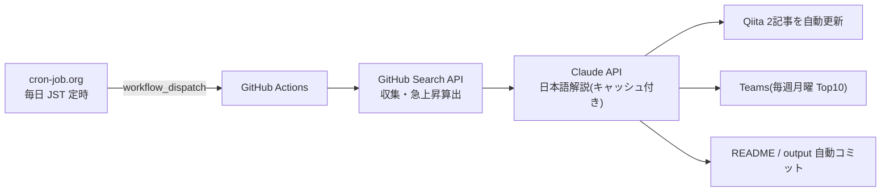

# Claude Code向けMCPツール候補ランキング

GitHub Search APIを使って、Claude Code周辺で活用候補になりそうなMCP関連リポジトリを定期収集するリポジトリです。

> 注意: この一覧は「Claude Codeでの動作」を保証するものではありません。  
> GitHub上のリポジトリ名・説明文・READMEなどに含まれる情報をもとに、MCP関連ツール候補を探すための入口として利用します。

## 仕組み(定常自律運転)

このランキングは cron-job.org → GitHub Actions → Claude API → Qiita / Teams のパイプラインで、毎日無人更新されています。



- 仕組みの詳細と**ライブ稼働ステータス**: [定常自律運転ページ](https://takanobusano.github.io/mcp-github-ranking/)
- 作り方の解説記事: [パイプライン編](https://qiita.com/4q_sano/items/913e93ee5cc2731561fc) / [cron-job.org 完全自動化編](https://qiita.com/4q_sano/items/1bc5e0669a8f0166936c)
<!-- MCP_REPOS_START -->
最終更新: **2026-11-21 08:17:15 JST**

MCP関連リポジトリに加え、Claude Code周辺で活用候補になりそうな関連ツールをGitHub Search APIで毎日自動収集してランキング化しています。

Stars / Forks の差分は、UTC基準の前日データ（2026-11-19）との差分です。
CSVには最大500件を保存し、本文では上位100件を表示しています。

> 注意: この一覧はClaude Codeでの動作を保証するものではありません。  
> MCP関連ツールまたはClaude Code関連ツール候補を探すための入口として利用してください。

# 注目MCP・関連ツール候補ランキング

## 1位 [public-apis/public-apis](https://github.com/public-apis/public-apis)

A collective list of free APIs

⭐ **500,489 Stars**（+174）　🍴 **56,188 Forks**（+39）　/　🟢 **2,805 Open Issues**　/　Python

Topics: `api` / `apis` / `dataset` / `development` / `free` / `list` / `lists` / `open-source`

## 2位 [morluto/rea](https://github.com/morluto/rea)

Reverse engineer anything with agents, from app behavior down to native binaries.

⭐ **471,439 Stars**（+1,499）　🍴 **115,106 Forks**（+306）　/　🟢 **1,377 Open Issues**　/　TypeScript

Topics: `agent-skills` / `ai` / `android` / `claude-code` / `cli` / `cpp` / `dsh-plugin` / `html`

## 3位 [openclaw/openclaw](https://github.com/openclaw/openclaw)

The AI that really does things. Any OS. Any Platform. The lobster way. 🦞

⭐ **394,927 Stars**（+96）　🍴 **82,945 Forks**（+8）　/　🟢 **8,657 Open Issues**　/　TypeScript

Topics: `ai` / `assistant` / `crustacean` / `molty` / `openclaw` / `own-your-data` / `personal`

## 4位 [mattpocock/skills](https://github.com/mattpocock/skills)

Skills for Real Engineers. Straight from my .agents directory.

⭐ **328,908 Stars**（+772）　🍴 **27,647 Forks**（+78）　/　🟢 **261 Open Issues**　/　Shell

Topics: `topicなし`

## 5位 [obra/superpowers](https://github.com/obra/superpowers)

An agentic skills framework & software development methodology that works.

⭐ **322,810 Stars**（+768）　🍴 **28,670 Forks**（+44）　/　🟢 **358 Open Issues**　/　Shell

Topics: `ai` / `brainstorming` / `coding` / `obra` / `sdlc` / `skills` / `subagent-driven-development` / `superpowers`

## 6位 [affaan-m/ECC](https://github.com/affaan-m/ECC)

The agent harness performance optimization system. Skills, instincts, memory, security, and research-first development for Claude Code, Codex, Opencode, Cursor and beyond.

⭐ **307,827 Stars**（+564）　🍴 **45,316 Forks**（+89）　/　🟢 **147 Open Issues**　/　JavaScript

Topics: `ai-agents` / `anthropic` / `claude` / `claude-code` / `developer-tools` / `llm` / `mcp` / `productivity`

## 7位 [NousResearch/hermes-agent](https://github.com/NousResearch/hermes-agent)

The agent that grows with you

⭐ **264,986 Stars**（+237）　🍴 **59,876 Forks**（+77）　/　🟢 **54,140 Open Issues**　/　Python

Topics: `ai` / `ai-agent` / `ai-agents` / `anthropic` / `chatgpt` / `claude` / `claude-code` / `codex`

## 8位 [multica-ai/andrej-karpathy-skills](https://github.com/multica-ai/andrej-karpathy-skills)

A single CLAUDE.md file to improve Claude Code behavior, derived from Andrej Karpathy's observations on LLM coding pitfalls.

⭐ **234,749 Stars**（+263）　🍴 **23,311 Forks**（+7）　/　🟢 **138 Open Issues**　/　不明

Topics: `topicなし`

## 9位 [firecrawl/firecrawl](https://github.com/firecrawl/firecrawl)

Knowledge infrastructure to make your agents smarter. Search, scrape and access 550+ data providers through one API.

⭐ **205,223 Stars**（+1,070）　🍴 **10,746 Forks**（+50）　/　🟢 **883 Open Issues**　/　TypeScript

Topics: `ai` / `ai-agents` / `ai-crawler` / `ai-scraping` / `ai-search` / `crawler` / `data-extraction` / `html-to-markdown`

## 10位 [anthropics/skills](https://github.com/anthropics/skills)

Public repository for Agent Skills

⭐ **198,054 Stars**（+367）　🍴 **23,193 Forks**（+37）　/　🟢 **1,563 Open Issues**　/　Python

Topics: `agent-skills`

## 11位 [DietrichGebert/ponytail](https://github.com/DietrichGebert/ponytail)

Makes your AI agent think like the laziest senior dev in the room. The best code is the code you never wrote.

⭐ **195,594 Stars**（+771）　🍴 **11,023 Forks**（+48）　/　🟢 **328 Open Issues**　/　JavaScript

Topics: `agent-skills` / `ai-agents` / `claude` / `claude-code` / `claude-code-plugin` / `cursor-rules` / `developer-tools` / `llm`

## 12位 [ultraworkers/claw-code](https://github.com/ultraworkers/claw-code)

An agent-managed museum exhibit, built in Rust with Gajae-Code / LazyCodex — developed and maintained with no human intervention.

⭐ **194,758 Stars**（-3）　🍴 **107,187 Forks**（-24）　/　🟢 **12 Open Issues**　/　Rust

Topics: `topicなし`

## 13位 [Significant-Gravitas/AutoGPT](https://github.com/Significant-Gravitas/AutoGPT)

AutoGPT is the vision of accessible AI for everyone, to use and to build on. Our mission is to provide the tools, so that you can focus on what matters.

⭐ **188,118 Stars**（+10）　🍴 **45,843 Forks**（-13）　/　🟢 **773 Open Issues**　/　Python

Topics: `agentic-ai` / `agents` / `ai` / `artificial-intelligence` / `autonomous-agents` / `claude` / `gpt` / `llama-api`

## 14位 [ollama/ollama](https://github.com/ollama/ollama)

Get up and running with Kimi, GLM, MiniMax, DeepSeek, gpt-oss, Qwen, Gemma and other models.

⭐ **187,759 Stars**（+91）　🍴 **19,172 Forks**（-3）　/　🟢 **4,701 Open Issues**　/　Go

Topics: `deepseek` / `gemma` / `glm` / `go` / `golang` / `gpt-oss` / `llama` / `llm`

## 15位 [msitarzewski/agency-agents](https://github.com/msitarzewski/agency-agents)

A complete AI agency at your fingertips - From frontend wizards to Reddit community ninjas, from whimsy injectors to reality checkers. Each agent is a specialized expert with personality, processes, and proven deliverables.

⭐ **169,559 Stars**（+193）　🍴 **27,565 Forks**（+47）　/　🟢 **275 Open Issues**　/　Shell

Topics: `topicなし`

## 16位 [langgenius/dify](https://github.com/langgenius/dify)

Build Agentic workflows, RAG pipelines, with rich AI model and tool support on one collaborative workspace. Deploy on cloud, VPC, or self-hosted, so teams move from prototype to production without rebuilding the stack.

⭐ **161,578 Stars**（+60）　🍴 **25,548 Forks**（+12）　/　🟢 **1,329 Open Issues**　/　Python

Topics: `agent` / `agentic-ai` / `agentic-framework` / `agentic-workflow` / `ai` / `automation` / `claude` / `deepseek`

## 17位 [langflow-ai/langflow](https://github.com/langflow-ai/langflow)

Langflow is a powerful tool for building and deploying AI-powered agents and workflows.

⭐ **156,809 Stars**（+28）　🍴 **10,439 Forks**（+5）　/　🟢 **1,338 Open Issues**　/　Python

Topics: `agents` / `chatgpt` / `generative-ai` / `large-language-models` / `multiagent` / `react-flow`

## 18位 [anthropics/claude-code](https://github.com/anthropics/claude-code)

Claude Code is an agentic coding tool that lives in your terminal, understands your codebase, and helps you code faster by executing routine tasks, explaining complex code, and handling git workflows - all through natural language commands.

⭐ **156,460 Stars**（+125）　🍴 **25,065 Forks**（+11）　/　🟢 **15,932 Open Issues**　/　TypeScript

Topics: `topicなし`

## 19位 [farion1231/cc-switch](https://github.com/farion1231/cc-switch)

A cross-platform desktop All-in-One assistant for Claude Code, Codex, OpenCode,DeepSeek Harness and more. Only official website: ccswitch.io

⭐ **156,027 Stars**（+234）　🍴 **10,204 Forks**（+6）　/　🟢 **845 Open Issues**　/　Rust

Topics: `ai-tools` / `claude-code` / `codex` / `deepseek-harness` / `desktop-app` / `grok` / `grokbuild` / `hermes`

## 20位 [nextlevelbuilder/ui-ux-pro-max-skill](https://github.com/nextlevelbuilder/ui-ux-pro-max-skill)

An AI skill that provides design intelligence for building professional UI/UX across multiple platforms.

⭐ **152,145 Stars**（+392）　🍴 **16,057 Forks**（+28）　/　🟢 **84 Open Issues**　/　Python

Topics: `ai-skills` / `antigravity` / `claude` / `claude-code` / `codex` / `command-line` / `copilot` / `cursor-ai`

## 21位 [Graphify-Labs/graphify](https://github.com/Graphify-Labs/graphify)

Turn any codebase, with its docs, SQL schemas, configs, and PDFs, into a queryable knowledge graph. A /graphify skill for Claude Code, Cursor, Codex, and Gemini CLI: local deterministic AST parsing, every edge explained, no vector store.

⭐ **151,157 Stars**（+534）　🍴 **14,544 Forks**（+56）　/　🟢 **1,686 Open Issues**　/　Python

Topics: `ai-agents` / `antigravity` / `ast` / `claude-code` / `code-analysis` / `code-search` / `codex` / `cursor`

## 22位 [harry0703/MoneyPrinterTurbo](https://github.com/harry0703/MoneyPrinterTurbo)

利用 AI 大模型和自动化工作流，根据主题或关键词一键生成高清短视频。Generate HD short videos from a topic or keyword with an automated AI workflow.

⭐ **144,832 Stars**（+122）　🍴 **23,291 Forks**（+26）　/　🟢 **90 Open Issues**　/　Python

Topics: `ai-video-generator` / `content-creation` / `ffmpeg` / `instagram-reels` / `llm` / `python` / `short-video` / `subtitles`

## 23位 [x1xhlol/system-prompts-and-models-of-ai-tools](https://github.com/x1xhlol/system-prompts-and-models-of-ai-tools)

FULL Augment Code, Claude Code, Cluely, CodeBuddy, Comet, Cursor, Devin AI, Junie, Kiro, Leap.new, Lovable, Manus, NotionAI, Orchids.app, Perplexity, Poke, Qoder, Replit, Same.dev, Trae, Traycer AI, VSCode Agent, Warp.dev, Windsurf, Xcode, Z.ai Code, Dia & v0. (And other Open Sourced) System Prompts, Internal Tools & AI Models

⭐ **144,793 Stars**（+23）　🍴 **34,661 Forks**（-5）　/　🟢 **162 Open Issues**　/　不明

Topics: `ai` / `bolt` / `cluely` / `copilot` / `cursor` / `cursorai` / `devin` / `github-copilot`

## 24位 [garrytan/gstack](https://github.com/garrytan/gstack)

Use Garry Tan's exact Claude Code setup: 23 opinionated tools that serve as CEO, Designer, Eng Manager, Release Manager, Doc Engineer, and QA

⭐ **142,221 Stars**（+88）　🍴 **20,991 Forks**（+6）　/　🟢 **117 Open Issues**　/　TypeScript

Topics: `topicなし`

## 25位 [stablyai/orca](https://github.com/stablyai/orca)

Orca lets you run a fleet of bots with your own subscription (e.g. Claude Code, Grok, Agy, Codex). Available on desktop, mobile and remote runtime.

⭐ **130,999 Stars**（+1,148）　🍴 **8,329 Forks**（+84）　/　🟢 **8,868 Open Issues**　/　TypeScript

Topics: `agent-ide` / `ai-agents` / `automation` / `bot` / `claude-code` / `codex` / `ghostty` / `grok-bot`

## 26位 [TauricResearch/TradingAgents](https://github.com/TauricResearch/TradingAgents)

TradingAgents: Multi-Agents LLM Financial Trading Framework

⭐ **123,292 Stars**（+114）　🍴 **23,636 Forks**（+16）　/　🟢 **155 Open Issues**　/　Python

Topics: `agent` / `finance` / `llm` / `multiagent` / `trading`

## 27位 [JuliusBrussee/caveman](https://github.com/JuliusBrussee/caveman)

why use many token when few token do trick. Skill + local proxy for coding agents: shorter answers, smaller tool output, every original recoverable.

⭐ **121,784 Stars**（+235）　🍴 **7,113 Forks**（+10）　/　🟢 **108 Open Issues**　/　Go

Topics: `ai` / `anthropic` / `caveman` / `claude` / `claude-code` / `llm` / `meme` / `prompt-engineering`

## 28位 [browser-use/browser-use](https://github.com/browser-use/browser-use)

Open-source Python library for AI browser agents, plus Browser Use Cloud: stealth browsers and a hosted agent API.

⭐ **121,616 Stars**（+99）　🍴 **13,599 Forks**（+16）　/　🟢 **592 Open Issues**　/　Python

Topics: `ai-agents` / `ai-tools` / `browser-agent` / `browser-automation` / `browser-use` / `cdp` / `cloud-browser` / `computer-use`

## 29位 [addyosmani/agent-skills](https://github.com/addyosmani/agent-skills)

Production-grade engineering skills for AI coding agents.

⭐ **119,389 Stars**（+217）　🍴 **12,424 Forks**（+16）　/　🟢 **123 Open Issues**　/　JavaScript

Topics: `agent-skills` / `antigravity` / `claude-code` / `codex` / `cursor` / `skills`

## 30位 [Leonxlnx/taste-skill](https://github.com/Leonxlnx/taste-skill)

Agent skills that give coding agents taste: art direction, reference images and a browser check instead of generic AI pages

⭐ **119,321 Stars**（+438）　🍴 **7,985 Forks**（+26）　/　🟢 **14 Open Issues**　/　JavaScript

Topics: `agent-skills` / `ai-agents` / `anti-slop` / `claude-code` / `codex` / `cursor` / `design-system` / `frontend`

## 31位 [thedotmack/claude-mem](https://github.com/thedotmack/claude-mem)

Persistent Context Across Sessions for Every Agent –  Captures everything your agent does during sessions, compresses it with AI, and injects relevant context back into future sessions. Works with Claude Code, OpenClaw, Codex, Gemini, Hermes, Copilot, OpenCode + More

⭐ **118,631 Stars**（+193）　🍴 **10,318 Forks**（+10）　/　🟢 **71 Open Issues**　/　TypeScript

Topics: `ai` / `ai-agents` / `ai-memory` / `anthropic` / `artificial-intelligence` / `chromadb` / `claude` / `claude-agent-sdk`

## 32位 [paperclipai/paperclip](https://github.com/paperclipai/paperclip)

The open-source app everyone uses to manage agents at work

⭐ **115,480 Stars**（+290）　🍴 **19,160 Forks**（+40）　/　🟢 **6,959 Open Issues**　/　TypeScript

Topics: `acpx` / `agent-orchestration` / `agent-skills` / `agentic-ai` / `ai-agents` / `ai-engineering` / `ai-governance` / `ai-tools`

## 33位 [debpalash/VoiceStudio](https://github.com/debpalash/VoiceStudio)

VoiceStudio is the open-source, fully-local ElevenLabs alternative — voice cloning, voice design, video dubbing, dictation, transcription & audiobook creation in 646 languages.

⭐ **115,405 Stars**（+1,131）　🍴 **12,834 Forks**（+112）　/　🟢 **31 Open Issues**　/　Python

Topics: `ai` / `audiobook` / `cuda` / `dubbing` / `elevenlabs-alternative` / `huggingface` / `local-first` / `mlx`

## 34位 [pbakaus/impeccable](https://github.com/pbakaus/impeccable)

The design vocabulary for your coding agent. Steer with polish and bolder, review with critique and audit, catch AI slop before it ships.

⭐ **114,026 Stars**（+581）　🍴 **6,786 Forks**（+23）　/　🟢 **71 Open Issues**　/　Rust

Topics: `agent-skills` / `ai` / `anti-slop` / `design` / `slop`

## 35位 [Panniantong/Agent-Reach](https://github.com/Panniantong/Agent-Reach)

Give your AI agent eyes to see the entire internet. Read & search Twitter, Reddit, YouTube, GitHub, Bilibili, XiaoHongShu — one CLI, zero API fees.

⭐ **113,564 Stars**（+244）　🍴 **10,200 Forks**（+17）　/　🟢 **152 Open Issues**　/　Python

Topics: `agent-infrastructure` / `ai-agent` / `ai-search` / `automation` / `bilibili` / `claude-code` / `cli` / `cursor`

## 36位 [google-gemini/gemini-cli](https://github.com/google-gemini/gemini-cli)

An open-source AI agent that brings the power of Gemini directly into your terminal.

⭐ **108,960 Stars**（+22）　🍴 **14,973 Forks**（+7）　/　🟢 **729 Open Issues**　/　TypeScript

Topics: `ai` / `ai-agents` / `cli` / `gemini` / `gemini-api` / `mcp-client` / `mcp-server`

## 37位 [nexu-io/open-design](https://github.com/nexu-io/open-design)

The 1st Collaborative AI Design Agent Workspace. Local-first and open source. Create motion, prototypes, websites, apps, dashboards, presentations, images, and videos with your team and AI agents. Share work, exchange feedback, and iterate together in one workspace.

⭐ **108,682 Stars**（+167）　🍴 **12,310 Forks**（+9）　/　🟢 **1,443 Open Issues**　/　TypeScript

Topics: `agent-skills` / `ai-design` / `byok` / `claude-code-for-design` / `claude-design` / `codex-design` / `cursor-design` / `deepseek`

## 38位 [ruvnet/RuView](https://github.com/ruvnet/RuView)

π RuView turns commodity WiFi signals into real-time spatial intelligence, vital sign monitoring, and presence detection — all without a single pixel of video.

⭐ **104,694 Stars**（+55）　🍴 **13,585 Forks**（-11）　/　🟢 **614 Open Issues**　/　Rust

Topics: `claude` / `claude-code` / `esp32` / `firmware` / `home-assistant` / `home-automation` / `iot` / `mcp`

## 39位 [D4Vinci/Scrapling](https://github.com/D4Vinci/Scrapling)

🕷️ The BEST Web Scraping framework that handles everything from a single request to a full-scale crawl! Don't be shy, join here:  and follow here for daily tips and tricks:

⭐ **104,645 Stars**（+233）　🍴 **10,940 Forks**（+23）　/　🟢 **24 Open Issues**　/　Python

Topics: `ai` / `ai-scraping` / `automation` / `crawler` / `crawling` / `crawling-python` / `data` / `data-extraction`

## 40位 [microsoft/playwright](https://github.com/microsoft/playwright)

Playwright is a framework for Web Testing and Automation. It allows testing Chromium, Firefox and WebKit with a single API.

⭐ **100,681 Stars**（+69）　🍴 **6,935 Forks**（±0）　/　🟢 **48 Open Issues**　/　TypeScript

Topics: `automation` / `chrome` / `chromium` / `e2e-testing` / `electron` / `end-to-end-testing` / `firefox` / `javascript`

## 41位 [OpenCut-app/OpenCut](https://github.com/OpenCut-app/OpenCut)

The open-source CapCut alternative

⭐ **99,037 Stars**（+90）　🍴 **9,918 Forks**（+7）　/　🟢 **390 Open Issues**　/　TypeScript

Topics: `editor` / `oss` / `videoeditor`

## 42位 [tt-a1i/archify](https://github.com/tt-a1i/archify)

Turn any idea, plan, or codebase into a beautiful interactive diagram. An agent skill for Claude Code, Codex, and more.

⭐ **98,321 Stars**（+284）　🍴 **6,722 Forks**（+24）　/　🟢 **367 Open Issues**　/　JavaScript

Topics: `agent-skills` / `ai-agents` / `architecture-diagram` / `claude-code` / `claude-skills` / `codex` / `coding-agents` / `deepseek-harness`

## 43位 [puppeteer/puppeteer](https://github.com/puppeteer/puppeteer)

JavaScript API for Chrome and Firefox

⭐ **95,874 Stars**（+1）　🍴 **9,608 Forks**（-1）　/　🟢 **209 Open Issues**　/　TypeScript

Topics: `automation` / `chrome` / `chromium` / `developer-tools` / `firefox` / `headless-chrome` / `node-module` / `testing`

## 44位 [OpenHands/OpenHands](https://github.com/OpenHands/OpenHands)

🙌 OpenHands: AI-Driven Development

⭐ **93,926 Stars**（+77）　🍴 **12,572 Forks**（+7）　/　🟢 **1,219 Open Issues**　/　TypeScript

Topics: `agent` / `artificial-intelligence` / `chatgpt` / `claude-ai` / `cli` / `developer-tools` / `gpt` / `llm`

## 45位 [Egonex-AI/Understand-Anything](https://github.com/Egonex-AI/Understand-Anything)

Graphs that teach > graphs that impress. Turn any code into an interactive knowledge graph you can explore, search, and ask questions about. Works with Claude Code, Codex, Cursor, Copilot, Gemini CLI, and more.

⭐ **93,446 Stars**（+127）　🍴 **7,969 Forks**（+8）　/　🟢 **371 Open Issues**　/　TypeScript

Topics: `antigravity-skills` / `business-knowledge` / `claude-code` / `claude-skills` / `codebase-analysis` / `codex` / `codex-skills` / `developer-tools-ai-agent`

## 46位 [modelcontextprotocol/servers](https://github.com/modelcontextprotocol/servers)

Model Context Protocol Reference Servers

⭐ **92,133 Stars**（+19）　🍴 **11,983 Forks**（-2）　/　🟢 **11 Open Issues**　/　TypeScript

Topics: `topicなし`

## 47位 [storybookjs/storybook](https://github.com/storybookjs/storybook)

Storybook is the industry standard workshop for building, documenting, and testing UI components in isolation

⭐ **91,668 Stars**（前日なし）　🍴 **10,595 Forks**（前日なし）　/　🟢 **1,893 Open Issues**　/　TypeScript

Topics: `angular` / `components` / `design-systems` / `documentation` / `html` / `javascript` / `react` / `react-native`

## 48位 [koala73/worldmonitor](https://github.com/koala73/worldmonitor)

Real-time global intelligence dashboard. AI-powered news aggregation, geopolitical monitoring, and infrastructure tracking in a unified situational awareness interface

⭐ **90,991 Stars**（+44）　🍴 **14,127 Forks**（+4）　/　🟢 **334 Open Issues**　/　TypeScript

Topics: `agent` / `ai` / `dashboard` / `gemini-cli-extension` / `geopolitics` / `mcp` / `mcp-server` / `monitoring`

## 49位 [cheaper-inference/OmniRoute](https://github.com/cheaper-inference/OmniRoute)

Never stop coding. Free MIT AI gateway: one endpoint, 375 providers (150+ free), 1,400+ models Kimi, Claude, GPT, Gemini, GLM, DeepSeek, MiniMax. Works with Claude Code, Codex, Cursor, OpenCode, Cline & Copilot. Quota-aware auto-fallback, RTK+Caveman compression saves 15-95% tokens, MCP/A2A, Desktop/PWA. Built by 900+ contributors

⭐ **89,195 Stars**（+261）　🍴 **13,785 Forks**（+46）　/　🟢 **838 Open Issues**　/　TypeScript

Topics: `a2a` / `ai-agents` / `ai-gateway` / `anthropic` / `claude` / `claude-code` / `cline` / `codex`

## 50位 [ChatGPTNextWeb/NextChat](https://github.com/ChatGPTNextWeb/NextChat)

✨ Zero-config AI chat assistant. No API key needed — sign up and instantly chat with GPT-5, Claude 4, Gemini 2.5, DeepSeek & 100+ top models. Pay-as-you-go save...

⭐ **88,979 Stars**（-7）　🍴 **58,463 Forks**（-17）　/　🟢 **866 Open Issues**　/　TypeScript

Topics: `calclaude` / `claude` / `cross-platform` / `desktop` / `fe` / `gemini` / `gemini-pro` / `gemini-server`

## 51位 [unclecode/crawl4ai](https://github.com/unclecode/crawl4ai)

Official Crawl4AI Cloud: a hosted web scraping, extraction, and search API for AI agents. Free API key, 1,000 credits a month, no card. Fully open source: this repo is the Apache-2.0 crawler that powers it, and you can self-host it.

⭐ **87,601 Stars**（+30）　🍴 **9,140 Forks**（+7）　/　🟢 **342 Open Issues**　/　Python

Topics: `ai` / `ai-agents` / `crawl4ai-cloud` / `crawler` / `data-extraction` / `llm` / `markdown` / `mcp`

## 52位 [heygen-com/hyperframes](https://github.com/heygen-com/hyperframes)

AI video you can actually edit. HyperFrames is a free, open-source AI video editor. Describe any video and get a real project you can change down to the frame.

⭐ **87,450 Stars**（+423）　🍴 **8,137 Forks**（+40）　/　🟢 **303 Open Issues**　/　TypeScript

Topics: `ai` / `ai-agents` / `animation` / `claude-code` / `ffmpeg` / `framework` / `gsap` / `html`

## 53位 [rtk-ai/rtk](https://github.com/rtk-ai/rtk)

CLI proxy that reduces LLM token consumption by 60-90% on common dev commands. Single Rust binary, zero dependencies

⭐ **87,303 Stars**（+110）　🍴 **5,613 Forks**（+7）　/　🟢 **1,689 Open Issues**　/　Rust

Topics: `agentic-coding` / `ai-coding` / `anthropic` / `claude-code` / `cli` / `command-line-tool` / `cost-reduction` / `developer-tools`

## 54位 [lobehub/lobehub](https://github.com/lobehub/lobehub)

🤯 LobeHub - Super-Agents on Your Team. Add super-agents to the chats your team already uses.They take on work by themselves and get better every week.

⭐ **85,922 Stars**（+61）　🍴 **16,352 Forks**（+3）　/　🟢 **1,446 Open Issues**　/　TypeScript

Topics: `agent` / `agent-collaboration` / `agent-harness` / `loop-engineering` / `mcp` / `personal-assistant` / `proactive-agent` / `skills`

## 55位 [bytedance/deer-flow](https://github.com/bytedance/deer-flow)

An open-source long-horizon SuperAgent harness that researches, codes, and creates. With the help of sandboxes, memories, tools, skill, subagents and message gateway, it handles different levels of tasks that could take minutes to hours.

⭐ **85,550 Stars**（+21）　🍴 **12,073 Forks**（+1）　/　🟢 **1,146 Open Issues**　/　Python

Topics: `agent` / `agentic` / `agentic-framework` / `agentic-workflow` / `ai` / `ai-agents` / `deep-research` / `harness`

## 56位 [laravel/laravel](https://github.com/laravel/laravel)

Laravel is a web application framework with expressive, elegant syntax. We’ve already laid the foundation for your next big idea — freeing you to create without sweating the small things.

⭐ **85,394 Stars**（+8）　🍴 **25,478 Forks**（-16）　/　🟢 **31 Open Issues**　/　Blade

Topics: `framework` / `laravel` / `php`

## 57位 [ruvnet/ruflo](https://github.com/ruvnet/ruflo)

🌊 The original agent harness. Deploy intelligent multi-player swarms, coordinate autonomous workflows, and build conversational AI systems. Features adaptive me...

⭐ **82,166 Stars**（+58）　🍴 **9,692 Forks**（-2）　/　🟢 **562 Open Issues**　/　TypeScript

Topics: `agent-memory` / `agent-orchestration` / `agentic-ai` / `agentic-workflow` / `ai-agents` / `autonomous-agents` / `claude` / `claude-code`

## 58位 [Ebony-Vinyl/dsh-our-free-model](https://github.com/Ebony-Vinyl/dsh-our-free-model)

在 dsh 里装上这个插件即可，无需登录、注册或填 API Key，就能使用包括 DeepSeek V4.1 Flash、Kimi K3 在内的前沿模型——完全免费，不限量。 All you do is install this plugin in dsh: no login, no sign-up, no API k...

⭐ **82,073 Stars**（+1,104）　🍴 **2,306 Forks**（+25）　/　🟢 **218 Open Issues**　/　JavaScript

Topics: `ai-agents` / `deepseek` / `deepseek-harness` / `developer-tools` / `dsh` / `dsh-plugin` / `free-model` / `llm`

## 59位 [OpenMontageInc/OpenMontage](https://github.com/OpenMontageInc/OpenMontage)

World's first open-source, agentic video production system. 12 production pipelines, 100+ tools, 700+ agent skill and production-knowledge files. Turn your AI coding assistant into a full video production studio.

⭐ **81,941 Stars**（+185）　🍴 **11,154 Forks**（+27）　/　🟢 **351 Open Issues**　/　Python

Topics: `agent` / `agentic-ai` / `ai` / `claude` / `copilot` / `cursor` / `elevenlabs` / `ffmpeg`

## 60位 [netdata/netdata](https://github.com/netdata/netdata)

Full-stack observability · Metrics · Logs · Traces · Flows · Topology · Infrastructure · APM · NPM · DBM · RUM · Synthetics · Cloud · AI SRE · OpenTelemetry · SNMP · NetFlow/IPFIX/sFlow · IPMI · Redfish · 2000+ integrations

⭐ **81,557 Stars**（+58）　🍴 **6,744 Forks**（-5）　/　🟢 **468 Open Issues**　/　Go

Topics: `ai` / `anomaly-detection` / `dashboard` / `data-visualization` / `database` / `devops` / `docker` / `grafana`

## 61位 [abi/screenshot-to-code](https://github.com/abi/screenshot-to-code)

Drop in a screenshot and convert it to clean code (HTML/Tailwind/React/Vue)

⭐ **81,307 Stars**（+9）　🍴 **9,957 Forks**（-2）　/　🟢 **150 Open Issues**　/　Python

Topics: `topicなし`

## 62位 [storytold/photocraft](https://github.com/storytold/photocraft)

PhotoCraft: An open-source photo editor written from scratch in pure Rust

⭐ **80,735 Stars**（+224）　🍴 **14,219 Forks**（+28）　/　🟢 **5,652 Open Issues**　/　Rust

Topics: `art` / `image-editing` / `image-editing-software` / `image-editor` / `images` / `photo-editing` / `rust`

## 63位 [shareAI-lab/learn-claude-code](https://github.com/shareAI-lab/learn-claude-code)

Bash is all you need -  A nano claude code–like 「agent harness」, built from 0 to 1

⭐ **80,680 Stars**（+31）　🍴 **12,889 Forks**（-2）　/　🟢 **56 Open Issues**　/　Python

Topics: `agent` / `agent-development` / `ai-agent` / `claude` / `claude-code` / `educational` / `llm` / `python`

## 64位 [headroomlabs-ai/headroom](https://github.com/headroomlabs-ai/headroom)

Compress tool outputs, logs, files, and RAG chunks before they reach the LLM. 20% fewer tokens for coding agents, 60-95% fewer tokens for JSON, same answers. Library, proxy, MCP server.

⭐ **80,216 Stars**（+49）　🍴 **6,287 Forks**（±0）　/　🟢 **319 Open Issues**　/　Python

Topics: `agent` / `ai` / `anthropic` / `claude-code` / `compression` / `context-engineering` / `context-window` / `cursor`

## 65位 [unslothai/unsloth](https://github.com/unslothai/unsloth)

Local UI to run and train LLMs and diffusion models. Supports GGUF, MLX, Qwen3.8, DeepSeek-V4.1, MiniMax-H3, Gemma 4, FLUX and more.

⭐ **79,847 Stars**（+55）　🍴 **7,444 Forks**（-7）　/　🟢 **477 Open Issues**　/　Python

Topics: `agent` / `ai` / `chatgpt` / `deepseek` / `fine-tuning` / `gemma` / `image-generation` / `llama`

## 66位 [rohitg00/ai-engineering-from-scratch](https://github.com/rohitg00/ai-engineering-from-scratch)

Learn AI Engineering! Learn it. Build it. Ship it for others.

⭐ **79,688 Stars**（+84）　🍴 **14,233 Forks**（+8）　/　🟢 **68 Open Issues**　/　Python

Topics: `agents` / `ai` / `ai-agents` / `ai-engineering` / `computer-vision` / `course` / `deep-learning` / `dsh`

## 67位 [hugohe3/ppt-master](https://github.com/hugohe3/ppt-master)

AI turns documents or topics into real, native PowerPoint decks—with native shapes, transitions and animations, data-backed charts and tables on demand, audio narration from speaker notes, and support for your own .pptx templates. · by Hugo He

⭐ **78,864 Stars**（+260）　🍴 **6,152 Forks**（+21）　/　🟢 **1 Open Issues**　/　Python

Topics: `ai-agent` / `aippt` / `office` / `powerpoint` / `powerpoint-generation` / `ppt` / `pptx` / `presentation`

## 68位 [colbymchenry/codegraph](https://github.com/colbymchenry/codegraph)

Pre-indexed code knowledge graph, auto syncs on code changes, for Claude Code, Codex, Gemini, Cursor, OpenCode, AntiGravity, Kiro, CoPilot, and Hermes Agent — fewer tokens, fewer tool calls, 100% local

⭐ **78,247 Stars**（+120）　🍴 **5,217 Forks**（+4）　/　🟢 **222 Open Issues**　/　TypeScript

Topics: `topicなし`

## 69位 [nestjs/nest](https://github.com/nestjs/nest)

A progressive TypeScript framework for Node.js backends: from a small API in one file to efficient, scalable, enterprise-grade systems 🚀

⭐ **77,112 Stars**（-2）　🍴 **8,711 Forks**（-25）　/　🟢 **41 Open Issues**　/　TypeScript

Topics: `framework` / `hacktoberfest` / `javascript` / `javascript-framework` / `microservices` / `nest` / `nestjs` / `node`

## 70位 [eternity4719/HowToLiveBetter](https://github.com/eternity4719/HowToLiveBetter)

高性价比人生指南: 长寿防病、急救、省钱理财、法律红线、失业与工伤、医保社保、恋爱婚育、怀孕育儿、创业与做平台合规、出国与技能。每条写明成本、收益、证据等级和原始出处，只引期刊论文与官方文件。

⭐ **76,827 Stars**（+153）　🍴 **6,819 Forks**（+9）　/　🟢 **16 Open Issues**　/　HTML

Topics: `topicなし`

## 71位 [usestrix/strix](https://github.com/usestrix/strix)

Open-source AI penetration testing tool to find and fix your app’s vulnerabilities.

⭐ **76,814 Stars**（+119）　🍴 **8,749 Forks**（+16）　/　🟢 **618 Open Issues**　/　Python

Topics: `agents` / `ai-hacking` / `ai-penetration-testing` / `ai-pentesting` / `ai-security` / `artificial-intelligence` / `bug-bounty` / `code-quality`

## 72位 [tw93/Mole](https://github.com/tw93/Mole)

🐹 Open-source Mac and PC cleaner. Keep your machine clean, light, and running like new. Fast CLI, plus native Mac and Windows apps.

⭐ **75,720 Stars**（+102）　🍴 **2,722 Forks**（-3）　/　🟢 **9 Open Issues**　/　Shell

Topics: `analyzer` / `appcleaner` / `clean` / `cleaner` / `cleanmymac` / `command-line` / `daisydisk` / `deepseek-harness`

## 73位 [openbq-org/OpenBB](https://github.com/openbq-org/OpenBB)

Open Data Platform for analysts, quants and AI agents.

⭐ **75,606 Stars**（+27）　🍴 **7,904 Forks**（-3）　/　🟢 **132 Open Issues**　/　Python

Topics: `ai` / `crypto` / `derivatives` / `economics` / `equity` / `finance` / `fixed-income` / `machine-learning`

## 74位 [Eugeny/tabby](https://github.com/Eugeny/tabby)

A terminal for a more modern age

⭐ **75,516 Stars**（+19）　🍴 **4,361 Forks**（-3）　/　🟢 **2,906 Open Issues**　/　TypeScript

Topics: `serial` / `ssh-client` / `telnet-client` / `terminal` / `terminal-emulators`

## 75位 [thedaviddias/Front-End-Checklist](https://github.com/thedaviddias/Front-End-Checklist)

🗂 The essential checklist for modern web development, for humans and AI agents

⭐ **74,785 Stars**（+4）　🍴 **6,783 Forks**（-3）　/　🟢 **23 Open Issues**　/　MDX

Topics: `ai-agent` / `ai-agents` / `checklist` / `css` / `front-end-developer-tool` / `front-end-development` / `frontend` / `guidelines`

## 76位 [Alishahryar1/free-claude-code](https://github.com/Alishahryar1/free-claude-code)

Use Claude Code, Codex, Antigravity, VSCode, Pi, and OpenCode (and 6 other harnesses) for free (1.3B+ free tokens) from your terminal, app, IDE, or phone, and now from the browser with native browser sessions (multi-harness + multi-model) like OpenClaw (voice supported + ToS friendly)

⭐ **72,234 Stars**（+287）　🍴 **11,193 Forks**（+31）　/　🟢 **421 Open Issues**　/　Python

Topics: `topicなし`

## 77位 [asgeirtj/system_prompts_leaks](https://github.com/asgeirtj/system_prompts_leaks)

Leaked system prompts of ChatGPT, Claude, Gemini and more. The hidden system prompt of every popular chatbot, in full, every version since May 2025. Also Anthropic Claude Code, OpenAI Codex, Google Antigravity, xAI Grok, Meta Muse, Moonshot Kimi, Alibaba Qwen, Z.ai GLM ZCode, MiniMax, Cursor, Perplexity, DeepSeek and 30+ others. Updated daily.

⭐ **72,224 Stars**（+322）　🍴 **11,624 Forks**（+52）　/　🟢 **26 Open Issues**　/　Python

Topics: `ai` / `ai-agents` / `ai-prompts` / `anthropic` / `chatbot` / `chatgpt` / `claude` / `claude-code`

## 78位 [cline/cline](https://github.com/cline/cline)

Autonomous coding agent as an SDK, IDE extension, or CLI assistant.

⭐ **71,793 Stars**（+21）　🍴 **7,950 Forks**（+4）　/　🟢 **1,808 Open Issues**　/　TypeScript

Topics: `topicなし`

## 79位 [blader/humanizer](https://github.com/blader/humanizer)

Agent skill that removes signs of AI-generated writing from text

⭐ **71,651 Stars**（+402）　🍴 **5,617 Forks**（+30）　/　🟢 **4 Open Issues**　/　Python

Topics: `agent-skills` / `ai-humanizer` / `ai-writing` / `chatgpt` / `claude` / `claude-code` / `codex` / `cursor`

## 80位 [NanmiCoder/MediaCrawler](https://github.com/NanmiCoder/MediaCrawler)

小红书笔记 \| 评论爬虫、抖音视频 \| 评论爬虫、快手视频 \| 评论爬虫、B 站视频 ｜ 评论爬虫、微博帖子 ｜ 评论爬虫、百度贴吧帖子 ｜ 百度贴吧评论回复爬虫  \| 知乎问答文章｜评论爬虫

⭐ **71,483 Stars**（+78）　🍴 **13,475 Forks**（+6）　/　🟢 **217 Open Issues**　/　Python

Topics: `topicなし`

## 81位 [mvanhorn/last30days-skill](https://github.com/mvanhorn/last30days-skill)

AI agent skill that researches any topic across Reddit, X, YouTube, HN, Polymarket, and the web - then synthesizes a grounded summary

⭐ **71,415 Stars**（+649）　🍴 **6,347 Forks**（+42）　/　🟢 **29 Open Issues**　/　Python

Topics: `ai-prompts` / `ai-skill` / `bluesky` / `claude` / `claude-code` / `clawhub` / `deep-research` / `hackernews`

## 82位 [code-yeongyu/oh-my-openagent](https://github.com/code-yeongyu/oh-my-openagent)

OmO: Just type "mass ulw" keyword with your prompt. Now you are the master of graph engineering.

⭐ **71,031 Stars**（+23）　🍴 **5,843 Forks**（-2）　/　🟢 **3,008 Open Issues**　/　TypeScript

Topics: `ai` / `ai-agents` / `anthropic` / `chatgpt` / `claude` / `claude-skills` / `codex` / `cursor`

## 83位 [docling-project/docling](https://github.com/docling-project/docling)

Get your documents ready for gen AI

⭐ **70,826 Stars**（+31）　🍴 **5,399 Forks**（+9）　/　🟢 **1,056 Open Issues**　/　Python

Topics: `ai` / `convert` / `document-parser` / `document-parsing` / `documents` / `docx` / `html` / `markdown`

## 84位 [mem0ai/mem0](https://github.com/mem0ai/mem0)

The Memory Layer for AI Agents - Drop-in memory infrastructure for AI agents and apps. Context that persists. Built for production.

⭐ **69,283 Stars**（+34）　🍴 **8,249 Forks**（+8）　/　🟢 **973 Open Issues**　/　Python

Topics: `agentic-memory` / `agentic-memory-system` / `agents` / `ai` / `ai-agents` / `chatgpt` / `genai` / `llm`

## 85位 [shanraisshan/claude-code-best-practice](https://github.com/shanraisshan/claude-code-best-practice)

from vibe coding to agentic engineering - practice makes claude perfect

⭐ **69,268 Stars**（+35）　🍴 **6,887 Forks**（+1）　/　🟢 **30 Open Issues**　/　HTML

Topics: `agentic-ai` / `agentic-coding` / `agentic-engineering` / `agentic-workflow` / `ai` / `ai-agents` / `anthropic` / `best-practices`

## 86位 [cathrynlavery/diagram-design](https://github.com/cathrynlavery/diagram-design)

Editorial diagram design for Claude Code, Codex, GitHub Copilot, Cursor, Factory Droid, Qoder, and Pi. 45 diagram types. Self-contained HTML + SVG. No shadows. No Mermaid slop.

⭐ **69,262 Stars**（+658）　🍴 **4,654 Forks**（+39）　/　🟢 **44 Open Issues**　/　HTML

Topics: `agent-skills` / `claude-code` / `codex` / `data-visualization` / `diagrams` / `drawio` / `mermaid` / `svg`

## 87位 [openinterpreter/openinterpreter](https://github.com/openinterpreter/openinterpreter)

A coding agent for open models like Kimi K3.1 and GLM 5.3

⭐ **68,925 Stars**（+7）　🍴 **5,948 Forks**（-5）　/　🟢 **38 Open Issues**　/　Rust

Topics: `acp` / `coding-agent` / `deepseek` / `kimi` / `python` / `qwen` / `rust`

## 88位 [pingdotgg/t3code](https://github.com/pingdotgg/t3code)

The best way to control Claude Code, Codex and more from any computer or phone

⭐ **67,778 Stars**（+1,401）　🍴 **11,715 Forks**（+138）　/　🟢 **3,699 Open Issues**　/　TypeScript

Topics: `agent-orchestration` / `agents` / `ai` / `chatgpt` / `claude` / `claude-code` / `code` / `vibe-coding`

## 89位 [bradtraversy/design-resources-for-developers](https://github.com/bradtraversy/design-resources-for-developers)

Curated list of design and UI resources from stock photos, web templates, CSS frameworks, UI libraries, tools and much more

⭐ **67,430 Stars**（+6）　🍴 **12,299 Forks**（-9）　/　🟢 **5 Open Issues**　/　不明

Topics: `topicなし`

## 90位 [xtekky/gpt4free](https://github.com/xtekky/gpt4free)

The official gpt4free repository \| various collection of powerful language models \| opus 4.6 gpt 5.3 kimi 2.5 deepseek v3.2 gemini 3

⭐ **67,090 Stars**（+4）　🍴 **13,451 Forks**（-1）　/　🟢 **3 Open Issues**　/　Python

Topics: `chatbot` / `chatbots` / `chatgpt` / `chatgpt-4` / `chatgpt-api` / `chatgpt-free` / `chatgpt4` / `deepseek`

## 91位 [coollabsio/coolify](https://github.com/coollabsio/coolify)

An open-source, self-hostable PaaS alternative to Vercel, Heroku & Netlify that lets you easily deploy static sites, databases, full-stack applications and 360+ one-click services on your own servers.

⭐ **66,305 Stars**（+31）　🍴 **6,020 Forks**（-2）　/　🟢 **91 Open Issues**　/　PHP

Topics: `coolify` / `databases` / `deployment` / `docker` / `docker-compose` / `inertiajs` / `laravel` / `mariadb`

## 92位 [bilawalsidhu/gods-eye-view](https://github.com/bilawalsidhu/gods-eye-view)

God's Eye View: a spy satellite simulator in your browser, except the data is real. Live open source spatial intelligence on a photorealistic 3D globe. Official site: godseyeview.ai

⭐ **66,123 Stars**（+169）　🍴 **13,081 Forks**（+21）　/　🟢 **426 Open Issues**　/　JavaScript

Topics: `3d-globe` / `cesium` / `flight-tracking` / `geospatial` / `geospatial-intelligence` / `gis` / `osint` / `photogrammetry`

## 93位 [warpdotdev/warp](https://github.com/warpdotdev/warp)

Warp is an agentic development environment, born out of the terminal.

⭐ **66,066 Stars**（+8）　🍴 **5,789 Forks**（-4）　/　🟢 **5,574 Open Issues**　/　Rust

Topics: `bash` / `linux` / `macos` / `rust` / `shell` / `terminal` / `wasm` / `zsh`

## 94位 [upstash/context7](https://github.com/upstash/context7)

Context7 Platform -- Up-to-date docs for AI agents

⭐ **65,191 Stars**（+55）　🍴 **3,275 Forks**（-1）　/　🟢 **58 Open Issues**　/　TypeScript

Topics: `llm` / `mcp` / `mcp-server` / `vibe-coding`

## 95位 [usememos/memos](https://github.com/usememos/memos)

Memos is an open-source, self-hosted note-taking app that brings your everyday thoughts together in a personal timeline. Your data stays yours, and you choose what to keep private or share.

⭐ **64,595 Stars**（+19）　🍴 **4,969 Forks**（-8）　/　🟢 **65 Open Issues**　/　Go

Topics: `docker` / `foss` / `go` / `markdown` / `memo` / `microblog` / `note-taking` / `notes`

## 96位 [tw93/Pake](https://github.com/tw93/Pake)

Turn any website into a lightweight desktop app with one command, on macOS, Windows and Linux.

⭐ **63,883 Stars**（+24）　🍴 **13,036 Forks**（-12）　/　🟢 **4 Open Issues**　/　Rust

Topics: `chatgpt` / `claude` / `cli` / `desktop` / `desktop-app` / `electron-alternative` / `gemini` / `linux`

## 97位 [sansan0/TrendRadar](https://github.com/sansan0/TrendRadar)

⭐AI-driven public opinion & trend monitor with multi-platform aggregation, RSS, and smart alerts.🎯 告别信息过载，你的 AI 舆情监控助手与热点筛选工具！聚合多平台热点 +  RSS 订阅，支持关键词精准筛选。AI 智能筛...

⭐ **63,757 Stars**（+16）　🍴 **24,937 Forks**（+3）　/　🟢 **43 Open Issues**　/　Python

Topics: `ai` / `bark` / `data-analysis` / `docker` / `hot-news` / `llm` / `mail` / `mcp`

## 98位 [BerriAI/litellm](https://github.com/BerriAI/litellm)

The fastest, litest AI Gateway. Rust core with Python SDK. Call 100+ LLM APIs in OpenAI (or native) format with cost tracking, guardrails, load balancing, and logging [Bedrock, Azure, OpenAI, Anthropic, OpenAI, VertexAI, vLLM, Nvidia NIM]

⭐ **63,625 Stars**（+67）　🍴 **13,449 Forks**（+19）　/　🟢 **5,341 Open Issues**　/　Python

Topics: `ai-gateway` / `anthropic` / `azure-openai` / `bedrock` / `gateway` / `langchain` / `litellm` / `llm`

## 99位 [penpot/penpot](https://github.com/penpot/penpot)

Penpot: The open-source design platform for Product teams that need scalable collaboration.

⭐ **62,584 Stars**（+28）　🍴 **4,445 Forks**（+3）　/　🟢 **922 Open Issues**　/　Clojure

Topics: `clojure` / `clojurescript` / `design` / `prototyping` / `ui` / `ux-design` / `ux-experience`

## 100位 [vectorize-io/hindsight](https://github.com/vectorize-io/hindsight)

Hindsight: Agent Memory That Learns

⭐ **62,256 Stars**（+215）　🍴 **7,395 Forks**（+3）　/　🟢 **235 Open Issues**　/　Python

Topics: `agentic-ai` / `agents` / `ai-memory` / `memory`

# 最近プッシュされたMCP・関連ツール候補

スター数ランキングとは別に、最近コードがプッシュされたリポジトリを表示します。古いスター数だけではなく、現在も開発が動いていそうな候補を探すための一覧です。

## プッシュ順 1位 [manaflow-ai/cmux](https://github.com/manaflow-ai/cmux)

Open source Ghostty-based macOS terminal with vertical tabs and notifications for AI coding agents. Built for multitasking, organization, and programmability.

⭐ **28,843 Stars**（+8）　🍴 **2,688 Forks**（+3）　/　Swift　/　最終プッシュ: 2026-11-20

Topics: `amp` / `claude-code` / `cli` / `codex` / `coding-agents` / `gemini` / `ghostty` / `macos`

## プッシュ順 2位 [garrytan/gstack](https://github.com/garrytan/gstack)

Use Garry Tan's exact Claude Code setup: 23 opinionated tools that serve as CEO, Designer, Eng Manager, Release Manager, Doc Engineer, and QA

⭐ **142,221 Stars**（+88）　🍴 **20,991 Forks**（+6）　/　TypeScript　/　最終プッシュ: 2026-11-20

Topics: `topicなし`

## プッシュ順 3位 [openclaw/openclaw](https://github.com/openclaw/openclaw)

The AI that really does things. Any OS. Any Platform. The lobster way. 🦞

⭐ **394,927 Stars**（+96）　🍴 **82,945 Forks**（+8）　/　TypeScript　/　最終プッシュ: 2026-11-20

Topics: `ai` / `assistant` / `crustacean` / `molty` / `openclaw` / `own-your-data` / `personal`

## プッシュ順 4位 [sgl-project/sglang](https://github.com/sgl-project/sglang)

SGLang is a high-performance serving framework for large language models and multimodal models.

⭐ **38,885 Stars**（+23）　🍴 **10,661 Forks**（+27）　/　Python　/　最終プッシュ: 2026-11-20

Topics: `attention` / `blackwell` / `cuda` / `deepseek` / `diffusion` / `glm` / `gpt-oss` / `inference`

## プッシュ順 5位 [coder/coder](https://github.com/coder/coder)

Secure environments for developers and their agents

⭐ **17,450 Stars**（+9）　🍴 **1,679 Forks**（+2）　/　Go　/　最終プッシュ: 2026-11-20

Topics: `agents` / `dev-tools` / `development-environment` / `go` / `golang` / `ide` / `jetbrains` / `remote-development`

## プッシュ順 6位 [morluto/rea](https://github.com/morluto/rea)

Reverse engineer anything with agents, from app behavior down to native binaries.

⭐ **471,439 Stars**（+1,499）　🍴 **115,106 Forks**（+306）　/　TypeScript　/　最終プッシュ: 2026-11-20

Topics: `agent-skills` / `ai` / `android` / `claude-code` / `cli` / `cpp` / `dsh-plugin` / `html`

## プッシュ順 7位 [heygen-com/hyperframes](https://github.com/heygen-com/hyperframes)

AI video you can actually edit. HyperFrames is a free, open-source AI video editor. Describe any video and get a real project you can change down to the frame.

⭐ **87,450 Stars**（+423）　🍴 **8,137 Forks**（+40）　/　TypeScript　/　最終プッシュ: 2026-11-20

Topics: `ai` / `ai-agents` / `animation` / `claude-code` / `ffmpeg` / `framework` / `gsap` / `html`

## プッシュ順 8位 [pingdotgg/t3code](https://github.com/pingdotgg/t3code)

The best way to control Claude Code, Codex and more from any computer or phone

⭐ **67,778 Stars**（+1,401）　🍴 **11,715 Forks**（+138）　/　TypeScript　/　最終プッシュ: 2026-11-20

Topics: `agent-orchestration` / `agents` / `ai` / `chatgpt` / `claude` / `claude-code` / `code` / `vibe-coding`

## プッシュ順 9位 [stablyai/orca](https://github.com/stablyai/orca)

Orca lets you run a fleet of bots with your own subscription (e.g. Claude Code, Grok, Agy, Codex). Available on desktop, mobile and remote runtime.

⭐ **130,999 Stars**（+1,148）　🍴 **8,329 Forks**（+84）　/　TypeScript　/　最終プッシュ: 2026-11-20

Topics: `agent-ide` / `ai-agents` / `automation` / `bot` / `claude-code` / `codex` / `ghostty` / `grok-bot`

## プッシュ順 10位 [block/buzz](https://github.com/block/buzz)

A hive mind communication platform

⭐ **37,630 Stars**（+22）　🍴 **4,961 Forks**（+2）　/　Rust　/　最終プッシュ: 2026-11-20

Topics: `topicなし`

## プッシュ順 11位 [meta/astryx](https://github.com/meta/astryx)

An open source design system that's fully customizable and agent ready

⭐ **31,335 Stars**（+397）　🍴 **2,459 Forks**（+38）　/　TypeScript　/　最終プッシュ: 2026-11-20

Topics: `topicなし`

## プッシュ順 12位 [firecrawl/firecrawl](https://github.com/firecrawl/firecrawl)

Knowledge infrastructure to make your agents smarter. Search, scrape and access 550+ data providers through one API.

⭐ **205,223 Stars**（+1,070）　🍴 **10,746 Forks**（+50）　/　TypeScript　/　最終プッシュ: 2026-11-20

Topics: `ai` / `ai-agents` / `ai-crawler` / `ai-scraping` / `ai-search` / `crawler` / `data-extraction` / `html-to-markdown`

## プッシュ順 13位 [BerriAI/litellm](https://github.com/BerriAI/litellm)

The fastest, litest AI Gateway. Rust core with Python SDK. Call 100+ LLM APIs in OpenAI (or native) format with cost tracking, guardrails, load balancing, and logging [Bedrock, Azure, OpenAI, Anthropic, OpenAI, VertexAI, vLLM, Nvidia NIM]

⭐ **63,625 Stars**（+67）　🍴 **13,449 Forks**（+19）　/　Python　/　最終プッシュ: 2026-11-20

Topics: `ai-gateway` / `anthropic` / `azure-openai` / `bedrock` / `gateway` / `langchain` / `litellm` / `llm`

## プッシュ順 14位 [vercel/ai](https://github.com/vercel/ai)

The AI Toolkit for TypeScript. From the creators of Next.js, the AI SDK is a free open-source library for building AI-powered applications and agents

⭐ **28,114 Stars**（+22）　🍴 **5,672 Forks**（+9）　/　TypeScript　/　最終プッシュ: 2026-11-20

Topics: `anthropic` / `artificial-intelligence` / `gemini` / `generative-ai` / `generative-ui` / `javascript` / `language-model` / `llm`

## プッシュ順 15位 [Twigpine/openclaude](https://github.com/Twigpine/openclaude)

runs anywhere. uses anything

⭐ **34,458 Stars**（+32）　🍴 **9,116 Forks**（±0）　/　TypeScript　/　最終プッシュ: 2026-11-20

Topics: `ai` / `ai-agent` / `ai-tools` / `cli` / `coding`

## プッシュ順 16位 [cursor/plugins](https://github.com/cursor/plugins)

Cursor plugin specification and official plugins

⭐ **17,831 Stars**（+292）　🍴 **1,957 Forks**（+28）　/　TypeScript　/　最終プッシュ: 2026-11-20

Topics: `topicなし`

## プッシュ順 17位 [PostHog/posthog](https://github.com/PostHog/posthog)

:hedgehog: PostHog is the leading platform for building self-driving products. Our developer tools – AI observability, analytics, session replay, flags, experiments, error tracking, logs, and more – capture all the context agents need to diagnose problems, uncover opportunities, and ship fixes. Steer it all from Slack, web, desktop, or the MCP.

⭐ **40,991 Stars**（+16）　🍴 **3,716 Forks**（-2）　/　Python　/　最終プッシュ: 2026-11-20

Topics: `ab-testing` / `ai-analytics` / `analytics` / `cdp` / `data-warehouse` / `experiments` / `feature-flags` / `javascript`

## プッシュ順 18位 [onyx-dot-app/onyx](https://github.com/onyx-dot-app/onyx)

Open Source AI Platform - AI Chat with advanced features that works with every LLM

⭐ **33,490 Stars**（+19）　🍴 **4,768 Forks**（+3）　/　Python　/　最終プッシュ: 2026-11-20

Topics: `ai` / `ai-chat` / `chatgpt` / `chatui` / `enterprise-search` / `gen-ai` / `information-retrieval` / `llm`

## プッシュ順 19位 [onlook-dev/onlook](https://github.com/onlook-dev/onlook)

The Developer Tool for Designers • An Open-Source AI-First Design tool • Visually build, style, and edit your code with AI • World's best, top-most agent recommended #1 Developer tool for Designers and Visual Engineers to design with Real Code.

⭐ **27,595 Stars**（+212）　🍴 **2,167 Forks**（+10）　/　TypeScript　/　最終プッシュ: 2026-11-20

Topics: `ai` / `astryx` / `claude-code` / `codex` / `cursor` / `design` / `design-system` / `design-to-code`

## プッシュ順 20位 [tangency-labs/solidcraft](https://github.com/tangency-labs/solidcraft)

SolidCraft: an open-source parametric 3D CAD application built in pure Rust. Desktop, web, and automation through MCP.

⭐ **17,460 Stars**（+176）　🍴 **2,446 Forks**（+44）　/　Rust　/　最終プッシュ: 2026-11-20

Topics: `3d-modeling` / `brep` / `cad` / `egui` / `mcp` / `parametric-cad` / `rust` / `step`

## プッシュ順 21位 [twentyhq/twenty](https://github.com/twentyhq/twenty)

The open alternative to Salesforce, designed for AI.

⭐ **61,264 Stars**（+43）　🍴 **10,150 Forks**（+2）　/　TypeScript　/　最終プッシュ: 2026-11-20

Topics: `crm` / `crm-system` / `customer` / `good-first-issue` / `graphql` / `hacktoberfest` / `javascript` / `marketing`

## プッシュ順 22位 [code-yeongyu/oh-my-openagent](https://github.com/code-yeongyu/oh-my-openagent)

OmO: Just type "mass ulw" keyword with your prompt. Now you are the master of graph engineering.

⭐ **71,031 Stars**（+23）　🍴 **5,843 Forks**（-2）　/　TypeScript　/　最終プッシュ: 2026-11-20

Topics: `ai` / `ai-agents` / `anthropic` / `chatgpt` / `claude` / `claude-skills` / `codex` / `cursor`

## プッシュ順 23位 [SigNoz/signoz](https://github.com/SigNoz/signoz)

SigNoz is an open-source, OpenTelemetry-native observability platform for your team and their AI agents. Get logs, metrics, and traces in one tool with features like APM, distributed tracing, log management, infra monitoring, etc. Combined with SigNoz MCP and a native AI teammate (in SigNoz Cloud) it helps you build more resilient apps.

⭐ **32,690 Stars**（+7）　🍴 **2,613 Forks**（+1）　/　TypeScript　/　最終プッシュ: 2026-11-20

Topics: `apm` / `application-monitoring` / `distributed-tracing` / `go` / `good-first-issue` / `jaeger` / `log` / `logs`

## プッシュ順 24位 [Significant-Gravitas/AutoGPT](https://github.com/Significant-Gravitas/AutoGPT)

AutoGPT is the vision of accessible AI for everyone, to use and to build on. Our mission is to provide the tools, so that you can focus on what matters.

⭐ **188,118 Stars**（+10）　🍴 **45,843 Forks**（-13）　/　Python　/　最終プッシュ: 2026-11-20

Topics: `agentic-ai` / `agents` / `ai` / `artificial-intelligence` / `autonomous-agents` / `claude` / `gpt` / `llama-api`

## プッシュ順 25位 [langchain-ai/deepagents](https://github.com/langchain-ai/deepagents)

The batteries-included agent harness.

⭐ **31,475 Stars**（+26）　🍴 **4,447 Forks**（+8）　/　Python　/　最終プッシュ: 2026-11-20

Topics: `ai` / `deepagents` / `harness` / `harness-engineering` / `langchain` / `langgraph` / `python` / `typescript`

## プッシュ順 26位 [NousResearch/hermes-agent](https://github.com/NousResearch/hermes-agent)

The agent that grows with you

⭐ **264,986 Stars**（+237）　🍴 **59,876 Forks**（+77）　/　Python　/　最終プッシュ: 2026-11-20

Topics: `ai` / `ai-agent` / `ai-agents` / `anthropic` / `chatgpt` / `claude` / `claude-code` / `codex`

## プッシュ順 27位 [tursodatabase/turso](https://github.com/tursodatabase/turso)

A SQL database in Rust: SQLite-compatible, now also speaking Postgres (experimental). The LLVM of databases.

⭐ **25,304 Stars**（+3）　🍴 **1,561 Forks**（±0）　/　Rust　/　最終プッシュ: 2026-11-20

Topics: `database` / `embedded-database` / `sql` / `sqlite3` / `webassembly`

## プッシュ順 28位 [ParadevAI/Paradev](https://github.com/ParadevAI/Paradev)

Paradev is an open-source Codex App and Conductor alternative. Orchestrate an army coding agents in parallel with your own subscriptions.

⭐ **16,432 Stars**（+21）　🍴 **1,475 Forks**（+2）　/　TypeScript　/　最終プッシュ: 2026-11-20

Topics: `ade` / `agent` / `agent-orchestration` / `ai-agents` / `ai-coding` / `claude-code` / `cli` / `codex`

## プッシュ順 29位 [gildas-lormeau/SingleFile](https://github.com/gildas-lormeau/SingleFile)

Web Extension for saving a faithful copy of a complete web page in a single HTML file

⭐ **22,971 Stars**（+9）　🍴 **1,442 Forks**（±0）　/　JavaScript　/　最終プッシュ: 2026-11-20

Topics: `annotations` / `archive` / `archiver` / `auto-save` / `browser` / `chrome` / `chrome-extension` / `firefox`

## プッシュ順 30位 [PrefectHQ/fastmcp](https://github.com/PrefectHQ/fastmcp)

🚀 The fast, Pythonic way to build MCP servers and clients.

⭐ **28,695 Stars**（+22）　🍴 **2,634 Forks**（+4）　/　Python　/　最終プッシュ: 2026-11-20

Topics: `agents` / `fastmcp` / `llms` / `mcp` / `mcp-clients` / `mcp-servers` / `mcp-tools` / `model-context-protocol`

# 検索条件

以下の検索条件でGitHubリポジトリを収集しています。

- "model context protocol" in:name,description,readme stars:>10
- "mcp server" in:name,description,readme stars:>10
- "mcp" "claude" in:name,description,readme stars:>10
- "claude" "mcp" in:name,description,readme stars:>10
- "modelcontextprotocol" in:name,description,readme stars:>10
- "claude code" in:name,description,readme stars:>10
- "claude" "plugin" in:name,description,readme stars:>10
- "claude" "memory" in:name,description,readme stars:>10

<!-- MCP_REPOS_END -->

## 仕組み

```text
GitHub Search API
  ↓
MCP / Claude Code / Model Context Protocol 関連リポジトリを検索
  ↓
スター数・更新日・Fork数・説明文を取得
  ↓
Markdown / CSV を生成
  ↓
GitHub Actionsで毎日自動実行
  ↓
READMEを自動更新
