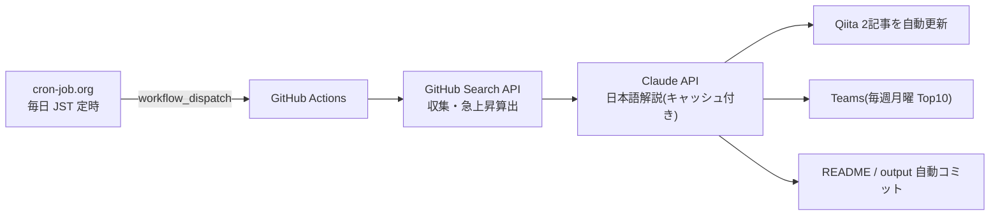

# Claude Code向けMCPツール候補ランキング

GitHub Search APIを使って、Claude Code周辺で活用候補になりそうなMCP関連リポジトリを定期収集するリポジトリです。

> 注意: この一覧は「Claude Codeでの動作」を保証するものではありません。  
> GitHub上のリポジトリ名・説明文・READMEなどに含まれる情報をもとに、MCP関連ツール候補を探すための入口として利用します。

## 仕組み(定常自律運転)

このランキングは cron-job.org → GitHub Actions → Claude API → Qiita / Teams のパイプラインで、毎日無人更新されています。



- 仕組みの詳細と**ライブ稼働ステータス**: [定常自律運転ページ](https://takanobusano.github.io/mcp-github-ranking/)
- 作り方の解説記事: [パイプライン編](https://qiita.com/4q_sano/items/913e93ee5cc2731561fc) / [cron-job.org 完全自動化編](https://qiita.com/4q_sano/items/1bc5e0669a8f0166936c)
<!-- MCP_REPOS_START -->
最終更新: **2026-10-14 08:17:10 JST**

MCP関連リポジトリに加え、Claude Code周辺で活用候補になりそうな関連ツールをGitHub Search APIで毎日自動収集してランキング化しています。

Stars / Forks の差分は、UTC基準の前日データ（2026-10-12）との差分です。
CSVには最大500件を保存し、本文では上位100件を表示しています。

> 注意: この一覧はClaude Codeでの動作を保証するものではありません。  
> MCP関連ツールまたはClaude Code関連ツール候補を探すための入口として利用してください。

# 注目MCP・関連ツール候補ランキング

## 1位 [public-apis/public-apis](https://github.com/public-apis/public-apis)

A collective list of free APIs

⭐ **488,416 Stars**（+426）　🍴 **54,158 Forks**（+61）　/　🟢 **2,144 Open Issues**　/　Python

Topics: `api` / `apis` / `dataset` / `development` / `free` / `list` / `lists` / `open-source`

## 2位 [openclaw/openclaw](https://github.com/openclaw/openclaw)

The AI that really does things. Any OS. Any Platform. The lobster way. 🦞

⭐ **391,903 Stars**（+103）　🍴 **82,415 Forks**（+34）　/　🟢 **9,540 Open Issues**　/　TypeScript

Topics: `ai` / `assistant` / `crustacean` / `molty` / `openclaw` / `own-your-data` / `personal`

## 3位 [obra/superpowers](https://github.com/obra/superpowers)

An agentic skills framework & software development methodology that works.

⭐ **298,646 Stars**（+463）　🍴 **26,694 Forks**（+48）　/　🟢 **339 Open Issues**　/　Shell

Topics: `ai` / `brainstorming` / `coding` / `obra` / `sdlc` / `skills` / `subagent-driven-development` / `superpowers`

## 4位 [mattpocock/skills](https://github.com/mattpocock/skills)

Skills for Real Engineers. Straight from my .agents directory.

⭐ **289,599 Stars**（+1,706）　🍴 **24,305 Forks**（+139）　/　🟢 **169 Open Issues**　/　Shell

Topics: `topicなし`

## 5位 [affaan-m/ECC](https://github.com/affaan-m/ECC)

The agent harness performance optimization system. Skills, instincts, memory, security, and research-first development for Claude Code, Codex, Opencode, Cursor and beyond.

⭐ **278,577 Stars**（+701）　🍴 **41,495 Forks**（+63）　/　🟢 **178 Open Issues**　/　JavaScript

Topics: `ai-agents` / `anthropic` / `claude` / `claude-code` / `developer-tools` / `llm` / `mcp` / `productivity`

## 6位 [NousResearch/hermes-agent](https://github.com/NousResearch/hermes-agent)

The agent that grows with you

⭐ **253,472 Stars**（+354）　🍴 **54,977 Forks**（+121）　/　🟢 **48,449 Open Issues**　/　Python

Topics: `ai` / `ai-agent` / `ai-agents` / `anthropic` / `chatgpt` / `claude` / `claude-code` / `codex`

## 7位 [multica-ai/andrej-karpathy-skills](https://github.com/multica-ai/andrej-karpathy-skills)

A single CLAUDE.md file to improve Claude Code behavior, derived from Andrej Karpathy's observations on LLM coding pitfalls.

⭐ **219,485 Stars**（+252）　🍴 **22,092 Forks**（+23）　/　🟢 **133 Open Issues**　/　不明

Topics: `topicなし`

## 8位 [morluto/rea](https://github.com/morluto/rea)

Reverse engineer anything with agents, from app behavior down to native binaries.

⭐ **205,670 Stars**（+51,069）　🍴 **50,072 Forks**（+14,492）　/　🟢 **553 Open Issues**　/　TypeScript

Topics: `agent-skills` / `ai-agents` / `binary-analysis` / `claude-code` / `cli` / `codex` / `cordis` / `ctf`

## 9位 [ultraworkers/claw-code](https://github.com/ultraworkers/claw-code)

An agent-managed museum exhibit, built in Rust with Gajae-Code / LazyCodex — developed and maintained with no human intervention.

⭐ **194,915 Stars**（-52）　🍴 **108,030 Forks**（-26）　/　🟢 **1 Open Issues**　/　Rust

Topics: `topicなし`

## 10位 [firecrawl/firecrawl](https://github.com/firecrawl/firecrawl)

Supercharge your AI agents with data from the web and beyond. Building the library for superintelligence. 🔥

⭐ **191,206 Stars**（+352）　🍴 **10,145 Forks**（+13）　/　🟢 **575 Open Issues**　/　TypeScript

Topics: `ai` / `ai-agents` / `ai-crawler` / `ai-scraping` / `ai-search` / `crawler` / `data-extraction` / `html-to-markdown`

## 11位 [ollama/ollama](https://github.com/ollama/ollama)

Get up and running with Kimi, GLM, MiniMax, DeepSeek, gpt-oss, Qwen, Gemma and other models.

⭐ **183,050 Stars**（+152）　🍴 **18,267 Forks**（+26）　/　🟢 **4,264 Open Issues**　/　Go

Topics: `deepseek` / `gemma` / `gemma3` / `glm` / `go` / `golang` / `gpt-oss` / `llama`

## 12位 [anthropics/skills](https://github.com/anthropics/skills)

Public repository for Agent Skills

⭐ **180,923 Stars**（+195）　🍴 **21,443 Forks**（+27）　/　🟢 **1,406 Open Issues**　/　Python

Topics: `agent-skills`

## 13位 [DietrichGebert/ponytail](https://github.com/DietrichGebert/ponytail)

Makes your AI agent think like the laziest senior dev in the room. The best code is the code you never wrote.

⭐ **162,727 Stars**（+871）　🍴 **8,793 Forks**（+59）　/　🟢 **15 Open Issues**　/　JavaScript

Topics: `agent-skills` / `ai-agents` / `claude` / `claude-code` / `claude-code-plugin` / `cursor-rules` / `developer-tools` / `llm`

## 14位 [msitarzewski/agency-agents](https://github.com/msitarzewski/agency-agents)

A complete AI agency at your fingertips - From frontend wizards to Reddit community ninjas, from whimsy injectors to reality checkers. Each agent is a specialized expert with personality, processes, and proven deliverables.

⭐ **159,877 Stars**（+366）　🍴 **25,854 Forks**（+78）　/　🟢 **207 Open Issues**　/　Shell

Topics: `topicなし`

## 15位 [langgenius/dify](https://github.com/langgenius/dify)

Build Agentic workflows, RAG pipelines, with rich AI model and tool support on one collaborative workspace. Deploy on cloud, VPC, or self-hosted, so teams move from prototype to production without rebuilding the stack.

⭐ **158,384 Stars**（+110）　🍴 **25,043 Forks**（+30）　/　🟢 **1,111 Open Issues**　/　TypeScript

Topics: `agent` / `agentic-ai` / `agentic-framework` / `agentic-workflow` / `ai` / `automation` / `claude` / `deepseek`

## 16位 [langflow-ai/langflow](https://github.com/langflow-ai/langflow)

Langflow is a powerful tool for building and deploying AI-powered agents and workflows.

⭐ **155,624 Stars**（+67）　🍴 **10,247 Forks**（+5）　/　🟢 **1,141 Open Issues**　/　Python

Topics: `agents` / `chatgpt` / `generative-ai` / `large-language-models` / `multiagent` / `react-flow`

## 17位 [anthropics/claude-code](https://github.com/anthropics/claude-code)

Claude Code is an agentic coding tool that lives in your terminal, understands your codebase, and helps you code faster by executing routine tasks, explaining complex code, and handling git workflows - all through natural language commands.

⭐ **150,649 Stars**（+222）　🍴 **26,445 Forks**（+134）　/　🟢 **14,771 Open Issues**　/　TypeScript

Topics: `topicなし`

## 18位 [x1xhlol/system-prompts-and-models-of-ai-tools](https://github.com/x1xhlol/system-prompts-and-models-of-ai-tools)

FULL Augment Code, Claude Code, Cluely, CodeBuddy, Comet, Cursor, Devin AI, Junie, Kiro, Leap.new, Lovable, Manus, NotionAI, Orchids.app, Perplexity, Poke, Qoder, Replit, Same.dev, Trae, Traycer AI, VSCode Agent, Warp.dev, Windsurf, Xcode, Z.ai Code, Dia & v0. (And other Open Sourced) System Prompts, Internal Tools & AI Models

⭐ **144,009 Stars**（+49）　🍴 **34,755 Forks**（-5）　/　🟢 **161 Open Issues**　/　不明

Topics: `ai` / `bolt` / `cluely` / `copilot` / `cursor` / `cursorai` / `devin` / `github-copilot`

## 19位 [farion1231/cc-switch](https://github.com/farion1231/cc-switch)

A cross-platform desktop All-in-One assistant for Claude Code, Codex, OpenCode, OpenClaw, Grok Build & Hermes Agent. Only official website: ccswitch.io

⭐ **143,773 Stars**（+498）　🍴 **9,560 Forks**（+25）　/　🟢 **1,973 Open Issues**　/　Rust

Topics: `ai-tools` / `claude-code` / `codex` / `desktop-app` / `grok` / `grokbuild` / `hermes` / `hermes-agent`

## 20位 [garrytan/gstack](https://github.com/garrytan/gstack)

Use Garry Tan's exact Claude Code setup: 23 opinionated tools that serve as CEO, Designer, Eng Manager, Release Manager, Doc Engineer, and QA

⭐ **136,312 Stars**（+165）　🍴 **20,242 Forks**（+32）　/　🟢 **71 Open Issues**　/　TypeScript

Topics: `topicなし`

## 21位 [nextlevelbuilder/ui-ux-pro-max-skill](https://github.com/nextlevelbuilder/ui-ux-pro-max-skill)

An AI skill that provides design intelligence for building professional UI/UX across multiple platforms.

⭐ **135,505 Stars**（+343）　🍴 **14,401 Forks**（+39）　/　🟢 **93 Open Issues**　/　Python

Topics: `ai-skills` / `antigravity` / `claude` / `claude-code` / `codex` / `command-line` / `copilot` / `cursor-ai`

## 22位 [harry0703/MoneyPrinterTurbo](https://github.com/harry0703/MoneyPrinterTurbo)

利用 AI 大模型和自动化工作流，根据主题或关键词一键生成高清短视频。Generate HD short videos from a topic or keyword with an automated AI workflow.

⭐ **130,530 Stars**（+271）　🍴 **20,481 Forks**（+62）　/　🟢 **96 Open Issues**　/　Python

Topics: `ai-video-generator` / `content-creation` / `ffmpeg` / `instagram-reels` / `llm` / `python` / `short-video` / `subtitles`

## 23位 [Graphify-Labs/graphify](https://github.com/Graphify-Labs/graphify)

Turn any codebase, with its docs, SQL schemas, configs, and PDFs, into a queryable knowledge graph. A /graphify skill for Claude Code, Cursor, Codex, and Gemini CLI: local deterministic AST parsing, every edge explained, no vector store.

⭐ **126,189 Stars**（+318）　🍴 **12,175 Forks**（+26）　/　🟢 **1,478 Open Issues**　/　Python

Topics: `ai-agents` / `antigravity` / `ast` / `claude-code` / `code-analysis` / `code-search` / `codex` / `cursor`

## 24位 [browser-use/browser-use](https://github.com/browser-use/browser-use)

Agents that use the browser.

⭐ **117,881 Stars**（+127）　🍴 **13,050 Forks**（+21）　/　🟢 **530 Open Issues**　/　Python

Topics: `ai-agents` / `ai-tools` / `browser-automation` / `browser-use` / `llm` / `playwright` / `python`

## 25位 [JuliusBrussee/caveman](https://github.com/JuliusBrussee/caveman)

🪨 why use many token when few token do trick. Viral skill + proxy for coding agents that cuts 65% of tokens by talking like a caveman.

⭐ **111,473 Stars**（+234）　🍴 **6,459 Forks**（+13）　/　🟢 **32 Open Issues**　/　Go

Topics: `ai` / `anthropic` / `caveman` / `claude` / `claude-code` / `llm` / `meme` / `prompt-engineering`

## 26位 [TauricResearch/TradingAgents](https://github.com/TauricResearch/TradingAgents)

TradingAgents: Multi-Agents LLM Financial Trading Framework

⭐ **111,036 Stars**（+195）　🍴 **21,401 Forks**（+51）　/　🟢 **111 Open Issues**　/　Python

Topics: `agent` / `finance` / `llm` / `multiagent` / `trading`

## 27位 [google-gemini/gemini-cli](https://github.com/google-gemini/gemini-cli)

An open-source AI agent that brings the power of Gemini directly into your terminal.

⭐ **107,326 Stars**（+26）　🍴 **14,711 Forks**（+5）　/　🟢 **754 Open Issues**　/　TypeScript

Topics: `ai` / `ai-agents` / `cli` / `gemini` / `gemini-api` / `mcp-client` / `mcp-server`

## 28位 [addyosmani/agent-skills](https://github.com/addyosmani/agent-skills)

Production-grade engineering skills for AI coding agents.

⭐ **106,185 Stars**（+580）　🍴 **11,070 Forks**（+55）　/　🟢 **117 Open Issues**　/　JavaScript

Topics: `agent-skills` / `antigravity` / `claude-code` / `codex` / `cursor` / `skills`

## 29位 [paperclipai/paperclip](https://github.com/paperclipai/paperclip)

The open-source app everyone uses to manage agents at work

⭐ **101,540 Stars**（+601）　🍴 **17,036 Forks**（+62）　/　🟢 **6,074 Open Issues**　/　TypeScript

Topics: `acpx` / `agent-orchestration` / `agent-skills` / `agentic-ai` / `ai-agents` / `ai-engineering` / `ai-governance` / `ai-tools`

## 30位 [nexu-io/open-design](https://github.com/nexu-io/open-design)

OpenDesign is the 1st Collaborative AI Design Agent Workspace. Local-first and open source. Create prototypes, websites, apps, dashboards, presentations, images, and videos with your team and AI agents. Share work, exchange feedback, and iterate together in one workspace.

⭐ **100,955 Stars**（+207）　🍴 **11,627 Forks**（+30）　/　🟢 **1,163 Open Issues**　/　TypeScript

Topics: `agent-skills` / `ai-design` / `byok` / `claude-code-for-design` / `claude-design` / `codex-design` / `coding-agents` / `cursor-design`

## 31位 [thedotmack/claude-mem](https://github.com/thedotmack/claude-mem)

Persistent Context Across Sessions for Every Agent –  Captures everything your agent does during sessions, compresses it with AI, and injects relevant context back into future sessions. Works with Claude Code, OpenClaw, Codex, Gemini, Hermes, Copilot, OpenCode + More

⭐ **100,425 Stars**（+349）　🍴 **8,799 Forks**（+19）　/　🟢 **81 Open Issues**　/　TypeScript

Topics: `ai` / `ai-agents` / `ai-memory` / `anthropic` / `artificial-intelligence` / `chromadb` / `claude` / `claude-agent-sdk`

## 32位 [microsoft/playwright](https://github.com/microsoft/playwright)

Playwright is a framework for Web Testing and Automation. It allows testing Chromium, Firefox and WebKit with a single API.

⭐ **97,649 Stars**（+87）　🍴 **6,599 Forks**（+6）　/　🟢 **177 Open Issues**　/　TypeScript

Topics: `automation` / `chrome` / `chromium` / `e2e-testing` / `electron` / `end-to-end-testing` / `firefox` / `javascript`

## 33位 [Panniantong/Agent-Reach](https://github.com/Panniantong/Agent-Reach)

Give your AI agent eyes to see the entire internet. Read & search Twitter, Reddit, YouTube, GitHub, Bilibili, XiaoHongShu — one CLI, zero API fees.

⭐ **96,981 Stars**（+407）　🍴 **8,490 Forks**（+37）　/　🟢 **211 Open Issues**　/　Python

Topics: `agent-infrastructure` / `ai-agent` / `ai-search` / `automation` / `bilibili` / `claude-code` / `cli` / `cursor`

## 34位 [puppeteer/puppeteer](https://github.com/puppeteer/puppeteer)

JavaScript API for Chrome and Firefox

⭐ **95,687 Stars**（+4）　🍴 **9,591 Forks**（+2）　/　🟢 **272 Open Issues**　/　TypeScript

Topics: `automation` / `chrome` / `chromium` / `developer-tools` / `firefox` / `headless-chrome` / `node-module` / `testing`

## 35位 [Leonxlnx/taste-skill](https://github.com/Leonxlnx/taste-skill)

Agent skills that give coding agents taste: art direction, reference images and a browser check instead of generic AI pages

⭐ **95,582 Stars**（+450）　🍴 **6,502 Forks**（+28）　/　🟢 **0 Open Issues**　/　JavaScript

Topics: `agent-skills` / `ai-agents` / `anti-slop` / `claude-code` / `codex` / `cursor` / `design-system` / `frontend`

## 36位 [OpenCut-app/OpenCut](https://github.com/OpenCut-app/OpenCut)

The open-source CapCut alternative

⭐ **94,116 Stars**（+273）　🍴 **9,247 Forks**（+40）　/　🟢 **376 Open Issues**　/　TypeScript

Topics: `editor` / `oss` / `videoeditor`

## 37位 [stablyai/orca](https://github.com/stablyai/orca)

Orca is the ADE for working with a fleet of parallel agents. Run any coding agent with your own subscription. Available on desktop, mobile and remote runtime.

⭐ **91,582 Stars**（+937）　🍴 **5,844 Forks**（+55）　/　🟢 **8,358 Open Issues**　/　TypeScript

Topics: `ade` / `agent-ide` / `ai-agents` / `claude-code` / `cli` / `codex` / `cursor-agent` / `devtools`

## 38位 [modelcontextprotocol/servers](https://github.com/modelcontextprotocol/servers)

Model Context Protocol Servers

⭐ **91,224 Stars**（+41）　🍴 **11,789 Forks**（+10）　/　🟢 **480 Open Issues**　/　JavaScript

Topics: `topicなし`

## 39位 [OpenHands/OpenHands](https://github.com/OpenHands/OpenHands)

🙌 OpenHands: AI-Driven Development

⭐ **90,828 Stars**（+81）　🍴 **12,039 Forks**（+21）　/　🟢 **966 Open Issues**　/　TypeScript

Topics: `agent` / `artificial-intelligence` / `chatgpt` / `claude-ai` / `cli` / `developer-tools` / `gpt` / `llm`

## 40位 [ChatGPTNextWeb/NextChat](https://github.com/ChatGPTNextWeb/NextChat)

✨ Zero-config AI chat assistant. No API key needed — sign up and instantly chat with GPT-5, Claude 4, Gemini 2.5, DeepSeek & 100+ top models. Pay-as-you-go save...

⭐ **88,844 Stars**（+4）　🍴 **58,842 Forks**（-12）　/　🟢 **853 Open Issues**　/　TypeScript

Topics: `calclaude` / `claude` / `cross-platform` / `desktop` / `fe` / `gemini` / `gemini-pro` / `gemini-server`

## 41位 [koala73/worldmonitor](https://github.com/koala73/worldmonitor)

Real-time global intelligence dashboard. AI-powered news aggregation, geopolitical monitoring, and infrastructure tracking in a unified situational awareness interface

⭐ **88,392 Stars**（+70）　🍴 **13,512 Forks**（+7）　/　🟢 **368 Open Issues**　/　TypeScript

Topics: `agent` / `ai` / `dashboard` / `geopolitics` / `mcp` / `mcp-server` / `monitoring` / `news`

## 42位 [D4Vinci/Scrapling](https://github.com/D4Vinci/Scrapling)

🕷️ An adaptive Web Scraping framework that handles everything from a single request to a full-scale crawl! Don't be shy, join here:  and follow here for daily tips and tricks:

⭐ **87,328 Stars**（+321）　🍴 **8,953 Forks**（+42）　/　🟢 **21 Open Issues**　/　Python

Topics: `ai` / `ai-scraping` / `automation` / `crawler` / `crawling` / `crawling-python` / `data` / `data-extraction`

## 43位 [Egonex-AI/Understand-Anything](https://github.com/Egonex-AI/Understand-Anything)

Graphs that teach > graphs that impress. Turn any code into an interactive knowledge graph you can explore, search, and ask questions about. Works with Claude Code, Codex, Cursor, Copilot, Gemini CLI, and more.

⭐ **86,174 Stars**（+113）　🍴 **7,268 Forks**（+11）　/　🟢 **319 Open Issues**　/　TypeScript

Topics: `antigravity-skills` / `business-knowledge` / `claude-code` / `claude-skills` / `codebase-analysis` / `codex` / `codex-skills` / `developer-tools-ai-agent`

## 44位 [unclecode/crawl4ai](https://github.com/unclecode/crawl4ai)

Open-source web crawler and scraper for LLMs and AI agents: any website into clean, LLM-ready Markdown. Run it yourself, or use Crawl4AI Cloud with one key.

⭐ **85,461 Stars**（+73）　🍴 **8,875 Forks**（+7）　/　🟢 **224 Open Issues**　/　Python

Topics: `ai` / `ai-agents` / `crawler` / `data-extraction` / `llm` / `markdown` / `mcp` / `open-source`

## 45位 [laravel/laravel](https://github.com/laravel/laravel)

Laravel is a web application framework with expressive, elegant syntax. We’ve already laid the foundation for your next big idea — freeing you to create without sweating the small things.

⭐ **85,097 Stars**（+28）　🍴 **27,590 Forks**（+152）　/　🟢 **31 Open Issues**　/　Blade

Topics: `framework` / `laravel` / `php`

## 46位 [bytedance/deer-flow](https://github.com/bytedance/deer-flow)

An open-source long-horizon SuperAgent harness that researches, codes, and creates. With the help of sandboxes, memories, tools, skill, subagents and message gateway, it handles different levels of tasks that could take minutes to hours.

⭐ **83,816 Stars**（+61）　🍴 **11,672 Forks**（+18）　/　🟢 **941 Open Issues**　/　Python

Topics: `agent` / `agentic` / `agentic-framework` / `agentic-workflow` / `ai` / `ai-agents` / `deep-research` / `harness`

## 47位 [rtk-ai/rtk](https://github.com/rtk-ai/rtk)

CLI proxy that reduces LLM token consumption by 60-90% on common dev commands. Single Rust binary, zero dependencies

⭐ **83,227 Stars**（+122）　🍴 **5,285 Forks**（+9）　/　🟢 **1,514 Open Issues**　/　Rust

Topics: `agentic-coding` / `ai-coding` / `anthropic` / `claude-code` / `cli` / `command-line-tool` / `cost-reduction` / `developer-tools`

## 48位 [lobehub/lobehub](https://github.com/lobehub/lobehub)

🤯 LobeHub is your Chief Agent Operator, organizing your agents into 7×24 operations by hiring, scheduling, and reporting on your entire AI team.

⭐ **83,209 Stars**（+30）　🍴 **15,979 Forks**（+4）　/　🟢 **1,069 Open Issues**　/　TypeScript

Topics: `agent` / `agent-collaboration` / `agent-harness` / `ai` / `cao` / `chatgpt` / `chief-agent-operator` / `claude`

## 49位 [tt-a1i/archify](https://github.com/tt-a1i/archify)

Turn any idea, plan, or codebase into a beautiful interactive diagram. An agent skill for Claude Code, Codex, and more.

⭐ **83,022 Stars**（+490）　🍴 **5,595 Forks**（+26）　/　🟢 **304 Open Issues**　/　JavaScript

Topics: `agent-skills` / `ai-agents` / `architecture-diagram` / `claude-code` / `claude-skills` / `codex` / `coding-agents` / `deepseek-harness`

## 50位 [pbakaus/impeccable](https://github.com/pbakaus/impeccable)

The design language that makes your AI harness better at design.

⭐ **80,761 Stars**（+475）　🍴 **4,833 Forks**（+50）　/　🟢 **79 Open Issues**　/　JavaScript

Topics: `topicなし`

## 51位 [abi/screenshot-to-code](https://github.com/abi/screenshot-to-code)

Drop in a screenshot and convert it to clean code (HTML/Tailwind/React/Vue)

⭐ **80,322 Stars**（+51）　🍴 **9,810 Forks**（-3）　/　🟢 **146 Open Issues**　/　Python

Topics: `topicなし`

## 52位 [shareAI-lab/learn-claude-code](https://github.com/shareAI-lab/learn-claude-code)

Bash is all you need -  A nano claude code–like 「agent harness」, built from 0 to 1

⭐ **78,515 Stars**（+63）　🍴 **12,574 Forks**（+4）　/　🟢 **64 Open Issues**　/　Python

Topics: `agent` / `agent-development` / `ai-agent` / `claude` / `claude-code` / `educational` / `llm` / `python`

## 53位 [unslothai/unsloth](https://github.com/unslothai/unsloth)

Local UI to run and train LLMs and diffusion models. Supports GGUF, MLX, Qwen3.8, DeepSeek-V4, MiniMax-H3, Gemma 4, FLUX and more.

⭐ **77,953 Stars**（+67）　🍴 **7,200 Forks**（+6）　/　🟢 **378 Open Issues**　/　Python

Topics: `agent` / `ai` / `chatgpt` / `deepseek` / `fine-tuning` / `gemma` / `image-generation` / `llama`

## 54位 [diegosouzapw/OmniRoute](https://github.com/diegosouzapw/OmniRoute)

Never stop coding. Free MIT AI gateway: one endpoint, 359 providers (150+ free), 1200+ models Kimi, Claude, GPT, Gemini, GLM, DeepSeek, MiniMax. Works with Claude Code, Codex, Cursor, OpenCode, Cline & Copilot. Quota-aware auto-fallback, RTK+Caveman compression saves 15-95% tokens, MCP/A2A, Desktop/PWA. Built by hundreds of contributors

⭐ **76,163 Stars**（+432）　🍴 **10,996 Forks**（+65）　/　🟢 **373 Open Issues**　/　TypeScript

Topics: `a2a` / `ai-agents` / `ai-gateway` / `anthropic` / `claude` / `claude-code` / `cline` / `codex`

## 55位 [headroomlabs-ai/headroom](https://github.com/headroomlabs-ai/headroom)

Compress tool outputs, logs, files, and RAG chunks before they reach the LLM. 20% fewer tokens for coding agents, 60-95% fewer tokens for JSON, same answers. Library, proxy, MCP server.

⭐ **75,247 Stars**（+108）　🍴 **5,839 Forks**（+11）　/　🟢 **430 Open Issues**　/　Python

Topics: `agent` / `ai` / `anthropic` / `claude-code` / `compression` / `context-engineering` / `context-window` / `cursor`

## 56位 [Eugeny/tabby](https://github.com/Eugeny/tabby)

A terminal for a more modern age

⭐ **74,956 Stars**（+16）　🍴 **4,289 Forks**（+2）　/　🟢 **2,832 Open Issues**　/　TypeScript

Topics: `serial` / `ssh-client` / `telnet-client` / `terminal` / `terminal-emulators`

## 57位 [ruvnet/ruflo](https://github.com/ruvnet/ruflo)

🌊 The original agent harness. Deploy intelligent multi-player swarms, coordinate autonomous workflows, and build conversational AI systems. Features adaptive me...

⭐ **74,559 Stars**（+118）　🍴 **8,869 Forks**（+17）　/　🟢 **1,067 Open Issues**　/　TypeScript

Topics: `agentic-ai` / `agentic-framework` / `agentic-workflow` / `agents` / `ai-agents` / `ai-assistant` / `ai-skills` / `autonomous-agents`

## 58位 [thedaviddias/Front-End-Checklist](https://github.com/thedaviddias/Front-End-Checklist)

🗂 The essential checklist for modern web development, for humans and AI agents

⭐ **74,452 Stars**（+11）　🍴 **6,759 Forks**（+1）　/　🟢 **10 Open Issues**　/　MDX

Topics: `ai-agent` / `ai-agents` / `checklist` / `css` / `front-end-developer-tool` / `front-end-development` / `frontend` / `guidelines`

## 59位 [openbq-org/OpenBB](https://github.com/openbq-org/OpenBB)

Open Data Platform for analysts, quants and AI agents.

⭐ **74,199 Stars**（+31）　🍴 **7,676 Forks**（+11）　/　🟢 **100 Open Issues**　/　Python

Topics: `ai` / `crypto` / `derivatives` / `economics` / `equity` / `finance` / `fixed-income` / `machine-learning`

## 60位 [colbymchenry/codegraph](https://github.com/colbymchenry/codegraph)

Pre-indexed code knowledge graph, auto syncs on code changes, for Claude Code, Codex, Gemini, Cursor, OpenCode, AntiGravity, Kiro, CoPilot, and Hermes Agent — fewer tokens, fewer tool calls, 100% local

⭐ **73,962 Stars**（+136）　🍴 **4,771 Forks**（+7）　/　🟢 **573 Open Issues**　/　C

Topics: `topicなし`

## 61位 [cline/cline](https://github.com/cline/cline)

Autonomous coding agent as an SDK, IDE extension, or CLI assistant.

⭐ **70,278 Stars**（+42）　🍴 **7,655 Forks**（+8）　/　🟢 **1,643 Open Issues**　/　TypeScript

Topics: `topicなし`

## 62位 [code-yeongyu/oh-my-openagent](https://github.com/code-yeongyu/oh-my-openagent)

OmO: Just type "mass ulw" keyword with your prompt. Now you are the master of graph engineering.

⭐ **70,000 Stars**（+23）　🍴 **5,756 Forks**（+8）　/　🟢 **1,289 Open Issues**　/　TypeScript

Topics: `ai` / `ai-agents` / `anthropic` / `chatgpt` / `claude` / `claude-skills` / `codex` / `cursor`

## 63位 [asgeirtj/system_prompts_leaks](https://github.com/asgeirtj/system_prompts_leaks)

Documented system prompts from Anthropic - Claude Fable 5.1, Opus 5.5, Claude Design, Claude Code. OpenAI - ChatGPT GPT-6-Astra, Codex. Google - Gemini 3.8 Flash, 3.1 Pro, Antigravity. xAI - Grok, Grok Bot, Cursor, Kimi and more! Updated regularly.

⭐ **69,574 Stars**（+90）　🍴 **11,314 Forks**（+15）　/　🟢 **56 Open Issues**　/　Python

Topics: `ai` / `ai-agents` / `ai-prompts` / `anthropic` / `chatbot` / `chatgpt` / `claude` / `claude-code`

## 64位 [docling-project/docling](https://github.com/docling-project/docling)

Get your documents ready for gen AI

⭐ **68,826 Stars**（+52）　🍴 **5,070 Forks**（+11）　/　🟢 **1,056 Open Issues**　/　Python

Topics: `ai` / `convert` / `document-parser` / `document-parsing` / `documents` / `docx` / `html` / `markdown`

## 65位 [rohitg00/ai-engineering-from-scratch](https://github.com/rohitg00/ai-engineering-from-scratch)

Learn AI Engineering! Learn it. Build it. Ship it for others.

⭐ **68,648 Stars**（+574）　🍴 **12,019 Forks**（+93）　/　🟢 **68 Open Issues**　/　Python

Topics: `agents` / `ai` / `ai-agents` / `ai-engineering` / `computer-vision` / `course` / `deep-learning` / `from-scratch`

## 66位 [openinterpreter/openinterpreter](https://github.com/openinterpreter/openinterpreter)

A coding agent for open models like Kimi K3 and GLM 5.3

⭐ **68,571 Stars**（+7）　🍴 **5,898 Forks**（+3）　/　🟢 **14 Open Issues**　/　Rust

Topics: `acp` / `coding-agent` / `deepseek` / `kimi` / `python` / `qwen` / `rust`

## 67位 [usestrix/strix](https://github.com/usestrix/strix)

Open-source AI penetration testing tool to find and fix your app’s vulnerabilities.

⭐ **68,400 Stars**（+219）　🍴 **7,585 Forks**（+35）　/　🟢 **471 Open Issues**　/　Python

Topics: `agents` / `ai-hacking` / `ai-penetration-testing` / `ai-pentesting` / `ai-security` / `artificial-intelligence` / `bug-bounty` / `code-quality`

## 68位 [calesthio/OpenMontage](https://github.com/calesthio/OpenMontage)

World's first open-source, agentic video production system. 12 production pipelines, 100+ tools, 700+ agent skill and production-knowledge files. Turn your AI coding assistant into a full video production studio.

⭐ **67,960 Stars**（+423）　🍴 **8,696 Forks**（+77）　/　🟢 **384 Open Issues**　/　Python

Topics: `agent` / `agentic-ai` / `ai` / `claude` / `copilot` / `cursor` / `elevenlabs` / `ffmpeg`

## 69位 [shanraisshan/claude-code-best-practice](https://github.com/shanraisshan/claude-code-best-practice)

from vibe coding to agentic engineering - practice makes claude perfect

⭐ **67,512 Stars**（+43）　🍴 **6,735 Forks**（+3）　/　🟢 **20 Open Issues**　/　HTML

Topics: `agentic-ai` / `agentic-coding` / `agentic-engineering` / `agentic-workflow` / `ai` / `ai-agents` / `anthropic` / `best-practices`

## 70位 [bradtraversy/design-resources-for-developers](https://github.com/bradtraversy/design-resources-for-developers)

Curated list of design and UI resources from stock photos, web templates, CSS frameworks, UI libraries, tools and much more

⭐ **67,153 Stars**（+7）　🍴 **12,253 Forks**（+4）　/　🟢 **19 Open Issues**　/　不明

Topics: `topicなし`

## 71位 [mem0ai/mem0](https://github.com/mem0ai/mem0)

The Memory Layer for AI Agents - Drop-in memory infrastructure for AI agents and apps. Context that persists. Built for production.

⭐ **67,133 Stars**（+74）　🍴 **7,895 Forks**（+11）　/　🟢 **823 Open Issues**　/　Python

Topics: `agentic-memory` / `agentic-memory-system` / `agents` / `ai` / `ai-agents` / `chatgpt` / `genai` / `llm`

## 72位 [xtekky/gpt4free](https://github.com/xtekky/gpt4free)

The official gpt4free repository \| various collection of powerful language models \| opus 4.6 gpt 5.3 kimi 2.5 deepseek v3.2 gemini 3

⭐ **66,838 Stars**（+33）　🍴 **13,480 Forks**（+3）　/　🟢 **5 Open Issues**　/　Python

Topics: `chatbot` / `chatbots` / `chatgpt` / `chatgpt-4` / `chatgpt-api` / `chatgpt-free` / `chatgpt4` / `deepseek`

## 73位 [NanmiCoder/MediaCrawler](https://github.com/NanmiCoder/MediaCrawler)

小红书笔记 \| 评论爬虫、抖音视频 \| 评论爬虫、快手视频 \| 评论爬虫、B 站视频 ｜ 评论爬虫、微博帖子 ｜ 评论爬虫、百度贴吧帖子 ｜ 百度贴吧评论回复爬虫  \| 知乎问答文章｜评论爬虫

⭐ **66,791 Stars**（+72）　🍴 **12,781 Forks**（+8）　/　🟢 **216 Open Issues**　/　Python

Topics: `topicなし`

## 74位 [warpdotdev/warp](https://github.com/warpdotdev/warp)

Warp is an agentic development environment, born out of the terminal.

⭐ **65,453 Stars**（+13）　🍴 **5,646 Forks**（+8）　/　🟢 **5,402 Open Issues**　/　Rust

Topics: `bash` / `linux` / `macos` / `rust` / `shell` / `terminal` / `wasm` / `zsh`

## 75位 [mvanhorn/last30days-skill](https://github.com/mvanhorn/last30days-skill)

AI agent skill that researches any topic across Reddit, X, YouTube, HN, Polymarket, and the web - then synthesizes a grounded summary

⭐ **64,163 Stars**（+81）　🍴 **5,599 Forks**（+10）　/　🟢 **26 Open Issues**　/　Python

Topics: `ai-prompts` / `ai-skill` / `bluesky` / `claude` / `claude-code` / `clawhub` / `deep-research` / `hackernews`

## 76位 [debpalash/VoiceStudio](https://github.com/debpalash/VoiceStudio)

VoiceStudio is the open-source, fully-local ElevenLabs alternative — voice cloning, voice design, video dubbing, dictation, transcription & audiobook creation in 646 languages.

⭐ **63,128 Stars**（+2,784）　🍴 **7,023 Forks**（+258）　/　🟢 **147 Open Issues**　/　Python

Topics: `ai` / `audiobook` / `cuda` / `dubbing` / `elevenlabs-alternative` / `huggingface` / `local-first` / `mlx`

## 77位 [upstash/context7](https://github.com/upstash/context7)

Context7 Platform -- Up-to-date code documentation for LLMs and AI code editors

⭐ **62,990 Stars**（+43）　🍴 **3,081 Forks**（+8）　/　🟢 **36 Open Issues**　/　TypeScript

Topics: `llm` / `mcp` / `mcp-server` / `vibe-coding`

## 78位 [coollabsio/coolify](https://github.com/coollabsio/coolify)

An open-source, self-hostable PaaS alternative to Vercel, Heroku & Netlify that lets you easily deploy static sites, databases, full-stack applications and 280+ one-click services on your own servers.

⭐ **62,950 Stars**（+47）　🍴 **5,654 Forks**（+12）　/　🟢 **719 Open Issues**　/　PHP

Topics: `coolify` / `databases` / `deployment` / `docker` / `docker-compose` / `inertiajs` / `laravel` / `mariadb`

## 79位 [sansan0/TrendRadar](https://github.com/sansan0/TrendRadar)

⭐AI-driven public opinion & trend monitor with multi-platform aggregation, RSS, and smart alerts.🎯 告别信息过载，你的 AI 舆情监控助手与热点筛选工具！聚合多平台热点 +  RSS 订阅，支持关键词精准筛选。AI 智能筛...

⭐ **62,877 Stars**（+45）　🍴 **24,902 Forks**（-1）　/　🟢 **29 Open Issues**　/　Python

Topics: `ai` / `bark` / `data-analysis` / `docker` / `hot-news` / `llm` / `mail` / `mcp`

## 80位 [heygen-com/hyperframes](https://github.com/heygen-com/hyperframes)

Write HTML. Render video. Built for agents.

⭐ **62,740 Stars**（+958）　🍴 **5,627 Forks**（+97）　/　🟢 **265 Open Issues**　/　TypeScript

Topics: `ai` / `animation` / `ffmpeg` / `framework` / `gsap` / `html` / `mcp` / `puppeteer`

## 81位 [tw93/Pake](https://github.com/tw93/Pake)

🤱🏻 Turn any website into a tiny, fast desktop app.

⭐ **62,056 Stars**（+23）　🍴 **12,780 Forks**（+5）　/　🟢 **1 Open Issues**　/　Rust

Topics: `chatgpt` / `claude` / `desktop` / `gemini` / `hight-performance` / `linux` / `macos` / `no-electron`

## 82位 [eternity4719/HowToLiveBetter](https://github.com/eternity4719/HowToLiveBetter)

高性价比人生指南: 长寿防病、急救、省钱理财、法律红线、失业与工伤、医保社保、恋爱婚育、怀孕育儿、创业与做平台合规、出国与技能。每条写明成本、收益、证据等级和原始出处，只引期刊论文与官方文件。

⭐ **62,012 Stars**（+981）　🍴 **5,189 Forks**（+105）　/　🟢 **13 Open Issues**　/　HTML

Topics: `topicなし`

## 83位 [1c7/chinese-independent-developer](https://github.com/1c7/chinese-independent-developer)

👩🏿‍💻👨🏾‍💻👩🏼‍💻👨🏽‍💻👩🏻‍💻中国独立开发者项目列表 -- 分享大家都在做什么

⭐ **61,791 Stars**（+9）　🍴 **5,452 Forks**（+4）　/　🟢 **2 Open Issues**　/　不明

Topics: `china` / `indie` / `indie-developer`

## 84位 [hugohe3/ppt-master](https://github.com/hugohe3/ppt-master)

AI turns documents or topics into real, native PowerPoint decks—with native shapes, transitions and animations, data-backed charts and tables on demand, audio narration from speaker notes, and support for your own .pptx templates. · by Hugo He

⭐ **61,649 Stars**（+575）　🍴 **4,884 Forks**（+54）　/　🟢 **5 Open Issues**　/　Python

Topics: `ai-agent` / `aippt` / `office` / `powerpoint` / `powerpoint-generation` / `ppt` / `pptx` / `presentation`

## 85位 [microsoft/autogen](https://github.com/microsoft/autogen)

A programming framework for agentic AI

⭐ **61,388 Stars**（+9）　🍴 **9,278 Forks**（±0）　/　🟢 **1,105 Open Issues**　/　Python

Topics: `agentic` / `agentic-agi` / `agents` / `ai` / `autogen` / `autogen-ecosystem` / `chatgpt` / `framework`

## 86位 [BerriAI/litellm](https://github.com/BerriAI/litellm)

The fastest, litest AI Gateway. Rust core with Python SDK. Call 100+ LLM APIs in OpenAI (or native) format with cost tracking, guardrails, load balancing, and logging [Bedrock, Azure, OpenAI, Anthropic, OpenAI, VertexAI, vLLM, Nvidia NIM]

⭐ **61,170 Stars**（+83）　🍴 **12,310 Forks**（+52）　/　🟢 **5,553 Open Issues**　/　Python

Topics: `ai-gateway` / `anthropic` / `azure-openai` / `bedrock` / `gateway` / `langchain` / `litellm` / `llm`

## 87位 [penpot/penpot](https://github.com/penpot/penpot)

Penpot: The open-source design platform for Product teams that need scalable collaboration.

⭐ **61,016 Stars**（+50）　🍴 **4,216 Forks**（+12）　/　🟢 **828 Open Issues**　/　Clojure

Topics: `clojure` / `clojurescript` / `design` / `prototyping` / `ui` / `ux-design` / `ux-experience`

## 88位 [Alishahryar1/free-claude-code](https://github.com/Alishahryar1/free-claude-code)

Use Claude Code, Codex, VSCode, Pi, and OpenCode (and 6 other harnesses) for free (1.3B+ free tokens) from your terminal, app, IDE, or phone, and now from the browser with native browser sessions (multi-harness + multi-model) like OpenClaw (voice supported + ToS friendly)

⭐ **60,200 Stars**（+1,151）　🍴 **9,434 Forks**（+128）　/　🟢 **309 Open Issues**　/　Python

Topics: `topicなし`

## 89位 [crewAIInc/crewAI](https://github.com/crewAIInc/crewAI)

Framework for orchestrating role-playing, autonomous AI agents. By fostering collaborative intelligence, CrewAI empowers agents to work together seamlessly, tackling complex tasks.

⭐ **59,661 Stars**（+43）　🍴 **8,717 Forks**（+7）　/　🟢 **679 Open Issues**　/　Python

Topics: `agents` / `ai` / `ai-agents` / `aiagentframework` / `llms`

## 90位 [meilisearch/meilisearch](https://github.com/meilisearch/meilisearch)

A lightning-fast search engine API bringing AI-powered hybrid search to your sites and applications.

⭐ **59,560 Stars**（+7）　🍴 **2,732 Forks**（+5）　/　🟢 **321 Open Issues**　/　Rust

Topics: `ai` / `api` / `app-search` / `database` / `enterprise-search` / `faceting` / `full-text-search` / `fuzzy-search`

## 91位 [MemPalace/mempalace](https://github.com/MemPalace/mempalace)

The best-benchmarked open-source AI memory system. And it's free.

⭐ **59,557 Stars**（+23）　🍴 **7,564 Forks**（+9）　/　🟢 **800 Open Issues**　/　Python

Topics: `ai` / `chromadb` / `llm` / `mcp` / `memory` / `python`

## 92位 [FoundationAgents/OpenManus](https://github.com/FoundationAgents/OpenManus)

No fortress, purely open ground.  OpenManus is Coming.

⭐ **58,638 Stars**（-2）　🍴 **10,173 Forks**（+3）　/　🟢 **449 Open Issues**　/　Python

Topics: `topicなし`

## 93位 [twentyhq/twenty](https://github.com/twentyhq/twenty)

The open alternative to Salesforce, designed for AI.

⭐ **58,295 Stars**（+40）　🍴 **9,523 Forks**（+9）　/　🟢 **131 Open Issues**　/　TypeScript

Topics: `crm` / `crm-system` / `customer` / `good-first-issue` / `graphql` / `hacktoberfest` / `javascript` / `marketing`

## 94位 [storytold/photocraft](https://github.com/storytold/photocraft)

PhotoCraft: An open-source, photo editor written by scratch in pure Rust

⭐ **57,735 Stars**（+4,464）　🍴 **9,735 Forks**（+886）　/　🟢 **1,500 Open Issues**　/　Rust

Topics: `art` / `image-editing` / `image-editing-software` / `image-editor` / `images` / `photo-editing` / `rust`

## 95位 [appwrite/appwrite](https://github.com/appwrite/appwrite)

The open-source cloud for agents & devs. Including Auth, Databases, Storage, Functions, Messaging, Hosting, Realtime, WAF and more

⭐ **57,676 Stars**（+24）　🍴 **5,789 Forks**（+9）　/　🟢 **780 Open Issues**　/　TypeScript

Topics: `android` / `appwrite` / `backend` / `backend-as-a-service` / `docker` / `firebase` / `firewall` / `flutter`

## 96位 [zylon-ai/private-gpt](https://github.com/zylon-ai/private-gpt)

Complete API layer for private AI applications on local models: RAG, skills, tools, MCP, text-to-sql, and more. Works with any OpenAI-compatible inference server.

⭐ **57,578 Stars**（+5）　🍴 **7,619 Forks**（±0）　/　🟢 **4 Open Issues**　/　Python

Topics: `ai` / `ai-tools` / `on-premise`

## 97位 [jamiepine/voicebox](https://github.com/jamiepine/voicebox)

The open-source AI voice studio. Clone, dictate, create.

⭐ **57,375 Stars**（+240）　🍴 **7,172 Forks**（+46）　/　🟢 **505 Open Issues**　/　Python

Topics: `ai` / `cuda` / `mlx` / `qwen3-tts` / `qwen3-tts-ui` / `voice-ai` / `voice-clone` / `whisper`

## 98位 [ayghri/i-have-adhd](https://github.com/ayghri/i-have-adhd)

A skill to stop your coding agent from burying the answer. ADHD-friendly output.

⭐ **56,926 Stars**（+241）　🍴 **3,266 Forks**（+18）　/　🟢 **66 Open Issues**　/　Python

Topics: `adhd` / `claude-` / `claude-code-plugin` / `claude-skills` / `developer-tools` / `productivity`

## 99位 [blader/humanizer](https://github.com/blader/humanizer)

Agent skill that removes signs of AI-generated writing from text

⭐ **56,574 Stars**（+380）　🍴 **4,472 Forks**（+29）　/　🟢 **3 Open Issues**　/　Python

Topics: `agent-skills` / `ai-humanizer` / `ai-writing` / `chatgpt` / `claude` / `claude-code` / `codex` / `cursor`

## 100位 [bilawalsidhu/gods-eye-view](https://github.com/bilawalsidhu/gods-eye-view)

A spy satellite simulator in your browser, except the data is real. Live open source spatial intelligence on a photorealistic 3D globe.

⭐ **55,302 Stars**（+1,718）　🍴 **10,816 Forks**（+219）　/　🟢 **409 Open Issues**　/　JavaScript

Topics: `3d-globe` / `cesium` / `flight-tracking` / `geospatial` / `geospatial-intelligence` / `gis` / `osint` / `photogrammetry`

# 最近プッシュされたMCP・関連ツール候補

スター数ランキングとは別に、最近コードがプッシュされたリポジトリを表示します。古いスター数だけではなく、現在も開発が動いていそうな候補を探すための一覧です。

## プッシュ順 1位 [openclaw/openclaw](https://github.com/openclaw/openclaw)

The AI that really does things. Any OS. Any Platform. The lobster way. 🦞

⭐ **391,903 Stars**（+103）　🍴 **82,415 Forks**（+34）　/　TypeScript　/　最終プッシュ: 2026-10-13

Topics: `ai` / `assistant` / `crustacean` / `molty` / `openclaw` / `own-your-data` / `personal`

## プッシュ順 2位 [PostHog/posthog](https://github.com/PostHog/posthog)

:hedgehog: PostHog is the leading platform for building self-driving products. Our developer tools – AI observability, analytics, session replay, flags, experiments, error tracking, logs, and more – capture all the context agents need to diagnose problems, uncover opportunities, and ship fixes. Steer it all from Slack, web, desktop, or the MCP.

⭐ **40,263 Stars**（+19）　🍴 **3,509 Forks**（+5）　/　Python　/　最終プッシュ: 2026-10-13

Topics: `ab-testing` / `ai-analytics` / `analytics` / `cdp` / `data-warehouse` / `experiments` / `feature-flags` / `javascript`

## プッシュ順 3位 [yc-software/qm](https://github.com/yc-software/qm)

Multiplayer agent harness for work.

⭐ **15,406 Stars**（+8）　🍴 **1,907 Forks**（+1）　/　TypeScript　/　最終プッシュ: 2026-10-13

Topics: `ai` / `assistant` / `harness` / `qm`

## プッシュ順 4位 [nukeop/nuclear](https://github.com/nukeop/nuclear)

Streaming music player that finds free music for you

⭐ **18,681 Stars**（+12）　🍴 **1,338 Forks**（+2）　/　TypeScript　/　最終プッシュ: 2026-10-13

Topics: `desktop-app` / `linux` / `mac` / `mcp` / `mcp-server` / `music` / `music-player` / `react`

## プッシュ順 5位 [code-yeongyu/oh-my-openagent](https://github.com/code-yeongyu/oh-my-openagent)

OmO: Just type "mass ulw" keyword with your prompt. Now you are the master of graph engineering.

⭐ **70,000 Stars**（+23）　🍴 **5,756 Forks**（+8）　/　TypeScript　/　最終プッシュ: 2026-10-13

Topics: `ai` / `ai-agents` / `anthropic` / `chatgpt` / `claude` / `claude-skills` / `codex` / `cursor`

## プッシュ順 6位 [manaflow-ai/cmux](https://github.com/manaflow-ai/cmux)

Open source Ghostty-based macOS terminal with vertical tabs and notifications for AI coding agents. Built for multitasking, organization, and programmability.

⭐ **28,154 Stars**（+20）　🍴 **2,499 Forks**（+8）　/　Swift　/　最終プッシュ: 2026-10-13

Topics: `amp` / `claude-code` / `cli` / `codex` / `coding-agents` / `gemini` / `ghostty` / `macos`

## プッシュ順 7位 [debpalash/VoiceStudio](https://github.com/debpalash/VoiceStudio)

VoiceStudio is the open-source, fully-local ElevenLabs alternative — voice cloning, voice design, video dubbing, dictation, transcription & audiobook creation in 646 languages.

⭐ **63,128 Stars**（+2,784）　🍴 **7,023 Forks**（+258）　/　Python　/　最終プッシュ: 2026-10-13

Topics: `ai` / `audiobook` / `cuda` / `dubbing` / `elevenlabs-alternative` / `huggingface` / `local-first` / `mlx`

## プッシュ順 8位 [questdb/questdb](https://github.com/questdb/questdb)

QuestDB is a high performance, open-source, time-series database

⭐ **17,441 Stars**（+2）　🍴 **1,671 Forks**（±0）　/　Java　/　最終プッシュ: 2026-10-13

Topics: `apache-arrow` / `capital-markets` / `database` / `historian` / `kdb` / `low-latency` / `market-data` / `parquet`

## プッシュ順 9位 [twentyhq/twenty](https://github.com/twentyhq/twenty)

The open alternative to Salesforce, designed for AI.

⭐ **58,295 Stars**（+40）　🍴 **9,523 Forks**（+9）　/　TypeScript　/　最終プッシュ: 2026-10-13

Topics: `crm` / `crm-system` / `customer` / `good-first-issue` / `graphql` / `hacktoberfest` / `javascript` / `marketing`

## プッシュ順 10位 [different-ai/openwork](https://github.com/different-ai/openwork)

The open-source alternative to Claude Cowork (powered by opencode)

⭐ **24,077 Stars**（+25）　🍴 **2,434 Forks**（+6）　/　TypeScript　/　最終プッシュ: 2026-10-13

Topics: `topicなし`

## プッシュ順 11位 [langchain-ai/deepagents](https://github.com/langchain-ai/deepagents)

The batteries-included agent harness.

⭐ **30,223 Stars**（+54）　🍴 **4,237 Forks**（+6）　/　Python　/　最終プッシュ: 2026-10-13

Topics: `ai` / `deepagents` / `harness` / `harness-engineering` / `langchain` / `langgraph` / `python` / `typescript`

## プッシュ順 12位 [superset-sh/superset](https://github.com/superset-sh/superset)

Superset is an agentic IDE to orchestrate 100+ coding agents in parallel. Run any agent with your own subscription.

⭐ **15,144 Stars**（+43）　🍴 **1,349 Forks**（+4）　/　TypeScript　/　最終プッシュ: 2026-10-13

Topics: `ade` / `agent` / `agent-orchestration` / `ai-agents` / `ai-coding` / `claude-code` / `cli` / `codex`

## プッシュ順 13位 [stablyai/orca](https://github.com/stablyai/orca)

Orca is the ADE for working with a fleet of parallel agents. Run any coding agent with your own subscription. Available on desktop, mobile and remote runtime.

⭐ **91,582 Stars**（+937）　🍴 **5,844 Forks**（+55）　/　TypeScript　/　最終プッシュ: 2026-10-13

Topics: `ade` / `agent-ide` / `ai-agents` / `claude-code` / `cli` / `codex` / `cursor-agent` / `devtools`

## プッシュ順 14位 [ccusage/ccusage](https://github.com/ccusage/ccusage)

npx ccusage

⭐ **19,001 Stars**（+19）　🍴 **876 Forks**（+4）　/　Rust　/　最終プッシュ: 2026-10-13

Topics: `topicなし`

## プッシュ順 15位 [block/buzz](https://github.com/block/buzz)

A hive mind communication platform

⭐ **35,924 Stars**（+32）　🍴 **4,752 Forks**（+3）　/　Rust　/　最終プッシュ: 2026-10-13

Topics: `topicなし`

## プッシュ順 16位 [BasedHardware/omi](https://github.com/BasedHardware/omi)

AI that sees your screen, listens to your conversations and tells you what to do

⭐ **13,720 Stars**（+17）　🍴 **2,607 Forks**（+6）　/　Python　/　最終プッシュ: 2026-10-13

Topics: `ai` / `app` / `bci` / `c` / `flutter` / `friend` / `mobile` / `necklace`

## プッシュ順 17位 [pydantic/pydantic-ai](https://github.com/pydantic/pydantic-ai)

How Python does AI. Agents, realtime voice, image generation, embeddings. Every model, every interface, typed end to end.

⭐ **20,597 Stars**（+15）　🍴 **2,912 Forks**（+6）　/　Python　/　最終プッシュ: 2026-10-13

Topics: `agent-framework` / `genai` / `harness` / `harness-engineering` / `llm` / `pydantic` / `python`

## プッシュ順 18位 [THU-MAIC/OpenMAIC](https://github.com/THU-MAIC/OpenMAIC)

Open Multi-Agent Interactive Classroom — Get an immersive, multi-agent learning experience in just one click

⭐ **40,654 Stars**（+128）　🍴 **6,288 Forks**（+12）　/　TypeScript　/　最終プッシュ: 2026-10-13

Topics: `topicなし`

## プッシュ順 19位 [browseros-ai/BrowserOS](https://github.com/browseros-ai/BrowserOS)

🌐 The open-source Agentic browser; alternative to ChatGPT Atlas, Perplexity Comet, Dia.

⭐ **13,904 Stars**（+21）　🍴 **1,492 Forks**（+5）　/　TypeScript　/　最終プッシュ: 2026-10-13

Topics: `agent` / `ai-agents` / `automation` / `browser` / `browser-automation` / `browseros` / `chromium` / `claude`

## プッシュ順 20位 [millionco/react-doctor](https://github.com/millionco/react-doctor)

Your agent writes bad React. This catches it

⭐ **15,001 Stars**（+10）　🍴 **487 Forks**（±0）　/　TypeScript　/　最終プッシュ: 2026-10-13

Topics: `agents` / `code-review` / `doctor` / `react` / `skill`

## プッシュ順 21位 [mastra-ai/mastra](https://github.com/mastra-ai/mastra)

Mastra is the modern TypeScript framework for AI-powered applications and agents.

⭐ **28,796 Stars**（+55）　🍴 **2,971 Forks**（+7）　/　TypeScript　/　最終プッシュ: 2026-10-13

Topics: `agents` / `ai` / `chatbots` / `evals` / `javascript` / `llm` / `mcp` / `nextjs`

## プッシュ順 22位 [NVIDIA/NemoClaw](https://github.com/NVIDIA/NemoClaw)

Run agents like Hermes, LangChain Deep Agents, and OpenClaw more securely inside NVIDIA OpenShell with managed inference

⭐ **22,736 Stars**（+13）　🍴 **3,139 Forks**（+1）　/　TypeScript　/　最終プッシュ: 2026-10-13

Topics: `ai-agents` / `deep-agents` / `hermes` / `nvidia` / `openclaw` / `openshell` / `sandboxing` / `typescript`

## プッシュ順 23位 [kortix-ai/suna](https://github.com/kortix-ai/suna)

The open-source AI Operating System

⭐ **20,272 Stars**（±0）　🍴 **3,435 Forks**（-1）　/　TypeScript　/　最終プッシュ: 2026-10-13

Topics: `ai` / `ai-agents` / `ai-operating-system` / `ai-os` / `llm` / `open-source` / `self-hosted`

## プッシュ順 24位 [unslothai/unsloth](https://github.com/unslothai/unsloth)

Local UI to run and train LLMs and diffusion models. Supports GGUF, MLX, Qwen3.8, DeepSeek-V4, MiniMax-H3, Gemma 4, FLUX and more.

⭐ **77,953 Stars**（+67）　🍴 **7,200 Forks**（+6）　/　Python　/　最終プッシュ: 2026-10-13

Topics: `agent` / `ai` / `chatgpt` / `deepseek` / `fine-tuning` / `gemma` / `image-generation` / `llama`

## プッシュ順 25位 [morluto/rea](https://github.com/morluto/rea)

Reverse engineer anything with agents, from app behavior down to native binaries.

⭐ **205,670 Stars**（+51,069）　🍴 **50,072 Forks**（+14,492）　/　TypeScript　/　最終プッシュ: 2026-10-13

Topics: `agent-skills` / `ai-agents` / `binary-analysis` / `claude-code` / `cli` / `codex` / `cordis` / `ctf`

## プッシュ順 26位 [onyx-dot-app/onyx](https://github.com/onyx-dot-app/onyx)

Open Source AI Platform - AI Chat with advanced features that works with every LLM

⭐ **32,441 Stars**（+14）　🍴 **4,555 Forks**（+6）　/　Python　/　最終プッシュ: 2026-10-13

Topics: `ai` / `ai-chat` / `chatgpt` / `chatui` / `enterprise-search` / `gen-ai` / `information-retrieval` / `llm`

## プッシュ順 27位 [garrytan/gbrain](https://github.com/garrytan/gbrain)

Garry's Opinionated OpenClaw/Hermes Agent Brain

⭐ **30,851 Stars**（+32）　🍴 **4,628 Forks**（+6）　/　TypeScript　/　最終プッシュ: 2026-10-13

Topics: `topicなし`

## プッシュ順 28位 [gastownhall/beads](https://github.com/gastownhall/beads)

Beads - A memory upgrade for your coding agent

⭐ **27,851 Stars**（+20）　🍴 **1,883 Forks**（±0）　/　Go　/　最終プッシュ: 2026-10-13

Topics: `agents` / `claude-code` / `coding`

## プッシュ順 29位 [coder/coder](https://github.com/coder/coder)

Secure environments for developers and their agents

⭐ **16,991 Stars**（+13）　🍴 **1,623 Forks**（+3）　/　Go　/　最終プッシュ: 2026-10-13

Topics: `agents` / `dev-tools` / `development-environment` / `go` / `golang` / `ide` / `jetbrains` / `remote-development`

## プッシュ順 30位 [codewhale-hq/Codewhale](https://github.com/codewhale-hq/Codewhale)

Open-source Rust agent engine and terminal client for Codewhale, with provider choice, tools, approvals and receipts.

⭐ **41,083 Stars**（+6）　🍴 **3,569 Forks**（+2）　/　Rust　/　最終プッシュ: 2026-10-13

Topics: `agent-orchestration` / `ai-agent` / `cli` / `codewhale` / `coding-agent` / `developer-tools` / `local-first` / `mcp`

# 検索条件

以下の検索条件でGitHubリポジトリを収集しています。

- "model context protocol" in:name,description,readme stars:>10
- "mcp server" in:name,description,readme stars:>10
- "mcp" "claude" in:name,description,readme stars:>10
- "claude" "mcp" in:name,description,readme stars:>10
- "modelcontextprotocol" in:name,description,readme stars:>10
- "claude code" in:name,description,readme stars:>10
- "claude" "plugin" in:name,description,readme stars:>10
- "claude" "memory" in:name,description,readme stars:>10

<!-- MCP_REPOS_END -->

## 仕組み

```text
GitHub Search API
  ↓
MCP / Claude Code / Model Context Protocol 関連リポジトリを検索
  ↓
スター数・更新日・Fork数・説明文を取得
  ↓
Markdown / CSV を生成
  ↓
GitHub Actionsで毎日自動実行
  ↓
READMEを自動更新
