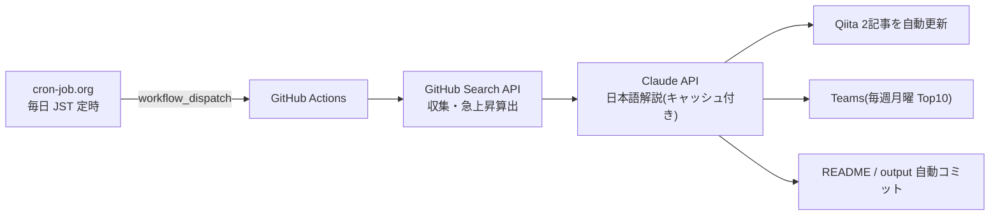

# Claude Code向けMCPツール候補ランキング

GitHub Search APIを使って、Claude Code周辺で活用候補になりそうなMCP関連リポジトリを定期収集するリポジトリです。

> 注意: この一覧は「Claude Codeでの動作」を保証するものではありません。  
> GitHub上のリポジトリ名・説明文・READMEなどに含まれる情報をもとに、MCP関連ツール候補を探すための入口として利用します。

## 仕組み(定常自律運転)

このランキングは cron-job.org → GitHub Actions → Claude API → Qiita / Teams のパイプラインで、毎日無人更新されています。



- 仕組みの詳細と**ライブ稼働ステータス**: [定常自律運転ページ](https://takanobusano.github.io/mcp-github-ranking/)
- 作り方の解説記事: [パイプライン編](https://qiita.com/4q_sano/items/913e93ee5cc2731561fc) / [cron-job.org 完全自動化編](https://qiita.com/4q_sano/items/1bc5e0669a8f0166936c)
<!-- MCP_REPOS_START -->
最終更新: **2026-11-23 08:17:17 JST**

MCP関連リポジトリに加え、Claude Code周辺で活用候補になりそうな関連ツールをGitHub Search APIで毎日自動収集してランキング化しています。

Stars / Forks の差分は、UTC基準の前日データ（2026-11-21）との差分です。
CSVには最大500件を保存し、本文では上位100件を表示しています。

> 注意: この一覧はClaude Codeでの動作を保証するものではありません。  
> MCP関連ツールまたはClaude Code関連ツール候補を探すための入口として利用してください。

# 注目MCP・関連ツール候補ランキング

## 1位 [public-apis/public-apis](https://github.com/public-apis/public-apis)

A collective list of free APIs

⭐ **500,850 Stars**（+201）　🍴 **56,244 Forks**（+32）　/　🟢 **2,841 Open Issues**　/　Python

Topics: `api` / `apis` / `dataset` / `development` / `free` / `list` / `lists` / `open-source`

## 2位 [morluto/rea](https://github.com/morluto/rea)

Reverse engineer anything with agents, from app behavior down to native binaries.

⭐ **474,034 Stars**（+1,299）　🍴 **115,590 Forks**（+204）　/　🟢 **1,339 Open Issues**　/　TypeScript

Topics: `agent-skills` / `ai` / `android` / `claude-code` / `cli` / `cpp` / `dsh-plugin` / `html`

## 3位 [openclaw/openclaw](https://github.com/openclaw/openclaw)

The AI that really does things. Any OS. Any Platform. The lobster way. 🦞

⭐ **395,055 Stars**（+66）　🍴 **82,955 Forks**（+6）　/　🟢 **8,929 Open Issues**　/　TypeScript

Topics: `ai` / `assistant` / `crustacean` / `molty` / `openclaw` / `own-your-data` / `personal`

## 4位 [mattpocock/skills](https://github.com/mattpocock/skills)

Skills for Real Engineers. Straight from my .agents directory.

⭐ **330,456 Stars**（+713）　🍴 **27,771 Forks**（+64）　/　🟢 **265 Open Issues**　/　Shell

Topics: `topicなし`

## 5位 [obra/superpowers](https://github.com/obra/superpowers)

An agentic skills framework & software development methodology that works.

⭐ **324,133 Stars**（+439）　🍴 **28,756 Forks**（+44）　/　🟢 **363 Open Issues**　/　Shell

Topics: `ai` / `brainstorming` / `coding` / `obra` / `sdlc` / `skills` / `subagent-driven-development` / `superpowers`

## 6位 [affaan-m/ECC](https://github.com/affaan-m/ECC)

The agent harness performance optimization system. Skills, instincts, memory, security, and research-first development for Claude Code, Codex, Opencode, Cursor and beyond.

⭐ **308,997 Stars**（+644）　🍴 **45,458 Forks**（+79）　/　🟢 **189 Open Issues**　/　JavaScript

Topics: `ai-agents` / `anthropic` / `claude` / `claude-code` / `developer-tools` / `llm` / `mcp` / `productivity`

## 7位 [NousResearch/hermes-agent](https://github.com/NousResearch/hermes-agent)

The agent that grows with you

⭐ **265,422 Stars**（+227）　🍴 **60,013 Forks**（+71）　/　🟢 **54,311 Open Issues**　/　Python

Topics: `ai` / `ai-agent` / `ai-agents` / `anthropic` / `chatgpt` / `claude` / `claude-code` / `codex`

## 8位 [multica-ai/andrej-karpathy-skills](https://github.com/multica-ai/andrej-karpathy-skills)

A single CLAUDE.md file to improve Claude Code behavior, derived from Andrej Karpathy's observations on LLM coding pitfalls.

⭐ **235,092 Stars**（+177）　🍴 **23,318 Forks**（+3）　/　🟢 **138 Open Issues**　/　不明

Topics: `topicなし`

## 9位 [firecrawl/firecrawl](https://github.com/firecrawl/firecrawl)

Knowledge infrastructure to make your agents smarter. Search, scrape and access 550+ data providers through one API.

⭐ **206,999 Stars**（+854）　🍴 **10,815 Forks**（+41）　/　🟢 **918 Open Issues**　/　TypeScript

Topics: `ai` / `ai-agents` / `ai-crawler` / `ai-scraping` / `ai-search` / `crawler` / `data-extraction` / `html-to-markdown`

## 10位 [anthropics/skills](https://github.com/anthropics/skills)

Public repository for Agent Skills

⭐ **198,980 Stars**（+520）　🍴 **23,287 Forks**（+63）　/　🟢 **1,568 Open Issues**　/　Python

Topics: `agent-skills`

## 11位 [DietrichGebert/ponytail](https://github.com/DietrichGebert/ponytail)

Makes your AI agent think like the laziest senior dev in the room. The best code is the code you never wrote.

⭐ **196,862 Stars**（+526）　🍴 **11,105 Forks**（+39）　/　🟢 **315 Open Issues**　/　JavaScript

Topics: `agent-skills` / `ai-agents` / `claude` / `claude-code` / `claude-code-plugin` / `cursor-rules` / `developer-tools` / `llm`

## 12位 [ultraworkers/claw-code](https://github.com/ultraworkers/claw-code)

An agent-managed museum exhibit, built in Rust with Gajae-Code / LazyCodex — developed and maintained with no human intervention.

⭐ **194,740 Stars**（±0）　🍴 **107,146 Forks**（-15）　/　🟢 **1 Open Issues**　/　Rust

Topics: `topicなし`

## 13位 [Significant-Gravitas/AutoGPT](https://github.com/Significant-Gravitas/AutoGPT)

AutoGPT is the vision of accessible AI for everyone, to use and to build on. Our mission is to provide the tools, so that you can focus on what matters.

⭐ **188,135 Stars**（+8）　🍴 **45,825 Forks**（-6）　/　🟢 **808 Open Issues**　/　Python

Topics: `agentic-ai` / `agents` / `ai` / `artificial-intelligence` / `autonomous-agents` / `claude` / `gpt` / `llama-api`

## 14位 [ollama/ollama](https://github.com/ollama/ollama)

Get up and running with Kimi, GLM, MiniMax, DeepSeek, gpt-oss, Qwen, Gemma and other models.

⭐ **187,886 Stars**（+44）　🍴 **19,142 Forks**（+15）　/　🟢 **4,726 Open Issues**　/　Go

Topics: `deepseek` / `gemma` / `glm` / `go` / `golang` / `gpt-oss` / `llama` / `llm`

## 15位 [msitarzewski/agency-agents](https://github.com/msitarzewski/agency-agents)

A complete AI agency at your fingertips - From frontend wizards to Reddit community ninjas, from whimsy injectors to reality checkers. Each agent is a specialized expert with personality, processes, and proven deliverables.

⭐ **169,812 Stars**（+148）　🍴 **27,592 Forks**（+25）　/　🟢 **277 Open Issues**　/　Shell

Topics: `topicなし`

## 16位 [langgenius/dify](https://github.com/langgenius/dify)

Build Agentic workflows, RAG pipelines, with rich AI model and tool support on one collaborative workspace. Deploy on cloud, VPC, or self-hosted, so teams move from prototype to production without rebuilding the stack.

⭐ **161,689 Stars**（+63）　🍴 **25,533 Forks**（±0）　/　🟢 **1,352 Open Issues**　/　Python

Topics: `agent` / `agentic-ai` / `agentic-framework` / `agentic-workflow` / `ai` / `automation` / `claude` / `deepseek`

## 17位 [langflow-ai/langflow](https://github.com/langflow-ai/langflow)

Langflow is a powerful tool for building and deploying AI-powered agents and workflows.

⭐ **156,850 Stars**（+25）　🍴 **10,432 Forks**（+3）　/　🟢 **1,343 Open Issues**　/　Python

Topics: `agents` / `chatgpt` / `generative-ai` / `large-language-models` / `multiagent` / `react-flow`

## 18位 [anthropics/claude-code](https://github.com/anthropics/claude-code)

Claude Code is an agentic coding tool that lives in your terminal, understands your codebase, and helps you code faster by executing routine tasks, explaining complex code, and handling git workflows - all through natural language commands.

⭐ **156,698 Stars**（+129）　🍴 **25,094 Forks**（+14）　/　🟢 **16,023 Open Issues**　/　TypeScript

Topics: `topicなし`

## 19位 [farion1231/cc-switch](https://github.com/farion1231/cc-switch)

A cross-platform desktop All-in-One assistant for Claude Code, Codex, OpenCode,DeepSeek Harness and more. Only official website: ccswitch.io

⭐ **156,390 Stars**（+192）　🍴 **10,216 Forks**（+12）　/　🟢 **785 Open Issues**　/　Rust

Topics: `ai-tools` / `claude-code` / `codex` / `deepseek-harness` / `desktop-app` / `grok` / `grokbuild` / `hermes`

## 20位 [nextlevelbuilder/ui-ux-pro-max-skill](https://github.com/nextlevelbuilder/ui-ux-pro-max-skill)

An AI skill that provides design intelligence for building professional UI/UX across multiple platforms.

⭐ **152,838 Stars**（+340）　🍴 **16,112 Forks**（+33）　/　🟢 **86 Open Issues**　/　Python

Topics: `ai-skills` / `antigravity` / `claude` / `claude-code` / `codex` / `command-line` / `copilot` / `cursor-ai`

## 21位 [Graphify-Labs/graphify](https://github.com/Graphify-Labs/graphify)

Turn any codebase, with its docs, SQL schemas, configs, and PDFs, into a queryable knowledge graph. A /graphify skill for Claude Code, Cursor, Codex, and Gemini CLI: local deterministic AST parsing, every edge explained, no vector store.

⭐ **152,036 Stars**（+434）　🍴 **14,617 Forks**（+55）　/　🟢 **1,703 Open Issues**　/　Python

Topics: `ai-agents` / `antigravity` / `ast` / `claude-code` / `code-analysis` / `code-search` / `codex` / `cursor`

## 22位 [harry0703/MoneyPrinterTurbo](https://github.com/harry0703/MoneyPrinterTurbo)

利用 AI 大模型和自动化工作流，根据主题或关键词一键生成高清短视频。Generate HD short videos from a topic or keyword with an automated AI workflow.

⭐ **145,089 Stars**（+104）　🍴 **23,333 Forks**（+14）　/　🟢 **104 Open Issues**　/　Python

Topics: `ai-video-generator` / `content-creation` / `ffmpeg` / `instagram-reels` / `llm` / `python` / `short-video` / `subtitles`

## 23位 [x1xhlol/system-prompts-and-models-of-ai-tools](https://github.com/x1xhlol/system-prompts-and-models-of-ai-tools)

FULL Augment Code, Claude Code, Cluely, CodeBuddy, Comet, Cursor, Devin AI, Junie, Kiro, Leap.new, Lovable, Manus, NotionAI, Orchids.app, Perplexity, Poke, Qoder, Replit, Same.dev, Trae, Traycer AI, VSCode Agent, Warp.dev, Windsurf, Xcode, Z.ai Code, Dia & v0. (And other Open Sourced) System Prompts, Internal Tools & AI Models

⭐ **144,818 Stars**（+13）　🍴 **34,640 Forks**（-10）　/　🟢 **161 Open Issues**　/　不明

Topics: `ai` / `bolt` / `cluely` / `copilot` / `cursor` / `cursorai` / `devin` / `github-copilot`

## 24位 [garrytan/gstack](https://github.com/garrytan/gstack)

Use Garry Tan's exact Claude Code setup: 23 opinionated tools that serve as CEO, Designer, Eng Manager, Release Manager, Doc Engineer, and QA

⭐ **142,379 Stars**（+100）　🍴 **21,009 Forks**（+16）　/　🟢 **46 Open Issues**　/　TypeScript

Topics: `topicなし`

## 25位 [stablyai/orca](https://github.com/stablyai/orca)

Orca lets you run a fleet of bots with your own subscription (e.g. Claude Code, Grok, Agy, Codex). Available on desktop, mobile and remote runtime.

⭐ **132,939 Stars**（+997）　🍴 **8,495 Forks**（+88）　/　🟢 **9,021 Open Issues**　/　TypeScript

Topics: `agent-ide` / `ai-agents` / `automation` / `bot` / `claude-code` / `codex` / `ghostty` / `grok-bot`

## 26位 [TauricResearch/TradingAgents](https://github.com/TauricResearch/TradingAgents)

TradingAgents: Multi-Agents LLM Financial Trading Framework

⭐ **123,502 Stars**（+114）　🍴 **23,655 Forks**（+20）　/　🟢 **161 Open Issues**　/　Python

Topics: `agent` / `finance` / `llm` / `multiagent` / `trading`

## 27位 [JuliusBrussee/caveman](https://github.com/JuliusBrussee/caveman)

why use many token when few token do trick. Skill + local proxy for coding agents: shorter answers, smaller tool output, every original recoverable.

⭐ **122,168 Stars**（+193）　🍴 **7,125 Forks**（+10）　/　🟢 **112 Open Issues**　/　Go

Topics: `ai` / `anthropic` / `caveman` / `claude` / `claude-code` / `llm` / `meme` / `prompt-engineering`

## 28位 [browser-use/browser-use](https://github.com/browser-use/browser-use)

Open-source Python library for AI browser agents, plus Browser Use Cloud: stealth browsers and a hosted agent API.

⭐ **121,771 Stars**（+90）　🍴 **13,603 Forks**（+7）　/　🟢 **596 Open Issues**　/　Python

Topics: `ai-agents` / `ai-tools` / `browser-agent` / `browser-automation` / `browser-use` / `cdp` / `cloud-browser` / `computer-use`

## 29位 [Leonxlnx/taste-skill](https://github.com/Leonxlnx/taste-skill)

Agent skills that give coding agents taste: art direction, reference images and a browser check instead of generic AI pages

⭐ **120,099 Stars**（+369）　🍴 **8,050 Forks**（+35）　/　🟢 **18 Open Issues**　/　JavaScript

Topics: `agent-skills` / `ai-agents` / `anti-slop` / `claude-code` / `codex` / `cursor` / `design-system` / `frontend`

## 30位 [addyosmani/agent-skills](https://github.com/addyosmani/agent-skills)

Production-grade engineering skills for AI coding agents.

⭐ **119,768 Stars**（+193）　🍴 **12,450 Forks**（+22）　/　🟢 **129 Open Issues**　/　JavaScript

Topics: `agent-skills` / `antigravity` / `claude-code` / `codex` / `cursor` / `skills`

## 31位 [thedotmack/claude-mem](https://github.com/thedotmack/claude-mem)

Persistent Context Across Sessions for Every Agent –  Captures everything your agent does during sessions, compresses it with AI, and injects relevant context back into future sessions. Works with Claude Code, OpenClaw, Codex, Gemini, Hermes, Copilot, OpenCode + More

⭐ **119,077 Stars**（+240）　🍴 **10,347 Forks**（+15）　/　🟢 **74 Open Issues**　/　TypeScript

Topics: `ai` / `ai-agents` / `ai-memory` / `anthropic` / `artificial-intelligence` / `chromadb` / `claude` / `claude-agent-sdk`

## 32位 [debpalash/VoiceStudio](https://github.com/debpalash/VoiceStudio)

VoiceStudio is the open-source, fully-local ElevenLabs alternative — voice cloning, voice design, video dubbing, dictation, transcription & audiobook creation in 646 languages.

⭐ **116,492 Stars**（+540）　🍴 **12,971 Forks**（+83）　/　🟢 **44 Open Issues**　/　Python

Topics: `ai` / `audiobook` / `cuda` / `dubbing` / `elevenlabs-alternative` / `huggingface` / `local-first` / `mlx`

## 33位 [paperclipai/paperclip](https://github.com/paperclipai/paperclip)

The open-source app everyone uses to manage agents at work

⭐ **115,963 Stars**（+294）　🍴 **19,257 Forks**（+63）　/　🟢 **7,024 Open Issues**　/　TypeScript

Topics: `acpx` / `agent-orchestration` / `agent-skills` / `agentic-ai` / `ai-agents` / `ai-engineering` / `ai-governance` / `ai-tools`

## 34位 [pbakaus/impeccable](https://github.com/pbakaus/impeccable)

The design vocabulary for your coding agent. Steer with polish and bolder, review with critique and audit, catch AI slop before it ships.

⭐ **114,997 Stars**（+481）　🍴 **6,850 Forks**（+37）　/　🟢 **74 Open Issues**　/　Rust

Topics: `agent-skills` / `ai` / `anti-slop` / `design` / `slop`

## 35位 [Panniantong/Agent-Reach](https://github.com/Panniantong/Agent-Reach)

Give your AI agent eyes to see the entire internet. Read & search Twitter, Reddit, YouTube, GitHub, Bilibili, XiaoHongShu — one CLI, zero API fees.

⭐ **114,010 Stars**（+252）　🍴 **10,238 Forks**（+28）　/　🟢 **159 Open Issues**　/　Python

Topics: `agent-infrastructure` / `ai-agent` / `ai-search` / `automation` / `bilibili` / `claude-code` / `cli` / `cursor`

## 36位 [google-gemini/gemini-cli](https://github.com/google-gemini/gemini-cli)

An open-source AI agent that brings the power of Gemini directly into your terminal.

⭐ **109,002 Stars**（+27）　🍴 **14,978 Forks**（+10）　/　🟢 **727 Open Issues**　/　TypeScript

Topics: `ai` / `ai-agents` / `cli` / `gemini` / `gemini-api` / `mcp-client` / `mcp-server`

## 37位 [nexu-io/open-design](https://github.com/nexu-io/open-design)

The 1st Collaborative AI Design Agent Workspace. Local-first and open source. Create motion, prototypes, websites, apps, dashboards, presentations, images, and videos with your team and AI agents. Share work, exchange feedback, and iterate together in one workspace.

⭐ **108,974 Stars**（+136）　🍴 **12,331 Forks**（+11）　/　🟢 **1,440 Open Issues**　/　TypeScript

Topics: `agent-skills` / `ai-design` / `byok` / `claude-code-for-design` / `claude-design` / `codex-design` / `cursor-design` / `deepseek`

## 38位 [D4Vinci/Scrapling](https://github.com/D4Vinci/Scrapling)

🕷️ The BEST Web Scraping framework that handles everything from a single request to a full-scale crawl! Don't be shy, join here:  and follow here for daily tips and tricks:

⭐ **105,014 Stars**（+199）　🍴 **10,983 Forks**（+18）　/　🟢 **23 Open Issues**　/　Python

Topics: `ai` / `ai-scraping` / `automation` / `crawler` / `crawling` / `crawling-python` / `data` / `data-extraction`

## 39位 [ruvnet/RuView](https://github.com/ruvnet/RuView)

π RuView turns commodity WiFi signals into real-time spatial intelligence, vital sign monitoring, and presence detection — all without a single pixel of video.

⭐ **104,808 Stars**（+66）　🍴 **13,582 Forks**（+4）　/　🟢 **626 Open Issues**　/　Rust

Topics: `claude` / `claude-code` / `esp32` / `firmware` / `home-assistant` / `home-automation` / `iot` / `mcp`

## 40位 [microsoft/playwright](https://github.com/microsoft/playwright)

Playwright is a framework for Web Testing and Automation. It allows testing Chromium, Firefox and WebKit with a single API.

⭐ **100,819 Stars**（+76）　🍴 **6,946 Forks**（+8）　/　🟢 **70 Open Issues**　/　TypeScript

Topics: `automation` / `chrome` / `chromium` / `e2e-testing` / `electron` / `end-to-end-testing` / `firefox` / `javascript`

## 41位 [OpenCut-app/OpenCut](https://github.com/OpenCut-app/OpenCut)

The open-source CapCut alternative

⭐ **99,180 Stars**（+76）　🍴 **9,925 Forks**（+5）　/　🟢 **392 Open Issues**　/　TypeScript

Topics: `editor` / `oss` / `videoeditor`

## 42位 [tt-a1i/archify](https://github.com/tt-a1i/archify)

Turn any idea, plan, or codebase into a beautiful interactive diagram. An agent skill for Claude Code, Codex, and more.

⭐ **98,787 Stars**（+213）　🍴 **6,754 Forks**（+20）　/　🟢 **356 Open Issues**　/　JavaScript

Topics: `agent-skills` / `ai-agents` / `architecture-diagram` / `claude-code` / `claude-skills` / `codex` / `coding-agents` / `deepseek-harness`

## 43位 [puppeteer/puppeteer](https://github.com/puppeteer/puppeteer)

JavaScript API for Chrome and Firefox

⭐ **95,886 Stars**（+6）　🍴 **9,604 Forks**（±0）　/　🟢 **212 Open Issues**　/　TypeScript

Topics: `automation` / `chrome` / `chromium` / `developer-tools` / `firefox` / `headless-chrome` / `node-module` / `testing`

## 44位 [OpenHands/OpenHands](https://github.com/OpenHands/OpenHands)

🙌 OpenHands: AI-Driven Development

⭐ **94,080 Stars**（+112）　🍴 **12,594 Forks**（+18）　/　🟢 **1,257 Open Issues**　/　TypeScript

Topics: `agent` / `artificial-intelligence` / `chatgpt` / `claude-ai` / `cli` / `developer-tools` / `gpt` / `llm`

## 45位 [Egonex-AI/Understand-Anything](https://github.com/Egonex-AI/Understand-Anything)

Graphs that teach > graphs that impress. Turn any code into an interactive knowledge graph you can explore, search, and ask questions about. Works with Claude Code, Codex, Cursor, Copilot, Gemini CLI, and more.

⭐ **93,678 Stars**（+120）　🍴 **7,969 Forks**（+10）　/　🟢 **378 Open Issues**　/　TypeScript

Topics: `antigravity-skills` / `business-knowledge` / `claude-code` / `claude-skills` / `codebase-analysis` / `codex` / `codex-skills` / `developer-tools-ai-agent`

## 46位 [modelcontextprotocol/servers](https://github.com/modelcontextprotocol/servers)

Model Context Protocol Reference Servers

⭐ **92,167 Stars**（+23）　🍴 **11,975 Forks**（+2）　/　🟢 **18 Open Issues**　/　TypeScript

Topics: `topicなし`

## 47位 [storybookjs/storybook](https://github.com/storybookjs/storybook)

Storybook is the industry standard workshop for building, documenting, and testing UI components in isolation

⭐ **91,683 Stars**（+9）　🍴 **10,584 Forks**（+3）　/　🟢 **1,904 Open Issues**　/　TypeScript

Topics: `angular` / `components` / `design-systems` / `documentation` / `html` / `javascript` / `react` / `react-native`

## 48位 [koala73/worldmonitor](https://github.com/koala73/worldmonitor)

Real-time global intelligence dashboard. AI-powered news aggregation, geopolitical monitoring, and infrastructure tracking in a unified situational awareness interface

⭐ **91,073 Stars**（+57）　🍴 **14,142 Forks**（+15）　/　🟢 **366 Open Issues**　/　TypeScript

Topics: `agent` / `ai` / `dashboard` / `gemini-cli-extension` / `geopolitics` / `mcp` / `mcp-server` / `monitoring`

## 49位 [cheaper-inference/OmniRoute](https://github.com/cheaper-inference/OmniRoute)

Never stop coding. Free MIT AI gateway: one endpoint, 375 providers (150+ free), 1,400+ models Kimi, Claude, GPT, Gemini, GLM, DeepSeek, MiniMax. Works with Claude Code, Codex, Cursor, OpenCode, Cline & Copilot. Quota-aware auto-fallback, RTK+Caveman compression saves 15-95% tokens, MCP/A2A, Desktop/PWA. Built by 900+ contributors

⭐ **89,624 Stars**（+214）　🍴 **13,871 Forks**（+57）　/　🟢 **844 Open Issues**　/　TypeScript

Topics: `a2a` / `ai-agents` / `ai-gateway` / `anthropic` / `claude` / `claude-code` / `cline` / `codex`

## 50位 [ChatGPTNextWeb/NextChat](https://github.com/ChatGPTNextWeb/NextChat)

✨ Zero-config AI chat assistant. No API key needed — sign up and instantly chat with GPT-5, Claude 4, Gemini 2.5, DeepSeek & 100+ top models. Pay-as-you-go save...

⭐ **88,987 Stars**（+2）　🍴 **58,449 Forks**（-1）　/　🟢 **869 Open Issues**　/　TypeScript

Topics: `calclaude` / `claude` / `cross-platform` / `desktop` / `fe` / `gemini` / `gemini-pro` / `gemini-server`

## 51位 [heygen-com/hyperframes](https://github.com/heygen-com/hyperframes)

AI video you can actually edit. HyperFrames is a free, open-source AI video editor. Describe any video and get a real project you can change down to the frame.

⭐ **88,260 Stars**（+436）　🍴 **8,214 Forks**（+38）　/　🟢 **301 Open Issues**　/　TypeScript

Topics: `ai` / `ai-agents` / `animation` / `claude-code` / `ffmpeg` / `framework` / `gsap` / `html`

## 52位 [unclecode/crawl4ai](https://github.com/unclecode/crawl4ai)

Official Crawl4AI Cloud: a hosted web scraping, extraction, and search API for AI agents. Free API key, 1,000 credits a month, no card. Fully open source: this repo is the Apache-2.0 crawler that powers it, and you can self-host it.

⭐ **87,675 Stars**（+38）　🍴 **9,141 Forks**（+1）　/　🟢 **347 Open Issues**　/　Python

Topics: `ai` / `ai-agents` / `crawl4ai-cloud` / `crawler` / `data-extraction` / `llm` / `markdown` / `mcp`

## 53位 [rtk-ai/rtk](https://github.com/rtk-ai/rtk)

CLI proxy that reduces LLM token consumption by 60-90% on common dev commands. Single Rust binary, zero dependencies

⭐ **87,503 Stars**（+87）　🍴 **5,619 Forks**（+7）　/　🟢 **1,682 Open Issues**　/　Rust

Topics: `agentic-coding` / `ai-coding` / `anthropic` / `claude-code` / `cli` / `command-line-tool` / `cost-reduction` / `developer-tools`

## 54位 [lobehub/lobehub](https://github.com/lobehub/lobehub)

🤯 LobeHub - Super-Agents on Your Team. Add super-agents to the chats your team already uses.They take on work by themselves and get better every week.

⭐ **86,002 Stars**（+51）　🍴 **16,350 Forks**（+11）　/　🟢 **1,462 Open Issues**　/　TypeScript

Topics: `agent` / `agent-collaboration` / `agent-harness` / `loop-engineering` / `mcp` / `personal-assistant` / `proactive-agent` / `skills`

## 55位 [bytedance/deer-flow](https://github.com/bytedance/deer-flow)

An open-source long-horizon SuperAgent harness that researches, codes, and creates. With the help of sandboxes, memories, tools, skill, subagents and message gateway, it handles different levels of tasks that could take minutes to hours.

⭐ **85,617 Stars**（+35）　🍴 **12,074 Forks**（+2）　/　🟢 **1,129 Open Issues**　/　Python

Topics: `agent` / `agentic` / `agentic-framework` / `agentic-workflow` / `ai` / `ai-agents` / `deep-research` / `harness`

## 56位 [laravel/laravel](https://github.com/laravel/laravel)

Laravel is a web application framework with expressive, elegant syntax. We’ve already laid the foundation for your next big idea — freeing you to create without sweating the small things.

⭐ **85,471 Stars**（+75）　🍴 **25,466 Forks**（±0）　/　🟢 **31 Open Issues**　/　Blade

Topics: `framework` / `laravel` / `php`

## 57位 [Ebony-Vinyl/dsh-our-free-model](https://github.com/Ebony-Vinyl/dsh-our-free-model)

在 dsh 里装上这个插件即可，无需登录、注册或填 API Key，就能使用包括 DeepSeek V4.1 Flash、Kimi K3 在内的前沿模型——完全免费，不限量。 All you do is install this plugin in dsh: no login, no sign-up, no API k...

⭐ **83,934 Stars**（+859）　🍴 **2,349 Forks**（+12）　/　🟢 **227 Open Issues**　/　JavaScript

Topics: `ai-agents` / `deepseek` / `deepseek-harness` / `developer-tools` / `dsh` / `dsh-plugin` / `free-model` / `llm`

## 58位 [OpenMontageInc/OpenMontage](https://github.com/OpenMontageInc/OpenMontage)

World's first open-source, agentic video production system. 12 production pipelines, 100+ tools, 700+ agent skill and production-knowledge files. Turn your AI coding assistant into a full video production studio.

⭐ **82,407 Stars**（+294）　🍴 **11,230 Forks**（+53）　/　🟢 **359 Open Issues**　/　Python

Topics: `agent` / `agentic-ai` / `ai` / `claude` / `copilot` / `cursor` / `elevenlabs` / `ffmpeg`

## 59位 [ruvnet/ruflo](https://github.com/ruvnet/ruflo)

🌊 The original agent harness. Deploy intelligent multi-player swarms, coordinate autonomous workflows, and build conversational AI systems. Features adaptive me...

⭐ **82,276 Stars**（+51）　🍴 **9,701 Forks**（+7）　/　🟢 **557 Open Issues**　/　TypeScript

Topics: `agent-memory` / `agent-orchestration` / `agentic-ai` / `agentic-workflow` / `ai-agents` / `autonomous-agents` / `claude` / `claude-code`

## 60位 [netdata/netdata](https://github.com/netdata/netdata)

Full-stack observability · Metrics · Logs · Traces · Flows · Topology · Infrastructure · APM · NPM · DBM · RUM · Synthetics · Cloud · AI SRE · OpenTelemetry · SNMP · NetFlow/IPFIX/sFlow · IPMI · Redfish · 2000+ integrations

⭐ **81,588 Stars**（+13）　🍴 **6,744 Forks**（+3）　/　🟢 **474 Open Issues**　/　Go

Topics: `ai` / `anomaly-detection` / `dashboard` / `data-visualization` / `database` / `devops` / `docker` / `grafana`

## 61位 [abi/screenshot-to-code](https://github.com/abi/screenshot-to-code)

Drop in a screenshot and convert it to clean code (HTML/Tailwind/React/Vue)

⭐ **81,377 Stars**（+43）　🍴 **9,963 Forks**（+9）　/　🟢 **150 Open Issues**　/　Python

Topics: `topicなし`

## 62位 [storytold/photocraft](https://github.com/storytold/photocraft)

PhotoCraft: An open-source photo editor written from scratch in pure Rust

⭐ **81,033 Stars**（+150）　🍴 **14,256 Forks**（+19）　/　🟢 **5,834 Open Issues**　/　Rust

Topics: `art` / `image-editing` / `image-editing-software` / `image-editor` / `images` / `photo-editing` / `rust`

## 63位 [shareAI-lab/learn-claude-code](https://github.com/shareAI-lab/learn-claude-code)

Bash is all you need -  A nano claude code–like 「agent harness」, built from 0 to 1

⭐ **80,735 Stars**（+32）　🍴 **12,880 Forks**（+5）　/　🟢 **56 Open Issues**　/　Python

Topics: `agent` / `agent-development` / `ai-agent` / `claude` / `claude-code` / `educational` / `llm` / `python`

## 64位 [headroomlabs-ai/headroom](https://github.com/headroomlabs-ai/headroom)

Compress tool outputs, logs, files, and RAG chunks before they reach the LLM. 20% fewer tokens for coding agents, 60-95% fewer tokens for JSON, same answers. Library, proxy, MCP server.

⭐ **80,497 Stars**（+240）　🍴 **6,303 Forks**（+19）　/　🟢 **333 Open Issues**　/　Python

Topics: `agent` / `ai` / `anthropic` / `claude-code` / `compression` / `context-engineering` / `context-window` / `cursor`

## 65位 [unslothai/unsloth](https://github.com/unslothai/unsloth)

Local UI to run and train LLMs and diffusion models. Supports GGUF, MLX, Qwen3.8, DeepSeek-V4.1, MiniMax-H3, Gemma 4, FLUX and more.

⭐ **79,992 Stars**（+81）　🍴 **7,450 Forks**（+10）　/　🟢 **572 Open Issues**　/　Python

Topics: `agent` / `ai` / `chatgpt` / `deepseek` / `fine-tuning` / `gemma` / `image-generation` / `llama`

## 66位 [rohitg00/ai-engineering-from-scratch](https://github.com/rohitg00/ai-engineering-from-scratch)

Learn AI Engineering! Learn it. Build it. Ship it for others.

⭐ **79,852 Stars**（+89）　🍴 **14,277 Forks**（+26）　/　🟢 **69 Open Issues**　/　Python

Topics: `agents` / `ai` / `ai-agents` / `ai-engineering` / `computer-vision` / `course` / `deep-learning` / `dsh`

## 67位 [hugohe3/ppt-master](https://github.com/hugohe3/ppt-master)

AI turns documents or topics into real, native PowerPoint decks—with native shapes, transitions and animations, data-backed charts and tables on demand, audio narration from speaker notes, and support for your own .pptx templates. · by Hugo He

⭐ **79,276 Stars**（+202）　🍴 **6,174 Forks**（+16）　/　🟢 **2 Open Issues**　/　Python

Topics: `ai-agent` / `aippt` / `office` / `powerpoint` / `powerpoint-generation` / `ppt` / `pptx` / `presentation`

## 68位 [colbymchenry/codegraph](https://github.com/colbymchenry/codegraph)

Pre-indexed code knowledge graph, auto syncs on code changes, for Claude Code, Codex, Gemini, Cursor, OpenCode, AntiGravity, Kiro, CoPilot, and Hermes Agent — fewer tokens, fewer tool calls, 100% local

⭐ **78,417 Stars**（+93）　🍴 **5,218 Forks**（+10）　/　🟢 **246 Open Issues**　/　TypeScript

Topics: `topicなし`

## 69位 [nestjs/nest](https://github.com/nestjs/nest)

A progressive TypeScript framework for Node.js backends: from a small API in one file to efficient, scalable, enterprise-grade systems 🚀

⭐ **77,209 Stars**（+89）　🍴 **8,655 Forks**（±0）　/　🟢 **46 Open Issues**　/　TypeScript

Topics: `framework` / `hacktoberfest` / `javascript` / `javascript-framework` / `microservices` / `nest` / `nestjs` / `node`

## 70位 [usestrix/strix](https://github.com/usestrix/strix)

Open-source AI penetration testing tool to find and fix your app’s vulnerabilities.

⭐ **77,084 Stars**（+165）　🍴 **8,777 Forks**（+19）　/　🟢 **621 Open Issues**　/　Python

Topics: `agents` / `ai-hacking` / `ai-penetration-testing` / `ai-pentesting` / `ai-security` / `artificial-intelligence` / `bug-bounty` / `code-quality`

## 71位 [eternity4719/HowToLiveBetter](https://github.com/eternity4719/HowToLiveBetter)

高性价比人生指南: 长寿防病、急救、省钱理财、法律红线、失业与工伤、医保社保、恋爱婚育、怀孕育儿、创业与做平台合规、出国与技能。每条写明成本、收益、证据等级和原始出处，只引期刊论文与官方文件。

⭐ **77,079 Stars**（+137）　🍴 **6,831 Forks**（+7）　/　🟢 **16 Open Issues**　/　HTML

Topics: `topicなし`

## 72位 [tw93/Mole](https://github.com/tw93/Mole)

🐹 Open-source Mac and PC cleaner. Keep your machine clean, light, and running like new. Fast CLI, plus native Mac and Windows apps.

⭐ **75,858 Stars**（+69）　🍴 **2,722 Forks**（+4）　/　🟢 **6 Open Issues**　/　Shell

Topics: `analyzer` / `appcleaner` / `clean` / `cleaner` / `cleanmymac` / `command-line` / `daisydisk` / `deepseek-harness`

## 73位 [openbq-org/OpenBB](https://github.com/openbq-org/OpenBB)

Open Data Platform for analysts, quants and AI agents.

⭐ **75,649 Stars**（+25）　🍴 **7,893 Forks**（+1）　/　🟢 **132 Open Issues**　/　Python

Topics: `ai` / `crypto` / `derivatives` / `economics` / `equity` / `finance` / `fixed-income` / `machine-learning`

## 74位 [Eugeny/tabby](https://github.com/Eugeny/tabby)

A terminal for a more modern age

⭐ **75,536 Stars**（+7）　🍴 **4,348 Forks**（+2）　/　🟢 **2,943 Open Issues**　/　TypeScript

Topics: `serial` / `ssh-client` / `telnet-client` / `terminal` / `terminal-emulators`

## 75位 [thedaviddias/Front-End-Checklist](https://github.com/thedaviddias/Front-End-Checklist)

🗂 The essential checklist for modern web development, for humans and AI agents

⭐ **74,799 Stars**（+9）　🍴 **6,768 Forks**（+1）　/　🟢 **23 Open Issues**　/　MDX

Topics: `ai-agent` / `ai-agents` / `checklist` / `css` / `front-end-developer-tool` / `front-end-development` / `frontend` / `guidelines`

## 76位 [ZhuLinsen/daily_stock_analysis](https://github.com/ZhuLinsen/daily_stock_analysis)

LLM 驱动的多市场股票智能分析系统：多源行情、实时新闻、决策看板与自动推送，支持零成本定时运行。  LLM-powered multi-market stock analysis system with multi-source market data, real-time news, decision dashbo...

⭐ **73,710 Stars**（+73）　🍴 **58,065 Forks**（+44）　/　🟢 **38 Open Issues**　/　Python

Topics: `a-stock` / `ai-agent` / `aigc` / `llm` / `quant` / `quantitative-finance` / `quantitative-trading`

## 77位 [Alishahryar1/free-claude-code](https://github.com/Alishahryar1/free-claude-code)

Use Claude Code, Codex, Antigravity, VSCode, Pi, and OpenCode (and 6 other harnesses) for free (1.3B+ free tokens) from your terminal, app, IDE, or phone, and now from the browser with native browser sessions (multi-harness + multi-model) like OpenClaw (voice supported + ToS friendly)

⭐ **72,680 Stars**（+204）　🍴 **11,280 Forks**（+43）　/　🟢 **429 Open Issues**　/　Python

Topics: `topicなし`

## 78位 [mvanhorn/last30days-skill](https://github.com/mvanhorn/last30days-skill)

AI agent skill that researches any topic across Reddit, X, YouTube, HN, Polymarket, and the web - then synthesizes a grounded summary

⭐ **72,676 Stars**（+711）　🍴 **6,420 Forks**（+48）　/　🟢 **22 Open Issues**　/　Python

Topics: `agent-skills` / `artificial-intelligence` / `bot` / `claude-code` / `command-line` / `data-science` / `dsh` / `dsh-plugin`

## 79位 [asgeirtj/system_prompts_leaks](https://github.com/asgeirtj/system_prompts_leaks)

Leaked system prompts of ChatGPT, Claude, Gemini and more. The hidden system prompt of every popular chatbot, in full, every version since May 2025. Also Anthropic Claude Code, OpenAI Codex, Google Antigravity, xAI Grok, Meta Muse, Moonshot Kimi, Alibaba Qwen, Z.ai GLM ZCode, MiniMax, Cursor, Perplexity, DeepSeek and 30+ others. Updated daily.

⭐ **72,425 Stars**（+99）　🍴 **11,652 Forks**（+13）　/　🟢 **27 Open Issues**　/　Python

Topics: `ai` / `ai-agents` / `ai-prompts` / `anthropic` / `chatbot` / `chatgpt` / `claude` / `claude-code`

## 80位 [blader/humanizer](https://github.com/blader/humanizer)

Agent skill that removes signs of AI-generated writing from text

⭐ **72,304 Stars**（+335）　🍴 **5,661 Forks**（+30）　/　🟢 **4 Open Issues**　/　Python

Topics: `agent-skills` / `ai-humanizer` / `ai-writing` / `chatgpt` / `claude` / `claude-code` / `codex` / `cursor`

## 81位 [cline/cline](https://github.com/cline/cline)

Autonomous coding agent as an SDK, IDE extension, or CLI assistant.

⭐ **71,825 Stars**（+17）　🍴 **7,947 Forks**（+4）　/　🟢 **1,815 Open Issues**　/　TypeScript

Topics: `topicなし`

## 82位 [NanmiCoder/MediaCrawler](https://github.com/NanmiCoder/MediaCrawler)

小红书笔记 \| 评论爬虫、抖音视频 \| 评论爬虫、快手视频 \| 评论爬虫、B 站视频 ｜ 评论爬虫、微博帖子 ｜ 评论爬虫、百度贴吧帖子 ｜ 百度贴吧评论回复爬虫  \| 知乎问答文章｜评论爬虫

⭐ **71,622 Stars**（+81）　🍴 **13,488 Forks**（+16）　/　🟢 **218 Open Issues**　/　Python

Topics: `topicなし`

## 83位 [pingdotgg/t3code](https://github.com/pingdotgg/t3code)

The best way to control Claude Code, Codex and more from any computer or phone

⭐ **71,519 Stars**（+2,040）　🍴 **12,106 Forks**（+219）　/　🟢 **3,775 Open Issues**　/　TypeScript

Topics: `agent-orchestration` / `agents` / `ai` / `chatgpt` / `claude` / `claude-code` / `code` / `vibe-coding`

## 84位 [code-yeongyu/oh-my-openagent](https://github.com/code-yeongyu/oh-my-openagent)

OmO: Just type "mass ulw" keyword with your prompt. Now you are the master of graph engineering.

⭐ **71,063 Stars**（+17）　🍴 **5,836 Forks**（+2）　/　🟢 **3,080 Open Issues**　/　TypeScript

Topics: `ai` / `ai-agents` / `anthropic` / `chatgpt` / `claude` / `claude-skills` / `codex` / `cursor`

## 85位 [docling-project/docling](https://github.com/docling-project/docling)

Get your documents ready for gen AI

⭐ **70,883 Stars**（+30）　🍴 **5,390 Forks**（+2）　/　🟢 **1,078 Open Issues**　/　Python

Topics: `ai` / `convert` / `document-parser` / `document-parsing` / `documents` / `docx` / `html` / `markdown`

## 86位 [cathrynlavery/diagram-design](https://github.com/cathrynlavery/diagram-design)

Editorial diagram design for Claude Code, Codex, GitHub Copilot, Cursor, Factory Droid, Qoder, and Pi. 45 diagram types. Self-contained HTML + SVG. No shadows. No Mermaid slop.

⭐ **70,272 Stars**（+498）　🍴 **4,713 Forks**（+28）　/　🟢 **44 Open Issues**　/　HTML

Topics: `agent-skills` / `claude-code` / `codex` / `data-visualization` / `diagrams` / `drawio` / `mermaid` / `svg`

## 87位 [mem0ai/mem0](https://github.com/mem0ai/mem0)

The Memory Layer for AI Agents - Drop-in memory infrastructure for AI agents and apps. Context that persists. Built for production.

⭐ **69,351 Stars**（+38）　🍴 **8,247 Forks**（+2）　/　🟢 **978 Open Issues**　/　Python

Topics: `agentic-memory` / `agentic-memory-system` / `agents` / `ai` / `ai-agents` / `chatgpt` / `genai` / `llm`

## 88位 [shanraisshan/claude-code-best-practice](https://github.com/shanraisshan/claude-code-best-practice)

from vibe coding to agentic engineering - practice makes claude perfect

⭐ **69,321 Stars**（+28）　🍴 **6,883 Forks**（-1）　/　🟢 **32 Open Issues**　/　HTML

Topics: `agentic-ai` / `agentic-coding` / `agentic-engineering` / `agentic-workflow` / `ai` / `ai-agents` / `anthropic` / `best-practices`

## 89位 [openinterpreter/openinterpreter](https://github.com/openinterpreter/openinterpreter)

A coding agent for open models like Kimi K3.1 and GLM 5.3

⭐ **68,946 Stars**（+17）　🍴 **5,945 Forks**（+4）　/　🟢 **38 Open Issues**　/　Rust

Topics: `acp` / `coding-agent` / `deepseek` / `kimi` / `python` / `qwen` / `rust`

## 90位 [bradtraversy/design-resources-for-developers](https://github.com/bradtraversy/design-resources-for-developers)

Curated list of design and UI resources from stock photos, web templates, CSS frameworks, UI libraries, tools and much more

⭐ **67,445 Stars**（+8）　🍴 **12,281 Forks**（-3）　/　🟢 **5 Open Issues**　/　不明

Topics: `topicなし`

## 91位 [xtekky/gpt4free](https://github.com/xtekky/gpt4free)

The official gpt4free repository \| various collection of powerful language models \| opus 4.6 gpt 5.3 kimi 2.5 deepseek v3.2 gemini 3

⭐ **67,098 Stars**（±0）　🍴 **13,435 Forks**（-2）　/　🟢 **4 Open Issues**　/　Python

Topics: `chatbot` / `chatbots` / `chatgpt` / `chatgpt-4` / `chatgpt-api` / `chatgpt-free` / `chatgpt4` / `deepseek`

## 92位 [bilawalsidhu/gods-eye-view](https://github.com/bilawalsidhu/gods-eye-view)

God's Eye View: a spy satellite simulator in your browser, except the data is real. Live open source spatial intelligence on a photorealistic 3D globe. Official site: godseyeview.ai

⭐ **66,376 Stars**（+141）　🍴 **13,131 Forks**（+33）　/　🟢 **431 Open Issues**　/　JavaScript

Topics: `3d-globe` / `cesium` / `flight-tracking` / `geospatial` / `geospatial-intelligence` / `gis` / `osint` / `photogrammetry`

## 93位 [coollabsio/coolify](https://github.com/coollabsio/coolify)

An open-source, self-hostable PaaS alternative to Vercel, Heroku & Netlify that lets you easily deploy static sites, databases, full-stack applications and 360+ one-click services on your own servers.

⭐ **66,371 Stars**（+40）　🍴 **6,014 Forks**（+8）　/　🟢 **89 Open Issues**　/　PHP

Topics: `coolify` / `databases` / `deployment` / `docker` / `docker-compose` / `inertiajs` / `laravel` / `mariadb`

## 94位 [warpdotdev/warp](https://github.com/warpdotdev/warp)

Warp is an agentic development environment, born out of the terminal.

⭐ **66,092 Stars**（+15）　🍴 **5,784 Forks**（+3）　/　🟢 **5,585 Open Issues**　/　Rust

Topics: `bash` / `linux` / `macos` / `rust` / `shell` / `terminal` / `wasm` / `zsh`

## 95位 [upstash/context7](https://github.com/upstash/context7)

Context7 Platform -- Up-to-date docs for AI agents

⭐ **65,290 Stars**（+50）　🍴 **3,267 Forks**（+7）　/　🟢 **57 Open Issues**　/　TypeScript

Topics: `llm` / `mcp` / `mcp-server` / `vibe-coding`

## 96位 [usememos/memos](https://github.com/usememos/memos)

Memos is an open-source, self-hosted note-taking app that brings your everyday thoughts together in a personal timeline. Your data stays yours, and you choose what to keep private or share.

⭐ **64,644 Stars**（+23）　🍴 **4,972 Forks**（+4）　/　🟢 **69 Open Issues**　/　Go

Topics: `docker` / `foss` / `go` / `markdown` / `memo` / `microblog` / `note-taking` / `notes`

## 97位 [tw93/Pake](https://github.com/tw93/Pake)

Turn any website into a lightweight desktop app with one command, on macOS, Windows and Linux.

⭐ **63,938 Stars**（+32）　🍴 **13,052 Forks**（+10）　/　🟢 **0 Open Issues**　/　Rust

Topics: `chatgpt` / `claude` / `cli` / `desktop` / `desktop-app` / `electron-alternative` / `gemini` / `linux`

## 98位 [sansan0/TrendRadar](https://github.com/sansan0/TrendRadar)

⭐AI-driven public opinion & trend monitor with multi-platform aggregation, RSS, web search, MCP & smart alerts.🎯 告别信息过载，你的 AI     舆情监控助手与热点筛选工具！聚合多平台热点 + RSS 订阅...

⭐ **63,801 Stars**（+22）　🍴 **24,934 Forks**（+2）　/　🟢 **44 Open Issues**　/　Python

Topics: `ai` / `bark` / `data-analysis` / `docker` / `hot-news` / `llm` / `mail` / `mcp`

## 99位 [BerriAI/litellm](https://github.com/BerriAI/litellm)

The fastest, litest AI Gateway. Rust core with Python SDK. Call 100+ LLM APIs in OpenAI (or native) format with cost tracking, guardrails, load balancing, and logging [Bedrock, Azure, OpenAI, Anthropic, OpenAI, VertexAI, vLLM, Nvidia NIM]

⭐ **63,714 Stars**（+43）　🍴 **13,475 Forks**（+13）　/　🟢 **5,417 Open Issues**　/　Python

Topics: `ai-gateway` / `anthropic` / `azure-openai` / `bedrock` / `gateway` / `langchain` / `litellm` / `llm`

## 100位 [HKUDS/CLI-Anything](https://github.com/HKUDS/CLI-Anything)

"CLI-Anything: Making ALL Software Agent-Native" -- CLI-Hub:

⭐ **62,745 Stars**（+696）　🍴 **5,692 Forks**（+70）　/　🟢 **286 Open Issues**　/　Python

Topics: `topicなし`

# 最近プッシュされたMCP・関連ツール候補

スター数ランキングとは別に、最近コードがプッシュされたリポジトリを表示します。古いスター数だけではなく、現在も開発が動いていそうな候補を探すための一覧です。

## プッシュ順 1位 [manaflow-ai/cmux](https://github.com/manaflow-ai/cmux)

Open source Ghostty-based macOS terminal with vertical tabs and notifications for AI coding agents. Built for multitasking, organization, and programmability.

⭐ **28,893 Stars**（+50）　🍴 **2,693 Forks**（+6）　/　Swift　/　最終プッシュ: 2026-11-22

Topics: `amp` / `claude-code` / `cli` / `codex` / `coding-agents` / `gemini` / `ghostty` / `macos`

## プッシュ順 2位 [Niko1221/Strata](https://github.com/Niko1221/Strata)

Qwen3.8-Flash-Next on any consumer hardware: one-click install for Windows / Linux. Strata inference engine, OpenAI/Anthropic API on localhost, optional image input.

⭐ **46,971 Stars**（+417）　🍴 **5,242 Forks**（+54）　/　C++　/　最終プッシュ: 2026-11-22

Topics: `topicなし`

## プッシュ順 3位 [garrytan/gstack](https://github.com/garrytan/gstack)

Use Garry Tan's exact Claude Code setup: 23 opinionated tools that serve as CEO, Designer, Eng Manager, Release Manager, Doc Engineer, and QA

⭐ **142,379 Stars**（+100）　🍴 **21,009 Forks**（+16）　/　TypeScript　/　最終プッシュ: 2026-11-22

Topics: `topicなし`

## プッシュ順 4位 [pingdotgg/t3code](https://github.com/pingdotgg/t3code)

The best way to control Claude Code, Codex and more from any computer or phone

⭐ **71,519 Stars**（+2,040）　🍴 **12,106 Forks**（+219）　/　TypeScript　/　最終プッシュ: 2026-11-22

Topics: `agent-orchestration` / `agents` / `ai` / `chatgpt` / `claude` / `claude-code` / `code` / `vibe-coding`

## プッシュ順 5位 [stablyai/orca](https://github.com/stablyai/orca)

Orca lets you run a fleet of bots with your own subscription (e.g. Claude Code, Grok, Agy, Codex). Available on desktop, mobile and remote runtime.

⭐ **132,939 Stars**（+997）　🍴 **8,495 Forks**（+88）　/　TypeScript　/　最終プッシュ: 2026-11-22

Topics: `agent-ide` / `ai-agents` / `automation` / `bot` / `claude-code` / `codex` / `ghostty` / `grok-bot`

## プッシュ順 6位 [BerriAI/litellm](https://github.com/BerriAI/litellm)

The fastest, litest AI Gateway. Rust core with Python SDK. Call 100+ LLM APIs in OpenAI (or native) format with cost tracking, guardrails, load balancing, and logging [Bedrock, Azure, OpenAI, Anthropic, OpenAI, VertexAI, vLLM, Nvidia NIM]

⭐ **63,714 Stars**（+43）　🍴 **13,475 Forks**（+13）　/　Python　/　最終プッシュ: 2026-11-22

Topics: `ai-gateway` / `anthropic` / `azure-openai` / `bedrock` / `gateway` / `langchain` / `litellm` / `llm`

## プッシュ順 7位 [simstudioai/sim](https://github.com/simstudioai/sim)

Sim is the collaborative workspace to build, deploy, and monitor AI agents and workflows. Used by 100,000+ builders.

⭐ **30,186 Stars**（+12）　🍴 **3,916 Forks**（+1）　/　TypeScript　/　最終プッシュ: 2026-11-22

Topics: `agent-workflow` / `agentic-workflow` / `agents` / `ai` / `aiagents` / `anthropic` / `artificial-intelligence` / `automation`

## プッシュ順 8位 [heygen-com/hyperframes](https://github.com/heygen-com/hyperframes)

AI video you can actually edit. HyperFrames is a free, open-source AI video editor. Describe any video and get a real project you can change down to the frame.

⭐ **88,260 Stars**（+436）　🍴 **8,214 Forks**（+38）　/　TypeScript　/　最終プッシュ: 2026-11-22

Topics: `ai` / `ai-agents` / `animation` / `claude-code` / `ffmpeg` / `framework` / `gsap` / `html`

## プッシュ順 9位 [trycua/cua](https://github.com/trycua/cua)

Scale computer-use 2.0 with open-source drivers, cross-OS sandboxes, and benchmarks for training, evaluation, and data generation.

⭐ **32,785 Stars**（+33）　🍴 **2,486 Forks**（+9）　/　Rust　/　最終プッシュ: 2026-11-22

Topics: `agent` / `ai-agent` / `apple` / `computer-use` / `computer-use-agent` / `containerization` / `cua` / `desktop-automation`

## プッシュ順 10位 [morluto/rea](https://github.com/morluto/rea)

Reverse engineer anything with agents, from app behavior down to native binaries.

⭐ **474,034 Stars**（+1,299）　🍴 **115,590 Forks**（+204）　/　TypeScript　/　最終プッシュ: 2026-11-22

Topics: `agent-skills` / `ai` / `android` / `claude-code` / `cli` / `cpp` / `dsh-plugin` / `html`

## プッシュ順 11位 [LibreChat-AI/LibreChat](https://github.com/LibreChat-AI/LibreChat)

Enhanced ChatGPT Clone: Features Agents, MCP, Skills, DeepSeek, Anthropic, AWS, OpenAI, Responses API, Azure, Groq, o1, GPT-5, Mistral, OpenRouter, Vertex AI, Gemini, Artifacts, AI model switching, message search, Code Interpreter, langchain, DALL-E-3, OpenAPI Actions, Functions, Secure Multi-User Auth, Presets, open-source for self-hosting. Active

⭐ **47,420 Stars**（+26）　🍴 **9,781 Forks**（+10）　/　TypeScript　/　最終プッシュ: 2026-11-22

Topics: `ai` / `anthropic` / `artifacts` / `aws` / `azure` / `chatgpt` / `chatgpt-clone` / `claude`

## プッシュ順 12位 [questdb/questdb](https://github.com/questdb/questdb)

QuestDB is a high performance, open-source, time-series database

⭐ **17,546 Stars**（+1）　🍴 **1,708 Forks**（+1）　/　Java　/　最終プッシュ: 2026-11-22

Topics: `apache-arrow` / `capital-markets` / `database` / `historian` / `kdb` / `low-latency` / `market-data` / `parquet`

## プッシュ順 13位 [Significant-Gravitas/AutoGPT](https://github.com/Significant-Gravitas/AutoGPT)

AutoGPT is the vision of accessible AI for everyone, to use and to build on. Our mission is to provide the tools, so that you can focus on what matters.

⭐ **188,135 Stars**（+8）　🍴 **45,825 Forks**（-6）　/　Python　/　最終プッシュ: 2026-11-22

Topics: `agentic-ai` / `agents` / `ai` / `artificial-intelligence` / `autonomous-agents` / `claude` / `gpt` / `llama-api`

## プッシュ順 14位 [openclaw/openclaw](https://github.com/openclaw/openclaw)

The AI that really does things. Any OS. Any Platform. The lobster way. 🦞

⭐ **395,055 Stars**（+66）　🍴 **82,955 Forks**（+6）　/　TypeScript　/　最終プッシュ: 2026-11-22

Topics: `ai` / `assistant` / `crustacean` / `molty` / `openclaw` / `own-your-data` / `personal`

## プッシュ順 15位 [PostHog/posthog](https://github.com/PostHog/posthog)

:hedgehog: PostHog is the leading platform for building self-driving products. Our developer tools – AI observability, analytics, session replay, flags, experiments, error tracking, logs, and more – capture all the context agents need to diagnose problems, uncover opportunities, and ship fixes. Steer it all from Slack, web, desktop, or the MCP.

⭐ **41,026 Stars**（+23）　🍴 **3,723 Forks**（+5）　/　Python　/　最終プッシュ: 2026-11-22

Topics: `ab-testing` / `ai-analytics` / `analytics` / `cdp` / `data-warehouse` / `experiments` / `feature-flags` / `javascript`

## プッシュ順 16位 [twentyhq/twenty](https://github.com/twentyhq/twenty)

The open alternative to Salesforce, designed for AI.

⭐ **61,339 Stars**（+42）　🍴 **10,151 Forks**（+7）　/　TypeScript　/　最終プッシュ: 2026-11-22

Topics: `crm` / `crm-system` / `customer` / `good-first-issue` / `graphql` / `hacktoberfest` / `javascript` / `marketing`

## プッシュ順 17位 [Kilo-Org/kilocode](https://github.com/Kilo-Org/kilocode)

Kilo is the all-in-one agentic engineering platform. Build, ship, and iterate faster with the most popular open source coding agent.

⭐ **28,088 Stars**（+12）　🍴 **3,388 Forks**（+3）　/　TypeScript　/　最終プッシュ: 2026-11-22

Topics: `ai` / `ai-age` / `ai-coding` / `ai-developer-tools` / `chatgpt` / `claude` / `cli` / `gemini`

## プッシュ順 18位 [aaif-goose/goose](https://github.com/aaif-goose/goose)

an open source, extensible AI agent that goes beyond code suggestions - install, execute, edit, and test with any LLM

⭐ **56,876 Stars**（+20）　🍴 **6,654 Forks**（+12）　/　Rust　/　最終プッシュ: 2026-11-22

Topics: `acp` / `ai` / `ai-agents` / `mcp`

## プッシュ順 19位 [nocobase/nocobase](https://github.com/nocobase/nocobase)

NocoBase is the open-source platform for building, running, and evolving business systems with AI. Agents write the code and do the work, NocoBase provides the foundation and governance, and people make the decisions.

⭐ **24,979 Stars**（+2）　🍴 **2,956 Forks**（±0）　/　TypeScript　/　最終プッシュ: 2026-11-22

Topics: `admin-dashboard` / `agent-skills` / `agentic-ai` / `ai-agent` / `ai-agents` / `ai-governance` / `claude-code` / `codex`

## プッシュ順 20位 [PrefectHQ/fastmcp](https://github.com/PrefectHQ/fastmcp)

🚀 The fast, Pythonic way to build MCP servers and clients.

⭐ **28,714 Stars**（+9）　🍴 **2,642 Forks**（+4）　/　Python　/　最終プッシュ: 2026-11-22

Topics: `agents` / `fastmcp` / `llms` / `mcp` / `mcp-clients` / `mcp-servers` / `mcp-tools` / `model-context-protocol`

## プッシュ順 21位 [tangency-labs/solidcraft](https://github.com/tangency-labs/solidcraft)

SolidCraft: an open-source parametric 3D CAD application built in pure Rust. Desktop, web, and automation through MCP.

⭐ **17,756 Stars**（+144）　🍴 **2,515 Forks**（+41）　/　Rust　/　最終プッシュ: 2026-11-22

Topics: `3d-modeling` / `brep` / `cad` / `egui` / `mcp` / `parametric-cad` / `rust` / `step`

## プッシュ順 22位 [coder/coder](https://github.com/coder/coder)

Secure environments for developers and their agents

⭐ **17,457 Stars**（+3）　🍴 **1,683 Forks**（+1）　/　Go　/　最終プッシュ: 2026-11-22

Topics: `agents` / `dev-tools` / `development-environment` / `go` / `golang` / `ide` / `jetbrains` / `remote-development`

## プッシュ順 23位 [meta/astryx](https://github.com/meta/astryx)

An open source design system that's fully customizable and agent ready

⭐ **32,206 Stars**（+419）　🍴 **2,528 Forks**（+31）　/　TypeScript　/　最終プッシュ: 2026-11-22

Topics: `topicなし`

## プッシュ順 24位 [code-yeongyu/oh-my-openagent](https://github.com/code-yeongyu/oh-my-openagent)

OmO: Just type "mass ulw" keyword with your prompt. Now you are the master of graph engineering.

⭐ **71,063 Stars**（+17）　🍴 **5,836 Forks**（+2）　/　TypeScript　/　最終プッシュ: 2026-11-22

Topics: `ai` / `ai-agents` / `anthropic` / `chatgpt` / `claude` / `claude-skills` / `codex` / `cursor`

## プッシュ順 25位 [garrytan/gbrain](https://github.com/garrytan/gbrain)

Garry's Opinionated OpenClaw/Hermes Agent Brain

⭐ **33,426 Stars**（+57）　🍴 **5,016 Forks**（+12）　/　TypeScript　/　最終プッシュ: 2026-11-22

Topics: `topicなし`

## プッシュ順 26位 [unslothai/unsloth](https://github.com/unslothai/unsloth)

Local UI to run and train LLMs and diffusion models. Supports GGUF, MLX, Qwen3.8, DeepSeek-V4.1, MiniMax-H3, Gemma 4, FLUX and more.

⭐ **79,992 Stars**（+81）　🍴 **7,450 Forks**（+10）　/　Python　/　最終プッシュ: 2026-11-22

Topics: `agent` / `ai` / `chatgpt` / `deepseek` / `fine-tuning` / `gemma` / `image-generation` / `llama`

## プッシュ順 27位 [storytold/filmcraft](https://github.com/storytold/filmcraft)

FilmCraft: An open-source, nonlinear video editor written from scratch in pure Rust

⭐ **18,853 Stars**（+79）　🍴 **7,589 Forks**（+18）　/　Rust　/　最終プッシュ: 2026-11-22

Topics: `art` / `rust` / `video` / `video-editing` / `video-editor` / `video-processing`

## プッシュ順 28位 [CherryHQ/cherry-studio](https://github.com/CherryHQ/cherry-studio)

Your AI workspace for models, agents, and productivity.

⭐ **53,755 Stars**（+31）　🍴 **5,253 Forks**（+4）　/　TypeScript　/　最終プッシュ: 2026-11-22

Topics: `agent-skills` / `agent-workspace` / `agentic-workspace` / `ai-agents` / `ai-models` / `ai-productivity` / `ai-workspace` / `computer-use`

## プッシュ順 29位 [mudler/LocalAI](https://github.com/mudler/LocalAI)

LocalAI is the open-source AI engine. Run any model - LLMs, vision, voice, image, video - on any hardware. No GPU required.

⭐ **50,499 Stars**（+6）　🍴 **4,632 Forks**（±0）　/　Go　/　最終プッシュ: 2026-11-22

Topics: `agents` / `ai` / `api` / `audio-generation` / `decentralized` / `distributed` / `image-generation` / `libp2p`

## プッシュ順 30位 [storytold/photocraft](https://github.com/storytold/photocraft)

PhotoCraft: An open-source photo editor written from scratch in pure Rust

⭐ **81,033 Stars**（+150）　🍴 **14,256 Forks**（+19）　/　Rust　/　最終プッシュ: 2026-11-22

Topics: `art` / `image-editing` / `image-editing-software` / `image-editor` / `images` / `photo-editing` / `rust`

# 検索条件

以下の検索条件でGitHubリポジトリを収集しています。

- "model context protocol" in:name,description,readme stars:>10
- "mcp server" in:name,description,readme stars:>10
- "mcp" "claude" in:name,description,readme stars:>10
- "claude" "mcp" in:name,description,readme stars:>10
- "modelcontextprotocol" in:name,description,readme stars:>10
- "claude code" in:name,description,readme stars:>10
- "claude" "plugin" in:name,description,readme stars:>10
- "claude" "memory" in:name,description,readme stars:>10

<!-- MCP_REPOS_END -->

## 仕組み

```text
GitHub Search API
  ↓
MCP / Claude Code / Model Context Protocol 関連リポジトリを検索
  ↓
スター数・更新日・Fork数・説明文を取得
  ↓
Markdown / CSV を生成
  ↓
GitHub Actionsで毎日自動実行
  ↓
READMEを自動更新
