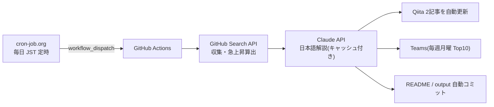

# Claude Code向けMCPツール候補ランキング

GitHub Search APIを使って、Claude Code周辺で活用候補になりそうなMCP関連リポジトリを定期収集するリポジトリです。

> 注意: この一覧は「Claude Codeでの動作」を保証するものではありません。  
> GitHub上のリポジトリ名・説明文・READMEなどに含まれる情報をもとに、MCP関連ツール候補を探すための入口として利用します。

## 仕組み(定常自律運転)

このランキングは cron-job.org → GitHub Actions → Claude API → Qiita / Teams のパイプラインで、毎日無人更新されています。



- 仕組みの詳細と**ライブ稼働ステータス**: [定常自律運転ページ](https://takanobusano.github.io/mcp-github-ranking/)
- 作り方の解説記事: [パイプライン編](https://qiita.com/4q_sano/items/913e93ee5cc2731561fc) / [cron-job.org 完全自動化編](https://qiita.com/4q_sano/items/1bc5e0669a8f0166936c)
<!-- MCP_REPOS_START -->
最終更新: **2026-11-09 08:17:14 JST**

MCP関連リポジトリに加え、Claude Code周辺で活用候補になりそうな関連ツールをGitHub Search APIで毎日自動収集してランキング化しています。

Stars / Forks の差分は、UTC基準の前日データ（2026-11-07）との差分です。
CSVには最大500件を保存し、本文では上位100件を表示しています。

> 注意: この一覧はClaude Codeでの動作を保証するものではありません。  
> MCP関連ツールまたはClaude Code関連ツール候補を探すための入口として利用してください。

# 注目MCP・関連ツール候補ランキング

## 1位 [public-apis/public-apis](https://github.com/public-apis/public-apis)

A collective list of free APIs

⭐ **497,318 Stars**（+306）　🍴 **55,595 Forks**（+48）　/　🟢 **2,606 Open Issues**　/　Python

Topics: `api` / `apis` / `dataset` / `development` / `free` / `list` / `lists` / `open-source`

## 2位 [morluto/rea](https://github.com/morluto/rea)

Reverse engineer anything with agents, from app behavior down to native binaries.

⭐ **443,648 Stars**（+2,729）　🍴 **109,593 Forks**（+495）　/　🟢 **1,651 Open Issues**　/　TypeScript

Topics: `agent-skills` / `ai` / `android` / `claude-code` / `cli` / `cpp` / `dsh-plugin` / `html`

## 3位 [openclaw/openclaw](https://github.com/openclaw/openclaw)

The AI that really does things. Any OS. Any Platform. The lobster way. 🦞

⭐ **394,216 Stars**（+72）　🍴 **82,845 Forks**（+18）　/　🟢 **7,791 Open Issues**　/　TypeScript

Topics: `ai` / `assistant` / `crustacean` / `molty` / `openclaw` / `own-your-data` / `personal`

## 4位 [mattpocock/skills](https://github.com/mattpocock/skills)

Skills for Real Engineers. Straight from my .agents directory.

⭐ **318,475 Stars**（+816）　🍴 **26,654 Forks**（+79）　/　🟢 **226 Open Issues**　/　Shell

Topics: `topicなし`

## 5位 [obra/superpowers](https://github.com/obra/superpowers)

An agentic skills framework & software development methodology that works.

⭐ **314,582 Stars**（+482）　🍴 **27,993 Forks**（+50）　/　🟢 **343 Open Issues**　/　Shell

Topics: `ai` / `brainstorming` / `coding` / `obra` / `sdlc` / `skills` / `subagent-driven-development` / `superpowers`

## 6位 [affaan-m/ECC](https://github.com/affaan-m/ECC)

The agent harness performance optimization system. Skills, instincts, memory, security, and research-first development for Claude Code, Codex, Opencode, Cursor and beyond.

⭐ **299,694 Stars**（+535）　🍴 **44,272 Forks**（+77）　/　🟢 **244 Open Issues**　/　JavaScript

Topics: `ai-agents` / `anthropic` / `claude` / `claude-code` / `developer-tools` / `llm` / `mcp` / `productivity`

## 7位 [NousResearch/hermes-agent](https://github.com/NousResearch/hermes-agent)

The agent that grows with you

⭐ **261,757 Stars**（+261）　🍴 **58,202 Forks**（+207）　/　🟢 **53,821 Open Issues**　/　Python

Topics: `ai` / `ai-agent` / `ai-agents` / `anthropic` / `chatgpt` / `claude` / `claude-code` / `codex`

## 8位 [multica-ai/andrej-karpathy-skills](https://github.com/multica-ai/andrej-karpathy-skills)

A single CLAUDE.md file to improve Claude Code behavior, derived from Andrej Karpathy's observations on LLM coding pitfalls.

⭐ **230,928 Stars**（+316）　🍴 **22,972 Forks**（+26）　/　🟢 **139 Open Issues**　/　不明

Topics: `topicなし`

## 9位 [firecrawl/firecrawl](https://github.com/firecrawl/firecrawl)

Supercharge your AI agents with data from the web and beyond. Building the library for superintelligence. 🔥

⭐ **199,802 Stars**（+283）　🍴 **10,514 Forks**（+14）　/　🟢 **773 Open Issues**　/　TypeScript

Topics: `ai` / `ai-agents` / `ai-crawler` / `ai-scraping` / `ai-search` / `crawler` / `data-extraction` / `html-to-markdown`

## 10位 [ultraworkers/claw-code](https://github.com/ultraworkers/claw-code)

An agent-managed museum exhibit, built in Rust with Gajae-Code / LazyCodex — developed and maintained with no human intervention.

⭐ **194,945 Stars**（+2）　🍴 **107,457 Forks**（-13）　/　🟢 **1 Open Issues**　/　Rust

Topics: `topicなし`

## 11位 [anthropics/skills](https://github.com/anthropics/skills)

Public repository for Agent Skills

⭐ **189,580 Stars**（+828）　🍴 **22,343 Forks**（+94）　/　🟢 **1,499 Open Issues**　/　Python

Topics: `agent-skills`

## 12位 [Significant-Gravitas/AutoGPT](https://github.com/Significant-Gravitas/AutoGPT)

AutoGPT is the vision of accessible AI for everyone, to use and to build on. Our mission is to provide the tools, so that you can focus on what matters.

⭐ **187,951 Stars**（+18）　🍴 **45,891 Forks**（-8）　/　🟢 **698 Open Issues**　/　Python

Topics: `agentic-ai` / `agents` / `ai` / `artificial-intelligence` / `autonomous-agents` / `claude` / `gpt` / `llama-api`

## 13位 [DietrichGebert/ponytail](https://github.com/DietrichGebert/ponytail)

Makes your AI agent think like the laziest senior dev in the room. The best code is the code you never wrote.

⭐ **186,908 Stars**（+544）　🍴 **10,351 Forks**（+33）　/　🟢 **189 Open Issues**　/　JavaScript

Topics: `agent-skills` / `ai-agents` / `claude` / `claude-code` / `claude-code-plugin` / `cursor-rules` / `developer-tools` / `llm`

## 14位 [ollama/ollama](https://github.com/ollama/ollama)

Get up and running with Kimi, GLM, MiniMax, DeepSeek, gpt-oss, Qwen, Gemma and other models.

⭐ **186,381 Stars**（+102）　🍴 **18,970 Forks**（+15）　/　🟢 **4,619 Open Issues**　/　Go

Topics: `deepseek` / `gemma` / `glm` / `go` / `golang` / `gpt-oss` / `llama` / `llm`

## 15位 [msitarzewski/agency-agents](https://github.com/msitarzewski/agency-agents)

A complete AI agency at your fingertips - From frontend wizards to Reddit community ninjas, from whimsy injectors to reality checkers. Each agent is a specialized expert with personality, processes, and proven deliverables.

⭐ **167,292 Stars**（+176）　🍴 **27,121 Forks**（+31）　/　🟢 **238 Open Issues**　/　Shell

Topics: `topicなし`

## 16位 [langgenius/dify](https://github.com/langgenius/dify)

Build Agentic workflows, RAG pipelines, with rich AI model and tool support on one collaborative workspace. Deploy on cloud, VPC, or self-hosted, so teams move from prototype to production without rebuilding the stack.

⭐ **160,686 Stars**（+55）　🍴 **25,424 Forks**（+6）　/　🟢 **1,200 Open Issues**　/　Python

Topics: `agent` / `agentic-ai` / `agentic-framework` / `agentic-workflow` / `ai` / `automation` / `claude` / `deepseek`

## 17位 [langflow-ai/langflow](https://github.com/langflow-ai/langflow)

Langflow is a powerful tool for building and deploying AI-powered agents and workflows.

⭐ **156,446 Stars**（+24）　🍴 **10,361 Forks**（+9）　/　🟢 **1,318 Open Issues**　/　Python

Topics: `agents` / `chatgpt` / `generative-ai` / `large-language-models` / `multiagent` / `react-flow`

## 18位 [anthropics/claude-code](https://github.com/anthropics/claude-code)

Claude Code is an agentic coding tool that lives in your terminal, understands your codebase, and helps you code faster by executing routine tasks, explaining complex code, and handling git workflows - all through natural language commands.

⭐ **154,999 Stars**（+90）　🍴 **25,618 Forks**（+19）　/　🟢 **16,850 Open Issues**　/　TypeScript

Topics: `topicなし`

## 19位 [farion1231/cc-switch](https://github.com/farion1231/cc-switch)

A cross-platform desktop All-in-One assistant for Claude Code, Codex, OpenCode,DeepSeek Harness and more. Only official website: ccswitch.io

⭐ **152,744 Stars**（+157）　🍴 **10,037 Forks**（+8）　/　🟢 **939 Open Issues**　/　Rust

Topics: `ai-tools` / `claude-code` / `codex` / `deepseek-harness` / `desktop-app` / `grok` / `grokbuild` / `hermes`

## 20位 [nextlevelbuilder/ui-ux-pro-max-skill](https://github.com/nextlevelbuilder/ui-ux-pro-max-skill)

An AI skill that provides design intelligence for building professional UI/UX across multiple platforms.

⭐ **146,902 Stars**（+364）　🍴 **15,548 Forks**（+39）　/　🟢 **86 Open Issues**　/　Python

Topics: `ai-skills` / `antigravity` / `claude` / `claude-code` / `codex` / `command-line` / `copilot` / `cursor-ai`

## 21位 [x1xhlol/system-prompts-and-models-of-ai-tools](https://github.com/x1xhlol/system-prompts-and-models-of-ai-tools)

FULL Augment Code, Claude Code, Cluely, CodeBuddy, Comet, Cursor, Devin AI, Junie, Kiro, Leap.new, Lovable, Manus, NotionAI, Orchids.app, Perplexity, Poke, Qoder, Replit, Same.dev, Trae, Traycer AI, VSCode Agent, Warp.dev, Windsurf, Xcode, Z.ai Code, Dia & v0. (And other Open Sourced) System Prompts, Internal Tools & AI Models

⭐ **144,570 Stars**（+23）　🍴 **34,700 Forks**（+3）　/　🟢 **162 Open Issues**　/　不明

Topics: `ai` / `bolt` / `cluely` / `copilot` / `cursor` / `cursorai` / `devin` / `github-copilot`

## 22位 [Graphify-Labs/graphify](https://github.com/Graphify-Labs/graphify)

Turn any codebase, with its docs, SQL schemas, configs, and PDFs, into a queryable knowledge graph. A /graphify skill for Claude Code, Cursor, Codex, and Gemini CLI: local deterministic AST parsing, every edge explained, no vector store.

⭐ **144,488 Stars**（+509）　🍴 **13,825 Forks**（+48）　/　🟢 **1,635 Open Issues**　/　Python

Topics: `ai-agents` / `antigravity` / `ast` / `claude-code` / `code-analysis` / `code-search` / `codex` / `cursor`

## 23位 [harry0703/MoneyPrinterTurbo](https://github.com/harry0703/MoneyPrinterTurbo)

利用 AI 大模型和自动化工作流，根据主题或关键词一键生成高清短视频。Generate HD short videos from a topic or keyword with an automated AI workflow.

⭐ **141,041 Stars**（+304）　🍴 **22,506 Forks**（+51）　/　🟢 **75 Open Issues**　/　Python

Topics: `ai-video-generator` / `content-creation` / `ffmpeg` / `instagram-reels` / `llm` / `python` / `short-video` / `subtitles`

## 24位 [garrytan/gstack](https://github.com/garrytan/gstack)

Use Garry Tan's exact Claude Code setup: 23 opinionated tools that serve as CEO, Designer, Eng Manager, Release Manager, Doc Engineer, and QA

⭐ **140,780 Stars**（+121）　🍴 **20,783 Forks**（+20）　/　🟢 **70 Open Issues**　/　TypeScript

Topics: `topicなし`

## 25位 [TauricResearch/TradingAgents](https://github.com/TauricResearch/TradingAgents)

TradingAgents: Multi-Agents LLM Financial Trading Framework

⭐ **121,374 Stars**（+193）　🍴 **23,223 Forks**（+50）　/　🟢 **128 Open Issues**　/　Python

Topics: `agent` / `finance` / `llm` / `multiagent` / `trading`

## 26位 [browser-use/browser-use](https://github.com/browser-use/browser-use)

Open-source Python library for AI browser agents, plus Browser Use Cloud: stealth browsers and a hosted agent API.

⭐ **120,344 Stars**（+82）　🍴 **13,443 Forks**（+18）　/　🟢 **629 Open Issues**　/　Python

Topics: `ai-agents` / `ai-tools` / `browser-agent` / `browser-automation` / `browser-use` / `cdp` / `cloud-browser` / `computer-use`

## 27位 [stablyai/orca](https://github.com/stablyai/orca)

Orca lets you run a fleet of coding agents (e.g. Claude Code, Codex) with your own subscription. Available on desktop, mobile and remote runtime.

⭐ **119,262 Stars**（+699）　🍴 **7,572 Forks**（+46）　/　🟢 **8,178 Open Issues**　/　TypeScript

Topics: `agent-ide` / `ai-agents` / `automation` / `bot` / `claude-code` / `codex` / `ghostty` / `grok-bot`

## 28位 [JuliusBrussee/caveman](https://github.com/JuliusBrussee/caveman)

🪨 why use many token when few token do trick. Viral skill + proxy for coding agents that cuts 65% of tokens by talking like a caveman.

⭐ **118,363 Stars**（+196）　🍴 **6,890 Forks**（+19）　/　🟢 **72 Open Issues**　/　Go

Topics: `ai` / `anthropic` / `caveman` / `claude` / `claude-code` / `llm` / `meme` / `prompt-engineering`

## 29位 [thedotmack/claude-mem](https://github.com/thedotmack/claude-mem)

Persistent Context Across Sessions for Every Agent –  Captures everything your agent does during sessions, compresses it with AI, and injects relevant context back into future sessions. Works with Claude Code, OpenClaw, Codex, Gemini, Hermes, Copilot, OpenCode + More

⭐ **114,881 Stars**（+433）　🍴 **9,979 Forks**（+54）　/　🟢 **88 Open Issues**　/　TypeScript

Topics: `ai` / `ai-agents` / `ai-memory` / `anthropic` / `artificial-intelligence` / `chromadb` / `claude` / `claude-agent-sdk`

## 30位 [addyosmani/agent-skills](https://github.com/addyosmani/agent-skills)

Production-grade engineering skills for AI coding agents.

⭐ **114,111 Stars**（+215）　🍴 **11,919 Forks**（+20）　/　🟢 **132 Open Issues**　/　JavaScript

Topics: `agent-skills` / `antigravity` / `claude-code` / `codex` / `cursor` / `skills`

## 31位 [paperclipai/paperclip](https://github.com/paperclipai/paperclip)

The open-source app everyone uses to manage agents at work

⭐ **112,321 Stars**（+304）　🍴 **18,623 Forks**（+68）　/　🟢 **6,565 Open Issues**　/　TypeScript

Topics: `acpx` / `agent-orchestration` / `agent-skills` / `agentic-ai` / `ai-agents` / `ai-engineering` / `ai-governance` / `ai-tools`

## 32位 [Leonxlnx/taste-skill](https://github.com/Leonxlnx/taste-skill)

Agent skills that give coding agents taste: art direction, reference images and a browser check instead of generic AI pages

⭐ **112,028 Stars**（+394）　🍴 **7,535 Forks**（+31）　/　🟢 **2 Open Issues**　/　JavaScript

Topics: `agent-skills` / `ai-agents` / `anti-slop` / `claude-code` / `codex` / `cursor` / `design-system` / `frontend`

## 33位 [Panniantong/Agent-Reach](https://github.com/Panniantong/Agent-Reach)

Give your AI agent eyes to see the entire internet. Read & search Twitter, Reddit, YouTube, GitHub, Bilibili, XiaoHongShu — one CLI, zero API fees.

⭐ **110,298 Stars**（+307）　🍴 **9,873 Forks**（+35）　/　🟢 **85 Open Issues**　/　Python

Topics: `agent-infrastructure` / `ai-agent` / `ai-search` / `automation` / `bilibili` / `claude-code` / `cli` / `cursor`

## 34位 [google-gemini/gemini-cli](https://github.com/google-gemini/gemini-cli)

An open-source AI agent that brings the power of Gemini directly into your terminal.

⭐ **108,785 Stars**（+16）　🍴 **14,931 Forks**（±0）　/　🟢 **753 Open Issues**　/　TypeScript

Topics: `ai` / `ai-agents` / `cli` / `gemini` / `gemini-api` / `mcp-client` / `mcp-server`

## 35位 [nexu-io/open-design](https://github.com/nexu-io/open-design)

The 1st Collaborative AI Design Agent Workspace. Local-first and open source. Create motion, prototypes, websites, apps, dashboards, presentations, images, and videos with your team and AI agents. Share work, exchange feedback, and iterate together in one workspace.

⭐ **106,654 Stars**（+178）　🍴 **12,145 Forks**（+30）　/　🟢 **1,382 Open Issues**　/　TypeScript

Topics: `agent-skills` / `ai-design` / `byok` / `claude-code-for-design` / `claude-design` / `codex-design` / `cursor-design` / `deepseek`

## 36位 [pbakaus/impeccable](https://github.com/pbakaus/impeccable)

The design vocabulary for your coding agent. Steer with polish and bolder, review with critique and audit, catch AI slop before it ships.

⭐ **106,179 Stars**（+673）　🍴 **6,309 Forks**（+39）　/　🟢 **77 Open Issues**　/　Rust

Topics: `agent-skills` / `ai` / `anti-slop` / `design` / `slop`

## 37位 [debpalash/VoiceStudio](https://github.com/debpalash/VoiceStudio)

VoiceStudio is the open-source, fully-local ElevenLabs alternative — voice cloning, voice design, video dubbing, dictation, transcription & audiobook creation in 646 languages.

⭐ **104,935 Stars**（+1,107）　🍴 **11,665 Forks**（+126）　/　🟢 **106 Open Issues**　/　Python

Topics: `ai` / `audiobook` / `cuda` / `dubbing` / `elevenlabs-alternative` / `huggingface` / `local-first` / `mlx`

## 38位 [D4Vinci/Scrapling](https://github.com/D4Vinci/Scrapling)

🕷️ The BEST Web Scraping framework that handles everything from a single request to a full-scale crawl! Don't be shy, join here:  and follow here for daily tips and tricks:

⭐ **99,842 Stars**（+536）　🍴 **10,438 Forks**（+43）　/　🟢 **16 Open Issues**　/　Python

Topics: `ai` / `ai-scraping` / `automation` / `crawler` / `crawling` / `crawling-python` / `data` / `data-extraction`

## 39位 [microsoft/playwright](https://github.com/microsoft/playwright)

Playwright is a framework for Web Testing and Automation. It allows testing Chromium, Firefox and WebKit with a single API.

⭐ **99,603 Stars**（+65）　🍴 **6,823 Forks**（+10）　/　🟢 **39 Open Issues**　/　TypeScript

Topics: `automation` / `chrome` / `chromium` / `e2e-testing` / `electron` / `end-to-end-testing` / `firefox` / `javascript`

## 40位 [OpenCut-app/OpenCut](https://github.com/OpenCut-app/OpenCut)

The open-source CapCut alternative

⭐ **97,802 Stars**（+201）　🍴 **9,757 Forks**（+27）　/　🟢 **386 Open Issues**　/　TypeScript

Topics: `editor` / `oss` / `videoeditor`

## 41位 [puppeteer/puppeteer](https://github.com/puppeteer/puppeteer)

JavaScript API for Chrome and Firefox

⭐ **95,816 Stars**（+5）　🍴 **9,592 Forks**（±0）　/　🟢 **216 Open Issues**　/　TypeScript

Topics: `automation` / `chrome` / `chromium` / `developer-tools` / `firefox` / `headless-chrome` / `node-module` / `testing`

## 42位 [tt-a1i/archify](https://github.com/tt-a1i/archify)

Turn any idea, plan, or codebase into a beautiful interactive diagram. An agent skill for Claude Code, Codex, and more.

⭐ **94,723 Stars**（+267）　🍴 **6,462 Forks**（+30）　/　🟢 **357 Open Issues**　/　JavaScript

Topics: `agent-skills` / `ai-agents` / `architecture-diagram` / `claude-code` / `claude-skills` / `codex` / `coding-agents` / `deepseek-harness`

## 43位 [OpenHands/OpenHands](https://github.com/OpenHands/OpenHands)

🙌 OpenHands: AI-Driven Development

⭐ **92,973 Stars**（+76）　🍴 **12,420 Forks**（+14）　/　🟢 **1,167 Open Issues**　/　TypeScript

Topics: `agent` / `artificial-intelligence` / `chatgpt` / `claude-ai` / `cli` / `developer-tools` / `gpt` / `llm`

## 44位 [modelcontextprotocol/servers](https://github.com/modelcontextprotocol/servers)

Model Context Protocol Reference Servers

⭐ **91,873 Stars**（+18）　🍴 **11,930 Forks**（+3）　/　🟢 **20 Open Issues**　/　TypeScript

Topics: `topicなし`

## 45位 [Egonex-AI/Understand-Anything](https://github.com/Egonex-AI/Understand-Anything)

Graphs that teach > graphs that impress. Turn any code into an interactive knowledge graph you can explore, search, and ask questions about. Works with Claude Code, Codex, Cursor, Copilot, Gemini CLI, and more.

⭐ **91,540 Stars**（+285）　🍴 **7,812 Forks**（+21）　/　🟢 **352 Open Issues**　/　TypeScript

Topics: `antigravity-skills` / `business-knowledge` / `claude-code` / `claude-skills` / `codebase-analysis` / `codex` / `codex-skills` / `developer-tools-ai-agent`

## 46位 [koala73/worldmonitor](https://github.com/koala73/worldmonitor)

Real-time global intelligence dashboard. AI-powered news aggregation, geopolitical monitoring, and infrastructure tracking in a unified situational awareness interface

⭐ **90,370 Stars**（+54）　🍴 **14,004 Forks**（+21）　/　🟢 **317 Open Issues**　/　TypeScript

Topics: `agent` / `ai` / `dashboard` / `geopolitics` / `mcp` / `mcp-server` / `monitoring` / `news`

## 47位 [ChatGPTNextWeb/NextChat](https://github.com/ChatGPTNextWeb/NextChat)

✨ Zero-config AI chat assistant. No API key needed — sign up and instantly chat with GPT-5, Claude 4, Gemini 2.5, DeepSeek & 100+ top models. Pay-as-you-go save...

⭐ **88,942 Stars**（-4）　🍴 **58,588 Forks**（-2）　/　🟢 **865 Open Issues**　/　TypeScript

Topics: `calclaude` / `claude` / `cross-platform` / `desktop` / `fe` / `gemini` / `gemini-pro` / `gemini-server`

## 48位 [unclecode/crawl4ai](https://github.com/unclecode/crawl4ai)

Official Crawl4AI Cloud: a hosted web scraping, extraction, and search API for AI agents. Free API key, 1,000 credits a month, no card. Fully open source: this repo is the Apache-2.0 crawler that powers it, and you can self-host it.

⭐ **87,101 Stars**（+42）　🍴 **9,075 Forks**（+5）　/　🟢 **318 Open Issues**　/　Python

Topics: `ai` / `ai-agents` / `crawl4ai-cloud` / `crawler` / `data-extraction` / `llm` / `markdown` / `mcp`

## 49位 [rtk-ai/rtk](https://github.com/rtk-ai/rtk)

CLI proxy that reduces LLM token consumption by 60-90% on common dev commands. Single Rust binary, zero dependencies

⭐ **85,932 Stars**（+98）　🍴 **5,505 Forks**（+9）　/　🟢 **1,680 Open Issues**　/　Rust

Topics: `agentic-coding` / `ai-coding` / `anthropic` / `claude-code` / `cli` / `command-line-tool` / `cost-reduction` / `developer-tools`

## 50位 [cheaper-inference/OmniRoute](https://github.com/cheaper-inference/OmniRoute)

Never stop coding. Free MIT AI gateway: one endpoint, 375 providers (150+ free), 1,400+ models Kimi, Claude, GPT, Gemini, GLM, DeepSeek, MiniMax. Works with Claude Code, Codex, Cursor, OpenCode, Cline & Copilot. Quota-aware auto-fallback, RTK+Caveman compression saves 15-95% tokens, MCP/A2A, Desktop/PWA. Built by 900+ contributors

⭐ **85,711 Stars**（+265）　🍴 **12,974 Forks**（+58）　/　🟢 **474 Open Issues**　/　TypeScript

Topics: `a2a` / `ai-agents` / `ai-gateway` / `anthropic` / `claude` / `claude-code` / `cline` / `codex`

## 51位 [laravel/laravel](https://github.com/laravel/laravel)

Laravel is a web application framework with expressive, elegant syntax. We’ve already laid the foundation for your next big idea — freeing you to create without sweating the small things.

⭐ **85,394 Stars**（+2）　🍴 **26,226 Forks**（-4）　/　🟢 **31 Open Issues**　/　Blade

Topics: `framework` / `laravel` / `php`

## 52位 [bytedance/deer-flow](https://github.com/bytedance/deer-flow)

An open-source long-horizon SuperAgent harness that researches, codes, and creates. With the help of sandboxes, memories, tools, skill, subagents and message gateway, it handles different levels of tasks that could take minutes to hours.

⭐ **85,141 Stars**（+24）　🍴 **11,974 Forks**（+12）　/　🟢 **1,073 Open Issues**　/　Python

Topics: `agent` / `agentic` / `agentic-framework` / `agentic-workflow` / `ai` / `ai-agents` / `deep-research` / `harness`

## 53位 [lobehub/lobehub](https://github.com/lobehub/lobehub)

🤯 LobeHub - Super-Agents on Your Team. Add super-agents to the chats your team already uses.They take on work by themselves and get better every week.

⭐ **84,423 Stars**（+85）　🍴 **16,148 Forks**（+18）　/　🟢 **1,293 Open Issues**　/　TypeScript

Topics: `agent` / `agent-collaboration` / `agent-harness` / `loop-engineering` / `mcp` / `personal-assistant` / `proactive-agent` / `skills`

## 54位 [ruvnet/ruflo](https://github.com/ruvnet/ruflo)

🌊 The original agent harness. Deploy intelligent multi-player swarms, coordinate autonomous workflows, and build conversational AI systems. Features adaptive me...

⭐ **81,270 Stars**（+93）　🍴 **9,555 Forks**（+6）　/　🟢 **652 Open Issues**　/　TypeScript

Topics: `agentic-ai` / `agentic-framework` / `agentic-workflow` / `agents` / `ai-agents` / `ai-assistant` / `ai-skills` / `autonomous-agents`

## 55位 [abi/screenshot-to-code](https://github.com/abi/screenshot-to-code)

Drop in a screenshot and convert it to clean code (HTML/Tailwind/React/Vue)

⭐ **81,103 Stars**（+25）　🍴 **9,936 Forks**（+1）　/　🟢 **150 Open Issues**　/　Python

Topics: `topicなし`

## 56位 [heygen-com/hyperframes](https://github.com/heygen-com/hyperframes)

Write HTML. Render video. Built for agents.

⭐ **81,070 Stars**（+517）　🍴 **7,483 Forks**（+52）　/　🟢 **226 Open Issues**　/　TypeScript

Topics: `ai` / `ai-agents` / `animation` / `claude-code` / `ffmpeg` / `framework` / `gsap` / `html`

## 57位 [shareAI-lab/learn-claude-code](https://github.com/shareAI-lab/learn-claude-code)

Bash is all you need -  A nano claude code–like 「agent harness」, built from 0 to 1

⭐ **80,062 Stars**（+41）　🍴 **12,811 Forks**（+9）　/　🟢 **59 Open Issues**　/　Python

Topics: `agent` / `agent-development` / `ai-agent` / `claude` / `claude-code` / `educational` / `llm` / `python`

## 58位 [unslothai/unsloth](https://github.com/unslothai/unsloth)

Local UI to run and train LLMs and diffusion models. Supports GGUF, MLX, Qwen3.8, DeepSeek-V4.1, MiniMax-H3, Gemma 4, FLUX and more.

⭐ **79,205 Stars**（+45）　🍴 **7,374 Forks**（+8）　/　🟢 **489 Open Issues**　/　Python

Topics: `agent` / `ai` / `chatgpt` / `deepseek` / `fine-tuning` / `gemma` / `image-generation` / `llama`

## 59位 [headroomlabs-ai/headroom](https://github.com/headroomlabs-ai/headroom)

Compress tool outputs, logs, files, and RAG chunks before they reach the LLM. 20% fewer tokens for coding agents, 60-95% fewer tokens for JSON, same answers. Library, proxy, MCP server.

⭐ **79,160 Stars**（+81）　🍴 **6,190 Forks**（+9）　/　🟢 **268 Open Issues**　/　Python

Topics: `agent` / `ai` / `anthropic` / `claude-code` / `compression` / `context-engineering` / `context-window` / `cursor`

## 60位 [OpenMontageInc/OpenMontage](https://github.com/OpenMontageInc/OpenMontage)

World's first open-source, agentic video production system. 12 production pipelines, 100+ tools, 700+ agent skill and production-knowledge files. Turn your AI coding assistant into a full video production studio.

⭐ **78,654 Stars**（前日なし）　🍴 **10,495 Forks**（前日なし）　/　🟢 **323 Open Issues**　/　Python

Topics: `agent` / `agentic-ai` / `ai` / `claude` / `copilot` / `cursor` / `elevenlabs` / `ffmpeg`

## 61位 [storytold/photocraft](https://github.com/storytold/photocraft)

PhotoCraft: An open-source, photo editor written by scratch in pure Rust

⭐ **77,970 Stars**（+249）　🍴 **13,798 Forks**（+35）　/　🟢 **4,007 Open Issues**　/　Rust

Topics: `art` / `image-editing` / `image-editing-software` / `image-editor` / `images` / `photo-editing` / `rust`

## 62位 [rohitg00/ai-engineering-from-scratch](https://github.com/rohitg00/ai-engineering-from-scratch)

Learn AI Engineering! Learn it. Build it. Ship it for others.

⭐ **77,802 Stars**（+364）　🍴 **13,813 Forks**（+87）　/　🟢 **59 Open Issues**　/　Python

Topics: `agents` / `ai` / `ai-agents` / `ai-engineering` / `computer-vision` / `course` / `deep-learning` / `dsh`

## 63位 [colbymchenry/codegraph](https://github.com/colbymchenry/codegraph)

Pre-indexed code knowledge graph, auto syncs on code changes, for Claude Code, Codex, Gemini, Cursor, OpenCode, AntiGravity, Kiro, CoPilot, and Hermes Agent — fewer tokens, fewer tool calls, 100% local

⭐ **77,087 Stars**（+81）　🍴 **5,130 Forks**（+13）　/　🟢 **265 Open Issues**　/　TypeScript

Topics: `topicなし`

## 64位 [nestjs/nest](https://github.com/nestjs/nest)

A progressive TypeScript framework for Node.js backends: from a small API in one file to efficient, scalable, enterprise-grade systems 🚀

⭐ **76,989 Stars**（-2）　🍴 **8,687 Forks**（+5）　/　🟢 **39 Open Issues**　/　TypeScript

Topics: `framework` / `hacktoberfest` / `javascript` / `javascript-framework` / `microservices` / `nest` / `nestjs` / `node`

## 65位 [Eugeny/tabby](https://github.com/Eugeny/tabby)

A terminal for a more modern age

⭐ **75,334 Stars**（+5）　🍴 **4,335 Forks**（+3）　/　🟢 **2,892 Open Issues**　/　TypeScript

Topics: `serial` / `ssh-client` / `telnet-client` / `terminal` / `terminal-emulators`

## 66位 [openbq-org/OpenBB](https://github.com/openbq-org/OpenBB)

Open Data Platform for analysts, quants and AI agents.

⭐ **75,248 Stars**（+42）　🍴 **7,866 Forks**（+6）　/　🟢 **105 Open Issues**　/　Python

Topics: `ai` / `crypto` / `derivatives` / `economics` / `equity` / `finance` / `fixed-income` / `machine-learning`

## 67位 [hugohe3/ppt-master](https://github.com/hugohe3/ppt-master)

AI turns documents or topics into real, native PowerPoint decks—with native shapes, transitions and animations, data-backed charts and tables on demand, audio narration from speaker notes, and support for your own .pptx templates. · by Hugo He

⭐ **74,888 Stars**（+357）　🍴 **5,869 Forks**（+28）　/　🟢 **1 Open Issues**　/　Python

Topics: `ai-agent` / `aippt` / `office` / `powerpoint` / `powerpoint-generation` / `ppt` / `pptx` / `presentation`

## 68位 [thedaviddias/Front-End-Checklist](https://github.com/thedaviddias/Front-End-Checklist)

🗂 The essential checklist for modern web development, for humans and AI agents

⭐ **74,678 Stars**（+9）　🍴 **6,785 Forks**（±0）　/　🟢 **21 Open Issues**　/　MDX

Topics: `ai-agent` / `ai-agents` / `checklist` / `css` / `front-end-developer-tool` / `front-end-development` / `frontend` / `guidelines`

## 69位 [usestrix/strix](https://github.com/usestrix/strix)

Open-source AI penetration testing tool to find and fix your app’s vulnerabilities.

⭐ **74,440 Stars**（+169）　🍴 **8,412 Forks**（+24）　/　🟢 **573 Open Issues**　/　Python

Topics: `agents` / `ai-hacking` / `ai-penetration-testing` / `ai-pentesting` / `ai-security` / `artificial-intelligence` / `bug-bounty` / `code-quality`

## 70位 [eternity4719/HowToLiveBetter](https://github.com/eternity4719/HowToLiveBetter)

高性价比人生指南: 长寿防病、急救、省钱理财、法律红线、失业与工伤、医保社保、恋爱婚育、怀孕育儿、创业与做平台合规、出国与技能。每条写明成本、收益、证据等级和原始出处，只引期刊论文与官方文件。

⭐ **74,377 Stars**（+177）　🍴 **6,566 Forks**（+24）　/　🟢 **15 Open Issues**　/　HTML

Topics: `topicなし`

## 71位 [tw93/Mole](https://github.com/tw93/Mole)

🐹 Open-source Mac and PC cleaner. Keep your machine clean, light, and running like new. Fast CLI, plus native Mac and Windows apps.

⭐ **74,286 Stars**（+89）　🍴 **2,665 Forks**（+11）　/　🟢 **6 Open Issues**　/　Shell

Topics: `analyzer` / `appcleaner` / `clean` / `cleaner` / `cleanmymac` / `command-line` / `daisydisk` / `istat`

## 72位 [cline/cline](https://github.com/cline/cline)

Autonomous coding agent as an SDK, IDE extension, or CLI assistant.

⭐ **71,473 Stars**（+23）　🍴 **7,898 Forks**（+8）　/　🟢 **1,757 Open Issues**　/　TypeScript

Topics: `topicなし`

## 73位 [asgeirtj/system_prompts_leaks](https://github.com/asgeirtj/system_prompts_leaks)

Leaked system prompts of ChatGPT, Claude, Gemini and more. The hidden system prompt of every popular chatbot, in full, every version since May 2025. Also Anthropic Claude Code, OpenAI Codex, Google Antigravity, xAI Grok, Meta Muse, Moonshot Kimi, Alibaba Qwen, Z.ai GLM ZCode, MiniMax, Cursor, Perplexity, DeepSeek and 30+ others. Updated daily.

⭐ **71,038 Stars**（+49）　🍴 **11,462 Forks**（-2）　/　🟢 **22 Open Issues**　/　Python

Topics: `ai` / `ai-agents` / `ai-prompts` / `anthropic` / `chatbot` / `chatgpt` / `claude` / `claude-code`

## 74位 [code-yeongyu/oh-my-openagent](https://github.com/code-yeongyu/oh-my-openagent)

OmO: Just type "mass ulw" keyword with your prompt. Now you are the master of graph engineering.

⭐ **70,786 Stars**（+14）　🍴 **5,845 Forks**（+3）　/　🟢 **2,446 Open Issues**　/　TypeScript

Topics: `ai` / `ai-agents` / `anthropic` / `chatgpt` / `claude` / `claude-skills` / `codex` / `cursor`

## 75位 [NanmiCoder/MediaCrawler](https://github.com/NanmiCoder/MediaCrawler)

小红书笔记 \| 评论爬虫、抖音视频 \| 评论爬虫、快手视频 \| 评论爬虫、B 站视频 ｜ 评论爬虫、微博帖子 ｜ 评论爬虫、百度贴吧帖子 ｜ 百度贴吧评论回复爬虫  \| 知乎问答文章｜评论爬虫

⭐ **70,661 Stars**（+81）　🍴 **13,380 Forks**（+12）　/　🟢 **219 Open Issues**　/　Python

Topics: `topicなし`

## 76位 [docling-project/docling](https://github.com/docling-project/docling)

Get your documents ready for gen AI

⭐ **70,301 Stars**（+41）　🍴 **5,294 Forks**（+10）　/　🟢 **959 Open Issues**　/　Python

Topics: `ai` / `convert` / `document-parser` / `document-parsing` / `documents` / `docx` / `html` / `markdown`

## 77位 [openinterpreter/openinterpreter](https://github.com/openinterpreter/openinterpreter)

A coding agent for open models like Kimi K3 and GLM 5.3

⭐ **68,841 Stars**（+15）　🍴 **5,940 Forks**（+1）　/　🟢 **38 Open Issues**　/　Rust

Topics: `acp` / `coding-agent` / `deepseek` / `kimi` / `python` / `qwen` / `rust`

## 78位 [shanraisshan/claude-code-best-practice](https://github.com/shanraisshan/claude-code-best-practice)

from vibe coding to agentic engineering - practice makes claude perfect

⭐ **68,830 Stars**（+57）　🍴 **6,853 Forks**（+4）　/　🟢 **43 Open Issues**　/　HTML

Topics: `agentic-ai` / `agentic-coding` / `agentic-engineering` / `agentic-workflow` / `ai` / `ai-agents` / `anthropic` / `best-practices`

## 79位 [mem0ai/mem0](https://github.com/mem0ai/mem0)

The Memory Layer for AI Agents - Drop-in memory infrastructure for AI agents and apps. Context that persists. Built for production.

⭐ **68,643 Stars**（+62）　🍴 **8,162 Forks**（+6）　/　🟢 **928 Open Issues**　/　Python

Topics: `agentic-memory` / `agentic-memory-system` / `agents` / `ai` / `ai-agents` / `chatgpt` / `genai` / `llm`

## 80位 [Alishahryar1/free-claude-code](https://github.com/Alishahryar1/free-claude-code)

Use Claude Code, Codex, Antigravity, VSCode, Pi, and OpenCode (and 6 other harnesses) for free (1.3B+ free tokens) from your terminal, app, IDE, or phone, and now from the browser with native browser sessions (multi-harness + multi-model) like OpenClaw (voice supported + ToS friendly)

⭐ **67,382 Stars**（+211）　🍴 **10,470 Forks**（+32）　/　🟢 **353 Open Issues**　/　Python

Topics: `topicなし`

## 81位 [bradtraversy/design-resources-for-developers](https://github.com/bradtraversy/design-resources-for-developers)

Curated list of design and UI resources from stock photos, web templates, CSS frameworks, UI libraries, tools and much more

⭐ **67,354 Stars**（+14）　🍴 **12,312 Forks**（+6）　/　🟢 **5 Open Issues**　/　不明

Topics: `topicなし`

## 82位 [xtekky/gpt4free](https://github.com/xtekky/gpt4free)

The official gpt4free repository \| various collection of powerful language models \| opus 4.6 gpt 5.3 kimi 2.5 deepseek v3.2 gemini 3

⭐ **67,020 Stars**（-2）　🍴 **13,457 Forks**（-2）　/　🟢 **6 Open Issues**　/　Python

Topics: `chatbot` / `chatbots` / `chatgpt` / `chatgpt-4` / `chatgpt-api` / `chatgpt-free` / `chatgpt4` / `deepseek`

## 83位 [mvanhorn/last30days-skill](https://github.com/mvanhorn/last30days-skill)

AI agent skill that researches any topic across Reddit, X, YouTube, HN, Polymarket, and the web - then synthesizes a grounded summary

⭐ **67,015 Stars**（+75）　🍴 **5,878 Forks**（+9）　/　🟢 **24 Open Issues**　/　Python

Topics: `ai-prompts` / `ai-skill` / `bluesky` / `claude` / `claude-code` / `clawhub` / `deep-research` / `hackernews`

## 84位 [blader/humanizer](https://github.com/blader/humanizer)

Agent skill that removes signs of AI-generated writing from text

⭐ **66,465 Stars**（+488）　🍴 **5,238 Forks**（+24）　/　🟢 **16 Open Issues**　/　Python

Topics: `agent-skills` / `ai-humanizer` / `ai-writing` / `chatgpt` / `claude` / `claude-code` / `codex` / `cursor`

## 85位 [Ebony-Vinyl/dsh-our-free-model](https://github.com/Ebony-Vinyl/dsh-our-free-model)

在 dsh 里装上这个插件即可，无需登录、注册或填 API Key，就能使用包括 DeepSeek V4.1 Flash、Kimi K3 在内的前沿模型——完全免费，不限量。 All you do is install this plugin in dsh: no login, no sign-up, no API k...

⭐ **66,147 Stars**（+761）　🍴 **1,777 Forks**（+21）　/　🟢 **146 Open Issues**　/　JavaScript

Topics: `ai-agents` / `deepseek` / `deepseek-harness` / `developer-tools` / `dsh` / `dsh-plugin` / `free-model` / `llm`

## 86位 [warpdotdev/warp](https://github.com/warpdotdev/warp)

Warp is an agentic development environment, born out of the terminal.

⭐ **65,929 Stars**（+17）　🍴 **5,770 Forks**（+7）　/　🟢 **5,548 Open Issues**　/　Rust

Topics: `bash` / `linux` / `macos` / `rust` / `shell` / `terminal` / `wasm` / `zsh`

## 87位 [cathrynlavery/diagram-design](https://github.com/cathrynlavery/diagram-design)

Editorial diagram design for Claude Code, Codex, GitHub Copilot, Cursor, Factory Droid, Qoder, and Pi. 45 diagram types. Self-contained HTML + SVG. No shadows. No Mermaid slop.

⭐ **65,873 Stars**（+197）　🍴 **4,369 Forks**（+21）　/　🟢 **52 Open Issues**　/　HTML

Topics: `agent-skills` / `claude-code` / `codex` / `data-visualization` / `diagrams` / `drawio` / `mermaid` / `svg`

## 88位 [coollabsio/coolify](https://github.com/coollabsio/coolify)

An open-source, self-hostable PaaS alternative to Vercel, Heroku & Netlify that lets you easily deploy static sites, databases, full-stack applications and 360+ one-click services on your own servers.

⭐ **65,801 Stars**（+43）　🍴 **5,946 Forks**（+5）　/　🟢 **241 Open Issues**　/　PHP

Topics: `coolify` / `databases` / `deployment` / `docker` / `docker-compose` / `inertiajs` / `laravel` / `mariadb`

## 89位 [upstash/context7](https://github.com/upstash/context7)

Context7 Platform -- Up-to-date docs for AI agents

⭐ **64,369 Stars**（+41）　🍴 **3,226 Forks**（+5）　/　🟢 **57 Open Issues**　/　TypeScript

Topics: `llm` / `mcp` / `mcp-server` / `vibe-coding`

## 90位 [usememos/memos](https://github.com/usememos/memos)

Memos is an open-source, self-hosted note-taking app that brings your everyday thoughts together in a personal timeline. Your data stays yours, and you choose what to keep private or share.

⭐ **64,351 Stars**（+10）　🍴 **4,942 Forks**（+3）　/　🟢 **57 Open Issues**　/　Go

Topics: `docker` / `foss` / `go` / `markdown` / `memo` / `microblog` / `note-taking` / `notes`

## 91位 [bilawalsidhu/gods-eye-view](https://github.com/bilawalsidhu/gods-eye-view)

A spy satellite simulator in your browser, except the data is real. Live open source spatial intelligence on a photorealistic 3D globe.

⭐ **63,600 Stars**（+202）　🍴 **12,529 Forks**（+49）　/　🟢 **427 Open Issues**　/　JavaScript

Topics: `3d-globe` / `cesium` / `flight-tracking` / `geospatial` / `geospatial-intelligence` / `gis` / `osint` / `photogrammetry`

## 92位 [sansan0/TrendRadar](https://github.com/sansan0/TrendRadar)

⭐AI-driven public opinion & trend monitor with multi-platform aggregation, RSS, and smart alerts.🎯 告别信息过载，你的 AI 舆情监控助手与热点筛选工具！聚合多平台热点 +  RSS 订阅，支持关键词精准筛选。AI 智能筛...

⭐ **63,523 Stars**（+6）　🍴 **24,919 Forks**（+1）　/　🟢 **38 Open Issues**　/　Python

Topics: `ai` / `bark` / `data-analysis` / `docker` / `hot-news` / `llm` / `mail` / `mcp`

## 93位 [tw93/Pake](https://github.com/tw93/Pake)

Turn any website into a lightweight desktop app with one command, on macOS, Windows and Linux.

⭐ **62,964 Stars**（+89）　🍴 **12,945 Forks**（+5）　/　🟢 **0 Open Issues**　/　Rust

Topics: `chatgpt` / `claude` / `cli` / `desktop` / `desktop-app` / `electron-alternative` / `gemini` / `linux`

## 94位 [BerriAI/litellm](https://github.com/BerriAI/litellm)

The fastest, litest AI Gateway. Rust core with Python SDK. Call 100+ LLM APIs in OpenAI (or native) format with cost tracking, guardrails, load balancing, and logging [Bedrock, Azure, OpenAI, Anthropic, OpenAI, VertexAI, vLLM, Nvidia NIM]

⭐ **62,917 Stars**（+36）　🍴 **13,121 Forks**（+23）　/　🟢 **5,735 Open Issues**　/　Python

Topics: `ai-gateway` / `anthropic` / `azure-openai` / `bedrock` / `gateway` / `langchain` / `litellm` / `llm`

## 95位 [penpot/penpot](https://github.com/penpot/penpot)

Penpot: The open-source design platform for Product teams that need scalable collaboration.

⭐ **62,190 Stars**（+21）　🍴 **4,386 Forks**（+2）　/　🟢 **939 Open Issues**　/　Clojure

Topics: `clojure` / `clojurescript` / `design` / `prototyping` / `ui` / `ux-design` / `ux-experience`

## 96位 [1c7/chinese-independent-developer](https://github.com/1c7/chinese-independent-developer)

👩🏿‍💻👨🏾‍💻👩🏼‍💻👨🏽‍💻👩🏻‍💻中国独立开发者项目列表 -- 分享大家都在做什么

⭐ **62,017 Stars**（+1）　🍴 **5,583 Forks**（+1）　/　🟢 **1 Open Issues**　/　不明

Topics: `china` / `indie` / `indie-developer`

## 97位 [microsoft/autogen](https://github.com/microsoft/autogen)

A programming framework for agentic AI

⭐ **61,750 Stars**（+12）　🍴 **9,389 Forks**（+9）　/　🟢 **1,172 Open Issues**　/　Python

Topics: `agentic` / `agentic-agi` / `agents` / `ai` / `autogen` / `autogen-ecosystem` / `chatgpt` / `framework`

## 98位 [crewAIInc/crewAI](https://github.com/crewAIInc/crewAI)

Framework for orchestrating role-playing, autonomous AI agents. By fostering collaborative intelligence, CrewAI empowers agents to work together seamlessly, tackling complex tasks.

⭐ **60,654 Stars**（+39）　🍴 **9,108 Forks**（+18）　/　🟢 **1,223 Open Issues**　/　Python

Topics: `agents` / `ai` / `ai-agents` / `aiagentframework` / `llms`

## 99位 [twentyhq/twenty](https://github.com/twentyhq/twenty)

The open alternative to Salesforce, designed for AI.

⭐ **60,654 Stars**（+44）　🍴 **10,021 Forks**（+14）　/　🟢 **95 Open Issues**　/　TypeScript

Topics: `crm` / `crm-system` / `customer` / `good-first-issue` / `graphql` / `hacktoberfest` / `javascript` / `marketing`

## 100位 [ayghri/i-have-adhd](https://github.com/ayghri/i-have-adhd)

A skill to stop your coding agent from burying the answer. ADHD-friendly output.

⭐ **60,539 Stars**（+105）　🍴 **3,536 Forks**（+7）　/　🟢 **95 Open Issues**　/　Python

Topics: `adhd` / `claude-` / `claude-code-plugin` / `claude-skills` / `developer-tools` / `productivity`

# 最近プッシュされたMCP・関連ツール候補

スター数ランキングとは別に、最近コードがプッシュされたリポジトリを表示します。古いスター数だけではなく、現在も開発が動いていそうな候補を探すための一覧です。

## プッシュ順 1位 [paperclipai/paperclip](https://github.com/paperclipai/paperclip)

The open-source app everyone uses to manage agents at work

⭐ **112,321 Stars**（+304）　🍴 **18,623 Forks**（+68）　/　TypeScript　/　最終プッシュ: 2026-11-08

Topics: `acpx` / `agent-orchestration` / `agent-skills` / `agentic-ai` / `ai-agents` / `ai-engineering` / `ai-governance` / `ai-tools`

## プッシュ順 2位 [garrytan/gbrain](https://github.com/garrytan/gbrain)

Garry's Opinionated OpenClaw/Hermes Agent Brain

⭐ **31,721 Stars**（+100）　🍴 **4,720 Forks**（+7）　/　TypeScript　/　最終プッシュ: 2026-11-08

Topics: `topicなし`

## プッシュ順 3位 [manaflow-ai/cmux](https://github.com/manaflow-ai/cmux)

Open source Ghostty-based macOS terminal with vertical tabs and notifications for AI coding agents. Built for multitasking, organization, and programmability.

⭐ **28,747 Stars**（+6）　🍴 **2,639 Forks**（+3）　/　Swift　/　最終プッシュ: 2026-11-08

Topics: `amp` / `claude-code` / `cli` / `codex` / `coding-agents` / `gemini` / `ghostty` / `macos`

## プッシュ順 4位 [openclaw/openclaw](https://github.com/openclaw/openclaw)

The AI that really does things. Any OS. Any Platform. The lobster way. 🦞

⭐ **394,216 Stars**（+72）　🍴 **82,845 Forks**（+18）　/　TypeScript　/　最終プッシュ: 2026-11-08

Topics: `ai` / `assistant` / `crustacean` / `molty` / `openclaw` / `own-your-data` / `personal`

## プッシュ順 5位 [pascalorg/editor](https://github.com/pascalorg/editor)

Open-source 3D architecture software for AECO, scan-to-BIM. Agent-friendly, browser-first, MCP, CLI.

⭐ **25,399 Stars**（+18）　🍴 **3,154 Forks**（±0）　/　TypeScript　/　最終プッシュ: 2026-11-08

Topics: `3d` / `3d-scanning` / `aec` / `agent-skills` / `ai-agents` / `bim` / `building-design` / `cad`

## プッシュ順 6位 [trycua/cua](https://github.com/trycua/cua)

Scale computer-use 2.0 with open-source drivers, cross-OS sandboxes, and benchmarks for training, evaluation, and data generation.

⭐ **32,004 Stars**（+59）　🍴 **2,385 Forks**（+6）　/　Rust　/　最終プッシュ: 2026-11-08

Topics: `agent` / `ai-agent` / `apple` / `computer-use` / `computer-use-agent` / `containerization` / `cua` / `desktop-automation`

## プッシュ順 7位 [PostHog/posthog](https://github.com/PostHog/posthog)

:hedgehog: PostHog is the leading platform for building self-driving products. Our developer tools – AI observability, analytics, session replay, flags, experiments, error tracking, logs, and more – capture all the context agents need to diagnose problems, uncover opportunities, and ship fixes. Steer it all from Slack, web, desktop, or the MCP.

⭐ **40,705 Stars**（+13）　🍴 **3,609 Forks**（+8）　/　Python　/　最終プッシュ: 2026-11-08

Topics: `ab-testing` / `ai-analytics` / `analytics` / `cdp` / `data-warehouse` / `experiments` / `feature-flags` / `javascript`

## プッシュ順 8位 [voyager-crew/voyager](https://github.com/voyager-crew/voyager)

Enhancement suite for Gemini, AI Studio, Claude, ChatGPT & DeepSeek — plus a prompt manager for any website, DeepSeek Harness included. / 面向 Gemini、AI Studio、Cl...

⭐ **20,570 Stars**（+9）　🍴 **693 Forks**（+2）　/　TypeScript　/　最終プッシュ: 2026-11-08

Topics: `ai-studio` / `browser-extension` / `bun` / `chat-management` / `chatgpt` / `chrome-extension` / `claude-ai` / `deepseek`

## プッシュ順 9位 [can1357/oh-my-pi](https://github.com/can1357/oh-my-pi)

⌥ Coding agent with the IDE wired in. Built by Stencil Labs.

⭐ **38,259 Stars**（+111）　🍴 **4,345 Forks**（+31）　/　TypeScript　/　最終プッシュ: 2026-11-08

Topics: `ai-agent` / `ai-coding-agent` / `anthropic` / `bun` / `claude` / `cli` / `coding-assistant` / `llm`

## プッシュ順 10位 [nocobase/nocobase](https://github.com/nocobase/nocobase)

NocoBase is the open-source platform for building, running, and evolving business systems with AI. Agents write the code and do the work, NocoBase provides the foundation and governance, and people make the decisions.

⭐ **24,871 Stars**（+7）　🍴 **2,951 Forks**（±0）　/　TypeScript　/　最終プッシュ: 2026-11-08

Topics: `admin-dashboard` / `agent-skills` / `agentic-ai` / `ai-agent` / `ai-agents` / `ai-governance` / `claude-code` / `codex`

## プッシュ順 11位 [Kilo-Org/kilocode](https://github.com/Kilo-Org/kilocode)

Kilo is the all-in-one agentic engineering platform. Build, ship, and iterate faster with the most popular open source coding agent.

⭐ **27,910 Stars**（+6）　🍴 **3,348 Forks**（+3）　/　TypeScript　/　最終プッシュ: 2026-11-08

Topics: `ai` / `ai-age` / `ai-coding` / `ai-developer-tools` / `chatgpt` / `claude` / `cli` / `gemini`

## プッシュ順 12位 [lidge-jun/opencodex](https://github.com/lidge-jun/opencodex)

Universal provider proxy for OpenAI Codex & Claude Code — use any LLM (Claude, Gemini, Grok, DeepSeek, Ollama…) with Codex CLI, App, SDK, and Claude Code

⭐ **18,301 Stars**（+15）　🍴 **1,453 Forks**（+3）　/　TypeScript　/　最終プッシュ: 2026-11-08

Topics: `ai-gateway` / `ai-tools` / `anthropic` / `chatgpt` / `claude` / `claude-code` / `codex` / `codex-cli`

## プッシュ順 13位 [gastownhall/beads](https://github.com/gastownhall/beads)

Beads - A memory upgrade for your coding agent

⭐ **28,598 Stars**（+22）　🍴 **1,938 Forks**（+2）　/　Go　/　最終プッシュ: 2026-11-08

Topics: `agents` / `claude-code` / `coding`

## プッシュ順 14位 [storytold/photocraft](https://github.com/storytold/photocraft)

PhotoCraft: An open-source, photo editor written by scratch in pure Rust

⭐ **77,970 Stars**（+249）　🍴 **13,798 Forks**（+35）　/　Rust　/　最終プッシュ: 2026-11-08

Topics: `art` / `image-editing` / `image-editing-software` / `image-editor` / `images` / `photo-editing` / `rust`

## プッシュ順 15位 [sgl-project/sglang](https://github.com/sgl-project/sglang)

SGLang is a high-performance serving framework for large language models and multimodal models.

⭐ **38,586 Stars**（+25）　🍴 **10,271 Forks**（+26）　/　Python　/　最終プッシュ: 2026-11-08

Topics: `attention` / `blackwell` / `cuda` / `deepseek` / `diffusion` / `glm` / `gpt-oss` / `inference`

## プッシュ順 16位 [lightpanda-io/browser](https://github.com/lightpanda-io/browser)

Lightpanda: the headless browser designed for AI and automation

⭐ **41,620 Stars**（+52）　🍴 **2,068 Forks**（+7）　/　Zig　/　最終プッシュ: 2026-11-08

Topics: `browser` / `browser-automation` / `cdp` / `headless` / `lightpanda` / `playwright` / `puppeteer` / `zig`

## プッシュ順 17位 [QwenLM/qwen-code](https://github.com/QwenLM/qwen-code)

An open-source AI coding agent that lives in your terminal.

⭐ **29,106 Stars**（+32）　🍴 **3,331 Forks**（+2）　/　TypeScript　/　最終プッシュ: 2026-11-08

Topics: `agentic` / `ai` / `ai-agent` / `ai-coding` / `cli` / `coding-agent` / `developer-tools` / `llm`

## プッシュ順 18位 [airbytehq/airbyte](https://github.com/airbytehq/airbyte)

Open-source data movement for ELT pipelines and AI agents — from APIs, databases & files to warehouses, lakes, and AI applications. Both self-hosted and Cloud.

⭐ **22,335 Stars**（+1）　🍴 **5,442 Forks**（±0）　/　Python　/　最終プッシュ: 2026-11-08

Topics: `bigquery` / `change-data-capture` / `data` / `data-analysis` / `data-collection` / `data-engineering` / `data-integration` / `data-pipeline`

## プッシュ順 19位 [DuarteSantos8/openGym](https://github.com/DuarteSantos8/openGym)

Open-source gym & body-weight tracker, now in the App Store (iPhone + Apple Watch) and as an Android APK. Plan routines, log workouts, see which muscles are trained, import from Strong/Hevy/FitNotes. Self-host it or use it on the phone alone.

⭐ **20,381 Stars**（+211）　🍴 **2,732 Forks**（+43）　/　JavaScript　/　最終プッシュ: 2026-11-08

Topics: `apple-watch` / `bodyweight` / `docker` / `fitness` / `fitness-tracker` / `gym` / `health` / `ios`

## プッシュ順 20位 [heygen-com/hyperframes](https://github.com/heygen-com/hyperframes)

Write HTML. Render video. Built for agents.

⭐ **81,070 Stars**（+517）　🍴 **7,483 Forks**（+52）　/　TypeScript　/　最終プッシュ: 2026-11-08

Topics: `ai` / `ai-agents` / `animation` / `claude-code` / `ffmpeg` / `framework` / `gsap` / `html`

## プッシュ順 21位 [EveryInc/compound-engineering-plugin](https://github.com/EveryInc/compound-engineering-plugin)

Official Compound Engineering plugin for Claude Code, Codex, Cursor, and more

⭐ **25,993 Stars**（+22）　🍴 **2,061 Forks**（+4）　/　TypeScript　/　最終プッシュ: 2026-11-08

Topics: `compound` / `engineering`

## プッシュ順 22位 [NousResearch/hermes-agent](https://github.com/NousResearch/hermes-agent)

The agent that grows with you

⭐ **261,757 Stars**（+261）　🍴 **58,202 Forks**（+207）　/　Python　/　最終プッシュ: 2026-11-08

Topics: `ai` / `ai-agent` / `ai-agents` / `anthropic` / `chatgpt` / `claude` / `claude-code` / `codex`

## プッシュ順 23位 [CherryHQ/cherry-studio](https://github.com/CherryHQ/cherry-studio)

Your AI workspace for models, agents, and productivity.

⭐ **53,347 Stars**（+24）　🍴 **5,193 Forks**（+2）　/　TypeScript　/　最終プッシュ: 2026-11-08

Topics: `agent-skills` / `agent-workspace` / `agentic-workspace` / `ai-agents` / `ai-models` / `ai-productivity` / `ai-workspace` / `computer-use`

## プッシュ順 24位 [questdb/questdb](https://github.com/questdb/questdb)

QuestDB is a high performance, open-source, time-series database

⭐ **17,512 Stars**（+4）　🍴 **1,693 Forks**（+1）　/　Java　/　最終プッシュ: 2026-11-08

Topics: `apache-arrow` / `capital-markets` / `database` / `historian` / `kdb` / `low-latency` / `market-data` / `parquet`

## プッシュ順 25位 [cheaper-inference/OmniRoute](https://github.com/cheaper-inference/OmniRoute)

Never stop coding. Free MIT AI gateway: one endpoint, 375 providers (150+ free), 1,400+ models Kimi, Claude, GPT, Gemini, GLM, DeepSeek, MiniMax. Works with Claude Code, Codex, Cursor, OpenCode, Cline & Copilot. Quota-aware auto-fallback, RTK+Caveman compression saves 15-95% tokens, MCP/A2A, Desktop/PWA. Built by 900+ contributors

⭐ **85,711 Stars**（+265）　🍴 **12,974 Forks**（+58）　/　TypeScript　/　最終プッシュ: 2026-11-08

Topics: `a2a` / `ai-agents` / `ai-gateway` / `anthropic` / `claude` / `claude-code` / `cline` / `codex`

## プッシュ順 26位 [pingdotgg/t3code](https://github.com/pingdotgg/t3code)

説明なし

⭐ **52,439 Stars**（+1,241）　🍴 **10,007 Forks**（+134）　/　TypeScript　/　最終プッシュ: 2026-11-08

Topics: `topicなし`

## プッシュ順 27位 [morluto/rea](https://github.com/morluto/rea)

Reverse engineer anything with agents, from app behavior down to native binaries.

⭐ **443,648 Stars**（+2,729）　🍴 **109,593 Forks**（+495）　/　TypeScript　/　最終プッシュ: 2026-11-08

Topics: `agent-skills` / `ai` / `android` / `claude-code` / `cli` / `cpp` / `dsh-plugin` / `html`

## プッシュ順 28位 [BerriAI/litellm](https://github.com/BerriAI/litellm)

The fastest, litest AI Gateway. Rust core with Python SDK. Call 100+ LLM APIs in OpenAI (or native) format with cost tracking, guardrails, load balancing, and logging [Bedrock, Azure, OpenAI, Anthropic, OpenAI, VertexAI, vLLM, Nvidia NIM]

⭐ **62,917 Stars**（+36）　🍴 **13,121 Forks**（+23）　/　Python　/　最終プッシュ: 2026-11-08

Topics: `ai-gateway` / `anthropic` / `azure-openai` / `bedrock` / `gateway` / `langchain` / `litellm` / `llm`

## プッシュ順 29位 [mudler/LocalAI](https://github.com/mudler/LocalAI)

LocalAI is the open-source AI engine. Run any model - LLMs, vision, voice, image, video - on any hardware. No GPU required.

⭐ **50,258 Stars**（+15）　🍴 **4,585 Forks**（+3）　/　Go　/　最終プッシュ: 2026-11-08

Topics: `agents` / `ai` / `api` / `audio-generation` / `decentralized` / `distributed` / `image-generation` / `libp2p`

## プッシュ順 30位 [stablyai/orca](https://github.com/stablyai/orca)

Orca lets you run a fleet of coding agents (e.g. Claude Code, Codex) with your own subscription. Available on desktop, mobile and remote runtime.

⭐ **119,262 Stars**（+699）　🍴 **7,572 Forks**（+46）　/　TypeScript　/　最終プッシュ: 2026-11-08

Topics: `agent-ide` / `ai-agents` / `automation` / `bot` / `claude-code` / `codex` / `ghostty` / `grok-bot`

# 検索条件

以下の検索条件でGitHubリポジトリを収集しています。

- "model context protocol" in:name,description,readme stars:>10
- "mcp server" in:name,description,readme stars:>10
- "mcp" "claude" in:name,description,readme stars:>10
- "claude" "mcp" in:name,description,readme stars:>10
- "modelcontextprotocol" in:name,description,readme stars:>10
- "claude code" in:name,description,readme stars:>10
- "claude" "plugin" in:name,description,readme stars:>10
- "claude" "memory" in:name,description,readme stars:>10

<!-- MCP_REPOS_END -->

## 仕組み

```text
GitHub Search API
  ↓
MCP / Claude Code / Model Context Protocol 関連リポジトリを検索
  ↓
スター数・更新日・Fork数・説明文を取得
  ↓
Markdown / CSV を生成
  ↓
GitHub Actionsで毎日自動実行
  ↓
READMEを自動更新
