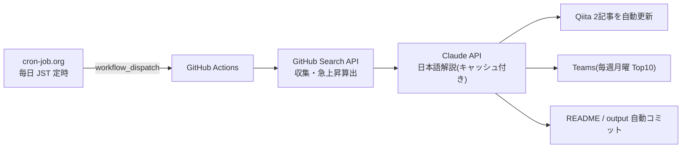

# Claude Code向けMCPツール候補ランキング

GitHub Search APIを使って、Claude Code周辺で活用候補になりそうなMCP関連リポジトリを定期収集するリポジトリです。

> 注意: この一覧は「Claude Codeでの動作」を保証するものではありません。  
> GitHub上のリポジトリ名・説明文・READMEなどに含まれる情報をもとに、MCP関連ツール候補を探すための入口として利用します。

## 仕組み(定常自律運転)

このランキングは cron-job.org → GitHub Actions → Claude API → Qiita / Teams のパイプラインで、毎日無人更新されています。



- 仕組みの詳細と**ライブ稼働ステータス**: [定常自律運転ページ](https://takanobusano.github.io/mcp-github-ranking/)
- 作り方の解説記事: [パイプライン編](https://qiita.com/4q_sano/items/913e93ee5cc2731561fc) / [cron-job.org 完全自動化編](https://qiita.com/4q_sano/items/1bc5e0669a8f0166936c)
<!-- MCP_REPOS_START -->
最終更新: **2026-11-18 08:17:13 JST**

MCP関連リポジトリに加え、Claude Code周辺で活用候補になりそうな関連ツールをGitHub Search APIで毎日自動収集してランキング化しています。

Stars / Forks の差分は、UTC基準の前日データ（2026-11-16）との差分です。
CSVには最大500件を保存し、本文では上位100件を表示しています。

> 注意: この一覧はClaude Codeでの動作を保証するものではありません。  
> MCP関連ツールまたはClaude Code関連ツール候補を探すための入口として利用してください。

# 注目MCP・関連ツール候補ランキング

## 1位 [public-apis/public-apis](https://github.com/public-apis/public-apis)

A collective list of free APIs

⭐ **499,860 Stars**（+252）　🍴 **56,059 Forks**（+49）　/　🟢 **2,768 Open Issues**　/　Python

Topics: `api` / `apis` / `dataset` / `development` / `free` / `list` / `lists` / `open-source`

## 2位 [morluto/rea](https://github.com/morluto/rea)

Reverse engineer anything with agents, from app behavior down to native binaries.

⭐ **466,224 Stars**（+2,169）　🍴 **114,080 Forks**（+509）　/　🟢 **1,537 Open Issues**　/　TypeScript

Topics: `agent-skills` / `ai` / `android` / `claude-code` / `cli` / `cpp` / `dsh-plugin` / `html`

## 3位 [openclaw/openclaw](https://github.com/openclaw/openclaw)

The AI that really does things. Any OS. Any Platform. The lobster way. 🦞

⭐ **394,686 Stars**（+85）　🍴 **82,924 Forks**（+16）　/　🟢 **8,260 Open Issues**　/　TypeScript

Topics: `ai` / `assistant` / `crustacean` / `molty` / `openclaw` / `own-your-data` / `personal`

## 4位 [mattpocock/skills](https://github.com/mattpocock/skills)

Skills for Real Engineers. Straight from my .agents directory.

⭐ **326,730 Stars**（+794）　🍴 **27,446 Forks**（+95）　/　🟢 **251 Open Issues**　/　Shell

Topics: `topicなし`

## 5位 [obra/superpowers](https://github.com/obra/superpowers)

An agentic skills framework & software development methodology that works.

⭐ **319,300 Stars**（+626）　🍴 **28,473 Forks**（+80）　/　🟢 **359 Open Issues**　/　Shell

Topics: `ai` / `brainstorming` / `coding` / `obra` / `sdlc` / `skills` / `subagent-driven-development` / `superpowers`

## 6位 [affaan-m/ECC](https://github.com/affaan-m/ECC)

The agent harness performance optimization system. Skills, instincts, memory, security, and research-first development for Claude Code, Codex, Opencode, Cursor and beyond.

⭐ **305,460 Stars**（+860）　🍴 **44,979 Forks**（+119）　/　🟢 **153 Open Issues**　/　JavaScript

Topics: `ai-agents` / `anthropic` / `claude` / `claude-code` / `developer-tools` / `llm` / `mcp` / `productivity`

## 7位 [NousResearch/hermes-agent](https://github.com/NousResearch/hermes-agent)

The agent that grows with you

⭐ **264,206 Stars**（+300）　🍴 **59,612 Forks**（+95）　/　🟢 **53,524 Open Issues**　/　Python

Topics: `ai` / `ai-agent` / `ai-agents` / `anthropic` / `chatgpt` / `claude` / `claude-code` / `codex`

## 8位 [multica-ai/andrej-karpathy-skills](https://github.com/multica-ai/andrej-karpathy-skills)

A single CLAUDE.md file to improve Claude Code behavior, derived from Andrej Karpathy's observations on LLM coding pitfalls.

⭐ **234,002 Stars**（+276）　🍴 **23,274 Forks**（+28）　/　🟢 **138 Open Issues**　/　不明

Topics: `topicなし`

## 9位 [firecrawl/firecrawl](https://github.com/firecrawl/firecrawl)

Knowledge infrastructure to make your agents smarter. Search, scrape and 550+ data providers through one API.

⭐ **202,627 Stars**（+281）　🍴 **10,608 Forks**（+5）　/　🟢 **814 Open Issues**　/　TypeScript

Topics: `ai` / `ai-agents` / `ai-crawler` / `ai-scraping` / `ai-search` / `crawler` / `data-extraction` / `html-to-markdown`

## 10位 [anthropics/skills](https://github.com/anthropics/skills)

Public repository for Agent Skills

⭐ **196,704 Stars**（+690）　🍴 **23,063 Forks**（+54）　/　🟢 **1,550 Open Issues**　/　Python

Topics: `agent-skills`

## 11位 [ultraworkers/claw-code](https://github.com/ultraworkers/claw-code)

An agent-managed museum exhibit, built in Rust with Gajae-Code / LazyCodex — developed and maintained with no human intervention.

⭐ **194,767 Stars**（+7）　🍴 **107,246 Forks**（-19）　/　🟢 **10 Open Issues**　/　Rust

Topics: `topicなし`

## 12位 [DietrichGebert/ponytail](https://github.com/DietrichGebert/ponytail)

Makes your AI agent think like the laziest senior dev in the room. The best code is the code you never wrote.

⭐ **192,999 Stars**（+857）　🍴 **10,837 Forks**（+56）　/　🟢 **255 Open Issues**　/　JavaScript

Topics: `agent-skills` / `ai-agents` / `claude` / `claude-code` / `claude-code-plugin` / `cursor-rules` / `developer-tools` / `llm`

## 13位 [Significant-Gravitas/AutoGPT](https://github.com/Significant-Gravitas/AutoGPT)

AutoGPT is the vision of accessible AI for everyone, to use and to build on. Our mission is to provide the tools, so that you can focus on what matters.

⭐ **188,078 Stars**（+16）　🍴 **45,866 Forks**（+12）　/　🟢 **684 Open Issues**　/　Python

Topics: `agentic-ai` / `agents` / `ai` / `artificial-intelligence` / `autonomous-agents` / `claude` / `gpt` / `llama-api`

## 14位 [ollama/ollama](https://github.com/ollama/ollama)

Get up and running with Kimi, GLM, MiniMax, DeepSeek, gpt-oss, Qwen, Gemma and other models.

⭐ **187,428 Stars**（+168）　🍴 **19,124 Forks**（+10）　/　🟢 **4,673 Open Issues**　/　Go

Topics: `deepseek` / `gemma` / `glm` / `go` / `golang` / `gpt-oss` / `llama` / `llm`

## 15位 [msitarzewski/agency-agents](https://github.com/msitarzewski/agency-agents)

A complete AI agency at your fingertips - From frontend wizards to Reddit community ninjas, from whimsy injectors to reality checkers. Each agent is a specialized expert with personality, processes, and proven deliverables.

⭐ **169,005 Stars**（+214）　🍴 **27,447 Forks**（+35）　/　🟢 **256 Open Issues**　/　Shell

Topics: `topicなし`

## 16位 [langgenius/dify](https://github.com/langgenius/dify)

Build Agentic workflows, RAG pipelines, with rich AI model and tool support on one collaborative workspace. Deploy on cloud, VPC, or self-hosted, so teams move from prototype to production without rebuilding the stack.

⭐ **161,375 Stars**（+86）　🍴 **25,517 Forks**（±0）　/　🟢 **1,432 Open Issues**　/　Python

Topics: `agent` / `agentic-ai` / `agentic-framework` / `agentic-workflow` / `ai` / `automation` / `claude` / `deepseek`

## 17位 [langflow-ai/langflow](https://github.com/langflow-ai/langflow)

Langflow is a powerful tool for building and deploying AI-powered agents and workflows.

⭐ **156,723 Stars**（+11）　🍴 **10,426 Forks**（+4）　/　🟢 **1,334 Open Issues**　/　Python

Topics: `agents` / `chatgpt` / `generative-ai` / `large-language-models` / `multiagent` / `react-flow`

## 18位 [anthropics/claude-code](https://github.com/anthropics/claude-code)

Claude Code is an agentic coding tool that lives in your terminal, understands your codebase, and helps you code faster by executing routine tasks, explaining complex code, and handling git workflows - all through natural language commands.

⭐ **156,034 Stars**（+118）　🍴 **25,026 Forks**（+6）　/　🟢 **17,067 Open Issues**　/　TypeScript

Topics: `topicなし`

## 19位 [farion1231/cc-switch](https://github.com/farion1231/cc-switch)

A cross-platform desktop All-in-One assistant for Claude Code, Codex, OpenCode,DeepSeek Harness and more. Only official website: ccswitch.io

⭐ **155,204 Stars**（+292）　🍴 **10,159 Forks**（+10）　/　🟢 **883 Open Issues**　/　Rust

Topics: `ai-tools` / `claude-code` / `codex` / `deepseek-harness` / `desktop-app` / `grok` / `grokbuild` / `hermes`

## 20位 [nextlevelbuilder/ui-ux-pro-max-skill](https://github.com/nextlevelbuilder/ui-ux-pro-max-skill)

An AI skill that provides design intelligence for building professional UI/UX across multiple platforms.

⭐ **150,878 Stars**（+465）　🍴 **15,947 Forks**（+45）　/　🟢 **83 Open Issues**　/　Python

Topics: `ai-skills` / `antigravity` / `claude` / `claude-code` / `codex` / `command-line` / `copilot` / `cursor-ai`

## 21位 [Graphify-Labs/graphify](https://github.com/Graphify-Labs/graphify)

Turn any codebase, with its docs, SQL schemas, configs, and PDFs, into a queryable knowledge graph. A /graphify skill for Claude Code, Cursor, Codex, and Gemini CLI: local deterministic AST parsing, every edge explained, no vector store.

⭐ **149,638 Stars**（+613）　🍴 **14,378 Forks**（+63）　/　🟢 **1,659 Open Issues**　/　Python

Topics: `ai-agents` / `antigravity` / `ast` / `claude-code` / `code-analysis` / `code-search` / `codex` / `cursor`

## 22位 [x1xhlol/system-prompts-and-models-of-ai-tools](https://github.com/x1xhlol/system-prompts-and-models-of-ai-tools)

FULL Augment Code, Claude Code, Cluely, CodeBuddy, Comet, Cursor, Devin AI, Junie, Kiro, Leap.new, Lovable, Manus, NotionAI, Orchids.app, Perplexity, Poke, Qoder, Replit, Same.dev, Trae, Traycer AI, VSCode Agent, Warp.dev, Windsurf, Xcode, Z.ai Code, Dia & v0. (And other Open Sourced) System Prompts, Internal Tools & AI Models

⭐ **144,734 Stars**（+18）　🍴 **34,677 Forks**（-7）　/　🟢 **162 Open Issues**　/　不明

Topics: `ai` / `bolt` / `cluely` / `copilot` / `cursor` / `cursorai` / `devin` / `github-copilot`

## 23位 [harry0703/MoneyPrinterTurbo](https://github.com/harry0703/MoneyPrinterTurbo)

利用 AI 大模型和自动化工作流，根据主题或关键词一键生成高清短视频。Generate HD short videos from a topic or keyword with an automated AI workflow.

⭐ **144,219 Stars**（+200）　🍴 **23,137 Forks**（+57）　/　🟢 **85 Open Issues**　/　Python

Topics: `ai-video-generator` / `content-creation` / `ffmpeg` / `instagram-reels` / `llm` / `python` / `short-video` / `subtitles`

## 24位 [garrytan/gstack](https://github.com/garrytan/gstack)

Use Garry Tan's exact Claude Code setup: 23 opinionated tools that serve as CEO, Designer, Eng Manager, Release Manager, Doc Engineer, and QA

⭐ **141,921 Stars**（+115）　🍴 **20,958 Forks**（+17）　/　🟢 **107 Open Issues**　/　TypeScript

Topics: `topicなし`

## 25位 [stablyai/orca](https://github.com/stablyai/orca)

Orca lets you run a fleet of coding agents (e.g. Claude Code, Codex) with your own subscription. Available on desktop, mobile and remote runtime.

⭐ **127,805 Stars**（+1,064）　🍴 **8,105 Forks**（+64）　/　🟢 **8,469 Open Issues**　/　TypeScript

Topics: `agent-ide` / `ai-agents` / `automation` / `bot` / `claude-code` / `codex` / `ghostty` / `grok-bot`

## 26位 [TauricResearch/TradingAgents](https://github.com/TauricResearch/TradingAgents)

TradingAgents: Multi-Agents LLM Financial Trading Framework

⭐ **122,965 Stars**（+114）　🍴 **23,574 Forks**（+20）　/　🟢 **152 Open Issues**　/　Python

Topics: `agent` / `finance` / `llm` / `multiagent` / `trading`

## 27位 [browser-use/browser-use](https://github.com/browser-use/browser-use)

Open-source Python library for AI browser agents, plus Browser Use Cloud: stealth browsers and a hosted agent API.

⭐ **121,324 Stars**（+93）　🍴 **13,563 Forks**（+9）　/　🟢 **597 Open Issues**　/　Python

Topics: `ai-agents` / `ai-tools` / `browser-agent` / `browser-automation` / `browser-use` / `cdp` / `cloud-browser` / `computer-use`

## 28位 [JuliusBrussee/caveman](https://github.com/JuliusBrussee/caveman)

why use many token when few token do trick. Skill + local proxy for coding agents: shorter answers, smaller tool output, every original recoverable.

⭐ **121,058 Stars**（+308）　🍴 **7,069 Forks**（+17）　/　🟢 **98 Open Issues**　/　Go

Topics: `ai` / `anthropic` / `caveman` / `claude` / `claude-code` / `llm` / `meme` / `prompt-engineering`

## 29位 [addyosmani/agent-skills](https://github.com/addyosmani/agent-skills)

Production-grade engineering skills for AI coding agents.

⭐ **118,649 Stars**（+332）　🍴 **12,376 Forks**（+23）　/　🟢 **132 Open Issues**　/　JavaScript

Topics: `agent-skills` / `antigravity` / `claude-code` / `codex` / `cursor` / `skills`

## 30位 [thedotmack/claude-mem](https://github.com/thedotmack/claude-mem)

Persistent Context Across Sessions for Every Agent –  Captures everything your agent does during sessions, compresses it with AI, and injects relevant context back into future sessions. Works with Claude Code, OpenClaw, Codex, Gemini, Hermes, Copilot, OpenCode + More

⭐ **117,985 Stars**（+303）　🍴 **10,251 Forks**（+30）　/　🟢 **73 Open Issues**　/　TypeScript

Topics: `ai` / `ai-agents` / `ai-memory` / `anthropic` / `artificial-intelligence` / `chromadb` / `claude` / `claude-agent-sdk`

## 31位 [Leonxlnx/taste-skill](https://github.com/Leonxlnx/taste-skill)

Agent skills that give coding agents taste: art direction, reference images and a browser check instead of generic AI pages

⭐ **117,708 Stars**（+829）　🍴 **7,876 Forks**（+48）　/　🟢 **11 Open Issues**　/　JavaScript

Topics: `agent-skills` / `ai-agents` / `anti-slop` / `claude-code` / `codex` / `cursor` / `design-system` / `frontend`

## 32位 [paperclipai/paperclip](https://github.com/paperclipai/paperclip)

The open-source app everyone uses to manage agents at work

⭐ **114,565 Stars**（+213）　🍴 **19,001 Forks**（+41）　/　🟢 **6,840 Open Issues**　/　TypeScript

Topics: `acpx` / `agent-orchestration` / `agent-skills` / `agentic-ai` / `ai-agents` / `ai-engineering` / `ai-governance` / `ai-tools`

## 33位 [debpalash/VoiceStudio](https://github.com/debpalash/VoiceStudio)

VoiceStudio is the open-source, fully-local ElevenLabs alternative — voice cloning, voice design, video dubbing, dictation, transcription & audiobook creation in 646 languages.

⭐ **112,795 Stars**（+892）　🍴 **12,525 Forks**（+107）　/　🟢 **43 Open Issues**　/　Python

Topics: `ai` / `audiobook` / `cuda` / `dubbing` / `elevenlabs-alternative` / `huggingface` / `local-first` / `mlx`

## 34位 [Panniantong/Agent-Reach](https://github.com/Panniantong/Agent-Reach)

Give your AI agent eyes to see the entire internet. Read & search Twitter, Reddit, YouTube, GitHub, Bilibili, XiaoHongShu — one CLI, zero API fees.

⭐ **112,775 Stars**（+445）　🍴 **10,107 Forks**（+39）　/　🟢 **133 Open Issues**　/　Python

Topics: `agent-infrastructure` / `ai-agent` / `ai-search` / `automation` / `bilibili` / `claude-code` / `cli` / `cursor`

## 35位 [pbakaus/impeccable](https://github.com/pbakaus/impeccable)

The design vocabulary for your coding agent. Steer with polish and bolder, review with critique and audit, catch AI slop before it ships.

⭐ **112,161 Stars**（+804）　🍴 **6,690 Forks**（+35）　/　🟢 **53 Open Issues**　/　Rust

Topics: `agent-skills` / `ai` / `anti-slop` / `design` / `slop`

## 36位 [google-gemini/gemini-cli](https://github.com/google-gemini/gemini-cli)

An open-source AI agent that brings the power of Gemini directly into your terminal.

⭐ **108,902 Stars**（+32）　🍴 **14,959 Forks**（+5）　/　🟢 **742 Open Issues**　/　TypeScript

Topics: `ai` / `ai-agents` / `cli` / `gemini` / `gemini-api` / `mcp-client` / `mcp-server`

## 37位 [nexu-io/open-design](https://github.com/nexu-io/open-design)

The 1st Collaborative AI Design Agent Workspace. Local-first and open source. Create motion, prototypes, websites, apps, dashboards, presentations, images, and videos with your team and AI agents. Share work, exchange feedback, and iterate together in one workspace.

⭐ **108,097 Stars**（+161）　🍴 **12,273 Forks**（+9）　/　🟢 **1,413 Open Issues**　/　TypeScript

Topics: `agent-skills` / `ai-design` / `byok` / `claude-code-for-design` / `claude-design` / `codex-design` / `cursor-design` / `deepseek`

## 38位 [ruvnet/RuView](https://github.com/ruvnet/RuView)

π RuView turns commodity WiFi signals into real-time spatial intelligence, vital sign monitoring, and presence detection — all without a single pixel of video.

⭐ **104,534 Stars**（+78）　🍴 **13,590 Forks**（+10）　/　🟢 **594 Open Issues**　/　Rust

Topics: `claude` / `claude-code` / `esp32` / `firmware` / `home-assistant` / `home-automation` / `iot` / `mcp`

## 39位 [D4Vinci/Scrapling](https://github.com/D4Vinci/Scrapling)

🕷️ The BEST Web Scraping framework that handles everything from a single request to a full-scale crawl! Don't be shy, join here:  and follow here for daily tips and tricks:

⭐ **103,936 Stars**（+302）　🍴 **10,844 Forks**（+30）　/　🟢 **21 Open Issues**　/　Python

Topics: `ai` / `ai-scraping` / `automation` / `crawler` / `crawling` / `crawling-python` / `data` / `data-extraction`

## 40位 [microsoft/playwright](https://github.com/microsoft/playwright)

Playwright is a framework for Web Testing and Automation. It allows testing Chromium, Firefox and WebKit with a single API.

⭐ **100,437 Stars**（+89）　🍴 **6,910 Forks**（+12）　/　🟢 **71 Open Issues**　/　TypeScript

Topics: `automation` / `chrome` / `chromium` / `e2e-testing` / `electron` / `end-to-end-testing` / `firefox` / `javascript`

## 41位 [OpenCut-app/OpenCut](https://github.com/OpenCut-app/OpenCut)

The open-source CapCut alternative

⭐ **98,766 Stars**（+76）　🍴 **9,888 Forks**（+8）　/　🟢 **389 Open Issues**　/　TypeScript

Topics: `editor` / `oss` / `videoeditor`

## 42位 [tt-a1i/archify](https://github.com/tt-a1i/archify)

Turn any idea, plan, or codebase into a beautiful interactive diagram. An agent skill for Claude Code, Codex, and more.

⭐ **97,474 Stars**（+316）　🍴 **6,655 Forks**（+19）　/　🟢 **369 Open Issues**　/　JavaScript

Topics: `agent-skills` / `ai-agents` / `architecture-diagram` / `claude-code` / `claude-skills` / `codex` / `coding-agents` / `deepseek-harness`

## 43位 [puppeteer/puppeteer](https://github.com/puppeteer/puppeteer)

JavaScript API for Chrome and Firefox

⭐ **95,855 Stars**（+7）　🍴 **9,608 Forks**（+2）　/　🟢 **198 Open Issues**　/　TypeScript

Topics: `automation` / `chrome` / `chromium` / `developer-tools` / `firefox` / `headless-chrome` / `node-module` / `testing`

## 44位 [OpenHands/OpenHands](https://github.com/OpenHands/OpenHands)

🙌 OpenHands: AI-Driven Development

⭐ **93,671 Stars**（+65）　🍴 **12,544 Forks**（+8）　/　🟢 **1,195 Open Issues**　/　TypeScript

Topics: `agent` / `artificial-intelligence` / `chatgpt` / `claude-ai` / `cli` / `developer-tools` / `gpt` / `llm`

## 45位 [Egonex-AI/Understand-Anything](https://github.com/Egonex-AI/Understand-Anything)

Graphs that teach > graphs that impress. Turn any code into an interactive knowledge graph you can explore, search, and ask questions about. Works with Claude Code, Codex, Cursor, Copilot, Gemini CLI, and more.

⭐ **93,027 Stars**（+168）　🍴 **7,932 Forks**（+14）　/　🟢 **372 Open Issues**　/　TypeScript

Topics: `antigravity-skills` / `business-knowledge` / `claude-code` / `claude-skills` / `codebase-analysis` / `codex` / `codex-skills` / `developer-tools-ai-agent`

## 46位 [modelcontextprotocol/servers](https://github.com/modelcontextprotocol/servers)

Model Context Protocol Reference Servers

⭐ **92,073 Stars**（+21）　🍴 **11,975 Forks**（+5）　/　🟢 **23 Open Issues**　/　TypeScript

Topics: `topicなし`

## 47位 [koala73/worldmonitor](https://github.com/koala73/worldmonitor)

Real-time global intelligence dashboard. AI-powered news aggregation, geopolitical monitoring, and infrastructure tracking in a unified situational awareness interface

⭐ **90,847 Stars**（+74）　🍴 **14,101 Forks**（+9）　/　🟢 **343 Open Issues**　/　TypeScript

Topics: `agent` / `ai` / `dashboard` / `gemini-cli-extension` / `geopolitics` / `mcp` / `mcp-server` / `monitoring`

## 48位 [ChatGPTNextWeb/NextChat](https://github.com/ChatGPTNextWeb/NextChat)

✨ Zero-config AI chat assistant. No API key needed — sign up and instantly chat with GPT-5, Claude 4, Gemini 2.5, DeepSeek & 100+ top models. Pay-as-you-go save...

⭐ **88,970 Stars**（+1）　🍴 **58,494 Forks**（-13）　/　🟢 **867 Open Issues**　/　TypeScript

Topics: `calclaude` / `claude` / `cross-platform` / `desktop` / `fe` / `gemini` / `gemini-pro` / `gemini-server`

## 49位 [cheaper-inference/OmniRoute](https://github.com/cheaper-inference/OmniRoute)

Never stop coding. Free MIT AI gateway: one endpoint, 375 providers (150+ free), 1,400+ models Kimi, Claude, GPT, Gemini, GLM, DeepSeek, MiniMax. Works with Claude Code, Codex, Cursor, OpenCode, Cline & Copilot. Quota-aware auto-fallback, RTK+Caveman compression saves 15-95% tokens, MCP/A2A, Desktop/PWA. Built by 900+ contributors

⭐ **88,404 Stars**（+299）　🍴 **13,596 Forks**（+75）　/　🟢 **692 Open Issues**　/　TypeScript

Topics: `a2a` / `ai-agents` / `ai-gateway` / `anthropic` / `claude` / `claude-code` / `cline` / `codex`

## 50位 [unclecode/crawl4ai](https://github.com/unclecode/crawl4ai)

Official Crawl4AI Cloud: a hosted web scraping, extraction, and search API for AI agents. Free API key, 1,000 credits a month, no card. Fully open source: this repo is the Apache-2.0 crawler that powers it, and you can self-host it.

⭐ **87,482 Stars**（+35）　🍴 **9,126 Forks**（+4）　/　🟢 **348 Open Issues**　/　Python

Topics: `ai` / `ai-agents` / `crawl4ai-cloud` / `crawler` / `data-extraction` / `llm` / `markdown` / `mcp`

## 51位 [rtk-ai/rtk](https://github.com/rtk-ai/rtk)

CLI proxy that reduces LLM token consumption by 60-90% on common dev commands. Single Rust binary, zero dependencies

⭐ **86,937 Stars**（+151）　🍴 **5,584 Forks**（+15）　/　🟢 **1,670 Open Issues**　/　Rust

Topics: `agentic-coding` / `ai-coding` / `anthropic` / `claude-code` / `cli` / `command-line-tool` / `cost-reduction` / `developer-tools`

## 52位 [heygen-com/hyperframes](https://github.com/heygen-com/hyperframes)

Write HTML. Render video. Built for agents.

⭐ **85,961 Stars**（+738）　🍴 **7,965 Forks**（+72）　/　🟢 **289 Open Issues**　/　TypeScript

Topics: `ai` / `ai-agents` / `animation` / `claude-code` / `ffmpeg` / `framework` / `gsap` / `html`

## 53位 [lobehub/lobehub](https://github.com/lobehub/lobehub)

🤯 LobeHub - Super-Agents on Your Team. Add super-agents to the chats your team already uses.They take on work by themselves and get better every week.

⭐ **85,711 Stars**（+68）　🍴 **16,341 Forks**（-4）　/　🟢 **1,408 Open Issues**　/　TypeScript

Topics: `agent` / `agent-collaboration` / `agent-harness` / `loop-engineering` / `mcp` / `personal-assistant` / `proactive-agent` / `skills`

## 54位 [laravel/laravel](https://github.com/laravel/laravel)

Laravel is a web application framework with expressive, elegant syntax. We’ve already laid the foundation for your next big idea — freeing you to create without sweating the small things.

⭐ **85,506 Stars**（+132）　🍴 **25,577 Forks**（+62）　/　🟢 **31 Open Issues**　/　Blade

Topics: `framework` / `laravel` / `php`

## 55位 [bytedance/deer-flow](https://github.com/bytedance/deer-flow)

An open-source long-horizon SuperAgent harness that researches, codes, and creates. With the help of sandboxes, memories, tools, skill, subagents and message gateway, it handles different levels of tasks that could take minutes to hours.

⭐ **85,449 Stars**（+44）　🍴 **12,049 Forks**（+7）　/　🟢 **1,126 Open Issues**　/　Python

Topics: `agent` / `agentic` / `agentic-framework` / `agentic-workflow` / `ai` / `ai-agents` / `deep-research` / `harness`

## 56位 [ruvnet/ruflo](https://github.com/ruvnet/ruflo)

🌊 The original agent harness. Deploy intelligent multi-player swarms, coordinate autonomous workflows, and build conversational AI systems. Features adaptive me...

⭐ **81,963 Stars**（+89）　🍴 **9,672 Forks**（+17）　/　🟢 **587 Open Issues**　/　TypeScript

Topics: `agent-memory` / `agent-orchestration` / `agentic-ai` / `agentic-workflow` / `ai-agents` / `autonomous-agents` / `claude` / `claude-code`

## 57位 [netdata/netdata](https://github.com/netdata/netdata)

Full-stack observability · Metrics · Logs · Traces · Flows · Topology · Infrastructure · APM · NPM · DBM · RUM · Synthetics · Cloud · AI · OpenTelemetry · SNMP · NetFlow/IPFIX/sFlow · IPMI · Redfish · 800+ integrations

⭐ **81,453 Stars**（前日なし）　🍴 **6,738 Forks**（前日なし）　/　🟢 **457 Open Issues**　/　Go

Topics: `ai` / `alerting` / `cncf` / `data-visualization` / `database` / `devops` / `docker` / `grafana`

## 58位 [OpenMontageInc/OpenMontage](https://github.com/OpenMontageInc/OpenMontage)

World's first open-source, agentic video production system. 12 production pipelines, 100+ tools, 700+ agent skill and production-knowledge files. Turn your AI coding assistant into a full video production studio.

⭐ **81,342 Stars**（+350）　🍴 **11,039 Forks**（+76）　/　🟢 **345 Open Issues**　/　Python

Topics: `agent` / `agentic-ai` / `ai` / `claude` / `copilot` / `cursor` / `elevenlabs` / `ffmpeg`

## 59位 [abi/screenshot-to-code](https://github.com/abi/screenshot-to-code)

Drop in a screenshot and convert it to clean code (HTML/Tailwind/React/Vue)

⭐ **81,274 Stars**（+22）　🍴 **9,956 Forks**（+3）　/　🟢 **150 Open Issues**　/　Python

Topics: `topicなし`

## 60位 [shareAI-lab/learn-claude-code](https://github.com/shareAI-lab/learn-claude-code)

Bash is all you need -  A nano claude code–like 「agent harness」, built from 0 to 1

⭐ **80,549 Stars**（+61）　🍴 **12,884 Forks**（+12）　/　🟢 **56 Open Issues**　/　Python

Topics: `agent` / `agent-development` / `ai-agent` / `claude` / `claude-code` / `educational` / `llm` / `python`

## 61位 [storytold/photocraft](https://github.com/storytold/photocraft)

PhotoCraft: An open-source photo editor written from scratch in pure Rust

⭐ **80,088 Stars**（+272）　🍴 **14,132 Forks**（+39）　/　🟢 **5,606 Open Issues**　/　Rust

Topics: `art` / `image-editing` / `image-editing-software` / `image-editor` / `images` / `photo-editing` / `rust`

## 62位 [headroomlabs-ai/headroom](https://github.com/headroomlabs-ai/headroom)

Compress tool outputs, logs, files, and RAG chunks before they reach the LLM. 20% fewer tokens for coding agents, 60-95% fewer tokens for JSON, same answers. Library, proxy, MCP server.

⭐ **79,918 Stars**（+75）　🍴 **6,266 Forks**（+8）　/　🟢 **277 Open Issues**　/　Python

Topics: `agent` / `ai` / `anthropic` / `claude-code` / `compression` / `context-engineering` / `context-window` / `cursor`

## 63位 [unslothai/unsloth](https://github.com/unslothai/unsloth)

Local UI to run and train LLMs and diffusion models. Supports GGUF, MLX, Qwen3.8, DeepSeek-V4.1, MiniMax-H3, Gemma 4, FLUX and more.

⭐ **79,699 Stars**（+80）　🍴 **7,442 Forks**（+9）　/　🟢 **489 Open Issues**　/　Python

Topics: `agent` / `ai` / `chatgpt` / `deepseek` / `fine-tuning` / `gemma` / `image-generation` / `llama`

## 64位 [rohitg00/ai-engineering-from-scratch](https://github.com/rohitg00/ai-engineering-from-scratch)

Learn AI Engineering! Learn it. Build it. Ship it for others.

⭐ **79,302 Stars**（+146）　🍴 **14,153 Forks**（+31）　/　🟢 **68 Open Issues**　/　Python

Topics: `agents` / `ai` / `ai-agents` / `ai-engineering` / `computer-vision` / `course` / `deep-learning` / `dsh`

## 65位 [Ebony-Vinyl/dsh-our-free-model](https://github.com/Ebony-Vinyl/dsh-our-free-model)

在 dsh 里装上这个插件即可，无需登录、注册或填 API Key，就能使用包括 DeepSeek V4.1 Flash、Kimi K3 在内的前沿模型——完全免费，不限量。 All you do is install this plugin in dsh: no login, no sign-up, no API k...

⭐ **78,509 Stars**（+1,240）　🍴 **2,213 Forks**（+32）　/　🟢 **205 Open Issues**　/　JavaScript

Topics: `ai-agents` / `deepseek` / `deepseek-harness` / `developer-tools` / `dsh` / `dsh-plugin` / `free-model` / `llm`

## 66位 [hugohe3/ppt-master](https://github.com/hugohe3/ppt-master)

AI turns documents or topics into real, native PowerPoint decks—with native shapes, transitions and animations, data-backed charts and tables on demand, audio narration from speaker notes, and support for your own .pptx templates. · by Hugo He

⭐ **77,927 Stars**（+403）　🍴 **6,089 Forks**（+26）　/　🟢 **1 Open Issues**　/　Python

Topics: `ai-agent` / `aippt` / `office` / `powerpoint` / `powerpoint-generation` / `ppt` / `pptx` / `presentation`

## 67位 [colbymchenry/codegraph](https://github.com/colbymchenry/codegraph)

Pre-indexed code knowledge graph, auto syncs on code changes, for Claude Code, Codex, Gemini, Cursor, OpenCode, AntiGravity, Kiro, CoPilot, and Hermes Agent — fewer tokens, fewer tool calls, 100% local

⭐ **77,875 Stars**（+127）　🍴 **5,197 Forks**（+8）　/　🟢 **343 Open Issues**　/　TypeScript

Topics: `topicなし`

## 68位 [nestjs/nest](https://github.com/nestjs/nest)

A progressive TypeScript framework for Node.js backends: from a small API in one file to efficient, scalable, enterprise-grade systems 🚀

⭐ **77,277 Stars**（+162）　🍴 **8,807 Forks**（+79）　/　🟢 **43 Open Issues**　/　TypeScript

Topics: `framework` / `hacktoberfest` / `javascript` / `javascript-framework` / `microservices` / `nest` / `nestjs` / `node`

## 69位 [usestrix/strix](https://github.com/usestrix/strix)

Open-source AI penetration testing tool to find and fix your app’s vulnerabilities.

⭐ **76,333 Stars**（+304）　🍴 **8,664 Forks**（+64）　/　🟢 **606 Open Issues**　/　Python

Topics: `agents` / `ai-hacking` / `ai-penetration-testing` / `ai-pentesting` / `ai-security` / `artificial-intelligence` / `bug-bounty` / `code-quality`

## 70位 [eternity4719/HowToLiveBetter](https://github.com/eternity4719/HowToLiveBetter)

高性价比人生指南: 长寿防病、急救、省钱理财、法律红线、失业与工伤、医保社保、恋爱婚育、怀孕育儿、创业与做平台合规、出国与技能。每条写明成本、收益、证据等级和原始出处，只引期刊论文与官方文件。

⭐ **76,316 Stars**（+205）　🍴 **6,779 Forks**（+19）　/　🟢 **16 Open Issues**　/　HTML

Topics: `topicなし`

## 71位 [openbq-org/OpenBB](https://github.com/openbq-org/OpenBB)

Open Data Platform for analysts, quants and AI agents.

⭐ **75,496 Stars**（+28）　🍴 **7,900 Forks**（+2）　/　🟢 **114 Open Issues**　/　Python

Topics: `ai` / `crypto` / `derivatives` / `economics` / `equity` / `finance` / `fixed-income` / `machine-learning`

## 72位 [Eugeny/tabby](https://github.com/Eugeny/tabby)

A terminal for a more modern age

⭐ **75,472 Stars**（+15）　🍴 **4,356 Forks**（+6）　/　🟢 **2,902 Open Issues**　/　TypeScript

Topics: `serial` / `ssh-client` / `telnet-client` / `terminal` / `terminal-emulators`

## 73位 [tw93/Mole](https://github.com/tw93/Mole)

🐹 Open-source Mac and PC cleaner. Keep your machine clean, light, and running like new. Fast CLI, plus native Mac and Windows apps.

⭐ **75,401 Stars**（+101）　🍴 **2,714 Forks**（+3）　/　🟢 **7 Open Issues**　/　Shell

Topics: `analyzer` / `appcleaner` / `clean` / `cleaner` / `cleanmymac` / `command-line` / `daisydisk` / `deepseek-harness`

## 74位 [thedaviddias/Front-End-Checklist](https://github.com/thedaviddias/Front-End-Checklist)

🗂 The essential checklist for modern web development, for humans and AI agents

⭐ **74,762 Stars**（+11）　🍴 **6,781 Forks**（-2）　/　🟢 **22 Open Issues**　/　MDX

Topics: `ai-agent` / `ai-agents` / `checklist` / `css` / `front-end-developer-tool` / `front-end-development` / `frontend` / `guidelines`

## 75位 [cline/cline](https://github.com/cline/cline)

Autonomous coding agent as an SDK, IDE extension, or CLI assistant.

⭐ **71,722 Stars**（+33）　🍴 **7,939 Forks**（+3）　/　🟢 **1,792 Open Issues**　/　TypeScript

Topics: `topicなし`

## 76位 [asgeirtj/system_prompts_leaks](https://github.com/asgeirtj/system_prompts_leaks)

Leaked system prompts of ChatGPT, Claude, Gemini and more. The hidden system prompt of every popular chatbot, in full, every version since May 2025. Also Anthropic Claude Code, OpenAI Codex, Google Antigravity, xAI Grok, Meta Muse, Moonshot Kimi, Alibaba Qwen, Z.ai GLM ZCode, MiniMax, Cursor, Perplexity, DeepSeek and 30+ others. Updated daily.

⭐ **71,639 Stars**（+67）　🍴 **11,523 Forks**（+2）　/　🟢 **26 Open Issues**　/　Python

Topics: `ai` / `ai-agents` / `ai-prompts` / `anthropic` / `chatbot` / `chatgpt` / `claude` / `claude-code`

## 77位 [NanmiCoder/MediaCrawler](https://github.com/NanmiCoder/MediaCrawler)

小红书笔记 \| 评论爬虫、抖音视频 \| 评论爬虫、快手视频 \| 评论爬虫、B 站视频 ｜ 评论爬虫、微博帖子 ｜ 评论爬虫、百度贴吧帖子 ｜ 百度贴吧评论回复爬虫  \| 知乎问答文章｜评论爬虫

⭐ **71,284 Stars**（+64）　🍴 **13,456 Forks**（+5）　/　🟢 **216 Open Issues**　/　Python

Topics: `topicなし`

## 78位 [Alishahryar1/free-claude-code](https://github.com/Alishahryar1/free-claude-code)

Use Claude Code, Codex, Antigravity, VSCode, Pi, and OpenCode (and 6 other harnesses) for free (1.3B+ free tokens) from your terminal, app, IDE, or phone, and now from the browser with native browser sessions (multi-harness + multi-model) like OpenClaw (voice supported + ToS friendly)

⭐ **71,064 Stars**（+216）　🍴 **11,027 Forks**（+22）　/　🟢 **416 Open Issues**　/　Python

Topics: `topicなし`

## 79位 [code-yeongyu/oh-my-openagent](https://github.com/code-yeongyu/oh-my-openagent)

OmO: Just type "mass ulw" keyword with your prompt. Now you are the master of graph engineering.

⭐ **70,980 Stars**（+29）　🍴 **5,845 Forks**（-4）　/　🟢 **2,965 Open Issues**　/　TypeScript

Topics: `ai` / `ai-agents` / `anthropic` / `chatgpt` / `claude` / `claude-skills` / `codex` / `cursor`

## 80位 [docling-project/docling](https://github.com/docling-project/docling)

Get your documents ready for gen AI

⭐ **70,717 Stars**（+57）　🍴 **5,372 Forks**（+8）　/　🟢 **1,073 Open Issues**　/　Python

Topics: `ai` / `convert` / `document-parser` / `document-parsing` / `documents` / `docx` / `html` / `markdown`

## 81位 [blader/humanizer](https://github.com/blader/humanizer)

Agent skill that removes signs of AI-generated writing from text

⭐ **70,354 Stars**（+460）　🍴 **5,524 Forks**（+32）　/　🟢 **5 Open Issues**　/　Python

Topics: `agent-skills` / `ai-humanizer` / `ai-writing` / `chatgpt` / `claude` / `claude-code` / `codex` / `cursor`

## 82位 [shanraisshan/claude-code-best-practice](https://github.com/shanraisshan/claude-code-best-practice)

from vibe coding to agentic engineering - practice makes claude perfect

⭐ **69,168 Stars**（+53）　🍴 **6,878 Forks**（+2）　/　🟢 **27 Open Issues**　/　HTML

Topics: `agentic-ai` / `agentic-coding` / `agentic-engineering` / `agentic-workflow` / `ai` / `ai-agents` / `anthropic` / `best-practices`

## 83位 [mem0ai/mem0](https://github.com/mem0ai/mem0)

The Memory Layer for AI Agents - Drop-in memory infrastructure for AI agents and apps. Context that persists. Built for production.

⭐ **69,132 Stars**（+56）　🍴 **8,228 Forks**（+6）　/　🟢 **964 Open Issues**　/　Python

Topics: `agentic-memory` / `agentic-memory-system` / `agents` / `ai` / `ai-agents` / `chatgpt` / `genai` / `llm`

## 84位 [mvanhorn/last30days-skill](https://github.com/mvanhorn/last30days-skill)

AI agent skill that researches any topic across Reddit, X, YouTube, HN, Polymarket, and the web - then synthesizes a grounded summary

⭐ **69,003 Stars**（+911）　🍴 **6,144 Forks**（+109）　/　🟢 **21 Open Issues**　/　Python

Topics: `ai-prompts` / `ai-skill` / `bluesky` / `claude` / `claude-code` / `clawhub` / `deep-research` / `hackernews`

## 85位 [openinterpreter/openinterpreter](https://github.com/openinterpreter/openinterpreter)

A coding agent for open models like Kimi K3.1 and GLM 5.3

⭐ **68,897 Stars**（+2）　🍴 **5,950 Forks**（±0）　/　🟢 **36 Open Issues**　/　Rust

Topics: `acp` / `coding-agent` / `deepseek` / `kimi` / `python` / `qwen` / `rust`

## 86位 [cathrynlavery/diagram-design](https://github.com/cathrynlavery/diagram-design)

Editorial diagram design for Claude Code, Codex, GitHub Copilot, Cursor, Factory Droid, Qoder, and Pi. 45 diagram types. Self-contained HTML + SVG. No shadows. No Mermaid slop.

⭐ **67,890 Stars**（+253）　🍴 **4,554 Forks**（+24）　/　🟢 **39 Open Issues**　/　HTML

Topics: `agent-skills` / `claude-code` / `codex` / `data-visualization` / `diagrams` / `drawio` / `mermaid` / `svg`

## 87位 [bradtraversy/design-resources-for-developers](https://github.com/bradtraversy/design-resources-for-developers)

Curated list of design and UI resources from stock photos, web templates, CSS frameworks, UI libraries, tools and much more

⭐ **67,416 Stars**（+2）　🍴 **12,309 Forks**（-2）　/　🟢 **5 Open Issues**　/　不明

Topics: `topicなし`

## 88位 [xtekky/gpt4free](https://github.com/xtekky/gpt4free)

The official gpt4free repository \| various collection of powerful language models \| opus 4.6 gpt 5.3 kimi 2.5 deepseek v3.2 gemini 3

⭐ **67,080 Stars**（+3）　🍴 **13,455 Forks**（±0）　/　🟢 **3 Open Issues**　/　Python

Topics: `chatbot` / `chatbots` / `chatgpt` / `chatgpt-4` / `chatgpt-api` / `chatgpt-free` / `chatgpt4` / `deepseek`

## 89位 [coollabsio/coolify](https://github.com/coollabsio/coolify)

An open-source, self-hostable PaaS alternative to Vercel, Heroku & Netlify that lets you easily deploy static sites, databases, full-stack applications and 360+ one-click services on your own servers.

⭐ **66,187 Stars**（+44）　🍴 **6,004 Forks**（+1）　/　🟢 **102 Open Issues**　/　PHP

Topics: `coolify` / `databases` / `deployment` / `docker` / `docker-compose` / `inertiajs` / `laravel` / `mariadb`

## 90位 [warpdotdev/warp](https://github.com/warpdotdev/warp)

Warp is an agentic development environment, born out of the terminal.

⭐ **66,042 Stars**（+6）　🍴 **5,793 Forks**（+5）　/　🟢 **5,568 Open Issues**　/　Rust

Topics: `bash` / `linux` / `macos` / `rust` / `shell` / `terminal` / `wasm` / `zsh`

## 91位 [bilawalsidhu/gods-eye-view](https://github.com/bilawalsidhu/gods-eye-view)

God's Eye View: a spy satellite simulator in your browser, except the data is real. Live open source spatial intelligence on a photorealistic 3D globe. Official site: godseyeview.ai

⭐ **65,547 Stars**（+249）　🍴 **12,957 Forks**（+55）　/　🟢 **443 Open Issues**　/　JavaScript

Topics: `3d-globe` / `cesium` / `flight-tracking` / `geospatial` / `geospatial-intelligence` / `gis` / `osint` / `photogrammetry`

## 92位 [upstash/context7](https://github.com/upstash/context7)

Context7 Platform -- Up-to-date docs for AI agents

⭐ **65,023 Stars**（+88）　🍴 **3,267 Forks**（+6）　/　🟢 **49 Open Issues**　/　TypeScript

Topics: `llm` / `mcp` / `mcp-server` / `vibe-coding`

## 93位 [usememos/memos](https://github.com/usememos/memos)

Memos is an open-source, self-hosted note-taking app that brings your everyday thoughts together in a personal timeline. Your data stays yours, and you choose what to keep private or share.

⭐ **64,525 Stars**（+16）　🍴 **4,973 Forks**（+7）　/　🟢 **64 Open Issues**　/　Go

Topics: `docker` / `foss` / `go` / `markdown` / `memo` / `microblog` / `note-taking` / `notes`

## 94位 [pingdotgg/t3code](https://github.com/pingdotgg/t3code)

The best way to control Claude Code, Codex and more from any computer or phone

⭐ **64,080 Stars**（+1,328）　🍴 **11,294 Forks**（+144）　/　🟢 **3,495 Open Issues**　/　TypeScript

Topics: `agent-orchestration` / `agents` / `ai` / `chatgpt` / `claude` / `claude-code` / `code` / `vibe-coding`

## 95位 [tw93/Pake](https://github.com/tw93/Pake)

Turn any website into a lightweight desktop app with one command, on macOS, Windows and Linux.

⭐ **63,751 Stars**（+54）　🍴 **13,037 Forks**（+10）　/　🟢 **0 Open Issues**　/　Rust

Topics: `chatgpt` / `claude` / `cli` / `desktop` / `desktop-app` / `electron-alternative` / `gemini` / `linux`

## 96位 [sansan0/TrendRadar](https://github.com/sansan0/TrendRadar)

⭐AI-driven public opinion & trend monitor with multi-platform aggregation, RSS, and smart alerts.🎯 告别信息过载，你的 AI 舆情监控助手与热点筛选工具！聚合多平台热点 +  RSS 订阅，支持关键词精准筛选。AI 智能筛...

⭐ **63,701 Stars**（+34）　🍴 **24,921 Forks**（+3）　/　🟢 **42 Open Issues**　/　Python

Topics: `ai` / `bark` / `data-analysis` / `docker` / `hot-news` / `llm` / `mail` / `mcp`

## 97位 [BerriAI/litellm](https://github.com/BerriAI/litellm)

The fastest, litest AI Gateway. Rust core with Python SDK. Call 100+ LLM APIs in OpenAI (or native) format with cost tracking, guardrails, load balancing, and logging [Bedrock, Azure, OpenAI, Anthropic, OpenAI, VertexAI, vLLM, Nvidia NIM]

⭐ **63,442 Stars**（+81）　🍴 **13,366 Forks**（+34）　/　🟢 **5,225 Open Issues**　/　Python

Topics: `ai-gateway` / `anthropic` / `azure-openai` / `bedrock` / `gateway` / `langchain` / `litellm` / `llm`

## 98位 [penpot/penpot](https://github.com/penpot/penpot)

Penpot: The open-source design platform for Product teams that need scalable collaboration.

⭐ **62,482 Stars**（+51）　🍴 **4,434 Forks**（+10）　/　🟢 **940 Open Issues**　/　Clojure

Topics: `clojure` / `clojurescript` / `design` / `prototyping` / `ui` / `ux-design` / `ux-experience`

## 99位 [1c7/chinese-independent-developer](https://github.com/1c7/chinese-independent-developer)

👩🏿‍💻👨🏾‍💻👩🏼‍💻👨🏽‍💻👩🏻‍💻中国独立开发者项目列表 -- 分享大家都在做什么

⭐ **62,148 Stars**（+11）　🍴 **5,620 Forks**（+8）　/　🟢 **1 Open Issues**　/　不明

Topics: `china` / `indie` / `indie-developer`

## 100位 [microsoft/autogen](https://github.com/microsoft/autogen)

A programming framework for agentic AI

⭐ **61,896 Stars**（+21）　🍴 **9,411 Forks**（-1）　/　🟢 **1,182 Open Issues**　/　Python

Topics: `agentic` / `agentic-agi` / `agents` / `ai` / `autogen` / `autogen-ecosystem` / `chatgpt` / `framework`

# 最近プッシュされたMCP・関連ツール候補

スター数ランキングとは別に、最近コードがプッシュされたリポジトリを表示します。古いスター数だけではなく、現在も開発が動いていそうな候補を探すための一覧です。

## プッシュ順 1位 [openclaw/openclaw](https://github.com/openclaw/openclaw)

The AI that really does things. Any OS. Any Platform. The lobster way. 🦞

⭐ **394,686 Stars**（+85）　🍴 **82,924 Forks**（+16）　/　TypeScript　/　最終プッシュ: 2026-11-17

Topics: `ai` / `assistant` / `crustacean` / `molty` / `openclaw` / `own-your-data` / `personal`

## プッシュ順 2位 [pydantic/pydantic-ai](https://github.com/pydantic/pydantic-ai)

How Python does AI. Agents, realtime voice, image generation, embeddings. Every model, every interface, typed end to end.

⭐ **21,263 Stars**（+16）　🍴 **3,204 Forks**（+6）　/　Python　/　最終プッシュ: 2026-11-17

Topics: `agent-framework` / `genai` / `harness` / `harness-engineering` / `llm` / `pydantic` / `python`

## プッシュ順 3位 [PostHog/posthog](https://github.com/PostHog/posthog)

:hedgehog: PostHog is the leading platform for building self-driving products. Our developer tools – AI observability, analytics, session replay, flags, experiments, error tracking, logs, and more – capture all the context agents need to diagnose problems, uncover opportunities, and ship fixes. Steer it all from Slack, web, desktop, or the MCP.

⭐ **40,856 Stars**（+27）　🍴 **3,697 Forks**（+7）　/　Python　/　最終プッシュ: 2026-11-17

Topics: `ab-testing` / `ai-analytics` / `analytics` / `cdp` / `data-warehouse` / `experiments` / `feature-flags` / `javascript`

## プッシュ順 4位 [stablyai/orca](https://github.com/stablyai/orca)

Orca lets you run a fleet of coding agents (e.g. Claude Code, Codex) with your own subscription. Available on desktop, mobile and remote runtime.

⭐ **127,805 Stars**（+1,064）　🍴 **8,105 Forks**（+64）　/　TypeScript　/　最終プッシュ: 2026-11-17

Topics: `agent-ide` / `ai-agents` / `automation` / `bot` / `claude-code` / `codex` / `ghostty` / `grok-bot`

## プッシュ順 5位 [manaflow-ai/cmux](https://github.com/manaflow-ai/cmux)

Open source Ghostty-based macOS terminal with vertical tabs and notifications for AI coding agents. Built for multitasking, organization, and programmability.

⭐ **28,811 Stars**（+13）　🍴 **2,678 Forks**（+2）　/　Swift　/　最終プッシュ: 2026-11-17

Topics: `amp` / `claude-code` / `cli` / `codex` / `coding-agents` / `gemini` / `ghostty` / `macos`

## プッシュ順 6位 [heygen-com/hyperframes](https://github.com/heygen-com/hyperframes)

Write HTML. Render video. Built for agents.

⭐ **85,961 Stars**（+738）　🍴 **7,965 Forks**（+72）　/　TypeScript　/　最終プッシュ: 2026-11-17

Topics: `ai` / `ai-agents` / `animation` / `claude-code` / `ffmpeg` / `framework` / `gsap` / `html`

## プッシュ順 7位 [garrytan/gstack](https://github.com/garrytan/gstack)

Use Garry Tan's exact Claude Code setup: 23 opinionated tools that serve as CEO, Designer, Eng Manager, Release Manager, Doc Engineer, and QA

⭐ **141,921 Stars**（+115）　🍴 **20,958 Forks**（+17）　/　TypeScript　/　最終プッシュ: 2026-11-17

Topics: `topicなし`

## プッシュ順 8位 [onyx-dot-app/onyx](https://github.com/onyx-dot-app/onyx)

Open Source AI Platform - AI Chat with advanced features that works with every LLM

⭐ **33,444 Stars**（+21）　🍴 **4,755 Forks**（+8）　/　Python　/　最終プッシュ: 2026-11-17

Topics: `ai` / `ai-chat` / `chatgpt` / `chatui` / `enterprise-search` / `gen-ai` / `information-retrieval` / `llm`

## プッシュ順 9位 [lobehub/lobehub](https://github.com/lobehub/lobehub)

🤯 LobeHub - Super-Agents on Your Team. Add super-agents to the chats your team already uses.They take on work by themselves and get better every week.

⭐ **85,711 Stars**（+68）　🍴 **16,341 Forks**（-4）　/　TypeScript　/　最終プッシュ: 2026-11-17

Topics: `agent` / `agent-collaboration` / `agent-harness` / `loop-engineering` / `mcp` / `personal-assistant` / `proactive-agent` / `skills`

## プッシュ順 10位 [garrytan/gbrain](https://github.com/garrytan/gbrain)

Garry's Opinionated OpenClaw/Hermes Agent Brain

⭐ **33,229 Stars**（+75）　🍴 **4,970 Forks**（+12）　/　TypeScript　/　最終プッシュ: 2026-11-17

Topics: `topicなし`

## プッシュ順 11位 [ParadevAI/Paradev](https://github.com/ParadevAI/Paradev)

Paradev is an open-source Codex App and Conductor alternative. Orchestrate an army coding agents in parallel with your own subscriptions.

⭐ **16,370 Stars**（+30）　🍴 **1,469 Forks**（+2）　/　TypeScript　/　最終プッシュ: 2026-11-17

Topics: `ade` / `agent` / `agent-orchestration` / `ai-agents` / `ai-coding` / `claude-code` / `cli` / `codex`

## プッシュ順 12位 [bilawalsidhu/gods-eye-view](https://github.com/bilawalsidhu/gods-eye-view)

God's Eye View: a spy satellite simulator in your browser, except the data is real. Live open source spatial intelligence on a photorealistic 3D globe. Official site: godseyeview.ai

⭐ **65,547 Stars**（+249）　🍴 **12,957 Forks**（+55）　/　JavaScript　/　最終プッシュ: 2026-11-17

Topics: `3d-globe` / `cesium` / `flight-tracking` / `geospatial` / `geospatial-intelligence` / `gis` / `osint` / `photogrammetry`

## プッシュ順 13位 [anthropics/claude-code](https://github.com/anthropics/claude-code)

Claude Code is an agentic coding tool that lives in your terminal, understands your codebase, and helps you code faster by executing routine tasks, explaining complex code, and handling git workflows - all through natural language commands.

⭐ **156,034 Stars**（+118）　🍴 **25,026 Forks**（+6）　/　TypeScript　/　最終プッシュ: 2026-11-17

Topics: `topicなし`

## プッシュ順 14位 [morluto/rea](https://github.com/morluto/rea)

Reverse engineer anything with agents, from app behavior down to native binaries.

⭐ **466,224 Stars**（+2,169）　🍴 **114,080 Forks**（+509）　/　TypeScript　/　最終プッシュ: 2026-11-17

Topics: `agent-skills` / `ai` / `android` / `claude-code` / `cli` / `cpp` / `dsh-plugin` / `html`

## プッシュ順 15位 [colbymchenry/codegraph](https://github.com/colbymchenry/codegraph)

Pre-indexed code knowledge graph, auto syncs on code changes, for Claude Code, Codex, Gemini, Cursor, OpenCode, AntiGravity, Kiro, CoPilot, and Hermes Agent — fewer tokens, fewer tool calls, 100% local

⭐ **77,875 Stars**（+127）　🍴 **5,197 Forks**（+8）　/　TypeScript　/　最終プッシュ: 2026-11-17

Topics: `topicなし`

## プッシュ順 16位 [tursodatabase/turso](https://github.com/tursodatabase/turso)

A SQL database in Rust: SQLite-compatible, now also speaking Postgres (experimental). The LLVM of databases.

⭐ **25,285 Stars**（+11）　🍴 **1,554 Forks**（+7）　/　Rust　/　最終プッシュ: 2026-11-17

Topics: `database` / `embedded-database` / `sql` / `sqlite3` / `webassembly`

## プッシュ順 17位 [block/buzz](https://github.com/block/buzz)

A hive mind communication platform

⭐ **37,556 Stars**（+31）　🍴 **4,956 Forks**（±0）　/　Rust　/　最終プッシュ: 2026-11-17

Topics: `topicなし`

## プッシュ順 18位 [aaif-goose/goose](https://github.com/aaif-goose/goose)

an open source, extensible AI agent that goes beyond code suggestions - install, execute, edit, and test with any LLM

⭐ **56,726 Stars**（+35）　🍴 **6,612 Forks**（+12）　/　Rust　/　最終プッシュ: 2026-11-17

Topics: `acp` / `ai` / `ai-agents` / `mcp`

## プッシュ順 19位 [Infisical/infisical](https://github.com/Infisical/infisical)

Infisical is the open-source platform for securing secrets, certificates, access, and AI Agents.

⭐ **30,568 Stars**（+23）　🍴 **2,434 Forks**（+2）　/　TypeScript　/　最終プッシュ: 2026-11-17

Topics: `acme` / `agents` / `ai-agents` / `certificate-management` / `devsecops` / `environment-variables` / `kubernetes` / `open-source`

## プッシュ順 20位 [NVIDIA/NemoClaw](https://github.com/NVIDIA/NemoClaw)

Run agents like Hermes, LangChain Deep Agents, and OpenClaw more securely inside NVIDIA OpenShell with managed inference

⭐ **23,050 Stars**（+8）　🍴 **3,220 Forks**（+2）　/　TypeScript　/　最終プッシュ: 2026-11-17

Topics: `ai-agents` / `deep-agents` / `hermes` / `nvidia` / `openclaw` / `openshell` / `sandboxing` / `typescript`

## プッシュ順 21位 [different-ai/openwork](https://github.com/different-ai/openwork)

The open-source alternative to Claude Cowork (powered by opencode)

⭐ **24,552 Stars**（+5）　🍴 **2,492 Forks**（-1）　/　TypeScript　/　最終プッシュ: 2026-11-17

Topics: `topicなし`

## プッシュ順 22位 [windmill-labs/windmill](https://github.com/windmill-labs/windmill)

Code-first platform for workflows, apps and AI agents, on the fastest self-hostable orchestrator (benchmarked against Airflow, Prefect and Temporal). Business teams build with AI, engineers control what ships. Open-source alternative to Lovable, Retool and n8n.

⭐ **18,622 Stars**（+8）　🍴 **1,165 Forks**（+1）　/　Rust　/　最終プッシュ: 2026-11-17

Topics: `ai-agents` / `airflow-alternative` / `internal-tools` / `open-source` / `orchestration` / `postgresql` / `python` / `rust`

## プッシュ順 23位 [mastra-ai/mastra](https://github.com/mastra-ai/mastra)

Mastra is the modern TypeScript framework for AI-powered applications and agents.

⭐ **29,573 Stars**（+21）　🍴 **3,110 Forks**（+6）　/　TypeScript　/　最終プッシュ: 2026-11-17

Topics: `agents` / `ai` / `chatbots` / `evals` / `javascript` / `llm` / `mcp` / `nextjs`

## プッシュ順 24位 [vercel/ai](https://github.com/vercel/ai)

The AI Toolkit for TypeScript. From the creators of Next.js, the AI SDK is a free open-source library for building AI-powered applications and agents

⭐ **28,050 Stars**（+34）　🍴 **5,645 Forks**（+13）　/　TypeScript　/　最終プッシュ: 2026-11-17

Topics: `anthropic` / `artificial-intelligence` / `gemini` / `generative-ai` / `generative-ui` / `javascript` / `language-model` / `llm`

## プッシュ順 25位 [BerriAI/litellm](https://github.com/BerriAI/litellm)

The fastest, litest AI Gateway. Rust core with Python SDK. Call 100+ LLM APIs in OpenAI (or native) format with cost tracking, guardrails, load balancing, and logging [Bedrock, Azure, OpenAI, Anthropic, OpenAI, VertexAI, vLLM, Nvidia NIM]

⭐ **63,442 Stars**（+81）　🍴 **13,366 Forks**（+34）　/　Python　/　最終プッシュ: 2026-11-17

Topics: `ai-gateway` / `anthropic` / `azure-openai` / `bedrock` / `gateway` / `langchain` / `litellm` / `llm`

## プッシュ順 26位 [Significant-Gravitas/AutoGPT](https://github.com/Significant-Gravitas/AutoGPT)

AutoGPT is the vision of accessible AI for everyone, to use and to build on. Our mission is to provide the tools, so that you can focus on what matters.

⭐ **188,078 Stars**（+16）　🍴 **45,866 Forks**（+12）　/　Python　/　最終プッシュ: 2026-11-17

Topics: `agentic-ai` / `agents` / `ai` / `artificial-intelligence` / `autonomous-agents` / `claude` / `gpt` / `llama-api`

## プッシュ順 27位 [pingdotgg/t3code](https://github.com/pingdotgg/t3code)

The best way to control Claude Code, Codex and more from any computer or phone

⭐ **64,080 Stars**（+1,328）　🍴 **11,294 Forks**（+144）　/　TypeScript　/　最終プッシュ: 2026-11-17

Topics: `agent-orchestration` / `agents` / `ai` / `chatgpt` / `claude` / `claude-code` / `code` / `vibe-coding`

## プッシュ順 28位 [CherryHQ/cherry-studio](https://github.com/CherryHQ/cherry-studio)

Your AI workspace for models, agents, and productivity.

⭐ **53,599 Stars**（+32）　🍴 **5,233 Forks**（+2）　/　TypeScript　/　最終プッシュ: 2026-11-17

Topics: `agent-skills` / `agent-workspace` / `agentic-workspace` / `ai-agents` / `ai-models` / `ai-productivity` / `ai-workspace` / `computer-use`

## プッシュ順 29位 [google/elephant-goldfish-model](https://github.com/google/elephant-goldfish-model)

Open-source plugin for designing and reviewing software with agents

⭐ **20,789 Stars**（+436）　🍴 **1,534 Forks**（+29）　/　Python　/　最終プッシュ: 2026-11-17

Topics: `agent-skills` / `ai-agents` / `antigravity` / `claude-code` / `claude-code-plugin` / `claude-skills` / `codex` / `codex-plugin`

## プッシュ順 30位 [sgl-project/sglang](https://github.com/sgl-project/sglang)

SGLang is a high-performance serving framework for large language models and multimodal models.

⭐ **38,987 Stars**（+37）　🍴 **10,575 Forks**（+31）　/　Python　/　最終プッシュ: 2026-11-17

Topics: `attention` / `blackwell` / `cuda` / `deepseek` / `diffusion` / `glm` / `gpt-oss` / `inference`

# 検索条件

以下の検索条件でGitHubリポジトリを収集しています。

- "model context protocol" in:name,description,readme stars:>10
- "mcp server" in:name,description,readme stars:>10
- "mcp" "claude" in:name,description,readme stars:>10
- "claude" "mcp" in:name,description,readme stars:>10
- "modelcontextprotocol" in:name,description,readme stars:>10
- "claude code" in:name,description,readme stars:>10
- "claude" "plugin" in:name,description,readme stars:>10
- "claude" "memory" in:name,description,readme stars:>10

<!-- MCP_REPOS_END -->

## 仕組み

```text
GitHub Search API
  ↓
MCP / Claude Code / Model Context Protocol 関連リポジトリを検索
  ↓
スター数・更新日・Fork数・説明文を取得
  ↓
Markdown / CSV を生成
  ↓
GitHub Actionsで毎日自動実行
  ↓
READMEを自動更新
